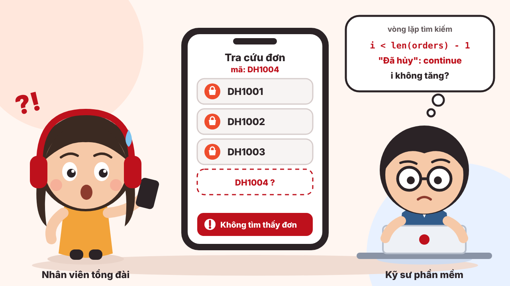

# Lỗi tra cứu đơn hàng theo mã trên Shopee

### 1. Bối cảnh nghiệp vụ



*Nhân viên chăm sóc khách hàng tra mã đơn thì báo không có, có lúc màn hình tra cứu đứng yên không trả lời.*

Bạn là kỹ sư phần mềm trong nhóm công cụ nội bộ của bộ phận chăm sóc khách hàng Shopee.

Khi khách gọi tổng đài hỏi về một đơn hàng, nhân viên nhập **mã đơn** để tra cứu. Danh sách đơn của một khách được lưu bằng list Python, mỗi đơn là một dict:

```plaintext
{"code": "DH1002", "status": "Đã giao"}
```

Hàm `find_order(orders, code)` thực hiện **tìm kiếm tuần tự**: đi từ đơn đầu tới đơn cuối, gặp mã cần tìm thì dừng. Hàm trả về một bộ hai giá trị:

- **Vị trí** của đơn (tính từ 0), hoặc `None` nếu không tìm thấy.
- **Số đơn đã xét**: mỗi đơn được đọc tính là 1, kể cả đơn bị bỏ qua. Con số này được ghi vào nhật ký để nhóm theo dõi tốc độ tra cứu khi khách có rất nhiều đơn.

Quy tắc nghiệp vụ: đơn có trạng thái **"Đã hủy"** coi như không có. Tra mã của một đơn đã hủy thì trả về `None`.

Kịch bản kiểm tra của nhóm (đoạn cuối tệp): tra bốn lần trên danh sách đơn hôm nay (đơn thứ hai, đơn cuối, mã không có, danh sách rỗng), rồi tra hai lần trên danh sách đơn của tuần trước, trong đó có một đơn đã hủy.

Kết quả đúng cần hiển thị:

```plaintext
Tra DH1002: (1, 2)
Tra DH1004: (3, 4)
Tra DH9999: (None, 4)
Danh sách rỗng: (None, 0)
Tra DH0903: (2, 3)
Tra DH0902: (None, 3)
```

### 2. Vấn đề hiện tại

Nhân viên tổng đài phản ánh ba hiện tượng:

- Khách đọc đúng mã của **đơn mới nhất** (đơn đứng cuối danh sách) nhưng màn hình báo không tìm thấy.
- Khi không tìm thấy, màn hình hiện vị trí **-1**, trong khi các màn hình khác của hệ thống quy ước "không có" là `None`.
- Với một số khách, màn hình tra cứu **đứng yên mãi**, không trả lời, phải tắt đi mở lại.

Nhắc lại kiến thức (Lesson 01):

- Một thuật toán phải **đúng** (cho kết quả đúng với mọi đầu vào hợp lệ) và **dừng** (luôn kết thúc sau một số bước hữu hạn).
- Muốn kiểm tra một hàm tìm kiếm, luôn chạy thử đủ ba trường hợp: mã có, mã không có, danh sách rỗng. Với hàm tìm kiếm tuần tự, mã đứng ở **vị trí cuối** là trường hợp hay bị bỏ sót.
- Vòng lặp `while` chỉ dừng khi biến điều khiển tiến dần tới điều kiện dừng ở **mọi** lượt lặp.

### 3. Mã nguồn hiện tại (Legacy Code)

Toàn bộ tệp `tra_cuu.py` trong thư mục khởi đầu (đoạn cuối tệp là kịch bản chạy thử):

```python
def find_order(orders, code):
    # Trả về (vị trí của đơn có mã code, số đơn đã xét).
    # Đơn "Đã hủy" coi như không có. Không tìm thấy thì trả về (None, số đơn đã xét).
    i = 0
    checked = 0
    while i < len(orders) - 1:
        if orders[i]["status"] == "Đã hủy":
            continue
        checked += 1
        if orders[i]["code"] == code:
            return i, checked
        i += 1
    return -1, checked


today = [
    {"code": "DH1001", "status": "Đang giao"},
    {"code": "DH1002", "status": "Đã giao"},
    {"code": "DH1003", "status": "Chờ lấy hàng"},
    {"code": "DH1004", "status": "Đang giao"},
]
print("Tra DH1002:", find_order(today, "DH1002"))
print("Tra DH1004:", find_order(today, "DH1004"))
print("Tra DH9999:", find_order(today, "DH9999"))
print("Danh sách rỗng:", find_order([], "DH1001"))

week = [
    {"code": "DH0901", "status": "Đã giao"},
    {"code": "DH0902", "status": "Đã hủy"},
    {"code": "DH0903", "status": "Đang giao"},
]
print("Tra DH0903:", find_order(week, "DH0903"))
print("Tra DH0902:", find_order(week, "DH0902"))
```

Kết quả hiển thị trên Console:

```plaintext
Tra DH1002: (1, 2)
Tra DH1004: (-1, 3)
Tra DH9999: (-1, 3)
Danh sách rỗng: (-1, 0)
(chương trình đứng yên, không in thêm gì; phải bấm Ctrl + C để dừng)
```

Các dòng 2 đến 4 cho thấy ba lỗi: tìm `DH1004` ra `-1` thay vì vị trí 3; số đơn đã xét chỉ là 3 thay vì 4; không tìm thấy thì trả về `-1` thay vì `None`. Ở danh sách tuần trước, chương trình đứng yên ngay lần tra đầu tiên.

### 4. Yêu cầu

Với vai trò kỹ sư phần mềm của nhóm, hãy thực hiện:

**(1) Phân tích lỗi** (trả lời vào `PHAN_TICH.md`)

- Với danh sách 4 đơn hôm nay, điều kiện `i < len(orders) - 1` cho biến `i` chạy những giá trị nào? Đơn nào không bao giờ được xét?
- Lập bảng chạy tay lần tra `DH0903` trên danh sách tuần trước: sau mỗi lượt lặp ghi giá trị `i`, `checked` và đơn đang xét. Từ lượt nào trở đi giá trị của `i` không còn thay đổi? Vì sao vòng lặp không bao giờ dừng?
- Dòng lệnh nào làm vòng lặp bỏ qua lệnh `i += 1`? Viết lại phần thân vòng lặp sao cho ở **mọi** lượt, `i` đều tăng.
- Quy ước "số đơn đã xét" tính cả đơn đã hủy. Trong mã hiện tại, đơn đã hủy có được cộng vào `checked` không?
- Tra mã `DH0902` (đơn đã hủy) phải trả về gì? Vì sao không được trả về vị trí 1?
- Nêu số đơn đã xét trong trường hợp tốt nhất và trường hợp xấu nhất khi khách có n đơn. Trường hợp xấu nhất xảy ra khi nào?
- Ghi ra ba bộ dữ liệu thử bạn dùng để khẳng định hàm đã đúng và đã dừng (mã có, mã không có, danh sách rỗng), kèm kết quả mong đợi của từng bộ.

**(2) Sửa lỗi**

- Sửa hàm `find_order` trong `tra_cuu.py`. Không đổi tên hàm, tham số và dạng giá trị trả về; không dùng `index()` hay `in` của list để tìm thay vòng lặp.
- Chạy `python tra_cuu.py` phải in đúng phần "Kết quả đúng cần hiển thị" ở mục 1.
- Chạy `python kiem_tra.py` phải đạt cả 5 mục.

### 5. Quy định nộp bài

1. Tạo một kho GitHub riêng cho bài này, đặt tên theo mẫu `[Tên Lớp]_IT301_Session01_Ex01`.
2. Tải thư mục khởi đầu tại https://github.com/cuongtm191221/it301-bai-tap-ve-nha/tree/main/session-01-tong-quan-do-phuc-tap/bai-01 rồi chép các tệp vào kho: `tra_cuu.py`, `kiem_tra.py`, `PHAN_TICH.md`.
3. Điền phần phân tích vào `PHAN_TICH.md`, sửa mã trong `tra_cuu.py`.
4. Mức AI của bài: AI-0 (tự làm, không dùng AI).
5. Đưa bài làm lên kho và nộp đường dẫn kho lên hệ thống.
