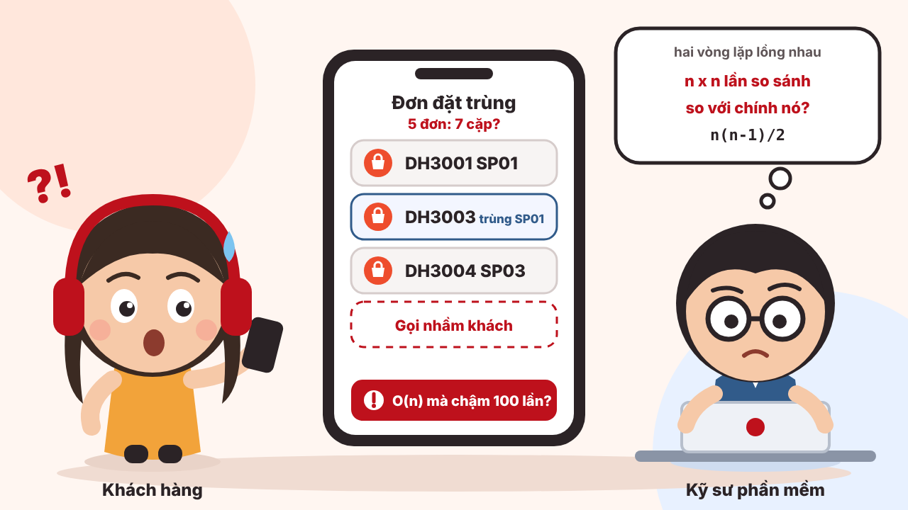

# Lỗi phát hiện đơn đặt trùng trên Shopee

### 1. Bối cảnh nghiệp vụ



*Khách bấm "Đặt hàng" hai lần vì mạng chậm; báo cáo đơn trùng đếm sai và chạy chậm hơn nhiều so với tài liệu.*

Bạn là kỹ sư phần mềm trong nhóm xử lý đơn hàng của Shopee.

Khi mạng chậm, có khách bấm nút **"Đặt hàng"** nhiều lần và tạo ra các **đơn trùng**: hai đơn khác nhau nhưng cùng người mua và cùng sản phẩm. Trước khi chuyển đơn cho người bán, hệ thống chạy báo cáo đếm số **cặp đơn trùng** để bộ phận hỗ trợ gọi lại cho khách. Mỗi đơn là một dict:

```plaintext
{"code": "DH3001", "buyer": "an.nguyen", "product": "SP01"}
```

Hàm `count_duplicate_pairs(orders)` so từng cặp hai đơn và trả về bộ (số cặp trùng, số lần so sánh hai đơn). Quy tắc đếm cặp:

- Một đơn **không** được so với chính nó.
- Mỗi cặp chỉ đếm **một lần**: cặp (DH3001, DH3003) và cặp (DH3003, DH3001) là một.
- Ba đơn giống nhau tạo ra **3 cặp** (đơn 1 với 2, 1 với 3, 2 với 3).

Như vậy với n đơn, hàm phải so đúng **n(n - 1)/2** lần. Tài liệu kỹ thuật ghi Big-O thời gian của hàm trong biến `COMPLEXITY`.

Kịch bản kiểm tra (đoạn cuối tệp): 5 đơn trong ngày có hai cặp trùng (an.nguyen mua SP01 hai lần, binh.tran mua SP02 hai lần, đơn thứ hai của binh.tran đứng cuối), danh sách 1 đơn, ba đơn giống nhau, rồi đếm số lần so sánh trên 100 và 1.000 đơn khác nhau.

Kết quả đúng cần hiển thị:

```plaintext
5 đơn trong ngày: (2, 10)
1 đơn: (0, 0)
Bấm đặt 3 lần: (3, 3)
100 đơn khác nhau: 4950 lần so sánh
1000 đơn khác nhau: 499500 lần so sánh
Big-O ghi trong tài liệu: O(n^2)
```

### 2. Vấn đề hiện tại

Bộ phận hỗ trợ phản ánh: báo cáo hôm nay có **7 cặp trùng** trong 5 đơn, gọi cho khách thì phần lớn khách chỉ đặt một lần. Nhóm hạ tầng thì phản ánh: tài liệu ghi hàm là O(n), nhưng khi số đơn tăng gấp 10, thời gian chạy tăng khoảng 100 lần.

Nhắc lại kiến thức (Lesson 03):

- **Nối tiếp thì cộng, lồng nhau thì nhân**: hai vòng lặp lồng nhau, mỗi vòng chạy theo n, cho số bước cỡ n × n, tức O(n²).
- Vòng trong chạy từ `i + 1` đến hết cho tổng số lượt (n - 1) + (n - 2) + … + 1 = n(n - 1)/2. Số này nhỏ hơn n² một nửa nhưng **vẫn là O(n²)**, vì Big-O bỏ hệ số.
- Thấy hai vòng lặp chưa chắc là O(n²): phải xem chúng nối tiếp hay lồng nhau.

### 3. Mã nguồn hiện tại (Legacy Code)

Toàn bộ tệp `don_trung.py` trong thư mục khởi đầu (đoạn cuối tệp là kịch bản chạy thử):

```python
def count_duplicate_pairs(orders):
    # Đếm số cặp đơn trùng: hai đơn khác nhau, cùng người mua và cùng sản phẩm.
    # Trả về (số cặp trùng, số lần so sánh hai đơn).
    pairs = 0
    comparisons = 0
    n = len(orders)
    for i in range(n):
        for j in range(n - 1):
            comparisons += 1
            if orders[i]["buyer"] == orders[j]["buyer"] and orders[i]["product"] == orders[j]["product"]:
                pairs += 1
    return pairs, comparisons


# Big-O thời gian ghi trong tài liệu kỹ thuật của nhóm
COMPLEXITY = "O(n)"


orders = [
    {"code": "DH3001", "buyer": "an.nguyen", "product": "SP01"},
    {"code": "DH3002", "buyer": "binh.tran", "product": "SP02"},
    {"code": "DH3003", "buyer": "an.nguyen", "product": "SP01"},
    {"code": "DH3004", "buyer": "chi.le", "product": "SP03"},
    {"code": "DH3005", "buyer": "binh.tran", "product": "SP02"},
]
print("5 đơn trong ngày:", count_duplicate_pairs(orders))
print("1 đơn:", count_duplicate_pairs(orders[:1]))
triple = [{"code": "DH", "buyer": "dung.pham", "product": "SP09"}] * 3
print("Bấm đặt 3 lần:", count_duplicate_pairs(triple))
for n in [100, 1000]:
    many = [{"code": "DH", "buyer": f"khach{i}", "product": "SP01"} for i in range(n)]
    print(f"{n} đơn khác nhau:", count_duplicate_pairs(many)[1], "lần so sánh")
print("Big-O ghi trong tài liệu:", COMPLEXITY)
```

Kết quả hiển thị trên Console:

```plaintext
5 đơn trong ngày: (7, 20)
1 đơn: (0, 0)
Bấm đặt 3 lần: (6, 6)
100 đơn khác nhau: 9900 lần so sánh
1000 đơn khác nhau: 999000 lần so sánh
Big-O ghi trong tài liệu: O(n)
```

Đối chiếu với kết quả đúng: 5 đơn ra 7 cặp thay vì 2 và 20 lần so sánh thay vì 10; ba đơn giống nhau ra 6 cặp thay vì 3; số lần so sánh trên 100 và 1.000 đơn lớn gấp đôi mức cần thiết; Big-O ghi O(n).

### 4. Yêu cầu

Với vai trò kỹ sư phần mềm của nhóm, hãy thực hiện:

**(1) Phân tích lỗi** (trả lời vào `PHAN_TICH.md`)

- Với 5 đơn mẫu, liệt kê các cặp (i, j) mà mã hiện tại so sánh và cho kết quả "trùng". Cặp nào là đơn so với chính nó? Cặp nào bị đếm hai lần?
- Với `range(n - 1)`, biến `j` không bao giờ nhận giá trị nào? Lấy một ví dụ (thay đơn cuối của 5 đơn mẫu) để thấy một cặp trùng thật bị bỏ sót.
- Phải đổi phạm vi của vòng trong thế nào để: không so một đơn với chính nó, mỗi cặp chỉ so một lần, không bỏ sót đơn cuối?
- Lập bảng số lượt của vòng trong ứng với từng giá trị `i` khi n = 5 sau khi sửa. Tổng là bao nhiêu? So với công thức n(n - 1)/2.
- Vì sao hàm là O(n²) chứ không phải O(n)? Vì sao số lần so sánh giảm còn một nửa mà Big-O vẫn không đổi?
- Từ số lần so sánh với 100 và 1.000 đơn, n tăng 10 lần thì số lần so sánh tăng khoảng bao nhiêu lần? Kết quả này khớp với phản ánh của nhóm hạ tầng không?
- Ước lượng số lần so sánh khi một ngày sale có 100.000 đơn.

**(2) Sửa lỗi**

- Sửa hàm `count_duplicate_pairs` và biến `COMPLEXITY` trong `don_trung.py`. Giữ cách so từng cặp bằng hai vòng lặp lồng nhau; không dùng `set`, `dict` hay sắp xếp.
- Chạy `python don_trung.py` phải in đúng phần "Kết quả đúng cần hiển thị" ở mục 1.
- Chạy `python kiem_tra.py` phải đạt cả 6 mục.

### 5. Quy định nộp bài

1. Tạo một kho GitHub riêng cho bài này, đặt tên theo mẫu `[Tên Lớp]_IT301_Session01_Ex03`.
2. Tải thư mục khởi đầu tại https://github.com/cuongtm191221/it301-bai-tap-ve-nha/tree/main/session-01-tong-quan-do-phuc-tap/bai-03 rồi chép các tệp vào kho: `don_trung.py`, `kiem_tra.py`, `PHAN_TICH.md`.
3. Điền phần phân tích vào `PHAN_TICH.md`, sửa mã trong `don_trung.py`.
4. Mức AI của bài: AI-0 (tự làm, không dùng AI).
5. Đưa bài làm lên kho và nộp đường dẫn kho lên hệ thống.
