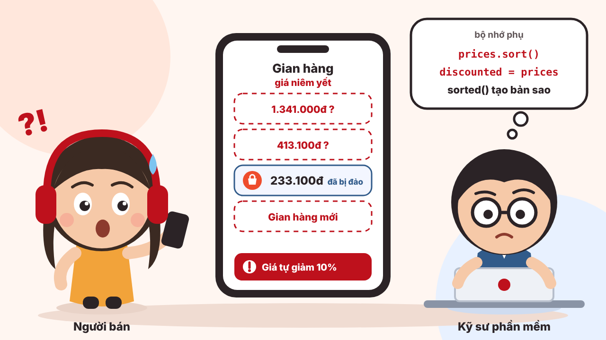

# Lỗi báo cáo bảng giá làm đảo lộn gian hàng trên Shopee

### 1. Bối cảnh nghiệp vụ



*Sau khi chạy báo cáo, thứ tự sản phẩm trên gian hàng bị đảo và giá niêm yết tự giảm.*

Bạn là kỹ sư phần mềm trong nhóm công cụ dành cho người bán trên Shopee.

Mỗi gian hàng có một list **giá niêm yết** (đơn vị: đồng), theo đúng thứ tự sản phẩm người bán sắp xếp trên trang gian hàng. Màn hình "Phân tích giá" gọi ba hàm trên **chính list đó**:

- `top_prices(prices, k)`: k giá cao nhất, từ cao xuống thấp.
- `average_price(prices)`: giá trung bình; gian hàng chưa có sản phẩm thì trả về `None`.
- `cheapest_after_discount(prices, percent)`: giá thấp nhất nếu cả gian hàng giảm `percent`%, làm tròn xuống đồng (phép chia `//`).

Yêu cầu bắt buộc: **không hàm nào được sửa list `prices`**, vì sau khi xem phân tích, trang gian hàng tiếp tục hiển thị list đó. Gian hàng lớn có tới hàng trăm nghìn sản phẩm, nên nhóm còn yêu cầu mỗi hàm chỉ dùng bộ nhớ phụ khi thật cần.

Kịch bản kiểm tra (đoạn cuối tệp): một gian hàng 5 sản phẩm; in giá niêm yết trước và sau mỗi lần gọi hàm; cuối cùng tính giá trung bình của một gian hàng mới chưa có sản phẩm.

Kết quả đúng cần hiển thị:

```plaintext
Giá niêm yết: [259000, 99000, 1490000, 459000, 189000]
3 giá cao nhất: [1490000, 459000, 259000]
Giá niêm yết sau khi lập top: [259000, 99000, 1490000, 459000, 189000]
Giá trung bình: 499200.0
Rẻ nhất sau khi giảm 10%: 89100
Giá niêm yết sau khi tính giảm giá: [259000, 99000, 1490000, 459000, 189000]
Giá trung bình của gian hàng mới: None
```

### 2. Vấn đề hiện tại

Người bán phản ánh: vừa mở màn hình "Phân tích giá" xong thì **thứ tự sản phẩm** trên gian hàng bị đảo thành từ đắt đến rẻ, và **giá niêm yết** của mọi sản phẩm tự giảm 10%. Gian hàng mới mở thì màn hình báo lỗi.

Nhắc lại kiến thức (Lesson 04):

- **Bộ nhớ phụ** là bộ nhớ hàm tạo thêm ngoài dữ liệu đầu vào. Vài biến đơn là O(1); một list có n phần tử là O(n).
- `list.sort()` sắp xếp **tại chỗ**, sửa list cũ và trả về `None`. `sorted(list)` tạo **bản sao** đã sắp xếp, list cũ giữ nguyên.
- Lát cắt `prices[:]` tạo một **list mới** n phần tử. Ngược lại, lệnh gán `a = prices` **không** tạo bản sao: `a` và `prices` là hai tên của cùng một list, sửa qua tên này thì nhìn qua tên kia cũng thấy đổi.

### 3. Mã nguồn hiện tại (Legacy Code)

Toàn bộ tệp `bang_gia.py` trong thư mục khởi đầu (đoạn cuối tệp là kịch bản chạy thử):

```python
def top_prices(prices, k):
    # Trả về k giá cao nhất, từ cao xuống thấp.
    # Danh sách prices phải giữ nguyên thứ tự niêm yết (màn hình gian hàng dùng thứ tự này).
    prices.sort(reverse=True)
    return prices[:k]


def average_price(prices):
    # Giá trung bình. Gian hàng chưa có sản phẩm thì trả về None. Chỉ cần bộ nhớ phụ O(1).
    copy = prices[:]
    total = 0
    for p in copy:
        total += p
    return total / len(copy)


def cheapest_after_discount(prices, percent):
    # Giá thấp nhất sau khi giảm percent% (làm tròn xuống đồng). Không được sửa danh sách prices.
    discounted = prices
    for i in range(len(discounted)):
        discounted[i] = discounted[i] * (100 - percent) // 100
    return min(discounted)


prices = [259000, 99000, 1490000, 459000, 189000]
print("Giá niêm yết:", prices)
print("3 giá cao nhất:", top_prices(prices, 3))
print("Giá niêm yết sau khi lập top:", prices)
print("Giá trung bình:", average_price(prices))
print("Rẻ nhất sau khi giảm 10%:", cheapest_after_discount(prices, 10))
print("Giá niêm yết sau khi tính giảm giá:", prices)
print("Giá trung bình của gian hàng mới:", average_price([]))
```

Kết quả hiển thị trên Console:

```plaintext
Giá niêm yết: [259000, 99000, 1490000, 459000, 189000]
3 giá cao nhất: [1490000, 459000, 259000]
Giá niêm yết sau khi lập top: [1490000, 459000, 259000, 189000, 99000]
Giá trung bình: 499200.0
Rẻ nhất sau khi giảm 10%: 89100
Giá niêm yết sau khi tính giảm giá: [1341000, 413100, 233100, 170100, 89100]
Traceback (most recent call last):
  ...
    return total / len(copy)
ZeroDivisionError: division by zero
```

Đối chiếu với kết quả đúng: sau `top_prices`, giá niêm yết đã bị sắp lại từ cao xuống thấp; sau `cheapest_after_discount`, mọi giá niêm yết đều đã bị giảm 10%; giá trung bình của gian hàng mới gây lỗi `ZeroDivisionError` thay vì trả về `None`.

### 4. Yêu cầu

Với vai trò kỹ sư phần mềm của nhóm, hãy thực hiện:

**(1) Phân tích lỗi** (trả lời vào `PHAN_TICH.md`)

- Dòng lệnh nào trong `top_prices` làm đổi thứ tự niêm yết? Viết lại bằng cách tạo bản sao đã sắp xếp. Bộ nhớ phụ của `top_prices` sau khi sửa là O(1) hay O(n)?
- Nếu viết `ranked = prices.sort(reverse=True)` rồi `return ranked[:k]` thì chuyện gì xảy ra? Vì sao?
- Trong `average_price`, dòng `copy = prices[:]` tạo thêm bao nhiêu phần tử với gian hàng 100.000 sản phẩm? Hàm có cần bản sao này không? Bộ nhớ phụ trước và sau khi sửa?
- Vì sao `average_price([])` báo `ZeroDivisionError`? Sửa thế nào để trả về `None`?
- Trong `cheapest_after_discount`, sau lệnh `discounted = prices`, `discounted` và `prices` có phải hai list khác nhau không? Lệnh nào làm giá niêm yết bị giảm?
- Viết lại `cheapest_after_discount` mà không sửa `prices` và chỉ dùng bộ nhớ phụ O(1). Vì sao không cần tạo list giá sau giảm?
- Lập bảng: tên hàm, thời gian (Big-O), bộ nhớ phụ (Big-O) của ba hàm sau khi sửa.

**(2) Sửa lỗi**

- Sửa ba hàm trong `bang_gia.py`. Không đổi tên hàm, tham số và dạng giá trị trả về. `average_price` và `cheapest_after_discount` không được tạo list mới.
- Chạy `python bang_gia.py` phải in đúng phần "Kết quả đúng cần hiển thị" ở mục 1.
- Chạy `python kiem_tra.py` phải đạt cả 5 mục.

### 5. Quy định nộp bài

1. Tạo một kho GitHub riêng cho bài này, đặt tên theo mẫu `[Tên Lớp]_IT301_Session01_Ex04`.
2. Tải thư mục khởi đầu tại https://github.com/cuongtm191221/it301-bai-tap-ve-nha/tree/main/session-01-tong-quan-do-phuc-tap/bai-04 rồi chép các tệp vào kho: `bang_gia.py`, `kiem_tra.py`, `PHAN_TICH.md`.
3. Điền phần phân tích vào `PHAN_TICH.md`, sửa mã trong `bang_gia.py`.
4. Mức AI của bài: AI-0 (tự làm, không dùng AI).
5. Đưa bài làm lên kho và nộp đường dẫn kho lên hệ thống.
