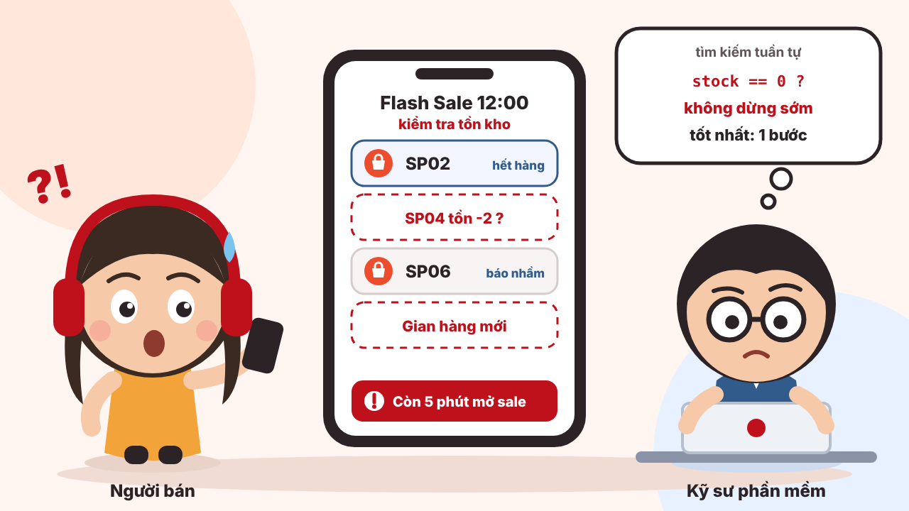

# Lỗi kiểm tra tồn kho trước giờ mở flash sale trên Shopee

### 1. Bối cảnh nghiệp vụ



*Năm phút trước flash sale, công cụ kiểm tra báo nhầm sản phẩm hết hàng và chạy hết cả gian hàng mới trả lời.*

Bạn là kỹ sư phần mềm trong nhóm Flash Sale của Shopee.

Năm phút trước giờ mở một đợt flash sale, hệ thống kiểm tra từng gian hàng tham gia: nếu có sản phẩm **hết hàng** thì báo ngay cho người bán để bổ sung hoặc gỡ sản phẩm khỏi đợt sale. Mỗi sản phẩm là một dict:

```plaintext
{"code": "SP04", "stock": -2}
```

Quy tắc nghiệp vụ:

- Hết hàng là **tồn kho từ 0 trở xuống**. Tồn kho âm xảy ra khi đơn được đặt nhanh hơn lúc kho cập nhật (bán vượt tồn kho), và càng phải báo gấp.
- Hàm `first_out_of_stock(products)` báo **sản phẩm hết hàng đầu tiên** theo thứ tự trên trang gian hàng và **dừng ngay** khi gặp, vì hàng nghìn gian hàng phải kiểm tra xong trong năm phút.
- Hàm trả về bộ (mã sản phẩm, số sản phẩm đã xét). Không có sản phẩm hết hàng thì trả về (`None`, số sản phẩm đã xét).

Kịch bản kiểm tra (đoạn cuối tệp): gian hàng 6 sản phẩm, gian hàng đủ hàng, gian hàng có sản phẩm bán vượt, gian hàng chưa có sản phẩm, rồi hai gian hàng 1.000 sản phẩm có sản phẩm hết hàng ở đầu và ở cuối.

Kết quả đúng cần hiển thị:

```plaintext
Gian hàng 6 sản phẩm: ('SP02', 2)
Gian hàng đủ hàng: (None, 3)
Bán vượt tồn kho: ('SP04', 2)
Gian hàng chưa có sản phẩm: (None, 0)
1.000 sản phẩm, hết hàng ở đầu: ('SPX', 1)
1.000 sản phẩm, hết hàng ở cuối: ('SPX', 1000)
```

### 2. Vấn đề hiện tại

Người bán và nhóm vận hành phản ánh:

- Gian hàng có sản phẩm `SP02` hết hàng nhưng hệ thống lại báo `SP06`, sản phẩm đứng cuối trang.
- Gian hàng **đủ hàng** vẫn bị báo là `SP01` hết hàng.
- Sản phẩm bán vượt (tồn kho -2) không được báo.
- Gian hàng mới mở chưa có sản phẩm thì công cụ báo lỗi và dừng cả lượt kiểm tra.
- Đợt kiểm tra trước giờ sale luôn chạy rất lâu: gian hàng nào cũng bị xét đến sản phẩm cuối cùng.

Nhắc lại kiến thức:

- Tìm kiếm tuần tự có **trường hợp tốt nhất** (gặp ngay phần tử đầu: 1 bước) và **trường hợp xấu nhất** (phần tử ở cuối hoặc không có: n bước). Muốn có trường hợp tốt nhất, hàm phải **dừng ngay** khi tìm thấy (Lesson 01, Lesson 03).
- Biến kết quả phải được khởi tạo bằng giá trị có nghĩa "chưa tìm thấy", không được lấy sẵn một phần tử của danh sách.

### 3. Mã nguồn hiện tại (Legacy Code)

Toàn bộ tệp `ton_kho.py` trong thư mục khởi đầu (đoạn cuối tệp là kịch bản chạy thử):

```python
def first_out_of_stock(products):
    # Trả về (mã sản phẩm hết hàng đầu tiên theo thứ tự trên trang, số sản phẩm đã xét).
    # Hết hàng: tồn kho từ 0 trở xuống (số âm là đã bán vượt tồn kho).
    # Gặp sản phẩm hết hàng đầu tiên thì dừng ngay. Không có thì trả về (None, số sản phẩm đã xét).
    result = products[0]["code"]
    checked = 0
    for p in products:
        checked += 1
        if p["stock"] == 0:
            result = p["code"]
    return result, checked


shop = [
    {"code": "SP01", "stock": 12},
    {"code": "SP02", "stock": 0},
    {"code": "SP03", "stock": 5},
    {"code": "SP04", "stock": -2},
    {"code": "SP05", "stock": 30},
    {"code": "SP06", "stock": 0},
]
print("Gian hàng 6 sản phẩm:", first_out_of_stock(shop))
print("Gian hàng đủ hàng:", first_out_of_stock([shop[0], shop[2], shop[4]]))
print("Bán vượt tồn kho:", first_out_of_stock([shop[0], shop[3], shop[4]]))
print("Gian hàng chưa có sản phẩm:", first_out_of_stock([]))
full = [{"code": "SP", "stock": 9}] * 999
print("1.000 sản phẩm, hết hàng ở đầu:", first_out_of_stock([{"code": "SPX", "stock": 0}] + full))
print("1.000 sản phẩm, hết hàng ở cuối:", first_out_of_stock(full + [{"code": "SPX", "stock": 0}]))
```

Kết quả hiển thị trên Console:

```plaintext
Gian hàng 6 sản phẩm: ('SP06', 6)
Gian hàng đủ hàng: ('SP01', 3)
Bán vượt tồn kho: ('SP01', 3)
Traceback (most recent call last):
  ...
    result = products[0]["code"]
IndexError: list index out of range
```

Đối chiếu với kết quả đúng: gian hàng 6 sản phẩm ra `SP06` thay vì `SP02` và xét cả 6 sản phẩm; gian hàng đủ hàng ra `SP01` thay vì `None`; sản phẩm bán vượt không được nhận ra; gian hàng chưa có sản phẩm gây lỗi `IndexError` nên hai dòng cuối không được in.

### 4. Yêu cầu

Với vai trò kỹ sư phần mềm của nhóm, hãy thực hiện:

**(1) Phân tích lỗi** (trả lời vào `PHAN_TICH.md`)

- Vì sao gian hàng đủ hàng vẫn bị báo `SP01`? Dòng nào gây ra lỗi này, và cũng chính dòng đó gây `IndexError` với gian hàng rỗng như thế nào?
- Lập bảng chạy tay trên gian hàng 6 sản phẩm: sau mỗi lượt ghi `checked`, `p["code"]`, `p["stock"]` và `result`. Vì sao kết quả cuối là `SP06`?
- Điều kiện `p["stock"] == 0` bỏ sót trường hợp nào? Viết lại điều kiện theo đúng quy tắc nghiệp vụ.
- Sửa thế nào để hàm dừng ngay khi gặp sản phẩm hết hàng đầu tiên? Sau khi sửa, cần trả về gì khi vòng lặp chạy hết mà không gặp?
- Với gian hàng n sản phẩm, số sản phẩm đã xét trong trường hợp tốt nhất và xấu nhất là bao nhiêu? Ghi Big-O của từng trường hợp. Khi nói độ phức tạp của hàm, ta dùng trường hợp nào, vì sao?
- Mã hiện tại xét bao nhiêu sản phẩm với mọi gian hàng n sản phẩm? Đợt kiểm tra 3.000 gian hàng, mỗi gian hàng 1.000 sản phẩm và hầu hết có sản phẩm hết hàng ngay ở đầu trang: mã hiện tại và mã đã sửa xét tổng cộng khoảng bao nhiêu sản phẩm?

**(2) Sửa lỗi**

- Sửa hàm `first_out_of_stock` trong `ton_kho.py`. Không đổi tên hàm, tham số và dạng giá trị trả về.
- Chạy `python ton_kho.py` phải in đúng phần "Kết quả đúng cần hiển thị" ở mục 1.
- Chạy `python kiem_tra.py` phải đạt cả 5 mục.

### 5. Quy định nộp bài

1. Tạo một kho GitHub riêng cho bài này, đặt tên theo mẫu `[Tên Lớp]_IT301_Session01_Ex05`.
2. Tải thư mục khởi đầu tại https://github.com/cuongtm191221/it301-bai-tap-ve-nha/tree/main/session-01-tong-quan-do-phuc-tap/bai-05 rồi chép các tệp vào kho: `ton_kho.py`, `kiem_tra.py`, `PHAN_TICH.md`.
3. Điền phần phân tích vào `PHAN_TICH.md`, sửa mã trong `ton_kho.py`.
4. Mức AI của bài: AI-0 (tự làm, không dùng AI).
5. Đưa bài làm lên kho và nộp đường dẫn kho lên hệ thống.
