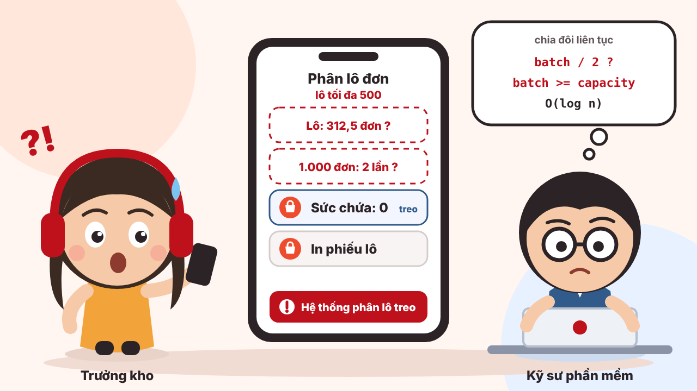

# Lỗi chia lô đơn hàng cho kho trong ngày sale Shopee

### 1. Bối cảnh nghiệp vụ



*Ngày sale, kho nhận lô có 312,5 đơn, chia lô thừa một lần, và có lúc hệ thống chia lô treo cứng.*

Bạn là kỹ sư phần mềm trong nhóm vận hành kho của Shopee.

Trong ngày sale, một kho có thể nhận hàng trăm nghìn đơn cùng lúc. Mỗi ca đóng gói chỉ xử lý được một **lô** có tối đa `capacity` đơn, nên hệ thống **chia đôi** lô đơn nhiều lần cho đến khi mỗi lô nhỏ hơn hoặc bằng `capacity`.

Quy tắc chia:

- Lô có số đơn lẻ thì nửa lớn hơn nhận thêm 1 đơn (ví dụ 625 đơn chia thành 313 và 312), nên **không đơn nào bị mất** và số đơn luôn là **số nguyên**.
- Lô có đúng `capacity` đơn là đã đạt, **không chia nữa**.
- `capacity` không dương là cấu hình lỗi: hàm trả về `None`.

Hàm `split_batches(n_orders, capacity)` trả về bộ (số lần chia đôi, số đơn của lô lớn nhất sau khi chia). Tài liệu kỹ thuật ghi Big-O thời gian theo n (số đơn) trong biến `COMPLEXITY`.

Kịch bản kiểm tra (đoạn cuối tệp): chia 10.000, 1.000, 300 và 1.000.000 đơn với lô tối đa 500, in Big-O, cuối cùng thử cấu hình lỗi lô tối đa 0.

Kết quả đúng cần hiển thị:

```plaintext
10.000 đơn, lô tối đa 500: (5, 313)
1.000 đơn, lô tối đa 500: (1, 500)
300 đơn, lô tối đa 500: (0, 300)
1.000.000 đơn, lô tối đa 500: (11, 489)
Big-O ghi trong tài liệu: O(log n)
Cấu hình lỗi, lô tối đa 0: None
```

### 2. Vấn đề hiện tại

Trưởng kho phản ánh:

- Màn hình phân lô hiện **312,5 đơn** mỗi lô, nhân viên không biết in phiếu thế nào.
- Lô 1.000 đơn với sức chứa 500 bị chia thành các lô 250 đơn: **thừa một lần chia**, số ca đóng gói tăng gấp đôi.
- Khi có người nhập nhầm sức chứa là 0, hệ thống phân lô **treo cứng**.

Nhóm hạ tầng thêm một câu hỏi: tài liệu ghi O(n), vậy 1.000.000 đơn sẽ chia khoảng một triệu lần? Thực tế hệ thống chỉ chia 11 lần.

Nhắc lại kiến thức (Lesson 02):

- **log n** là số lần chia đôi n cho đến khi còn 1. n tăng từ 1.000 lên 1.000.000 (gấp 1.000 lần) nhưng số lần chia đôi chỉ thêm khoảng 10.
- Vòng lặp chia đôi chỉ dừng khi giá trị **thật sự giảm tới** điều kiện dừng. Phép `/` cho số thực; phép `//` cho số nguyên.

### 3. Mã nguồn hiện tại (Legacy Code)

Toàn bộ tệp `chia_lo.py` trong thư mục khởi đầu (đoạn cuối tệp là kịch bản chạy thử):

```python
def split_batches(n_orders, capacity):
    # Chia đôi lô đơn liên tục cho đến khi mỗi lô có không quá capacity đơn.
    # Khi chia, lô lẻ đơn thì nửa lớn hơn nhận thêm 1 đơn, nên không đơn nào bị mất.
    # Trả về (số lần chia đôi, số đơn của lô lớn nhất sau khi chia). capacity không dương thì trả về None.
    batch = n_orders
    splits = 0
    while batch >= capacity:
        batch = batch / 2
        splits += 1
    return splits, batch


# Big-O thời gian theo n (số đơn), ghi trong tài liệu kỹ thuật của nhóm
COMPLEXITY = "O(n)"


print("10.000 đơn, lô tối đa 500:", split_batches(10000, 500))
print("1.000 đơn, lô tối đa 500:", split_batches(1000, 500))
print("300 đơn, lô tối đa 500:", split_batches(300, 500))
print("1.000.000 đơn, lô tối đa 500:", split_batches(1000000, 500))
print("Big-O ghi trong tài liệu:", COMPLEXITY)
print("Cấu hình lỗi, lô tối đa 0:", split_batches(100, 0))
```

Kết quả hiển thị trên Console:

```plaintext
10.000 đơn, lô tối đa 500: (5, 312.5)
1.000 đơn, lô tối đa 500: (2, 250.0)
300 đơn, lô tối đa 500: (0, 300)
1.000.000 đơn, lô tối đa 500: (11, 488.28125)
Big-O ghi trong tài liệu: O(n)
(chương trình đứng yên, không in thêm gì; phải bấm Ctrl + C để dừng)
```

Đối chiếu với kết quả đúng: lô sau khi chia là số thực (312.5, 488.28125) thay vì số nguyên (313, 489); 1.000 đơn bị chia 2 lần thay vì 1; Big-O ghi O(n); với lô tối đa 0 chương trình không dừng.

### 4. Yêu cầu

Với vai trò kỹ sư phần mềm của nhóm, hãy thực hiện:

**(1) Phân tích lỗi** (trả lời vào `PHAN_TICH.md`)

- Phép `batch / 2` cho kiểu dữ liệu gì? Viết biểu thức chia đôi làm tròn lên, chỉ dùng số nguyên, để lô lẻ không mất đơn. Kiểm tra lại với 625 đơn.
- Với 1.000 đơn và sức chứa 500, chạy tay điều kiện `batch >= capacity` qua từng lượt. Vì sao bị chia thêm một lần? Sửa điều kiện thế nào?
- Với `capacity = 0`, lập bảng vài lượt đầu của `batch`. Vì sao vòng lặp không bao giờ dừng (dù dùng `/` hay `//`)? Cần kiểm tra gì trước vòng lặp?
- Lập bảng số lần chia đôi với n = 1.000, 10.000, 100.000 và 1.000.000 (sức chứa 500). Khi n tăng 10 lần, số lần chia tăng thêm bao nhiêu?
- Vì sao Big-O của hàm là O(log n) chứ không phải O(n)? Vì sao tài liệu không cần ghi cơ số của log?
- Một kho nhận 8.000.000 đơn: ước lượng số lần chia mà không chạy chương trình, rồi chạy để kiểm chứng.

**(2) Sửa lỗi**

- Sửa hàm `split_batches` và biến `COMPLEXITY` trong `chia_lo.py`. Không đổi tên hàm, tham số và dạng giá trị trả về.
- Chạy `python chia_lo.py` phải in đúng phần "Kết quả đúng cần hiển thị" ở mục 1.
- Chạy `python kiem_tra.py` phải đạt cả 6 mục.

### 5. Quy định nộp bài

1. Tạo một kho GitHub riêng cho bài này, đặt tên theo mẫu `[Tên Lớp]_IT301_Session01_Ex06`.
2. Tải thư mục khởi đầu tại https://github.com/cuongtm191221/it301-bai-tap-ve-nha/tree/main/session-01-tong-quan-do-phuc-tap/bai-06 rồi chép các tệp vào kho: `chia_lo.py`, `kiem_tra.py`, `PHAN_TICH.md`.
3. Điền phần phân tích vào `PHAN_TICH.md`, sửa mã trong `chia_lo.py`.
4. Mức AI của bài: AI-0 (tự làm, không dùng AI).
5. Đưa bài làm lên kho và nộp đường dẫn kho lên hệ thống.
