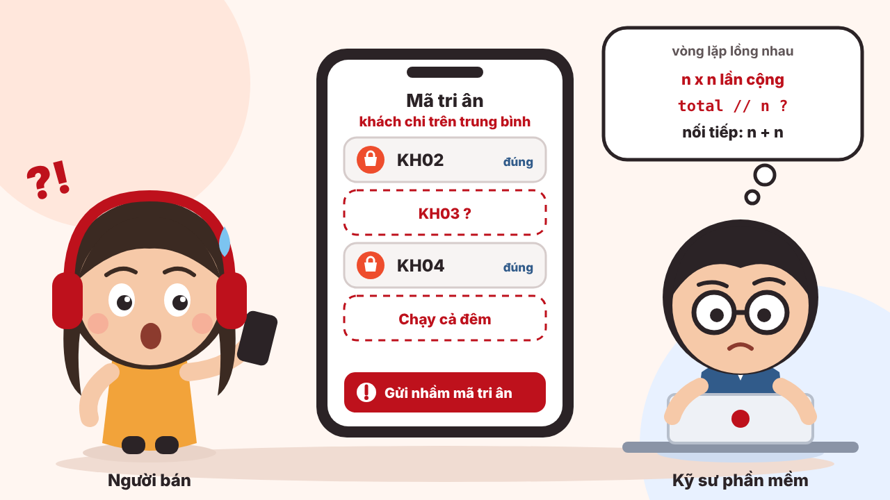

# Lỗi báo cáo khách hàng chi tiêu cao trên Shopee

### 1. Bối cảnh nghiệp vụ



*Báo cáo khách chi tiêu cao gửi nhầm mã tri ân và chạy cả đêm với gian hàng lớn.*

Bạn là kỹ sư phần mềm trong nhóm chăm sóc người bán của Shopee.

Mỗi cuối tháng, gian hàng gửi **mã giảm giá tri ân** cho những khách có tổng chi tiêu **lớn hơn hẳn mức trung bình** của gian hàng. Mỗi khách là một dict:

```plaintext
{"code": "KH04", "spent": 1500001}
```

Hàm `above_average(customers)` trả về bộ hai giá trị:

- List mã các khách có `spent` **lớn hơn** mức trung bình (khách chi đúng bằng mức trung bình thì không được chọn), giữ thứ tự như trong danh sách.
- **Số lần cộng**: mỗi lần cộng một khoản chi tiêu vào tổng tính là 1. Nhóm hạ tầng dùng con số này để ước lượng thời gian chạy.

Mức trung bình là tổng chi tiêu chia cho số khách, **giữ nguyên phần lẻ**. Gian hàng chưa có khách thì trả về (`[]`, 0).

Kịch bản kiểm tra (đoạn cuối tệp): một gian hàng 4 khách, hai khách chi bằng nhau, gian hàng chưa có khách, rồi đếm số lần cộng với 100 và 1.000 khách.

Kết quả đúng cần hiển thị:

```plaintext
4 khách: (['KH02', 'KH04'], 4)
2 khách chi bằng nhau: ([], 2)
Chưa có khách: ([], 0)
100 khách: 100 lần cộng
1000 khách: 1000 lần cộng
```

### 2. Vấn đề hiện tại

Người bán và nhóm hạ tầng phản ánh:

- Khách `KH03` chi 1.500.000đ, **thấp hơn** mức trung bình 1.500.000,25đ, nhưng vẫn nhận mã tri ân.
- Gian hàng có hai khách chi bằng nhau: cả hai đều nhận mã, trong khi không ai chi hơn mức trung bình.
- Gian hàng 200.000 khách chạy báo cáo **cả đêm** chưa xong.

Nhắc lại kiến thức (Lesson 03):

- **Nối tiếp thì cộng, lồng nhau thì nhân**: một vòng lặp n lượt đặt bên trong một vòng lặp n lượt khác cho n × n bước; hai vòng lặp n lượt đặt nối tiếp nhau chỉ cho n + n bước.
- Một giá trị không đổi trong suốt vòng lặp (như tổng chi tiêu của cả gian hàng) chỉ cần tính **một lần**, trước vòng lặp.
- Phép `//` bỏ phần lẻ; phép `/` giữ phần lẻ.

### 3. Mã nguồn hiện tại (Legacy Code)

Toàn bộ tệp `khach_hang.py` trong thư mục khởi đầu (đoạn cuối tệp là kịch bản chạy thử):

```python
def above_average(customers):
    # Trả về (danh sách mã khách có tổng chi tiêu LỚN HƠN mức trung bình của gian hàng, số lần cộng).
    # Số lần cộng: mỗi lần cộng một khoản chi tiêu vào tổng tính là 1.
    result = []
    additions = 0
    for c in customers:
        total = 0
        for other in customers:
            total += other["spent"]
            additions += 1
        average = total // len(customers)
        if c["spent"] >= average:
            result.append(c["code"])
    return result, additions


customers = [
    {"code": "KH01", "spent": 1000000},
    {"code": "KH02", "spent": 2000000},
    {"code": "KH03", "spent": 1500000},
    {"code": "KH04", "spent": 1500001},
]
print("4 khách:", above_average(customers))
same = [{"code": "KH05", "spent": 500000}, {"code": "KH06", "spent": 500000}]
print("2 khách chi bằng nhau:", above_average(same))
print("Chưa có khách:", above_average([]))
for n in [100, 1000]:
    many = [{"code": f"KH{i}", "spent": i * 1000} for i in range(n)]
    print(f"{n} khách:", above_average(many)[1], "lần cộng")
```

Kết quả hiển thị trên Console:

```plaintext
4 khách: (['KH02', 'KH03', 'KH04'], 16)
2 khách chi bằng nhau: (['KH05', 'KH06'], 4)
Chưa có khách: ([], 0)
100 khách: 10000 lần cộng
1000 khách: 1000000 lần cộng
```

Đối chiếu với kết quả đúng: gian hàng 4 khách chọn thêm `KH03` và tốn 16 lần cộng thay vì 4; hai khách chi bằng nhau đều được chọn; 100 khách tốn 10.000 lần cộng và 1.000 khách tốn 1.000.000 lần cộng thay vì 100 và 1.000.

### 4. Yêu cầu

Với vai trò kỹ sư phần mềm của nhóm, hãy thực hiện:

**(1) Phân tích lỗi** (trả lời vào `PHAN_TICH.md`)

- Với gian hàng 4 khách, tính mức trung bình bằng `/` và bằng `//`. Vì sao `KH03` bị chọn nhầm? Hai lỗi nào cùng gây ra kết quả này?
- Với n khách, mã hiện tại thực hiện bao nhiêu lần cộng? Ghi biểu thức và Big-O. Vì sao lặp lại việc tính tổng ở mỗi khách là không cần thiết?
- Viết lại hàm thành hai vòng lặp **nối tiếp**: vòng thứ nhất làm gì, vòng thứ hai làm gì? Số lần cộng và Big-O sau khi sửa?
- Sau khi tách vòng lặp, gian hàng chưa có khách sẽ gặp lỗi gì nếu không xử lý riêng? Xử lý thế nào?
- Từ số lần cộng với 100 và 1.000 khách, n tăng 10 lần thì số lần cộng của mã cũ và mã mới tăng bao nhiêu lần?
- Ước lượng số lần cộng với gian hàng 200.000 khách cho mã cũ và mã mới. Giải thích vì sao báo cáo chạy cả đêm.
- Tháng sau, gian hàng chỉ muốn tri ân khách chi tiêu lớn hơn 1,5 lần mức trung bình. Hàm đã sửa cần đổi dòng nào? Số lần cộng và Big-O có thay đổi không?

**(2) Sửa lỗi**

- Sửa hàm `above_average` trong `khach_hang.py`. Không đổi tên hàm, tham số và dạng giá trị trả về; không dùng hàm có sẵn `sum()` hay `statistics` để thay cho vòng lặp.
- Chạy `python khach_hang.py` phải in đúng phần "Kết quả đúng cần hiển thị" ở mục 1.
- Chạy `python kiem_tra.py` phải đạt cả 5 mục.

### 5. Quy định nộp bài

1. Tạo một kho GitHub riêng cho bài này, đặt tên theo mẫu `[Tên Lớp]_IT301_Session01_Ex07`.
2. Tải thư mục khởi đầu tại https://github.com/cuongtm191221/it301-bai-tap-ve-nha/tree/main/session-01-tong-quan-do-phuc-tap/bai-07 rồi chép các tệp vào kho: `khach_hang.py`, `kiem_tra.py`, `PHAN_TICH.md`.
3. Điền phần phân tích vào `PHAN_TICH.md`, sửa mã trong `khach_hang.py`.
4. Mức AI của bài: AI-0 (tự làm, không dùng AI).
5. Đưa bài làm lên kho và nộp đường dẫn kho lên hệ thống.
