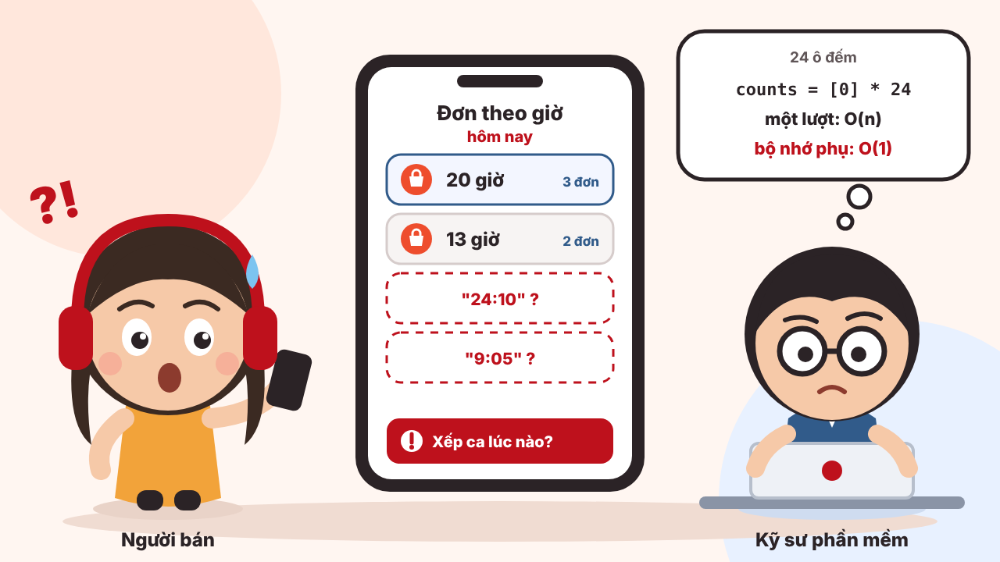

# Khung giờ cao điểm đặt hàng của gian hàng Shopee

### 1. Bối cảnh & Vấn đề



*Người bán muốn biết khung giờ nào khách đặt nhiều nhất để xếp ca đóng gói; dữ liệu giờ đặt có cả dòng lỗi.*

Người bán trên Shopee muốn biết **khung giờ nào trong ngày khách đặt hàng nhiều nhất** để xếp ca đóng gói và hẹn giờ chạy quảng cáo. Khung giờ được tính theo giờ tròn: mọi đơn từ 20:00 đến 20:59 thuộc khung giờ 20, mọi đơn từ 00:00 đến 00:59 thuộc khung giờ 0. Hệ thống xuất danh sách **thời điểm đặt** của các đơn trong ngày, mỗi thời điểm là một chuỗi dạng `"HH:MM"`:

```plaintext
["20:15", " 09:05 ", "20:47", "13:30", "24:10", "21:02", ...]
```

Dữ liệu được ghép từ nhiều nguồn nên có dòng thừa khoảng trắng và có cả dòng lỗi (giờ 24, phút 60, thiếu số 0 ở đầu...).

Một gian hàng lớn có hàng trăm nghìn đơn mỗi ngày, và báo cáo chạy cho mọi gian hàng cùng lúc. Vì vậy nhóm đặt yêu cầu: chỉ duyệt danh sách **một lần**, và **không lưu lại từng đơn**: chỉ dùng **24 ô đếm**, mỗi ô ứng với một giờ. 24 ô này không tăng theo số đơn, nên bộ nhớ phụ là O(1).

Bạn được giao viết ba hàm trong `khung_gio.py`.

### 2. Yêu cầu nghiệp vụ

**2.1. Đọc giờ: `parse_hour(text)`**

- Xóa khoảng trắng hai đầu. Chuỗi hợp lệ có đúng 5 ký tự: hai chữ số giờ, dấu `:`, hai chữ số phút; giờ từ 00 đến 23, phút từ 00 đến 59.
- Hợp lệ thì trả về **giờ** (số nguyên), ví dụ `"20:15"` trả về `20`. Không hợp lệ thì trả về `None`.

**2.2. Đếm theo giờ: `count_by_hour(times)`**

Trả về bộ (list đúng 24 số nguyên, số dòng không hợp lệ). Ô thứ h là số đơn đặt trong giờ h.

**2.3. Thông báo: `peak_hour_message(times)`**

Trả về thông báo cho người bán, gồm khung giờ có nhiều đơn nhất, số đơn, và số dòng bị bỏ qua:

```plaintext
Giờ cao điểm: 20:00 - 20:59 (3 đơn). Bỏ qua 3 dòng lỗi.
```

### 3. Edge Cases (Bẫy dữ liệu)

**Bẫy 1 — Thừa khoảng trắng**

- `" 09:05 "` vẫn là giờ 9.

**Bẫy 2 — Chuỗi sai định dạng hoặc ngoài khoảng**

- `"24:10"`, `"07:60"`, `"9:05"`, `"ab:cd"`, `""` đều không hợp lệ: bỏ qua và cộng vào số dòng lỗi, không được làm chương trình dừng.

**Bẫy 3 — Hai khung giờ bằng nhau**

- Chọn khung giờ **sớm hơn**. Với `["13:10", "08:00", "13:55", "08:30"]`:

```plaintext
Giờ cao điểm: 08:00 - 08:59 (2 đơn). Bỏ qua 0 dòng lỗi.
```

**Bẫy 4 — Giờ một chữ số khi hiển thị**

- Giờ 0 hiển thị là `00:00 - 00:59`, giờ 8 là `08:00 - 08:59`.

**Bẫy 5 — Không có đơn hợp lệ**

- Danh sách rỗng hoặc toàn dòng lỗi:

```plaintext
Chưa có đơn hàng hợp lệ. Bỏ qua 2 dòng lỗi.
```

**Kịch bản chạy thử.** Chạy `python khung_gio.py` (đoạn chạy thử có sẵn ở cuối tệp) phải in ra đúng:

```plaintext
parse_hour(" 09:05 "): 9 | parse_hour("24:10"): None
Số đơn lúc 20 giờ: 3 | số dòng lỗi: 3
Giờ cao điểm: 20:00 - 20:59 (3 đơn). Bỏ qua 3 dòng lỗi.
Giờ cao điểm: 08:00 - 08:59 (2 đơn). Bỏ qua 0 dòng lỗi.
Giờ cao điểm: 00:00 - 00:59 (2 đơn). Bỏ qua 0 dòng lỗi.
Chưa có đơn hàng hợp lệ. Bỏ qua 2 dòng lỗi.
Chưa có đơn hàng hợp lệ. Bỏ qua 0 dòng lỗi.
```

### 4. Yêu cầu

Với vai trò kỹ sư phần mềm, bạn phải thực hiện đầy đủ hai phần sau:

**(1) Phân tích và thiết kế giải pháp (bắt buộc, viết vào `PHAN_TICH.md`)**

- Phân tích Input/Output: với từng hàm, nêu dữ liệu đầu vào (kiểu dữ liệu) và giá trị trả về trong trường hợp thường và trong từng bẫy.
- Thiết kế giải pháp: vì sao 24 ô đếm đủ để tìm giờ cao điểm mà không cần lưu từng đơn? Vẽ 24 ô đếm sau khi xử lý danh sách trong kịch bản chạy thử (chỉ cần ghi các ô khác 0).
- Liệt kê các bước kiểm tra một chuỗi trong `parse_hour` theo thứ tự; vì sao phải kiểm tra độ dài và dấu `:` trước khi gọi `int()`?
- Viết mã giả cho `peak_hour_message`; chỉ rõ chỗ bảo đảm chọn khung giờ sớm hơn khi bằng nhau.
- Tuần sau người bán muốn xem thêm **khung giờ vắng nhất** (trong các giờ có ít nhất một đơn). Cần thêm gì vào thiết kế? Độ phức tạp có thay đổi không?
- Độ phức tạp: ghi Big-O thời gian và bộ nhớ phụ của ba hàm theo n (số dòng). So với cách lưu tất cả các giờ vào một list rồi sắp xếp, cách 24 ô đếm khác nhau thế nào về thời gian và bộ nhớ?

**(2) Triển khai code**

- Viết thân các hàm trong `khung_gio.py`. Không đổi tên hàm, tham số.
- Không sắp xếp, không lưu lại từng đơn vào list hay dict; chỉ dùng list 24 ô đếm.
- Xử lý đủ 5 bẫy ở mục 3; `python khung_gio.py` in đúng kịch bản chạy thử; `python kiem_tra.py` đạt cả 6 mục.
- Mã sạch, dễ đọc, tên biến theo snake_case, có chú thích ở những chỗ quyết định độ phức tạp.

### 5. Quy định nộp bài

1. Tạo một kho GitHub riêng cho bài này, đặt tên theo mẫu `[Tên Lớp]_IT301_Session01_Ex09`.
2. Tải thư mục khởi đầu tại https://github.com/cuongtm191221/it301-bai-tap-ve-nha/tree/main/session-01-tong-quan-do-phuc-tap/bai-09 rồi chép các tệp vào kho: `khung_gio.py`, `kiem_tra.py`, `PHAN_TICH.md`.
3. Điền phần phân tích vào `PHAN_TICH.md`, viết mã trong `khung_gio.py`.
4. Mức AI của bài: AI-0 (tự làm, không dùng AI).
5. Đưa bài làm lên kho và nộp đường dẫn kho lên hệ thống.
