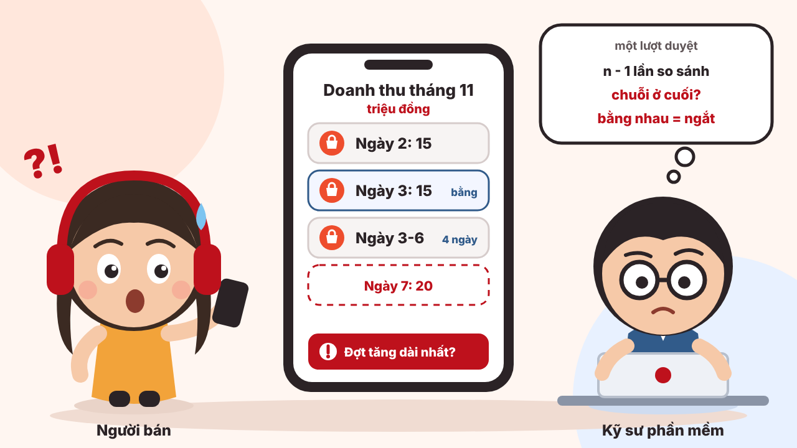

# Chuỗi ngày doanh thu tăng liên tiếp của gian hàng Shopee

### 1. Bối cảnh & Vấn đề



*Người bán muốn biết đợt tăng trưởng dài nhất trong tháng; báo cáo phải chạy một lượt trên dữ liệu nhiều năm.*

Trong mục **"Phân tích bán hàng"** của Shopee, người bán muốn biết **chuỗi ngày doanh thu tăng liên tiếp dài nhất**: một dãy ngày liền nhau mà mỗi ngày doanh thu **cao hơn hẳn** ngày trước đó. Chuỗi này giúp người bán đối chiếu với lịch chạy quảng cáo để biết chiến dịch nào hiệu quả.

Doanh thu được lưu bằng một list, ngày 1 ở vị trí 0 (đơn vị: triệu đồng):

```plaintext
[12, 15, 15, 18, 21, 25, 20, 22, 30]

Ngày 3 → 6: 15 → 18 → 21 → 25  (4 ngày tăng liên tiếp)
```

Ngày 2 và ngày 3 cùng là 15 nên **không** tính là tăng: chuỗi mới bắt đầu từ ngày 3. Ngày 7 doanh thu giảm còn 20 nên chuỗi tiếp theo bắt đầu lại từ ngày 7 (20 → 22 → 30, dài 3 ngày).

Cách dễ nghĩ nhất là xét mọi ngày bắt đầu, từ mỗi ngày đếm tới khi hết tăng. Cách này tốn tới O(n²) khi doanh thu tăng đều. Gian hàng lâu năm có dữ liệu hàng nghìn ngày và báo cáo chạy cho mọi gian hàng, nên nhóm yêu cầu: **duyệt một lượt**, mỗi cặp ngày liền nhau chỉ so sánh **một lần**, tức đúng n - 1 lần so sánh với n ngày.

Bạn được giao viết hai hàm trong `chuoi_tang.py`.

### 2. Yêu cầu nghiệp vụ

**2.1. `longest_growth_streak(revenues)`**

Trả về bộ ba giá trị:

- Độ dài chuỗi dài nhất (tính bằng số ngày; một ngày đứng riêng là chuỗi dài 1).
- Ngày bắt đầu của chuỗi đó, **tính từ 1**.
- Số lần so sánh doanh thu hai ngày liền nhau đã thực hiện.

Với ví dụ ở mục 1, hàm trả về `(4, 3, 8)`.

**2.2. `streak_message(revenues)`**

Trả về thông báo cho người bán:

```plaintext
Chuỗi tăng dài nhất: 4 ngày, từ ngày 3 đến ngày 6.
```

### 3. Edge Cases (Bẫy dữ liệu)

**Bẫy 1 — Hai ngày bằng nhau**

- Bằng nhau không phải là tăng. `[9, 8, 6, 6, 2]` không có hai ngày liên tiếp nào tăng:

```plaintext
Chưa có hai ngày liên tiếp nào doanh thu tăng.
```

**Bẫy 2 — Hai chuỗi dài bằng nhau**

- Chọn chuỗi **sớm hơn**. `[5, 7, 9, 3, 4, 6]` có hai chuỗi 3 ngày:

```plaintext
Chuỗi tăng dài nhất: 3 ngày, từ ngày 1 đến ngày 3.
```

**Bẫy 3 — Chuỗi kéo dài tới ngày cuối**

- `[4, 6, 2, 3, 5, 8]`: chuỗi dài nhất là ngày 3 đến ngày 6. Lỗi thường gặp là chỉ cập nhật kết quả khi chuỗi bị ngắt, nên chuỗi chạy tới ngày cuối bị bỏ sót.

**Bẫy 4 — Chỉ có một ngày**

- `[10]`: `longest_growth_streak` trả về `(1, 1, 0)`; thông báo giống bẫy 1.

**Bẫy 5 — Chưa có dữ liệu**

- `[]`: `longest_growth_streak` trả về `(0, None, 0)`, thông báo:

```plaintext
Chưa có dữ liệu doanh thu.
```

**Kịch bản chạy thử.** Chạy `python chuoi_tang.py` (đoạn chạy thử có sẵn ở cuối tệp) phải in ra đúng:

```plaintext
Tháng 11: (4, 3, 8)
Chuỗi tăng dài nhất: 4 ngày, từ ngày 3 đến ngày 6.
Chuỗi tăng dài nhất: 3 ngày, từ ngày 1 đến ngày 3.
Chưa có hai ngày liên tiếp nào doanh thu tăng.
Chuỗi tăng dài nhất: 4 ngày, từ ngày 3 đến ngày 6.
Chưa có hai ngày liên tiếp nào doanh thu tăng.
Chưa có dữ liệu doanh thu.
1.000 ngày: 999 lần so sánh
```

### 4. Yêu cầu

Với vai trò kỹ sư phần mềm, bạn phải thực hiện đầy đủ hai phần sau:

**(1) Phân tích và thiết kế giải pháp (bắt buộc, viết vào `PHAN_TICH.md`)**

- Phân tích Input/Output: với từng hàm, nêu dữ liệu đầu vào (kiểu dữ liệu) và giá trị trả về trong trường hợp thường và trong từng bẫy.
- Thiết kế giải pháp: trong một lượt duyệt, cần giữ những biến nào để biết chuỗi đang xét và chuỗi dài nhất đã gặp? Khi nào cập nhật chuỗi dài nhất, và vì sao cập nhật như vậy xử lý được bẫy 3?
- Lập bảng chạy tay trên ví dụ ở mục 1: sau mỗi ngày ghi giá trị các biến bạn dùng.
- Viết mã giả của `longest_growth_streak`.
- Người bán muốn xem thêm **chuỗi ngày giảm liên tiếp dài nhất** để biết lúc nào cần kích cầu. Cần đổi những chỗ nào? Có cần duyệt thêm một lượt không, hay làm chung trong một lượt?
- Độ phức tạp: ghi Big-O thời gian và bộ nhớ phụ của hàm. Tính số bước của cách dễ nghĩ nhất (xét mọi ngày bắt đầu) khi doanh thu 1.000 ngày tăng đều, so với cách duyệt một lượt.

**(2) Triển khai code**

- Viết thân các hàm trong `chuoi_tang.py`. Không đổi tên hàm, tham số.
- Không sắp xếp, không tạo list phụ; chỉ dùng vài biến đơn (bộ nhớ phụ O(1)).
- Xử lý đủ 5 bẫy ở mục 3; `python chuoi_tang.py` in đúng kịch bản chạy thử; `python kiem_tra.py` đạt cả 6 mục.
- Mã sạch, dễ đọc, tên biến theo snake_case, có chú thích ở những chỗ quyết định độ phức tạp.

### 5. Quy định nộp bài

1. Tạo một kho GitHub riêng cho bài này, đặt tên theo mẫu `[Tên Lớp]_IT301_Session01_Ex10`.
2. Tải thư mục khởi đầu tại https://github.com/cuongtm191221/it301-bai-tap-ve-nha/tree/main/session-01-tong-quan-do-phuc-tap/bai-10 rồi chép các tệp vào kho: `chuoi_tang.py`, `kiem_tra.py`, `PHAN_TICH.md`.
3. Điền phần phân tích vào `PHAN_TICH.md`, viết mã trong `chuoi_tang.py`.
4. Mức AI của bài: AI-0 (tự làm, không dùng AI).
5. Đưa bài làm lên kho và nộp đường dẫn kho lên hệ thống.
