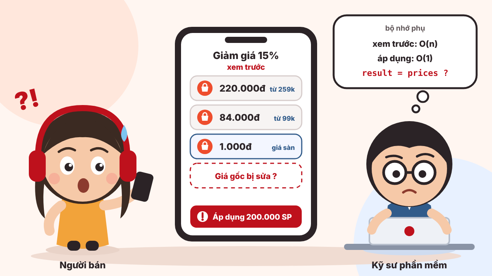

# Giảm giá hàng loạt cho gian hàng Shopee

### 1. Bối cảnh & Vấn đề



*Người bán muốn xem trước bảng giá sau giảm rồi mới áp dụng; gian hàng lớn có hàng trăm nghìn sản phẩm.*

Trước mỗi đợt sale, người bán trên Shopee dùng chức năng **"Giảm giá hàng loạt"**: chọn phần trăm giảm cho cả gian hàng, xem trước bảng giá mới, rồi bấm áp dụng. Giá niêm yết của gian hàng là một list số nguyên (đơn vị: đồng):

```plaintext
[259000, 99000, 1490000, 1500]
```

Giá được làm tròn đến nghìn đồng để bảng giá dễ đọc và khớp với quy định hiển thị giá của sàn. Chức năng gồm ba màn hình, mỗi màn hình có yêu cầu **bộ nhớ** khác nhau:

- **Xem trước**: hiện bảng giá mới bên cạnh bảng giá cũ, nên phải tạo một list mới và **giữ nguyên** list cũ.
- **Áp dụng**: ghi giá mới **ngay trên** list giá của gian hàng. Gian hàng lớn có hàng trăm nghìn sản phẩm, nên không được tạo thêm list nào.
- **Tổng tiền minh họa**: chỉ cần một con số (tổng tiền nếu mua mỗi sản phẩm một cái), nên không được tạo list nào.

Bạn được giao viết bốn hàm trong `giam_gia.py`.

### 2. Yêu cầu nghiệp vụ

**2.1. Giá sau giảm của một sản phẩm: `discounted_price(price, percent)`**

- Giá sau giảm = giá × (100 - percent) / 100, **làm tròn xuống đến nghìn đồng**. Ví dụ 259.000đ giảm 15% là 220.150đ, làm tròn xuống thành 220.000đ.
- Giá sau giảm không được thấp hơn **giá sàn 1.000đ**.
- `percent` phải từ 1 đến 90.

**2.2. Áp dụng: `apply_discount_in_place(prices, percent)`**

Ghi giá sau giảm vào chính list `prices`, **trả về `None`**.

**2.3. Xem trước: `discounted_copy(prices, percent)`**

Trả về list mới chứa giá sau giảm theo đúng thứ tự; list `prices` giữ nguyên. Thứ tự giống hệt list cũ để màn hình xem trước hiện giá cũ và giá mới của cùng một sản phẩm trên cùng một dòng.

**2.4. Tổng tiền: `total_after_discount(prices, percent)`**

Trả về tổng giá sau giảm của mọi sản phẩm, không tạo list nào.

Các hàm 2.2 đến 2.4 đều dùng lại `discounted_price` để quy tắc làm tròn chỉ viết ở một chỗ.

### 3. Edge Cases (Bẫy dữ liệu)

**Bẫy 1 — Phần trăm ngoài khoảng cho phép**

- `percent` là 0, 91, 95 hay -5: báo lỗi `ValueError` với thông báo:

```plaintext
Phần trăm giảm phải từ 1 đến 90.
```

**Bẫy 2 — Làm tròn**

- Làm tròn **xuống**, không làm tròn gần nhất: 99.000đ giảm 15% là 84.150đ, thành 84.000đ.

**Bẫy 3 — Giá sàn**

- Sản phẩm 1.500đ giảm 15% là 1.275đ, làm tròn xuống thành 1.000đ, vẫn hợp lệ; nếu làm tròn ra 0đ thì phải nâng lên 1.000đ.

**Bẫy 4 — Xem trước làm hỏng giá gốc**

- Sau khi gọi `discounted_copy`, list giá gốc phải giữ nguyên. Lỗi thường gặp: gán `result = prices` rồi sửa `result`, tưởng là đã tạo bản sao.

**Bẫy 5 — Dùng kết quả trả về của hàm áp dụng**

- `apply_discount_in_place` trả về `None`, giống `list.sort()`. Viết `prices = apply_discount_in_place(prices, 15)` sẽ làm mất cả bảng giá. Gian hàng trống (`[]`) thì cả bốn hàm đều chạy bình thường.

**Kịch bản chạy thử.** Chạy `python giam_gia.py` (đoạn chạy thử có sẵn ở cuối tệp) phải in ra đúng:

```plaintext
Giá 259.000đ giảm 15%: 220000
Xem trước: [220000, 84000, 1266000, 1000] | giá gốc: [259000, 99000, 1490000, 1500]
Tổng nếu mua mỗi món một cái: 1571000
Áp dụng tại chỗ trả về: None
Giá sau khi áp dụng: [220000, 84000, 1266000, 1000]
Gian hàng trống: [] 0
Giảm 95%: Phần trăm giảm phải từ 1 đến 90.
```

### 4. Yêu cầu

Với vai trò kỹ sư phần mềm, bạn phải thực hiện đầy đủ hai phần sau:

**(1) Phân tích và thiết kế giải pháp (bắt buộc, viết vào `PHAN_TICH.md`)**

- Phân tích Input/Output: với từng hàm, nêu dữ liệu đầu vào (kiểu dữ liệu) và giá trị trả về trong trường hợp thường và trong từng bẫy.
- Thiết kế giải pháp: viết công thức làm tròn xuống đến nghìn đồng chỉ dùng phép tính số nguyên, kiểm tra với 259.000đ, 99.000đ và 1.500đ (giảm 15%).
- Với mỗi hàm 2.2 đến 2.4, vẽ hình cho thấy sau khi gọi hàm có mấy list trong bộ nhớ và mỗi tên biến trỏ tới list nào.
- `discounted_price` kiểm tra `percent` ở đầu hàm. Với gian hàng 200.000 sản phẩm, phép kiểm tra này chạy bao nhiêu lần trong `discounted_copy`? Có làm đổi Big-O không? Nếu phần trăm sai, hàm áp dụng tại chỗ có để lại list bị giảm giá một nửa không, vì sao?
- Độ phức tạp: ghi Big-O thời gian và bộ nhớ phụ của bốn hàm theo n (số sản phẩm). Với gian hàng 200.000 sản phẩm, hàm nào tạo thêm 200.000 phần tử? Vì sao màn hình "Áp dụng" không dùng lại `discounted_copy` rồi gán đè?

**(2) Triển khai code**

- Viết thân các hàm trong `giam_gia.py`. Không đổi tên hàm, tham số.
- Không sắp xếp. `apply_discount_in_place` và `total_after_discount` không được tạo list mới.
- Xử lý đủ 5 bẫy ở mục 3; `python giam_gia.py` in đúng kịch bản chạy thử; `python kiem_tra.py` đạt cả 5 mục.
- Mã sạch, dễ đọc, tên biến theo snake_case, có chú thích ở những chỗ quyết định độ phức tạp.

### 5. Quy định nộp bài

1. Tạo một kho GitHub riêng cho bài này, đặt tên theo mẫu `[Tên Lớp]_IT301_Session01_Ex11`.
2. Tải thư mục khởi đầu tại https://github.com/cuongtm191221/it301-bai-tap-ve-nha/tree/main/session-01-tong-quan-do-phuc-tap/bai-11 rồi chép các tệp vào kho: `giam_gia.py`, `kiem_tra.py`, `PHAN_TICH.md`.
3. Điền phần phân tích vào `PHAN_TICH.md`, viết mã trong `giam_gia.py`.
4. Mức AI của bài: AI-0 (tự làm, không dùng AI).
5. Đưa bài làm lên kho và nộp đường dẫn kho lên hệ thống.
