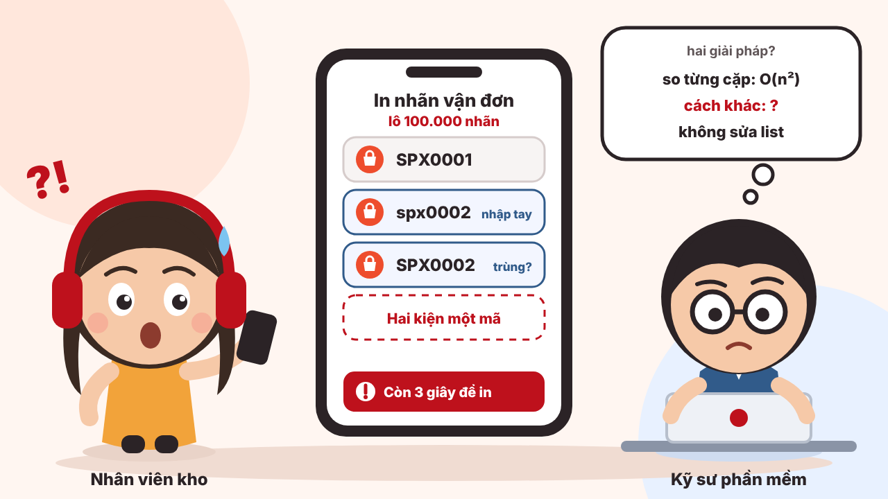

# Kiểm tra mã vận đơn trùng trước khi in nhãn trên Shopee

### 1. Bối cảnh & Vấn đề



*Kho sắp in 100.000 nhãn giao hàng; chỉ cần một mã vận đơn trùng là hai kiện hàng đi nhầm địa chỉ.*

Trước mỗi ca giao hàng, kho của Shopee in **nhãn vận đơn** cho cả lô kiện hàng. Mỗi nhãn có một mã vận đơn, ví dụ `SPX0001`, và mã phải là **duy nhất**: nếu hai kiện mang cùng một mã, máy quét ở trung tâm phân loại sẽ coi là một kiện, và một trong hai kiện đi nhầm địa chỉ.

Mã vận đơn đến từ nhiều nguồn, có lô được nhân viên **nhập tay**, nên có thể bị viết thường hoặc thừa khoảng trắng: `" spx0002"` và `"SPX0002 "` là **cùng một mã**. Hàm `normalize_code` có sẵn để chuẩn hóa một mã.

Trước khi in, hệ thống phải trả lời câu hỏi: **lô này có mã trùng không?** Một lô ngày sale có tới **100.000 vận đơn**, và thông báo kiểm tra phải hiện ra trong **3 giây** để máy in không phải chờ. Ngoài ra, list mã vận đơn được dùng tiếp để in theo đúng thứ tự, nên **không được sửa** list đó.

Có nhiều cách để phát hiện mã trùng, mỗi cách tốn thời gian và bộ nhớ khác nhau. Trưởng nhóm yêu cầu bạn đề xuất ít nhất hai giải pháp, đo, so sánh rồi mới chọn.

### 2. Yêu cầu nghiệp vụ

Tệp `van_don.py` có sẵn hàm `normalize_code`. Bạn viết ba hàm.

**2.1. Hai hàm kiểm tra: `has_duplicate_v1(codes)` và `has_duplicate_v2(codes)`**

Mỗi hàm cài một giải pháp của bạn. Trả về `True` nếu có ít nhất hai mã trùng nhau **sau khi chuẩn hóa**, ngược lại `False`. Hai hàm cho cùng kết quả với mọi dữ liệu nhưng **khác nhau về cách làm**.

**2.2. Thông báo trước khi in: `print_check_message(codes)`**

Dùng giải pháp bạn chọn, trả về một trong ba thông báo:

```plaintext
Không có mã trùng, in 5 vận đơn.
Phát hiện mã vận đơn trùng, dừng in.
Chưa có vận đơn để in.
```

### 3. Edge Cases (Bẫy dữ liệu)

**Bẫy 1 — Khác cách viết**

- `["SPX0001", " spx0002", "SPX0003", "SPX0002 "]` có mã trùng (`SPX0002`).

**Bẫy 2 — Mã trùng ở hai đầu lô**

- `["SPX0009", "SPX0001", "SPX0002", "SPX0009"]`: mã đầu và mã cuối trùng nhau. Cách làm nào chỉ so mã với mã đứng ngay cạnh nó trong list gốc sẽ bỏ sót.

**Bẫy 3 — Không được sửa list đầu vào**

- Sau khi kiểm tra, list mã vẫn giữ nguyên thứ tự và cách viết ban đầu (máy in dùng list này).

**Bẫy 4 — Lô rỗng và lô 1 vận đơn**

- Lô rỗng: thông báo "Chưa có vận đơn để in."; lô 1 vận đơn: không có mã trùng.

**Bẫy 5 — Lô 100.000 vận đơn**

- `print_check_message` phải trả lời trong 3 giây với lô 100.000 vận đơn không có mã trùng (trường hợp xấu nhất: phải xét hết lô mới kết luận được).

**Kịch bản chạy thử.** Chạy `python van_don.py` (đoạn chạy thử có sẵn ở cuối tệp) phải in ra đúng:

```plaintext
Lô 5 vận đơn: False False | Không có mã trùng, in 5 vận đơn.
Lô nhập tay: True True | Phát hiện mã vận đơn trùng, dừng in.
Trùng ở hai đầu: True True
Lô sau khi kiểm tra: ['SPX0009', 'SPX0001', 'SPX0002', 'SPX0009']
Lô 1 vận đơn: Không có mã trùng, in 1 vận đơn.
Lô rỗng: Chưa có vận đơn để in.
```

### 4. Yêu cầu

Với vai trò kỹ sư phần mềm, bạn phải thực hiện đầy đủ ba phần sau:

**(1) Đề xuất và phân tích nhiều giải pháp (bắt buộc, viết vào `PHAN_TICH.md`)**

- Phân tích Input/Output của các hàm: kiểu dữ liệu đầu vào, giá trị trả về trong trường hợp thường và trong từng bẫy.
- Đề xuất **ít nhất hai giải pháp** khác nhau về cách làm cho việc phát hiện mã trùng. Với mỗi giải pháp: mô tả ý tưởng trong 2–3 câu, minh họa trên ví dụ ở mục 1, viết mã giả.
- Đo thời gian hai giải pháp bằng `timeit` (như bài đọc Lesson 03, mục 3.3) với n = 1.000, 2.000 và 4.000 mã không trùng (trường hợp xấu nhất); ghi bảng số đo, phiên bản Python và máy đo.
- So sánh các giải pháp theo bảng 5 tiêu chí: thời gian (Big-O), bộ nhớ phụ (Big-O), kết quả đo, độ dễ đọc và dễ bảo trì, mức phù hợp với bối cảnh của bài.
- Chọn giải pháp dùng cho `print_check_message` và nêu lý do dựa trên bảng so sánh. Lựa chọn không có lý do không được tính điểm.

**(2) Chạy tay**

- Với mỗi giải pháp, chạy tay trên lô ở bẫy 2: ghi các bước cho tới khi hàm trả về, và số lần so sánh hai mã đã thực hiện.

**(3) Triển khai code**

- Viết thân ba hàm trong `van_don.py`. Không đổi tên hàm, tham số.
- Không dùng `set` hay `dict` (sẽ học ở buổi bảng băm); không sửa list `codes`.
- Xử lý đủ 5 bẫy ở mục 3; `python van_don.py` in đúng kịch bản chạy thử; `python kiem_tra.py` đạt cả 7 mục (mỗi mục về hai giải pháp chạy trên cả hai hàm).
- Mã sạch, dễ đọc, tên biến theo snake_case, có chú thích nêu ý tưởng và độ phức tạp ở đầu mỗi hàm.

### 5. Quy định nộp bài

1. Tạo một kho GitHub riêng cho bài này, đặt tên theo mẫu `[Tên Lớp]_IT301_Session01_Ex13`.
2. Tải thư mục khởi đầu tại https://github.com/cuongtm191221/it301-bai-tap-ve-nha/tree/main/session-01-tong-quan-do-phuc-tap/bai-13 rồi chép các tệp vào kho: `van_don.py`, `kiem_tra.py`, `PHAN_TICH.md`.
3. Điền phần phân tích vào `PHAN_TICH.md`, viết mã trong `van_don.py`.
4. Mức AI của bài: AI-0 (tự làm, không dùng AI).
5. Đưa bài làm lên kho và nộp đường dẫn kho lên hệ thống.
