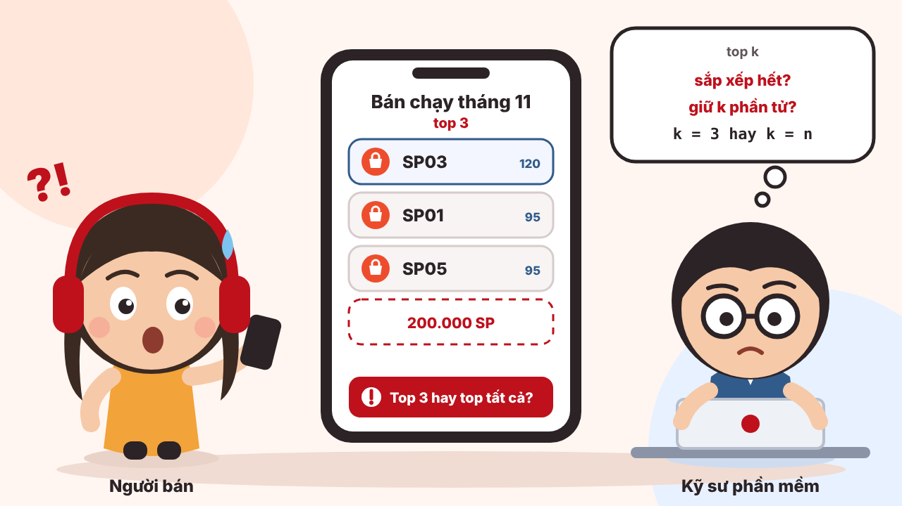

# Bảng xếp hạng sản phẩm bán chạy của gian hàng Shopee

### 1. Bối cảnh & Vấn đề



*Người bán muốn xem top sản phẩm bán chạy ngay trên ứng dụng; có gian hàng 200.000 sản phẩm nhưng chỉ cần top 3.*

Màn hình **"Sản phẩm bán chạy"** trong ứng dụng người bán của Shopee hiện **top k sản phẩm** có số lượng bán cao nhất trong tháng. Phần lớn người bán chỉ xem top 3 hoặc top 10, nhưng gian hàng lớn có tới 200.000 sản phẩm, và người bán cũng có thể chọn xem toàn bộ bảng xếp hạng.

Dữ liệu là list sản phẩm theo thứ tự đăng bán, mỗi sản phẩm là một dict:

```plaintext
{"code": "SP03", "sold": 120}
```

Quy tắc xếp hạng:

- Số lượng bán **giảm dần**.
- Hai sản phẩm bán **bằng nhau** thì sản phẩm **đăng bán trước** (đứng trước trong list) xếp trên.
- List sản phẩm dùng cho các màn hình khác, nên **không được đổi thứ tự** của nó.

Có nhiều cách lấy top k. Có cách tốn thời gian như nhau dù k là 3 hay 200.000; có cách nhanh khi k nhỏ nhưng chậm khi k lớn. Trưởng nhóm yêu cầu bạn đề xuất ít nhất hai giải pháp, đo, so sánh rồi chọn cách dùng cho màn hình.

### 2. Yêu cầu nghiệp vụ

**2.1. Hai hàm lấy top k: `top_k_v1(sales, k)` và `top_k_v2(sales, k)`**

Mỗi hàm cài một giải pháp của bạn, trả về list các bộ `(mã, số lượng bán)` của k sản phẩm đứng đầu bảng xếp hạng, theo đúng thứ tự xếp hạng. Ví dụ với 6 sản phẩm trong kịch bản chạy thử và k = 3:

```plaintext
[('SP03', 120), ('SP01', 95), ('SP05', 95)]
```

**2.2. Thông báo: `top_message(sales, k)`**

Dùng giải pháp bạn chọn, trả về:

```plaintext
Top 3 bán chạy: SP03 (120), SP01 (95), SP05 (95)
```

### 3. Edge Cases (Bẫy dữ liệu)

**Bẫy 1 — Bán bằng nhau**

- `SP01` và `SP05` cùng bán 95: `SP01` đăng trước nên đứng trên.

**Bẫy 2 — k lớn hơn số sản phẩm**

- Trả về toàn bộ bảng xếp hạng. Thông báo ghi đúng số sản phẩm thật: `Top 6 bán chạy: ...`.

**Bẫy 3 — k không dương**

- Hai hàm top k trả về `[]`; `top_message` trả về:

```plaintext
Số sản phẩm cần xếp hạng phải lớn hơn 0.
```

**Bẫy 4 — Gian hàng chưa bán được gì**

- `sales` rỗng: hai hàm trả về `[]`; thông báo:

```plaintext
Gian hàng chưa bán được sản phẩm nào.
```

**Bẫy 5 — Không đổi thứ tự list sản phẩm**

- Sau khi xếp hạng, list `sales` vẫn theo thứ tự đăng bán.

**Kịch bản chạy thử.** Chạy `python ban_chay.py` (đoạn chạy thử có sẵn ở cuối tệp) phải in ra đúng:

```plaintext
Top 3 (cách 1): [('SP03', 120), ('SP01', 95), ('SP05', 95)]
Top 3 (cách 2): [('SP03', 120), ('SP01', 95), ('SP05', 95)]
Top 3 bán chạy: SP03 (120), SP01 (95), SP05 (95)
Top 6 bán chạy: SP03 (120), SP01 (95), SP05 (95), SP06 (60), SP02 (40), SP04 (7)
Số sản phẩm cần xếp hạng phải lớn hơn 0.
Gian hàng chưa bán được sản phẩm nào.
Thứ tự gốc giữ nguyên: ['SP01', 'SP02', 'SP03', 'SP04', 'SP05', 'SP06']
```

### 4. Yêu cầu

Với vai trò kỹ sư phần mềm, bạn phải thực hiện đầy đủ ba phần sau:

**(1) Đề xuất và phân tích nhiều giải pháp (bắt buộc, viết vào `PHAN_TICH.md`)**

- Phân tích Input/Output của các hàm: kiểu dữ liệu đầu vào, giá trị trả về trong trường hợp thường và trong từng bẫy.
- Đề xuất **ít nhất hai giải pháp** khác nhau về cách làm cho việc lấy top k. Với mỗi giải pháp: mô tả ý tưởng trong 2–3 câu, minh họa trên ví dụ ở mục 1, viết mã giả.
- Đo thời gian hai giải pháp bằng `timeit` (như bài đọc Lesson 03, mục 3.3) với n = 200.000 sản phẩm, lần lượt k = 3, k = 100 và k = 2.000; ghi bảng số đo, phiên bản Python và máy đo.
- So sánh các giải pháp theo bảng 5 tiêu chí: thời gian (Big-O), bộ nhớ phụ (Big-O), kết quả đo, độ dễ đọc và dễ bảo trì, mức phù hợp với bối cảnh của bài.
- Chọn giải pháp dùng cho `top_message`, biết rằng phần lớn người bán xem k = 3 hoặc k = 10 và nêu lý do dựa trên bảng so sánh. Lựa chọn không có lý do không được tính điểm.

**(2) Chạy tay**

- Với mỗi giải pháp, chạy tay trên 6 sản phẩm của kịch bản chạy thử với k = 3: ghi trạng thái dữ liệu trung gian (list đã sắp xếp, hoặc các sản phẩm đang giữ) sau mỗi sản phẩm được xét.

**(3) Triển khai code**

- Viết thân ba hàm trong `ban_chay.py`. Không đổi tên hàm, tham số.
- Không sửa list `sales`; mỗi giải pháp nêu rõ Big-O theo cả n và k.
- Xử lý đủ 5 bẫy ở mục 3; `python ban_chay.py` in đúng kịch bản chạy thử; `python kiem_tra.py` đạt cả 6 mục (mỗi mục về hai giải pháp chạy trên cả hai hàm).
- Mã sạch, dễ đọc, tên biến theo snake_case, có chú thích nêu ý tưởng và độ phức tạp ở đầu mỗi hàm.

### 5. Quy định nộp bài

1. Tạo một kho GitHub riêng cho bài này, đặt tên theo mẫu `[Tên Lớp]_IT301_Session01_Ex14`.
2. Tải thư mục khởi đầu tại https://github.com/cuongtm191221/it301-bai-tap-ve-nha/tree/main/session-01-tong-quan-do-phuc-tap/bai-14 rồi chép các tệp vào kho: `ban_chay.py`, `kiem_tra.py`, `PHAN_TICH.md`.
3. Điền phần phân tích vào `PHAN_TICH.md`, viết mã trong `ban_chay.py`.
4. Mức AI của bài: AI-0 (tự làm, không dùng AI).
5. Đưa bài làm lên kho và nộp đường dẫn kho lên hệ thống.
