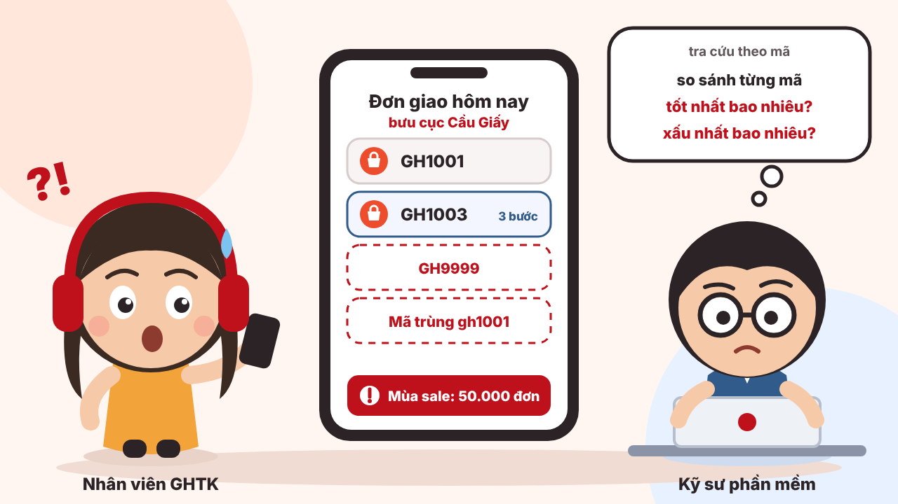

# Hệ thống quản lý đơn giao trong ngày của bưu cục GHTK

### 1. Bối cảnh & Vấn đề



*Nhân viên bưu cục GHTK tra cứu đơn trên màn hình dòng lệnh*

Mỗi sáng, bưu cục **Giao Hàng Tiết Kiệm (GHTK)** ở Cầu Giấy nhận danh sách đơn giao trong ngày; mỗi đơn là một list con theo thứ tự cố định:

```plaintext
[mã đơn, người nhận, quận, tiền thu hộ (đồng)]
```

Trong ca, nhân viên xem danh sách, nhận thêm đơn tại quầy, tra cứu đơn khi khách gọi hỏi và đếm đơn từng quận để chia tuyến. Tổng tiền thu hộ sai thì cuối ca đối soát lệch tiền; thêm trùng mã thì một đơn có thể bị giao hai lần. Trưởng bưu cục còn muốn biết **mỗi lần tra cứu tốn bao nhiêu lần so sánh mã**, để ước lượng cho mùa sale khi danh sách lên hàng chục nghìn đơn.

Bạn xây dựng module **"GHTK Daily Orders CLI"**.

### 2. Yêu cầu nghiệp vụ

Dữ liệu mẫu ban đầu (hàm `make_orders()` có sẵn trả về bản sao):

```python
SAMPLE_ORDERS = [
    ["GH1001", "Nguyễn Văn An", "Cầu Giấy", 350000],
    ["GH1002", "Trần Thị Bình", "Đống Đa", 0],
    ["GH1003", "Lê Minh Châu", "Hà Đông", 1250000],
    ["GH1004", "Phạm Thu Dung", "Cầu Giấy", 89000],
    ["GH1005", "Hoàng Văn Em", "Thanh Xuân", 460000],
]
```

Menu lặp lại liên tục gồm:

**Chức năng 1 — Xem danh sách đơn và tổng tiền thu hộ.** Mỗi đơn một dòng kèm số thứ tự, rồi dòng `Tổng: <số đơn> đơn, thu hộ <tổng tiền>`.

**Chức năng 2 — Thêm đơn mới.** Nhập mã, người nhận, quận, tiền thu hộ (mã đổi sang chữ in hoa, bỏ khoảng trắng hai đầu). Thêm vào cuối danh sách và in `Đã thêm đơn <mã>. Hiện có <n> đơn.`

**Chức năng 3 — Tra cứu đơn theo mã.** Tìm từ đầu danh sách, dừng ngay khi thấy; in đơn tìm thấy hoặc `Không tìm thấy đơn <mã>`, kèm số lần so sánh mã.

**Chức năng 4 — Đếm đơn theo quận.** Nhập tên quận (không phân biệt hoa thường), in `Quận <tên> có <k> đơn.`

**Chức năng 5 — Thoát.** In `Đã lưu ca làm việc. Tạm biệt!` và dừng.

Màn hình mẫu (đoạn đầu; phím gõ vào hiện sau dấu hai chấm, `[menu chính]` là menu được in lại):

```plaintext
===== BƯU CỤC GHTK - ĐƠN GIAO TRONG NGÀY =====
1. Xem danh sách đơn và tổng tiền thu hộ
2. Thêm đơn mới
3. Tra cứu đơn theo mã
4. Đếm đơn theo quận
5. Thoát
Chọn chức năng (1-5): 1
1. GH1001 | Nguyễn Văn An | Cầu Giấy | 350.000đ
2. GH1002 | Trần Thị Bình | Đống Đa | 0đ
3. GH1003 | Lê Minh Châu | Hà Đông | 1.250.000đ
4. GH1004 | Phạm Thu Dung | Cầu Giấy | 89.000đ
5. GH1005 | Hoàng Văn Em | Thanh Xuân | 460.000đ
Tổng: 5 đơn, thu hộ 2.149.000đ

[menu chính]
Chọn chức năng (1-5): 3
Nhập mã đơn:   gh1003 
Tìm thấy: GH1003 | Lê Minh Châu | Hà Đông | 1.250.000đ (đã so sánh 3 mã).

[menu chính]
Chọn chức năng (1-5): 3
Nhập mã đơn: GH9999
Không tìm thấy đơn GH9999 (đã so sánh 5 mã).

[... các lượt sau: thêm dữ liệu sai, nhập menu sai, thoát ...]
```

### 3. Edge Cases (Bẫy dữ liệu)

**Bẫy 1 — Dữ liệu thêm đơn sai.** `add_order` báo `ValueError` với đúng thông báo trong docstring (mã trống, mã đã tồn tại, người nhận trống, quận trống, tiền thu hộ không phải số nguyên không âm); `main.py` in `Lỗi: <thông báo>`, danh sách giữ nguyên. Mã trùng được nhận ra cả khi gõ chữ thường (`gh1001`); tiền `-5000`, `12.5`, `abc` đều sai.

**Bẫy 2 — Mã tra cứu gõ không chuẩn hoặc không có.** `  gh1003 ` vẫn tìm thấy `GH1003`; mã không có thì số lần so sánh bằng số đơn.

**Bẫy 3 — Lựa chọn menu không hợp lệ.** `abc`, `7`, `2.5`, bấm Enter không nhập gì: in `Lựa chọn không hợp lệ, vui lòng nhập số từ 1 đến 5.` và hỏi lại, chương trình không dừng.

### 4. Yêu cầu

**(1) Phân tích và thiết kế (viết vào `PHAN_TICH.md`)**

- Input/Output của từng chức năng, trong trường hợp thường và trong từng bẫy; luồng chương trình (mã giả hoặc các bước).
- Bảng số lần so sánh của chức năng 3 với 5 đơn mẫu khi mã ở đầu, ở cuối, không có; với n đơn thì tốt nhất, xấu nhất là bao nhiêu bước.
- Big-O thời gian của bốn chức năng theo n (số đơn).

**(2) Triển khai code**

- Viết các hàm trong `don_hang.py` (giữ tên, tham số; hàm "Có sẵn" giữ nguyên) và chương trình menu trong `main.py`. Hàm nghiệp vụ không gọi `input()`, `print()`.
- Thông báo đúng từng chữ như đề; không dừng vì lỗi ở bất kỳ thao tác nào; tên biến snake_case, có chú thích.
- `python kiem_tra.py` đạt cả 8 mục (mục cuối tự chạy `main.py`, gõ một loạt lựa chọn có cả dữ liệu sai, và kiểm tra các thông báo của đề).

### 5. Quy định nộp bài

1. Tạo kho GitHub riêng, đặt tên `[Tên Lớp]_IT301_Session02_TH01`. Tải thư mục khởi đầu tại https://github.com/cuongtm191221/it301-bai-tap-ve-nha/tree/main/session-02-thuc-hanh-cli/bai-01 rồi chép các tệp vào kho: `don_hang.py`, `main.py`, `kiem_tra.py`, `PHAN_TICH.md`.
2. Mức AI: AI-0 (tự làm, không dùng AI).
3. Đưa bài làm lên kho và nộp đường dẫn kho lên hệ thống.
