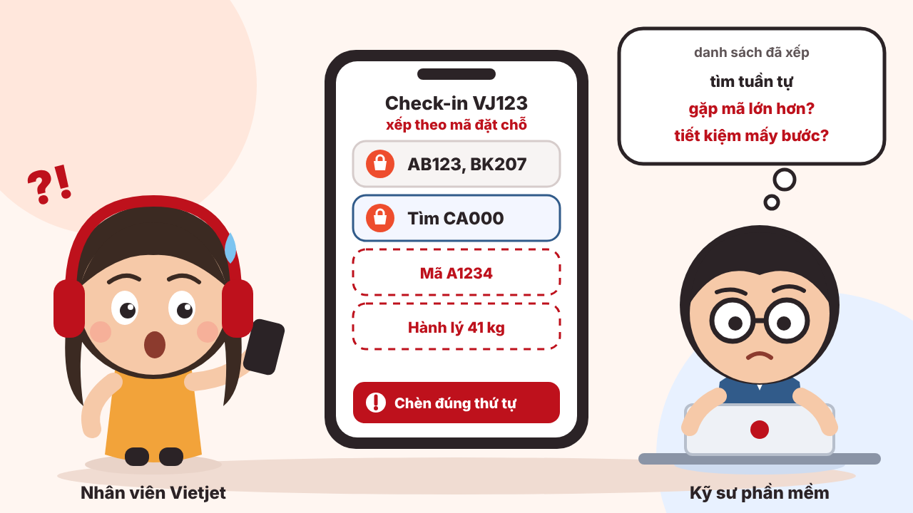

# Hệ thống check-in hành khách của Vietjet Air

### 1. Bối cảnh & Vấn đề



*Nhân viên quầy check-in Vietjet tra cứu mã đặt chỗ*

Tại quầy check-in chuyến **VJ123** của **Vietjet Air**, danh sách hành khách đã check-in được giữ **xếp tăng dần theo mã đặt chỗ**; mỗi hành khách là một list con:

```plaintext
[mã đặt chỗ, họ tên, hành lý ký gửi (kg)]
```

Nhân viên cần xem nhanh vài hành khách đầu hoặc cuối danh sách, check-in thêm khách, tra cứu mã khi khách hỏi lại và thống kê hành lý để báo cho bộ phận xếp hàng hóa. Vì danh sách đã xếp, trưởng ca đề xuất cách **tìm có dừng sớm**: đi từ đầu, gặp mã lớn hơn mã cần tìm thì dừng vì phía sau không thể có. Bạn cần cho thấy bằng số bước cách này tiết kiệm được bao nhiêu.

Bạn xây dựng module **"Vietjet Check-in CLI"**.

### 2. Yêu cầu nghiệp vụ

Dữ liệu mẫu: `make_passengers()` trả về bản sao của 6 hành khách `AB123`, `BK207`, `CK310`, `DN452`, `HV518`, `QT609` (xem `check_in.py`).

**Chức năng 1 — Xem danh sách** (menu phụ): `1` toàn bộ kèm dòng `Tổng: <n> hành khách`; `2` k người đầu; `3` k người cuối (hỏi k; k lớn hơn số người thì in tất cả).

**Chức năng 2 — Check-in hành khách.** Nhập mã, họ tên, hành lý; chèn vào **đúng vị trí** để danh sách vẫn tăng dần; in `Đã check-in <mã> ở vị trí <i>/<n>.`

**Chức năng 3 — Tra cứu mã đặt chỗ** (menu phụ): `1` tìm tuần tự, `2` tìm có dừng sớm. In kết quả hoặc `không có <mã>`, kèm số lần so sánh mã.

**Chức năng 4 — Thống kê hành lý.** In tổng kg và số hành khách vượt 20 kg, **không tạo list phụ** (bộ nhớ phụ O(1)).

**Chức năng 5 — Thoát.** In `Đóng quầy check-in. Chúc chuyến bay tốt đẹp!`.

Màn hình mẫu (đoạn đầu; phím gõ vào hiện sau dấu hai chấm, `[menu chính]` là menu được in lại):

```plaintext
===== VIETJET VJ123 - QUẦY CHECK-IN =====
1. Xem danh sách hành khách
2. Check-in hành khách
3. Tra cứu mã đặt chỗ
4. Thống kê hành lý
5. Thoát
Chọn chức năng (1-5): 1
1. Toàn bộ  2. k người đầu  3. k người cuối
Chọn cách xem: 2
Số hành khách: 3
1. AB123 | Nguyễn Minh An | 15 kg
2. BK207 | Trần Thu Bình | 23 kg
3. CK310 | Lê Hoàng Cường | 7 kg

[menu chính]
Chọn chức năng (1-5): 3
1. Tìm tuần tự  2. Tìm có dừng sớm
Chọn cách tìm: 1
Mã đặt chỗ: DN452
Tìm tuần tự: DN452 | Phạm Ngọc Dung | 20 kg (so sánh 4 mã).

[menu chính]
Chọn chức năng (1-5): 3
1. Tìm tuần tự  2. Tìm có dừng sớm
Chọn cách tìm: 2
Mã đặt chỗ: DN452
Tìm có dừng sớm: DN452 | Phạm Ngọc Dung | 20 kg (so sánh 4 mã).

[menu chính]
Chọn chức năng (1-5): 3
1. Tìm tuần tự  2. Tìm có dừng sớm
Chọn cách tìm: 2
Mã đặt chỗ: CA000
Tìm có dừng sớm: không có CA000 (so sánh 3 mã).

[... các lượt sau: thêm dữ liệu sai, nhập menu sai, thoát ...]
```

### 3. Edge Cases (Bẫy dữ liệu)

**Bẫy 1 — Mã đặt chỗ sai định dạng.** Mã hợp lệ gồm đúng 2 chữ cái rồi 3 chữ số (gõ thường vẫn được): `A1234`, `AB12` in `Lỗi: Mã đặt chỗ phải gồm 2 chữ cái và 3 chữ số`.

**Bẫy 2 — Check-in sai.** Mã đã check-in, họ tên trống, hành lý không phải số nguyên từ 0 đến 40: đúng thông báo trong docstring của `check_in`, danh sách giữ nguyên.

**Bẫy 3 — Chèn ở hai đầu.** Mã nhỏ hơn mọi mã vào vị trí 1; lớn hơn mọi mã vào cuối.

**Bẫy 4 — Nhập sai ở menu.** k không phải số nguyên dương: `Lỗi: Số hành khách phải là số nguyên dương`. Menu phụ sai: `Lựa chọn không hợp lệ.`; menu chính sai: `Lựa chọn không hợp lệ, vui lòng nhập số từ 1 đến 5.`

### 4. Yêu cầu

**(1) Phân tích và thiết kế (viết vào `PHAN_TICH.md`)**

- Input/Output của từng chức năng, trong trường hợp thường và trong từng bẫy; luồng chương trình (mã giả hoặc các bước).
- Bảng số lần so sánh của hai cách tìm với 6 hành khách mẫu: mã `DN452`, `CA000`, `AA000`, `ZZ999`. Khi nào dừng sớm có lợi, khi nào không? Big-O xấu nhất của mỗi cách.
- Check-in giữ thứ tự tốn bao nhiêu bước theo n (tìm vị trí và chèn)? Vì sao chức năng 4 chỉ cần bộ nhớ phụ O(1)?

**(2) Triển khai code**

- Viết các hàm trong `check_in.py` (giữ tên, tham số; hàm "Có sẵn" giữ nguyên) và chương trình menu trong `main.py`. Hàm nghiệp vụ không gọi `input()`, `print()`.
- Thông báo đúng từng chữ như đề; không dừng vì lỗi ở bất kỳ thao tác nào; tên biến snake_case, có chú thích.
- `python kiem_tra.py` đạt cả 8 mục (mục cuối tự chạy `main.py`, gõ một loạt lựa chọn có cả dữ liệu sai, và kiểm tra các thông báo của đề).

### 5. Quy định nộp bài

1. Tạo kho GitHub riêng, đặt tên `[Tên Lớp]_IT301_Session02_TH03`. Tải thư mục khởi đầu tại https://github.com/cuongtm191221/it301-bai-tap-ve-nha/tree/main/session-02-thuc-hanh-cli/bai-03 rồi chép các tệp vào kho: `check_in.py`, `main.py`, `kiem_tra.py`, `PHAN_TICH.md`.
2. Mức AI: AI-0 (tự làm, không dùng AI).
3. Đưa bài làm lên kho và nộp đường dẫn kho lên hệ thống.
