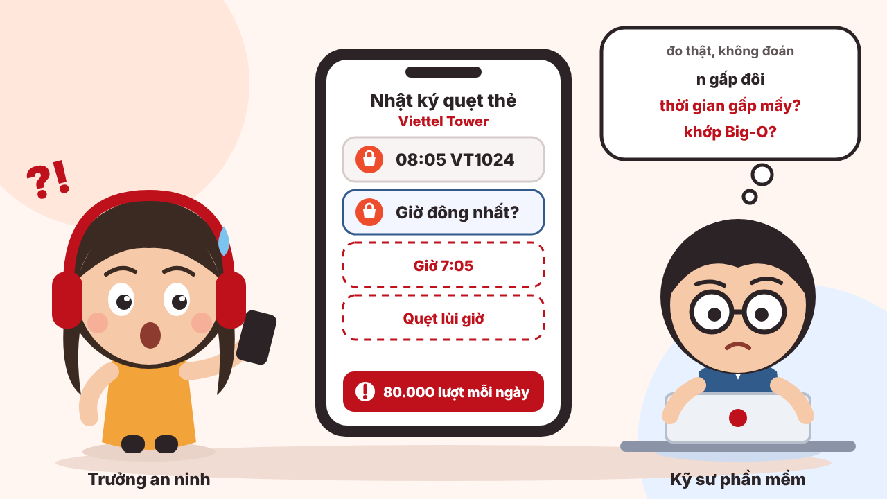

# Hệ thống nhật ký quẹt thẻ ra vào tòa nhà Viettel Tower

### 1. Bối cảnh & Vấn đề



*Bộ phận an ninh Viettel Tower xem nhật ký quẹt thẻ*

Mỗi lần nhân viên quẹt thẻ qua cổng **Viettel Tower**, hệ thống ghi một lượt vào nhật ký, xếp theo thời gian:

```plaintext
[mã thẻ, giờ quẹt tính bằng phút từ 00:00]     ví dụ ["VT1024", 485] là 08:05
```

Bộ phận an ninh cần xem nhanh các lượt gần nhất, ghi lượt thủ công khi đầu đọc hỏng, đếm số lượt của một thẻ và tìm giờ đông nhất để bố trí bảo vệ. Tòa nhà có hơn 5.000 nhân viên, mỗi ngày hàng chục nghìn lượt; trưởng bộ phận muốn **thấy bằng số đo** thời gian tra cứu tăng thế nào khi nhật ký dài gấp đôi, trước khi quyết định có nâng cấp máy chủ.

Bạn xây dựng module **"Viettel Tower Access Log CLI"**.

### 2. Yêu cầu nghiệp vụ

Dữ liệu mẫu: `make_logs()` trả về bản sao 8 lượt quẹt từ 07:50 đến 13:30 (xem `quet_the.py`).

**Chức năng 1 — Xem các lượt gần nhất.** Nhập k, in k lượt **mới nhất trước** dạng `<i>. <HH:MM> | <mã thẻ>`.

**Chức năng 2 — Ghi lượt quẹt mới.** Nhập mã thẻ và giờ `HH:MM`; ghi vào cuối nhật ký.

**Chức năng 3 — Tra cứu** (menu phụ): `1` số lượt của một thẻ; `2` giờ đông nhất (`08:00-08:59`), bằng nhau lấy giờ sớm hơn, **bộ nhớ phụ không tăng theo số lượt**.

**Chức năng 4 — Đo hiệu năng.** Hàm `benchmark` dùng `timeit` đo thời gian một lần gọi của hai thao tác tra cứu trên nhật ký giả lập (`make_big_logs`, có sẵn) với n = 20.000, 40.000, 80.000; in bảng thời gian (ms) và tỉ lệ so với n trước đó.

**Chức năng 5 — Thoát.** In `Đã lưu nhật ký. Tạm biệt!`.

Màn hình mẫu (đoạn đầu; phím gõ vào hiện sau dấu hai chấm, `[menu chính]` là menu được in lại):

```plaintext
===== VIETTEL TOWER - NHẬT KÝ QUẸT THẺ =====
1. Xem các lượt quẹt gần nhất
2. Ghi lượt quẹt mới
3. Tra cứu
4. Đo hiệu năng
5. Thoát
Chọn chức năng (1-5): 1
Số lượt cần xem: 3
1. 13:30 | VT4096
2. 12:05 | VT3001
3. 12:00 | VT1024

[menu chính]
Chọn chức năng (1-5): 3
1. Số lượt của một thẻ  2. Giờ đông nhất
Chọn tra cứu: 2
Giờ đông nhất: 08:00-08:59 với 3 lượt.

[menu chính]
Chọn chức năng (1-5): 3
1. Số lượt của một thẻ  2. Giờ đông nhất
Chọn tra cứu: 1
Mã thẻ: vt1024
Thẻ VT1024 quẹt 3 lượt.

[... các lượt sau: thêm dữ liệu sai, nhập menu sai, thoát ...]
```

Chức năng 4 in bảng dạng sau (số đo trên máy soạn đề, Python 3.10; máy của bạn sẽ khác):

```plaintext
n | đếm lượt một thẻ (ms) | giờ đông nhất (ms)
20000 | 0.39 | 0.76
40000 | 0.79 (x2.0) | 1.51 (x2.0)
80000 | 1.58 (x2.0) | 3.05 (x2.0)
```

### 3. Edge Cases (Bẫy dữ liệu)

**Bẫy 1 — Giờ sai.** `7:05`, `24:00`, `08:60`, `08-30`: `Lỗi: Giờ quẹt phải có dạng HH:MM từ 00:00 đến 23:59`.

**Bẫy 2 — Giờ lùi.** Nhật ký luôn xếp theo thời gian: giờ sớm hơn lượt cuối báo `Lỗi: Giờ quẹt không được sớm hơn lượt trước (<HH:MM>)`; bằng giờ lượt cuối vẫn hợp lệ.

**Bẫy 3 — Mã thẻ, số lượt sai.** Mã không đúng dạng `VT` + 4 chữ số: `Lỗi: Mã thẻ phải gồm VT và 4 chữ số`; k không phải số nguyên dương: `Lỗi: Số lượt phải là số nguyên dương`; k lớn hơn số lượt thì in tất cả.

**Bẫy 4 — Dữ liệu lớn.** 200.000 lượt: đếm và tìm giờ đông nhất xong trong 3 giây.

**Bẫy 5 — Menu sai.** Menu phụ: `Lựa chọn không hợp lệ.`; menu chính: `Lựa chọn không hợp lệ, vui lòng nhập số từ 1 đến 5.`

### 4. Yêu cầu

**(1) Phân tích và thiết kế (viết vào `PHAN_TICH.md`)**

- Input/Output của từng chức năng, trong trường hợp thường và trong từng bẫy; luồng chương trình (mã giả hoặc các bước).
- Big-O thời gian và bộ nhớ phụ của bốn thao tác (xem k lượt, ghi lượt, đếm theo thẻ, giờ đông nhất) theo n và k.
- Bảng số đo của chức năng 4 trên máy bạn (ghi phiên bản Python); n gấp đôi thì thời gian tăng khoảng bao nhiêu lần, có khớp Big-O không? Vì sao không kết luận từ một lần chạy?

**(2) Triển khai code**

- Viết các hàm trong `quet_the.py` (giữ tên, tham số; hàm "Có sẵn" giữ nguyên) và chương trình menu trong `main.py`. Hàm nghiệp vụ không gọi `input()`, `print()`.
- Thông báo đúng từng chữ như đề; không dừng vì lỗi ở bất kỳ thao tác nào; tên biến snake_case, có chú thích.
- `python kiem_tra.py` đạt cả 7 mục (mục cuối tự chạy `main.py`, gõ một loạt lựa chọn có cả dữ liệu sai, và kiểm tra các thông báo của đề).

### 5. Quy định nộp bài

1. Tạo kho GitHub riêng, đặt tên `[Tên Lớp]_IT301_Session02_TH05`. Tải thư mục khởi đầu tại https://github.com/cuongtm191221/it301-bai-tap-ve-nha/tree/main/session-02-thuc-hanh-cli/bai-05 rồi chép các tệp vào kho: `quet_the.py`, `main.py`, `kiem_tra.py`, `PHAN_TICH.md`.
2. Mức AI: AI-0 (tự làm, không dùng AI).
3. Đưa bài làm lên kho và nộp đường dẫn kho lên hệ thống.
