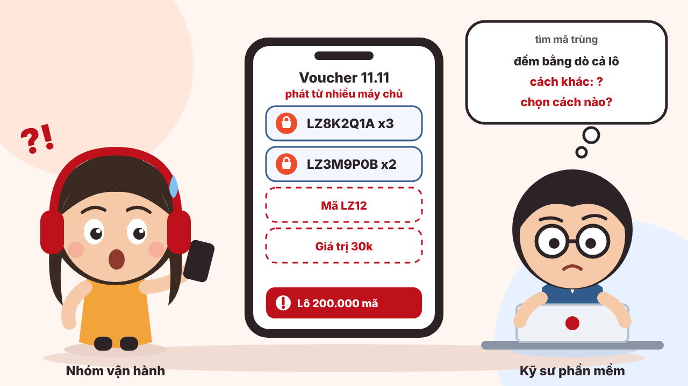

# Hệ thống kiểm tra voucher phát trùng của Lazada

### 1. Bối cảnh & Vấn đề



*Nhóm vận hành Lazada kiểm tra lô voucher 11.11*

Đợt **11.11**, **Lazada** phát voucher từ nhiều máy chủ cùng lúc. Mỗi voucher là `[mã voucher, giá trị (nghìn đồng)]`. Do lỗi đồng bộ, **một mã có thể bị phát nhiều lần**; nếu không phát hiện trước giờ mở bán, một mã có thể bị dùng lặp và công ty mất tiền.

Nhóm vận hành cần xem lô voucher, phát thêm mã, và **liệt kê mọi mã bị phát trùng kèm số lần**. Công cụ hiện tại đếm mỗi mã bằng cách dò cả lô; lô thử 1.000 mã chạy tức thì, nhưng lô thật hơn 200.000 mã thì chạy không xong trước giờ mở bán. Trưởng nhóm yêu cầu một giải pháp khác, chứng minh bằng số đo và phân tích.

Bạn xây dựng module **"Lazada Voucher Check CLI"**.

### 2. Yêu cầu nghiệp vụ

Dữ liệu mẫu: `make_vouchers()` trả về bản sao 7 voucher, trong đó `LZ8K2Q1A` xuất hiện 3 lần và `LZ3M9P0B` 2 lần (xem `voucher.py`).

**Chức năng 1 — Xem lô voucher** (menu phụ): `1` toàn bộ kèm dòng `Tổng: <n> voucher, giá trị <tổng>k`; `2` k voucher phát gần nhất, mới nhất trước.

**Chức năng 2 — Phát thêm voucher.** Nhập mã và giá trị; mã trùng **vẫn được phát** (đúng như hệ thống thật).

**Chức năng 3 — Kiểm tra mã trùng** (menu phụ chọn giải pháp). In `Mã trùng: <mã> (<k> lần), ...` theo mã tăng dần, hoặc `Không có mã trùng.` Hai hàm `find_duplicates_v1`, `find_duplicates_v2` trả về **cùng kết quả**, **khác nhau về cách làm**; giải pháp 2 xử lý 200.000 voucher trong 2 giây; không làm đổi lô.

**Chức năng 4 — Đo so sánh hai giải pháp.** `benchmark` đo bằng `timeit` trên lô giả lập (`make_big_vouchers`, có sẵn) với n = 1.000, 2.000, 4.000.

**Chức năng 5 — Thoát.** In `Đã khóa lô voucher. Tạm biệt!`.

Màn hình mẫu (đoạn đầu; phím gõ vào hiện sau dấu hai chấm, `[menu chính]` là menu được in lại):

```plaintext
===== LAZADA - KIỂM TRA VOUCHER ĐỢT 11.11 =====
1. Xem lô voucher
2. Phát thêm voucher
3. Kiểm tra mã trùng
4. Đo so sánh hai giải pháp
5. Thoát
Chọn chức năng (1-5): 3
1. Giải pháp 1  2. Giải pháp 2
Chọn giải pháp: 1
Mã trùng: LZ3M9P0B (2 lần), LZ8K2Q1A (3 lần)

[menu chính]
Chọn chức năng (1-5): 1
1. Toàn bộ  2. k voucher gần nhất
Chọn cách xem: 1
1. LZ8K2Q1A | 50k
2. LZ3M9P0B | 20k
3. LZ8K2Q1A | 50k
4. LZ7T4R2C | 100k
5. LZ3M9P0B | 20k
6. LZ1X5W6D | 10k
7. LZ8K2Q1A | 50k
Tổng: 7 voucher, giá trị 300k

[menu chính]
Chọn chức năng (1-5): 2
Mã voucher: lz1x5w6d
Giá trị (nghìn đồng): 10
Đã phát LZ1X5W6D trị giá 10k. Lô có 8 voucher.

[... các lượt sau: thêm dữ liệu sai, nhập menu sai, thoát ...]
```

Chức năng 4 in bảng dạng sau (số đo trên máy soạn đề, Python 3.10):

```plaintext
n | giải pháp 1 (ms) | giải pháp 2 (ms)
1000 | 20.0 | 0.2
2000 | 78.7 (x3.9) | 0.4 (x2.0)
4000 | 313.4 (x4.0) | 0.7 (x2.0)
```

### 3. Edge Cases (Bẫy dữ liệu)

**Bẫy 1 — Một mã phát nhiều lần.** Mỗi mã trùng chỉ in một lần, kèm đúng số lần xuất hiện.

**Bẫy 2 — Lô rỗng, một voucher, không có trùng.** In `Không có mã trùng.`; xem lô rỗng in `Lô voucher đang trống.`

**Bẫy 3 — Dữ liệu phát sai.** Mã không đủ 8 ký tự chữ hoặc số, không bắt đầu bằng `LZ`; giá trị khác 10, 20, 50, 100: đúng thông báo trong docstring của `issue`.

**Bẫy 4 — Không làm đổi lô.** Kiểm tra xong, thứ tự lô giữ nguyên.

**Bẫy 5 — Menu sai.** k không phải số nguyên dương: `Lỗi: Số voucher phải là số nguyên dương`; menu phụ: `Lựa chọn không hợp lệ.`; menu chính: `Lựa chọn không hợp lệ, vui lòng nhập số từ 1 đến 5.`

### 4. Yêu cầu

**(1) Phân tích và thiết kế (viết vào `PHAN_TICH.md`)**

- Input/Output của từng chức năng, trong trường hợp thường và trong từng bẫy; luồng chương trình (mã giả hoặc các bước).
- Đề xuất ít nhất hai giải pháp tìm mã trùng khác nhau: ý tưởng, hình minh họa trên lô mẫu, mã giả.
- Bảng so sánh 5 tiêu chí (tốc độ, bộ nhớ phụ, độ dễ đọc, dễ bảo trì, phù hợp bối cảnh) kèm Big-O và số đo của chức năng 4 trên máy bạn; chọn giải pháp cho lô 200.000 mã và giải thích.

**(2) Triển khai code**

- Viết các hàm trong `voucher.py` (giữ tên, tham số; hàm "Có sẵn" giữ nguyên) và chương trình menu trong `main.py`. Hàm nghiệp vụ không gọi `input()`, `print()`.
- Thông báo đúng từng chữ như đề; không dừng vì lỗi ở bất kỳ thao tác nào; tên biến snake_case, có chú thích.
- `python kiem_tra.py` đạt cả 8 mục (mục cuối tự chạy `main.py`, gõ một loạt lựa chọn có cả dữ liệu sai, và kiểm tra các thông báo của đề).

### 5. Quy định nộp bài

1. Tạo kho GitHub riêng, đặt tên `[Tên Lớp]_IT301_Session02_TH08`. Tải thư mục khởi đầu tại https://github.com/cuongtm191221/it301-bai-tap-ve-nha/tree/main/session-02-thuc-hanh-cli/bai-08 rồi chép các tệp vào kho: `voucher.py`, `main.py`, `kiem_tra.py`, `PHAN_TICH.md`.
2. Mức AI: AI-0 (tự làm, không dùng AI).
3. Đưa bài làm lên kho và nộp đường dẫn kho lên hệ thống.
