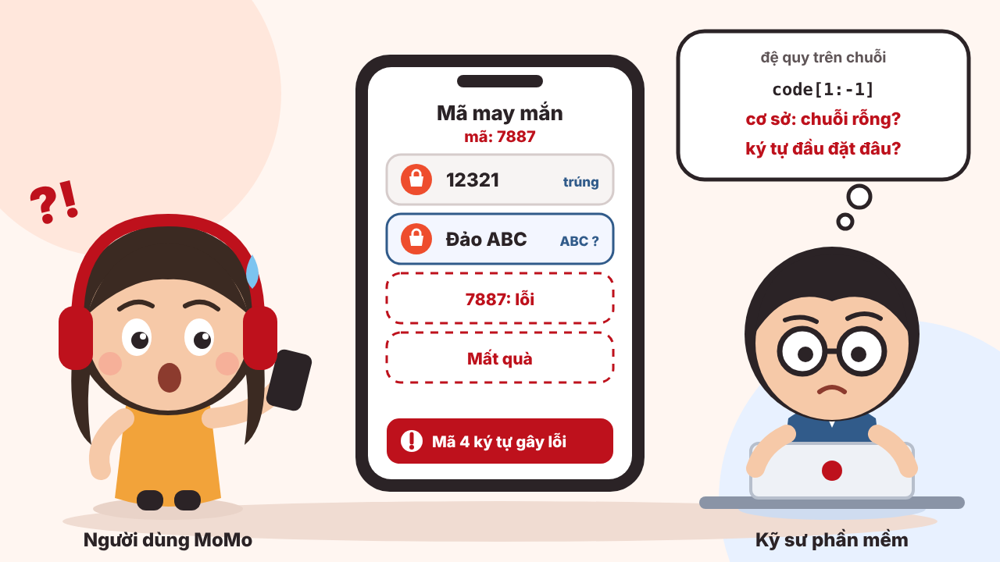

# Lỗi trò chơi "Mã may mắn" trên ví MoMo

### 1. Bối cảnh nghiệp vụ



*Mã giao dịch đọc xuôi đọc ngược như nhau thì trúng thưởng, nhưng mã có số ký tự chẵn làm trò chơi báo lỗi.*

Bạn là kỹ sư phần mềm trong nhóm trò chơi khuyến mãi của ví MoMo.

Trò chơi **"Mã may mắn"**: mỗi giao dịch có một mã; nếu mã **đối xứng** (đọc xuôi và đọc ngược giống nhau, ví dụ `12321`, `7887`) thì người dùng nhận quà. Màn hình kết quả còn hiện **mã viết ngược** để người dùng tự so.

Nhóm viết hai hàm bằng đệ quy trên chuỗi (Lesson 02):

- `reverse_code(code)`: trả về mã viết ngược. Đảo `"ABC"` được `"CBA"`.
- `is_symmetric(code)`: `True` nếu mã đối xứng. So ký tự đầu với ký tự cuối; nếu bằng nhau thì xét tiếp phần giữa `code[1:-1]`. Chuỗi một ký tự và chuỗi rỗng là đối xứng.

Mỗi tuần có hàng chục nghìn lượt chơi. Mã trúng mà hệ thống báo lỗi thì người dùng mất quà và gọi tổng đài khiếu nại; mã không trúng mà hệ thống báo trúng thì công ty mất tiền. Vì vậy hai hàm phải đúng với mọi độ dài mã, kể cả mã rỗng do lỗi nhập liệu từ hệ thống cũ. Mã giao dịch dài từ 1 đến 20 ký tự, gồm chữ số và chữ cái in hoa; hai hàm không cần phân biệt chữ hoa, chữ thường.

Kịch bản kiểm tra (đoạn cuối tệp): đảo ba mã, kiểm tra năm mã gồm cả mã có số ký tự lẻ và chẵn, rồi kiểm tra mã rỗng.

Kết quả đúng cần hiển thị:

```plaintext
Đảo MOMO24: 42OMOM
Đảo ABC: CBA
Đảo X: X
121 đối xứng? True
7887 đối xứng? True
12321 đối xứng? True
MOMO đối xứng? False
A đối xứng? True
Mã rỗng đối xứng? True
```

### 2. Vấn đề hiện tại

Người dùng và bộ phận chăm sóc khách hàng phản ánh:

- Màn hình kết quả hiện mã "viết ngược" **giống hệt** mã gốc.
- Mã `7887` (4 ký tự) làm trò chơi **báo lỗi** thay vì trao quà; mã `121` thì vẫn chạy đúng.

Nhắc lại kiến thức (Lesson 02):

- Đảo chuỗi: đảo phần còn lại `code[1:]` rồi đặt ký tự đầu `code[0]` vào **cuối**. Đặt ký tự đầu sai chỗ là lỗi thường gặp: kết quả "không đổi".
- Mỗi lần xét `code[1:-1]`, chuỗi ngắn đi **hai** ký tự. Chuỗi độ dài lẻ rút dần về 1 ký tự; chuỗi độ dài chẵn rút dần về **chuỗi rỗng**. Cơ sở phải bao phủ cả hai.
- Mỗi hàm đệ quy phải trả lời đúng **ba câu hỏi** (Lesson 01): (1) trường hợp cơ sở trả đúng chưa; (2) từ kết quả của bài toán nhỏ hơn, phần ghép ra kết quả lớn đúng chưa; (3) mỗi lần gọi có tiến về trường hợp cơ sở không.

### 3. Mã nguồn hiện tại (Legacy Code)

Toàn bộ tệp `ma_may_man.py` trong thư mục khởi đầu (đoạn cuối tệp là kịch bản chạy thử):

```python
def reverse_code(code):
    # Trả về chuỗi code viết ngược.
    if code == "":
        return ""
    return code[0] + reverse_code(code[1:])


def is_symmetric(code):
    # True nếu code đọc xuôi và đọc ngược giống nhau. Chuỗi rỗng và chuỗi một ký tự là đối xứng.
    if len(code) == 1:
        return True
    if code[0] != code[-1]:
        return False
    return is_symmetric(code[1:-1])


for code in ["MOMO24", "ABC", "X"]:
    print(f"Đảo {code}:", reverse_code(code))
for code in ["121", "7887", "12321", "MOMO", "A"]:
    print(f"{code} đối xứng?", is_symmetric(code))
print("Mã rỗng đối xứng?", is_symmetric(""))
```

Kết quả hiển thị trên Console:

```plaintext
Đảo MOMO24: MOMO24
Đảo ABC: ABC
Đảo X: X
121 đối xứng? True
Traceback (most recent call last):
  ...
    if code[0] != code[-1]:
IndexError: string index out of range
```

Đối chiếu với kết quả đúng: ba mã đảo ngược đều giữ nguyên; `121` đúng nhưng `7887` gây lỗi `IndexError` nên các dòng sau không được in.

### 4. Yêu cầu

Với vai trò kỹ sư phần mềm của nhóm, hãy thực hiện:

**(1) Phân tích lỗi** (trả lời vào `PHAN_TICH.md`)

- Chạy tay `reverse_code("ABC")` của mã hiện tại: ghi từng lời gọi và giá trị trả về khi quay lên. Vì sao kết quả không đổi? Sửa phần ghép thế nào?
- Chạy tay `is_symmetric("7887")`: ghi chuỗi ở mỗi lời gọi. Lời gọi nào gây `IndexError`, vì sao?
- Vì sao `is_symmetric("121")` vẫn đúng với mã hiện tại? Thử thêm một mã độ dài lẻ không đối xứng để chắc chắn.
- Sửa trường hợp cơ sở của `is_symmetric` để bao phủ cả chuỗi độ dài chẵn và chuỗi rỗng. Kiểm tra lại với `""`, `"11"`, `"12"`.
- Trả lời ba câu hỏi kiểm tra cho hai hàm sau khi sửa.
- Với mã dài k ký tự, mỗi hàm gọi đệ quy bao nhiêu lần? Mã dài 5.000 ký tự thì sao (Lesson 03)?
- Ghi bốn bộ dữ liệu thử cho `is_symmetric`: mã đối xứng độ dài lẻ, mã đối xứng độ dài chẵn, mã không đối xứng chỉ khác ở giữa, mã rỗng; kèm kết quả mong đợi và kết quả sau khi sửa.

**(2) Sửa lỗi**

- Sửa hai hàm trong `ma_may_man.py`, giữ cách viết đệ quy. Không đổi tên hàm, tham số; không dùng vòng lặp, `[::-1]` hay `reversed()`.
- Chạy `python ma_may_man.py` phải in đúng phần "Kết quả đúng cần hiển thị" ở mục 1.
- Chạy `python kiem_tra.py` phải đạt cả 4 mục.

### 5. Quy định nộp bài

1. Tạo một kho GitHub riêng cho bài này, đặt tên theo mẫu `[Tên Lớp]_IT301_Session03_Ex03`.
2. Tải thư mục khởi đầu tại https://github.com/cuongtm191221/it301-bai-tap-ve-nha/tree/main/session-03-de-quy/bai-03 rồi chép các tệp vào kho: `ma_may_man.py`, `kiem_tra.py`, `PHAN_TICH.md`.
3. Điền phần phân tích vào `PHAN_TICH.md`, sửa mã trong `ma_may_man.py`.
4. Mức AI của bài: AI-0 (tự làm, không dùng AI).
5. Đưa bài làm lên kho và nộp đường dẫn kho lên hệ thống.
