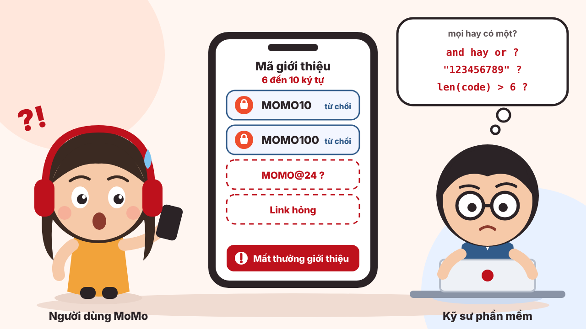

# Lỗi kiểm tra mã giới thiệu bạn bè trên ví MoMo

### 1. Bối cảnh nghiệp vụ



*Mã giới thiệu đúng quy định bị từ chối, mã có ký tự lạ lại được chấp nhận.*

Bạn là kỹ sư phần mềm trong nhóm chương trình "Giới thiệu bạn bè" của ví MoMo.

Người dùng tự đặt **mã giới thiệu** để bạn bè nhập khi đăng ký; cả hai cùng nhận thưởng. Mã hợp lệ phải thỏa **tất cả** quy định:

1. Dài từ **6 đến 10** ký tự (tính cả hai đầu).
2. Bắt đầu bằng một **chữ in hoa** A-Z.
3. Chỉ gồm chữ in hoa A-Z và chữ số 0-9.
4. Có **ít nhất 2 chữ số**.

Nhóm viết ba hàm; hai hàm đầu viết bằng đệ quy trên chuỗi (Lesson 02):

- `valid_chars(code)`: `True` nếu **mọi** ký tự là chữ in hoa hoặc chữ số; chuỗi rỗng trả về `True`.
- `count_digit_chars(code)`: số ký tự là chữ số.
- `is_valid_code(code)`: kết hợp bốn quy định.

Mã không hợp lệ phải bị từ chối ngay lúc đặt, vì mã có ký tự lạ làm lỗi đường link chia sẻ và tin nhắn gửi bạn bè.

Kịch bản kiểm tra (đoạn cuối tệp): tám mã, gồm mã đúng quy định, mã có ký tự lạ, mã dài đúng 6 ký tự, mã có chữ số 0, mã bắt đầu bằng chữ số, mã không có chữ số và mã rỗng.

Kết quả đúng cần hiển thị:

```plaintext
'MOMO2024'   hợp lệ
'MOMO@24'    không hợp lệ
'MOMO10'     hợp lệ
'AB1234'     hợp lệ
'MOMO100'    hợp lệ
'1MOMO23'    không hợp lệ
'MOMOVN'     không hợp lệ
''           không hợp lệ
```

### 2. Vấn đề hiện tại

Bộ phận chăm sóc khách hàng nhận phản ánh:

- Mã `MOMO10`, `AB1234` (đúng 6 ký tự) bị báo không hợp lệ.
- Mã `MOMO100` có 3 chữ số vẫn bị từ chối.
- Mã `MOMO@24` có ký tự `@` lại được chấp nhận, làm hỏng đường link chia sẻ.

Nhắc lại kiến thức (Lesson 01, Lesson 02):

- Mỗi hàm đệ quy phải trả lời đúng **ba câu hỏi** (Lesson 01): (1) trường hợp cơ sở trả đúng chưa; (2) từ kết quả của bài toán nhỏ hơn, phần ghép ra kết quả lớn đúng chưa; (3) mỗi lần gọi có tiến về trường hợp cơ sở không.
- Kiểm tra "**mọi** ký tự đều thỏa": ký tự đầu thỏa **và** phần còn lại đều thỏa. Kiểm tra "**có ít nhất một** ký tự thỏa": ký tự đầu thỏa **hoặc** phần còn lại có ký tự thỏa. Nhầm `and` với `or` làm đổi hẳn ý nghĩa của hàm.
- Khi chạy tay, ghi chuỗi ở mỗi lời gọi và giá trị trả về khi quay lên; đó là cách nhanh nhất để thấy phần ghép sai.

### 3. Mã nguồn hiện tại (Legacy Code)

Toàn bộ tệp `ma_gioi_thieu.py` trong thư mục khởi đầu (đoạn cuối tệp là kịch bản chạy thử):

```python
LETTERS = "ABCDEFGHIJKLMNOPQRSTUVWXYZ"
DIGITS = "0123456789"


def valid_chars(code):
    # True nếu mọi ký tự của code là chữ in hoa hoặc chữ số. Chuỗi rỗng: True.
    if code == "":
        return True
    return code[0] in LETTERS + DIGITS or valid_chars(code[1:])


def count_digit_chars(code):
    # Số ký tự là chữ số trong code.
    if code == "":
        return 0
    if code[0] in "123456789":
        return 1 + count_digit_chars(code[1:])
    return count_digit_chars(code[1:])


def is_valid_code(code):
    # Mã hợp lệ: dài 6 đến 10 ký tự, bắt đầu bằng chữ in hoa,
    # chỉ gồm chữ in hoa và chữ số, có ít nhất 2 chữ số.
    return (len(code) > 6 and len(code) <= 10 and code[0] in LETTERS
            and valid_chars(code) and count_digit_chars(code) >= 2)


for code in ("MOMO2024", "MOMO@24", "MOMO10", "AB1234", "MOMO100", "1MOMO23", "MOMOVN", ""):
    print(f"{code!r:12}", "hợp lệ" if is_valid_code(code) else "không hợp lệ")
```

Kết quả hiển thị trên Console:

```plaintext
'MOMO2024'   hợp lệ
'MOMO@24'    hợp lệ
'MOMO10'     không hợp lệ
'AB1234'     không hợp lệ
'MOMO100'    không hợp lệ
'1MOMO23'    không hợp lệ
'MOMOVN'     không hợp lệ
''           không hợp lệ
```

Đối chiếu với kết quả đúng: bốn mã `MOMO@24`, `MOMO10`, `AB1234`, `MOMO100` cho kết quả ngược với quy định; bốn mã còn lại đúng.

### 4. Yêu cầu

Với vai trò kỹ sư phần mềm của nhóm, hãy thực hiện:

**(1) Phân tích lỗi** (trả lời vào `PHAN_TICH.md`)

- Chạy tay `valid_chars("@B")` và `valid_chars("A@")` của mã hiện tại: ghi chuỗi ở mỗi lời gọi và giá trị trả về. Hàm hiện tại đang kiểm tra điều gì? Sửa phần ghép thế nào?
- Với phần ghép đã sửa, cơ sở `code == ""` trả về `True` có đúng không? Nếu trả về `False` thì chuyện gì xảy ra với mọi mã?
- Chạy tay `count_digit_chars("MOMO100")`. Vì sao ra 1? Sửa thế nào?
- Quy định "dài từ 6 đến 10 ký tự" bị viết sai ở đâu trong `is_valid_code`? Ghi các độ dài biên cần thử.
- Vì sao `is_valid_code("")` không báo `IndexError` dù có `code[0]`? Nếu đổi thứ tự các điều kiện thì sao?
- Lập bảng tám mã của kịch bản và bốn mã biên (dài 5, 6, 10, 11 ký tự): kết quả của mã hiện tại, kết quả mong đợi, quy định liên quan.

**(2) Sửa lỗi**

- Sửa ba hàm trong `ma_gioi_thieu.py`. `valid_chars` và `count_digit_chars` giữ cách viết đệ quy, không dùng vòng lặp hay `isdigit()`. Không đổi tên hàm, tham số.
- Chạy `python ma_gioi_thieu.py` phải in đúng phần "Kết quả đúng cần hiển thị" ở mục 1.
- Chạy `python kiem_tra.py` phải đạt cả 5 mục.

### 5. Quy định nộp bài

1. Tạo một kho GitHub riêng cho bài này, đặt tên theo mẫu `[Tên Lớp]_IT301_Session03_Ex08`.
2. Tải thư mục khởi đầu tại https://github.com/cuongtm191221/it301-bai-tap-ve-nha/tree/main/session-03-de-quy/bai-08 rồi chép các tệp vào kho: `ma_gioi_thieu.py`, `kiem_tra.py`, `PHAN_TICH.md`.
3. Điền phần phân tích vào `PHAN_TICH.md`, sửa mã trong `ma_gioi_thieu.py`.
4. Mức AI của bài: AI-0 (tự làm, không dùng AI).
5. Đưa bài làm lên kho và nộp đường dẫn kho lên hệ thống.
