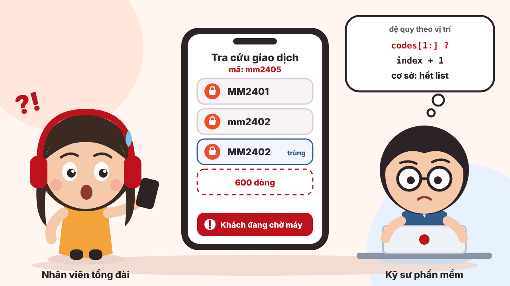

# Tra cứu giao dịch theo mã cho tổng đài MoMo

### 1. Bối cảnh & Vấn đề



*Nhân viên tổng đài nhập mã giao dịch khách đọc qua điện thoại; mã có thể viết thường, thừa khoảng trắng hoặc bị trùng.*

Khi khách gọi tổng đài ví MoMo khiếu nại một giao dịch, nhân viên nhập **mã giao dịch** khách đọc qua điện thoại để tìm dòng tương ứng trong danh sách giao dịch của khách. Danh sách là một list chuỗi theo thứ tự thời gian:

```plaintext
["MM2401", " mm2402", "MM2403 ", "MM2402", "MM2405"]
```

Dữ liệu được ghép từ nhiều hệ thống nên có mã viết thường, thừa khoảng trắng, và đôi khi một mã xuất hiện hai lần do lỗi đồng bộ. Mã khách đọc cũng có thể bị nhân viên gõ thường hoặc thừa dấu cách.

Nhóm muốn viết phần tra cứu theo cách đệ quy để thống nhất với bộ thư viện thống kê đã có. Một khách có tối đa vài trăm giao dịch. Vì danh sách được đọc trực tiếp từ bộ nhớ đệm dùng chung, nhóm hạ tầng đặt hai ràng buộc: **không sửa list**, và **không tạo list mới ở mỗi lời gọi** (mỗi lần cắt `codes[1:]` là một bản sao, vài trăm lần cắt là vài chục nghìn phần tử bị sao chép cho một lần tra cứu).

Hàm `normalize(code)` (có sẵn) bỏ khoảng trắng hai đầu và đổi sang chữ in hoa. Bạn được giao viết ba hàm trong `tim_giao_dich.py`.

### 2. Yêu cầu nghiệp vụ

**2.1. `find_transaction(codes, target, index=0)`**

- Trả về vị trí (đánh số từ 0) của giao dịch **đầu tiên**, xét từ vị trí `index` trở đi, có mã bằng `target` sau khi chuẩn hóa cả hai; không có thì trả về `-1`.

**2.2. `count_matches(codes, target, index=0)`**

- Trả về số giao dịch, xét từ vị trí `index` trở đi, có mã bằng `target` sau khi chuẩn hóa.

**2.3. `search_message(codes, target)`**

Trả về thông báo cho nhân viên, số dòng đánh số từ 1:

```plaintext
Tìm thấy MM2403 ở dòng 3.
Không tìm thấy giao dịch MM9999.
```

### 3. Edge Cases (Bẫy dữ liệu)

**Bẫy 1 — Mã viết thường, thừa khoảng trắng.** `"mm2405 "` vẫn phải tìm thấy `"MM2405"`; thông báo in mã đã chuẩn hóa.

**Bẫy 2 — Mã bị trùng.** Trả về dòng đầu tiên và nhắc kiểm tra:

```plaintext
Tìm thấy MM2402 ở dòng 2 (mã xuất hiện 2 lần, cần kiểm tra trùng).
```

**Bẫy 3 — Danh sách rỗng.** Khách mới chưa có giao dịch: `find_transaction` trả về `-1`, `count_matches` trả về `0`, không báo lỗi.

**Bẫy 4 — Mã cần tìm trống.** Nhân viên lỡ bấm tìm khi ô mã chỉ có dấu cách:

```plaintext
Mã giao dịch trống, vui lòng nhập lại.
```

**Bẫy 5 — Danh sách dài.** 600 giao dịch, mã cần tìm ở dòng cuối: phải tìm được, không báo `RecursionError`, không cắt list.

**Kịch bản chạy thử.** Chạy `python tim_giao_dich.py` (đoạn chạy thử có sẵn ở cuối tệp) phải in ra đúng:

```plaintext
Tìm thấy MM2403 ở dòng 3.
Tìm thấy MM2405 ở dòng 5.
Tìm thấy MM2402 ở dòng 2 (mã xuất hiện 2 lần, cần kiểm tra trùng).
Không tìm thấy giao dịch MM9999.
Không tìm thấy giao dịch MM2401.
Mã giao dịch trống, vui lòng nhập lại.
```

### 4. Yêu cầu

Với vai trò kỹ sư phần mềm, bạn phải thực hiện đầy đủ hai phần sau:

**(1) Phân tích và thiết kế giải pháp (bắt buộc, viết vào `PHAN_TICH.md`)**

- Phân tích Input/Output: với từng hàm, nêu dữ liệu đầu vào (kiểu dữ liệu) và giá trị trả về trong trường hợp thường và trong từng bẫy.
- Với mỗi hàm đệ quy, trả lời ba câu hỏi kiểm tra (Lesson 01): trường hợp cơ sở là gì, phần ghép từ kết quả nhỏ hơn ra sao, mỗi lần gọi tiến về cơ sở thế nào.
- Thiết kế giải pháp: so sánh hai cách đệ quy trên danh sách, cắt `codes[1:]` và truyền vị trí `index`. Với n giao dịch, mỗi cách sao chép tổng cộng bao nhiêu phần tử?
- Chạy tay `find_transaction(["A", "B", "C"], "C")`: ghi `index` ở mỗi lời gọi và giá trị trả về khi quay lên.
- Vẽ call stack lúc sâu nhất khi tìm mã ở dòng 600. Nếu khách có 5.000 giao dịch thì chuyện gì xảy ra (Lesson 03)? Đề xuất cách xử lý.
- Bộ dữ liệu thử: lập bảng ít nhất 6 đầu vào phủ đủ 5 bẫy ở mục 3, mỗi dòng ghi kết quả mong đợi (tính tay trước khi chạy) và kết quả chạy thật của bài làm.
- Độ phức tạp: ghi Big-O thời gian và bộ nhớ phụ (kể cả call stack) của ba hàm theo n (số giao dịch). `search_message` gọi hai hàm đệ quy: tổng số lời gọi là bao nhiêu?

**(2) Triển khai code**

- Viết thân các hàm còn trống trong `tim_giao_dich.py`. Không đổi tên hàm, tham số; hàm ghi "Có sẵn" giữ nguyên.
- Hai hàm `find_transaction`, `count_matches` viết bằng đệ quy theo vị trí: không dùng vòng lặp, không cắt list, không dùng `.index()`, `.count()` hay toán tử `in` trên list.
- Xử lý đủ 5 bẫy ở mục 3; `python tim_giao_dich.py` in đúng kịch bản chạy thử; `python kiem_tra.py` đạt cả 5 mục.
- Mã sạch, dễ đọc, tên biến theo snake_case, có chú thích ở trường hợp cơ sở và phần ghép.

### 5. Quy định nộp bài

1. Tạo một kho GitHub riêng cho bài này, đặt tên theo mẫu `[Tên Lớp]_IT301_Session03_Ex09`.
2. Tải thư mục khởi đầu tại https://github.com/cuongtm191221/it301-bai-tap-ve-nha/tree/main/session-03-de-quy/bai-09 rồi chép các tệp vào kho: `tim_giao_dich.py`, `kiem_tra.py`, `PHAN_TICH.md`.
3. Điền phần phân tích vào `PHAN_TICH.md`, viết mã trong `tim_giao_dich.py`.
4. Mức AI của bài: AI-0 (tự làm, không dùng AI).
5. Đưa bài làm lên kho và nộp đường dẫn kho lên hệ thống.
