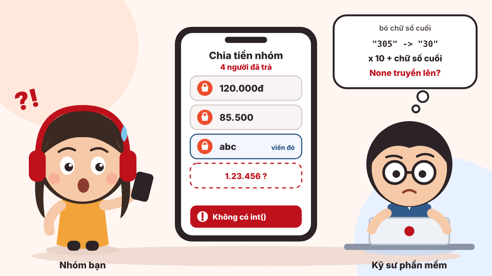

# Đọc số tiền người dùng nhập ở ô "Số tiền" của MoMo

### 1. Bối cảnh & Vấn đề



*Người dùng gõ số tiền theo nhiều kiểu: có dấu chấm, có chữ đ, thừa dấu cách; hệ thống phải đọc đúng hoặc từ chối rõ ràng.*

Ở màn hình **"Chia tiền nhóm"** của ví MoMo, mỗi thành viên gõ số tiền mình đã trả vào ô nhập. Người dùng gõ theo thói quen:

```plaintext
"50000"   "1.234.567đ"   " 20.000 đ "   "1.23.456"   "12a"
```

Hệ thống phải đổi chuỗi thành **số nguyên** để cộng tổng, hoặc từ chối chuỗi sai để ô nhập hiện viền đỏ. Đọc sai một dấu chấm là sai tiền thật giữa các thành viên.

Giống bài định dạng biên lai, mã này chạy trên thiết bị có bản Python rút gọn, **không có `int()`**. Nhóm viết hàm đọc chữ số bằng đệ quy theo ý: giá trị của chuỗi chữ số = giá trị của chuỗi **bỏ chữ số cuối** × 10 + **chữ số cuối**. Giá trị một chữ số lấy bằng vị trí của nó trong chuỗi `DIGITS = "0123456789"` (ví dụ `DIGITS.index("7")` là 7).

Mỗi bữa ăn nhóm có thể có tới vài chục thành viên, và người tạo nhóm thường dán cả một danh sách số tiền vào một lần. Dòng nào sai thì chỉ dòng đó bị từ chối, các dòng khác vẫn được cộng, và màn hình báo số dòng cần nhập lại để người dùng sửa.

Bạn được giao viết ba hàm trong `doc_so_tien.py`.

### 2. Yêu cầu nghiệp vụ

**2.1. `digits_value(digits)`**

- Chuỗi chỉ gồm chữ số trả về giá trị số nguyên: `"2024"` thành `2024`, `"007"` thành `7`. Chuỗi rỗng hoặc có ký tự khác chữ số trả về `None`.

**2.2. `parse_amount(text)`**

- Bỏ khoảng trắng hai đầu; nếu cuối chuỗi có chữ `đ` thì bỏ chữ `đ` và khoảng trắng trước nó.
- Dấu chấm (nếu có) ngăn cách hàng nghìn: **nhóm đầu 1 đến 3 chữ số, mỗi nhóm sau đúng 3 chữ số**. Hợp lệ thì trả về số nguyên, không hợp lệ trả về `None`.

**2.3. `total_amounts(texts)`**

- Nhận list chuỗi, trả về bộ (tổng các số tiền hợp lệ, số dòng không hợp lệ).

### 3. Edge Cases (Bẫy dữ liệu)

**Bẫy 1 — Chữ đ và khoảng trắng.** `" 20.000 đ "` là 20000; chuỗi chỉ có `"đ"` là `None`.

**Bẫy 2 — Nhóm chữ số sai.** `"1.23.456"`, `"1234.567"`, `".500"`, `"1.000."`, `"1..000"` đều là `None`.

**Bẫy 3 — Ký tự lạ.** `"12a"`, `"-5.000"`, `"5,000"` (dấu phẩy) là `None`.

**Bẫy 4 — Chuỗi rỗng và số 0.** `""` là `None`; `"0"` là 0 (hợp lệ, ví dụ thành viên không trả gì).

**Bẫy 5 — Tổng có dòng sai.** Dòng sai không được cộng và không làm dừng chương trình: `["120.000đ", "85.500", "abc", "1.000.000đ"]` cho `(1205500, 1)`. List rỗng cho `(0, 0)`.

**Kịch bản chạy thử.** Chạy `python doc_so_tien.py` (đoạn chạy thử có sẵn ở cuối tệp) phải in ra đúng:

```plaintext
'50000' -> 50000
'1.234.567đ' -> 1234567
' 20.000 đ ' -> 20000
'0' -> 0
'1.23.456' -> None
'12a' -> None
'' -> None
'.500' -> None
'1.000.' -> None
Tổng hóa đơn chia nhóm: (1205500, 1)
```

### 4. Yêu cầu

Với vai trò kỹ sư phần mềm, bạn phải thực hiện đầy đủ hai phần sau:

**(1) Phân tích và thiết kế giải pháp (bắt buộc, viết vào `PHAN_TICH.md`)**

- Phân tích Input/Output: với từng hàm, nêu dữ liệu đầu vào (kiểu dữ liệu) và giá trị trả về trong trường hợp thường và trong từng bẫy.
- Với mỗi hàm đệ quy, trả lời ba câu hỏi kiểm tra (Lesson 01): trường hợp cơ sở là gì, phần ghép từ kết quả nhỏ hơn ra sao, mỗi lần gọi tiến về cơ sở thế nào.
- Thiết kế giải pháp: chạy tay `digits_value("305")`: ghi chuỗi ở mỗi lời gọi và giá trị trả về khi quay lên. Khi một tầng gặp ký tự lạ, giá trị `None` được truyền lên các tầng trên thế nào?
- Liệt kê các bước kiểm tra trong `parse_amount` theo thứ tự (bỏ khoảng trắng, bỏ chữ đ, kiểm tra nhóm, đọc chữ số). Bước nào phải làm trước bước nào, vì sao?
- So sánh hai cách chia bài toán của `digits_value`: bỏ chữ số **cuối** và bỏ chữ số **đầu**. Cách bỏ chữ số đầu cần biết thêm thông tin gì?
- Bộ dữ liệu thử: lập bảng ít nhất 6 đầu vào phủ đủ 5 bẫy ở mục 3, mỗi dòng ghi kết quả mong đợi (tính tay trước khi chạy) và kết quả chạy thật của bài làm.
- Độ phức tạp: ghi Big-O thời gian của `digits_value` theo d (số chữ số) và của `total_amounts` theo n (số dòng) khi mỗi dòng có tối đa d chữ số.

**(2) Triển khai code**

- Viết thân các hàm còn trống trong `doc_so_tien.py`. Không đổi tên hàm, tham số; hàm ghi "Có sẵn" giữ nguyên.
- `digits_value` và `total_amounts` viết bằng đệ quy: không dùng vòng lặp, không dùng `int()`, `isdigit()` hay `sum()`. `parse_amount` được dùng vòng lặp để kiểm tra các nhóm.
- Xử lý đủ 5 bẫy ở mục 3; `python doc_so_tien.py` in đúng kịch bản chạy thử; `python kiem_tra.py` đạt cả 6 mục.
- Mã sạch, dễ đọc, tên biến theo snake_case, có chú thích ở trường hợp cơ sở và phần ghép.

### 5. Quy định nộp bài

1. Tạo một kho GitHub riêng cho bài này, đặt tên theo mẫu `[Tên Lớp]_IT301_Session03_Ex11`.
2. Tải thư mục khởi đầu tại https://github.com/cuongtm191221/it301-bai-tap-ve-nha/tree/main/session-03-de-quy/bai-11 rồi chép các tệp vào kho: `doc_so_tien.py`, `kiem_tra.py`, `PHAN_TICH.md`.
3. Điền phần phân tích vào `PHAN_TICH.md`, viết mã trong `doc_so_tien.py`.
4. Mức AI của bài: AI-0 (tự làm, không dùng AI).
5. Đưa bài làm lên kho và nộp đường dẫn kho lên hệ thống.
