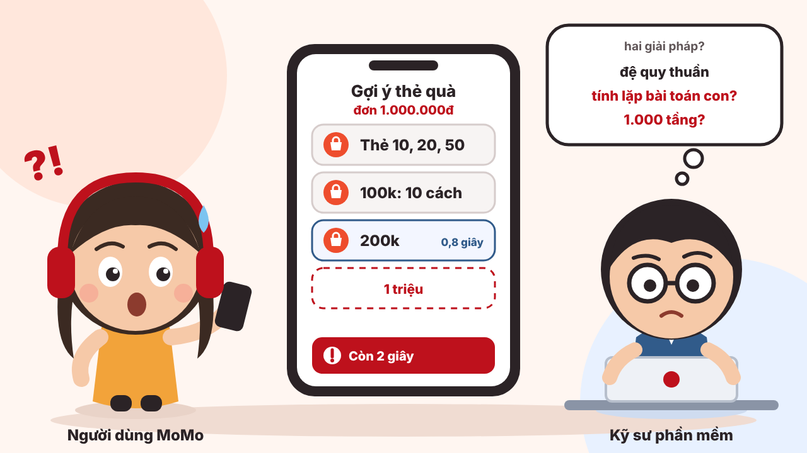

# Đếm số cách ghép thẻ quà tặng để thanh toán trên MoMo

### 1. Bối cảnh & Vấn đề



*Người dùng có nhiều thẻ quà mệnh giá khác nhau; màn hình gợi ý cần biết có bao nhiêu cách ghép đúng số tiền đơn hàng.*

Ví MoMo phát **thẻ quà tặng** nhiều mệnh giá (tính theo nghìn đồng), ví dụ thẻ 10, 20, 50. Khi người dùng thanh toán, màn hình **"Gợi ý dùng thẻ quà"** cho biết có bao nhiêu cách ghép thẻ để trả **đúng** số tiền đơn hàng, để nhóm sản phẩm chọn cách gợi ý phù hợp. Mỗi mệnh giá dùng bao nhiêu thẻ cũng được; hai cách chỉ khác thứ tự thẻ được coi là **một cách**. Ví dụ 100 nghìn đồng từ thẻ 10, 20, 50 có 10 cách, trong đó có 50 + 50, 50 + 20 + 20 + 10, 20 × 5.

Danh sách mệnh giá do hệ thống khuyến mãi gửi sang nên có thể **lặp lại** (hai chiến dịch cùng phát thẻ 20) hoặc có mệnh giá **0, âm** do lỗi cấu hình; các mệnh giá này phải bị bỏ qua.

Một bạn trong nhóm đã viết thử bằng đệ quy theo ý: xét mệnh giá thứ nhất, hoặc dùng thêm một thẻ mệnh giá đó, hoặc bỏ hẳn mệnh giá đó rồi xét các mệnh giá còn lại. Cách này cho kết quả đúng với đơn nhỏ, nhưng với thẻ 1, 2, 5, 10, 20, 50 và đơn 200 nghìn đồng đã mất gần một giây, đơn 1 triệu đồng thì không bao giờ chạy xong. Màn hình gợi ý phải trả lời trong **2 giây** với đơn tới **1.000 nghìn đồng**. Trưởng nhóm yêu cầu bạn đề xuất ít nhất hai giải pháp, đo, so sánh rồi mới chọn.

### 2. Yêu cầu nghiệp vụ

Bạn viết bốn hàm trong `the_qua.py`.

**2.1. `clean_values(values)`**

- Trả về list mệnh giá hợp lệ (số nguyên dương), mỗi mệnh giá một lần, xếp tăng dần.

**2.2. Hai hàm đếm: `count_pay_ways_v1(amount, values)` và `count_pay_ways_v2(amount, values)`**

Mỗi hàm cài một giải pháp, trả về số cách ghép đúng `amount` nghìn đồng. Hai hàm cho cùng kết quả với mọi dữ liệu nhưng **khác nhau về cách làm**.

**2.3. `pay_ways_message(amount, values)`**

Dùng giải pháp bạn chọn, trả về một trong ba thông báo (mệnh giá in theo thứ tự tăng dần, đã làm sạch):

```plaintext
Có 10 cách ghép 100 nghìn đồng từ các thẻ 10, 20, 50.
Không ghép được 35 nghìn đồng từ các thẻ hiện có.
Số tiền không hợp lệ.
```

### 3. Edge Cases (Bẫy dữ liệu)

**Bẫy 1 — Mệnh giá lặp lại.** `[50, 20, 10, 20]` cho cùng kết quả với `[10, 20, 50]`; không đếm hai lần.

**Bẫy 2 — Mệnh giá 0 hoặc âm.** `[0, -10, 20, 30]` chỉ còn thẻ 20, 30. Thẻ 0 nếu không bị loại sẽ làm số tiền không giảm sau mỗi lần dùng thẻ.

**Bẫy 3 — Không ghép được.** 35 nghìn đồng từ thẻ 10, 20: 0 cách.

**Bẫy 4 — Số tiền 0 hoặc âm.** Hai hàm đếm trả về 1 với `amount = 0` (không dùng thẻ nào) và 0 với `amount < 0`; thông báo với số tiền từ 0 trở xuống là "Số tiền không hợp lệ."

**Bẫy 5 — Đơn lớn.** 1.000 nghìn đồng từ thẻ 1, 2, 5, 10, 20, 50: thông báo trong 2 giây, không báo `RecursionError`. Lưu ý thẻ 1 nghìn đồng làm số tầng gọi đệ quy có thể lên tới 1.000.

**Kịch bản chạy thử.** Chạy `python the_qua.py` (đoạn chạy thử có sẵn ở cuối tệp) phải in ra đúng:

```plaintext
Có 10 cách ghép 100 nghìn đồng từ các thẻ 10, 20, 50.
Có 10 cách ghép 100 nghìn đồng từ các thẻ 10, 20, 50.
Không ghép được 35 nghìn đồng từ các thẻ hiện có.
Có 2 cách ghép 60 nghìn đồng từ các thẻ 20, 30.
Số tiền không hợp lệ.
Có 103119386 cách ghép 1000 nghìn đồng từ các thẻ 1, 2, 5, 10, 20, 50.
```

### 4. Yêu cầu

Với vai trò kỹ sư phần mềm, bạn phải thực hiện đầy đủ ba phần sau:

**(1) Đề xuất và phân tích nhiều giải pháp (bắt buộc, viết vào `PHAN_TICH.md`)**

- Phân tích Input/Output của các hàm: kiểu dữ liệu đầu vào, giá trị trả về trong trường hợp thường và trong từng bẫy.
- Đề xuất **ít nhất hai giải pháp** khác nhau về cách làm cho việc đếm số cách ghép. Với mỗi giải pháp: mô tả ý tưởng trong 2–3 câu, minh họa trên ví dụ ở mục 1, viết mã giả. Nếu giải pháp là đệ quy, trả lời ba câu hỏi kiểm tra (Lesson 01) và ghi độ sâu call stack lớn nhất.
- Đo thời gian hai giải pháp bằng `timeit` với thẻ 1, 2, 5, 10, 20, 50 và số tiền 50, 100, 150, 200 nghìn đồng; ghi bảng số đo, phiên bản Python và máy đo. Với giải pháp đệ quy, đếm thêm số lời gọi bằng một biến đếm (hoặc `cache_info()` nếu dùng `lru_cache`).
- So sánh các giải pháp theo bảng 5 tiêu chí: thời gian (Big-O), bộ nhớ phụ kể cả call stack (Big-O), kết quả đo, độ dễ đọc và dễ bảo trì, mức phù hợp với bối cảnh của bài.
- Chọn giải pháp dùng cho `pay_ways_message` và nêu lý do dựa trên bảng so sánh. Lựa chọn không có lý do không được tính điểm.

**(2) Chạy tay**

- Với mỗi giải pháp, chạy tay `40` nghìn đồng từ thẻ 10, 20: ghi các bài toán con được tính (hoặc các ô được điền) theo thứ tự, và chỉ ra bài toán con nào bị tính lặp lại ở giải pháp đệ quy thuần.

**(3) Triển khai code**

- Viết thân bốn hàm trong `the_qua.py`. Không đổi tên hàm, tham số.
- Không dùng `set` hay `dict` (sẽ học ở buổi bảng băm); được dùng `functools.lru_cache`.
- Xử lý đủ 5 bẫy ở mục 3; `python the_qua.py` in đúng kịch bản chạy thử; `python kiem_tra.py` đạt cả 6 mục (các mục về giải pháp chạy trên cả hai hàm `_v1`, `_v2`).
- Mã sạch, dễ đọc, tên biến theo snake_case, có chú thích nêu ý tưởng và độ phức tạp ở đầu mỗi hàm.

### 5. Quy định nộp bài

1. Tạo một kho GitHub riêng cho bài này, đặt tên theo mẫu `[Tên Lớp]_IT301_Session03_Ex13`.
2. Tải thư mục khởi đầu tại https://github.com/cuongtm191221/it301-bai-tap-ve-nha/tree/main/session-03-de-quy/bai-13 rồi chép các tệp vào kho: `the_qua.py`, `kiem_tra.py`, `PHAN_TICH.md`.
3. Điền phần phân tích vào `PHAN_TICH.md`, viết mã trong `the_qua.py`.
4. Mức AI của bài: AI-0 (tự làm, không dùng AI).
5. Đưa bài làm lên kho và nộp đường dẫn kho lên hệ thống.
