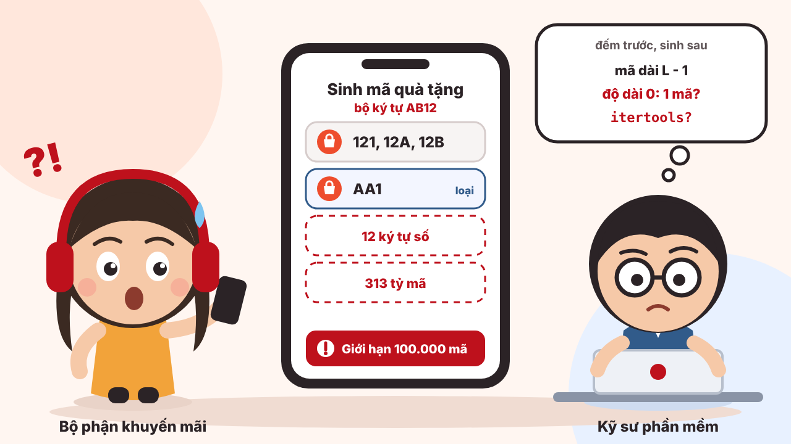

# Sinh mã quà tặng cho chiến dịch khuyến mãi MoMo

### 1. Bối cảnh & Vấn đề



*Bộ phận khuyến mãi cần sinh hàng chục nghìn mã quà tặng dễ đọc, và cần biết trước một cấu hình sinh ra bao nhiêu mã.*

Mỗi chiến dịch khuyến mãi của ví MoMo phát **mã quà tặng** để người dùng nhập khi thanh toán. Bộ phận khuyến mãi chọn một **bộ ký tự** (ví dụ `"AB12"`) và một **độ dài** (ví dụ 3); hệ thống sinh ra **mọi mã** dài đúng độ dài đó, lấy từ bộ ký tự. Để mã dễ đọc qua điện thoại, nhóm thêm quy tắc: **hai ký tự đứng cạnh nhau không được giống nhau** (`"A1A"` được, `"AA1"` không được).

Bộ ký tự do nhân viên gõ nên có thể có khoảng trắng, chữ thường, ký tự lặp lại. Số mã tăng rất nhanh theo độ dài, nên trước khi sinh, hệ thống phải **đếm** số mã của cấu hình; nếu vượt **100.000 mã** thì từ chối, không sinh (sinh hàng tỷ mã sẽ làm đầy bộ nhớ máy chủ).

Bài này tổng hợp kiến thức cả buổi: đệ quy trên số (độ dài), đệ quy sinh danh sách, chọn trường hợp cơ sở đúng, và tránh tính những thứ không cần.

### 2. Yêu cầu nghiệp vụ

Bạn viết bốn hàm trong `sinh_ma.py`.

**2.1. `clean_chars(chars)`**: list ký tự dùng để sinh mã: bỏ khoảng trắng, đổi sang chữ in hoa, mỗi ký tự một lần, xếp tăng dần.

**2.2. `count_codes(chars, length)`**: số mã dài `length` theo quy tắc trên, **tính mà không sinh mã**, viết bằng đệ quy theo độ dài (số mã dài L tính từ số mã dài L - 1).

**2.3. `generate_codes(chars, length)`**: list mọi mã, xếp tăng dần theo thứ tự từ điển, viết bằng đệ quy theo độ dài (mã dài L tạo từ các mã dài L - 1).

**2.4. `codes_message(chars, length)`**: thông báo cho bộ phận khuyến mãi:

```plaintext
Đã sinh 36 mã, ví dụ: 121, 12A, 12B
Có 313810596090 mã, vượt giới hạn 100000 mã mỗi lần sinh.
Không sinh được mã nào với cấu hình này.
Cấu hình mã không hợp lệ.
```

### 3. Edge Cases (Bẫy dữ liệu)

**Bẫy 1 — Bộ ký tự bẩn.** `" b a 1 a "` chỉ còn `["1", "A", "B"]`.

**Bẫy 2 — Độ dài 0.** Hai hàm `count_codes`, `generate_codes` coi độ dài 0 có đúng một mã là chuỗi rỗng (đây là trường hợp cơ sở tự nhiên); thông báo với độ dài từ 0 trở xuống hoặc bộ ký tự rỗng là "Cấu hình mã không hợp lệ."

**Bẫy 3 — Một ký tự, độ dài từ 2.** `"7"` độ dài 3: không có mã nào thỏa quy tắc.

**Bẫy 4 — Cấu hình rất lớn.** `"0123456789"` độ dài 12: thông báo vượt giới hạn trong 1 giây; không được sinh mã rồi mới đếm.

**Bẫy 5 — Thứ tự và tính đúng.** Với mọi độ dài từ 0 đến 4, số mã sinh ra phải đúng bằng số đếm được; mã xếp tăng dần.

**Kịch bản chạy thử.** Chạy `python sinh_ma.py` (đoạn chạy thử có sẵn ở cuối tệp) phải in ra đúng:

```plaintext
Đã sinh 36 mã, ví dụ: 121, 12A, 12B
['12', '1A', '1B', '21', '2A', '2B', 'A1', 'A2', 'AB', 'B1', 'B2', 'BA']
Đã sinh 6 mã, ví dụ: 1A, 1B, A1
Không sinh được mã nào với cấu hình này.
Có 313810596090 mã, vượt giới hạn 100000 mã mỗi lần sinh.
Cấu hình mã không hợp lệ.
Số mã dài 8 từ chữ A-Z và số 0-9: 2316214687500
```

### 4. Yêu cầu

Bạn phụ trách trọn tính năng và phải thực hiện đủ ba phần:

**(1) Phân tích và thiết kế (viết vào `PHAN_TICH.md`)**

- Input/Output của từng hàm, trong trường hợp thường và trong từng bẫy.
- Với mỗi hàm đệ quy: ba câu hỏi kiểm tra (Lesson 01) và độ sâu call stack lớn nhất trong bối cảnh của bài. Với mỗi hàm bạn chọn viết bằng vòng lặp: vì sao không dùng đệ quy.
- Lập công thức đệ quy cho số mã: số mã dài L liên hệ thế nào với số mã dài L - 1? Kiểm tra công thức với `"AB12"` độ dài 1, 2, 3 bằng cách liệt kê tay độ dài 2.
- Vẽ quá trình `generate_codes("AB1", 2)`: các mã dài 1 nhận được từ lời gọi nhỏ hơn và cách nối thêm ký tự. Vì sao thứ tự kết quả tự động tăng dần nếu bộ ký tự đã xếp tăng dần?
- Độ phức tạp: ghi Big-O thời gian và bộ nhớ của `count_codes` và `generate_codes` theo n (số ký tự) và L (độ dài). Vì sao `codes_message` phải gọi `count_codes` trước?

**(2) Triển khai code**

- Viết mã trong `sinh_ma.py`; được thêm hàm phụ; không đổi tên và tham số đã có trong khung; hàm ghi "Có sẵn" giữ nguyên.
- `count_codes` và `generate_codes` viết bằng đệ quy theo độ dài. Không dùng `itertools`.
- Xử lý đủ 5 bẫy; `python sinh_ma.py` in đúng kịch bản chạy thử; `python kiem_tra.py` đạt cả 6 mục.

**(3) Nghiên cứu mở rộng (viết vào mục cuối của `PHAN_TICH.md`)**

- Tìm hiểu hàm `itertools.product` của thư viện chuẩn: nó sinh ra gì, theo thứ tự nào, và vì sao nó trả về từng bộ một thay vì cả list.
- Tạo `nghien_cuu.py`: sinh mã bằng `itertools.product` rồi lọc theo quy tắc hai ký tự cạnh nhau, so với `generate_codes` (kết quả có giống nhau không) và đo thời gian bằng `timeit` với bộ `"0123456789"` độ dài 3, 4, 5. Mỗi cách phải xét bao nhiêu bộ ký tự? Cách nào bạn dùng cho hệ thống, vì sao?
- Được tra cứu tài liệu và hỏi AI để tìm hiểu; phải ghi nguồn và viết lại bằng lời của bạn.

### 5. Quy định nộp bài

1. Tạo một kho GitHub riêng cho bài này, đặt tên theo mẫu `[Tên Lớp]_IT301_Session03_Ex17`.
2. Tải thư mục khởi đầu tại https://github.com/cuongtm191221/it301-bai-tap-ve-nha/tree/main/session-03-de-quy/bai-17 rồi chép các tệp vào kho: `sinh_ma.py`, `kiem_tra.py`, `PHAN_TICH.md`.
3. Viết mã trong `sinh_ma.py`, điền phần phân tích và phần nghiên cứu mở rộng vào `PHAN_TICH.md`. Tạo thêm `nghien_cuu.py` cho phần nghiên cứu.
4. Mức AI của bài: AI-0 cho phần phân tích và mã chính (tự làm, không dùng AI); AI-1 cho phần nghiên cứu mở rộng (được hỏi AI để tìm hiểu, phải ghi nguồn và tự kiểm chứng).
5. Đưa bài làm lên kho và nộp đường dẫn kho lên hệ thống.
