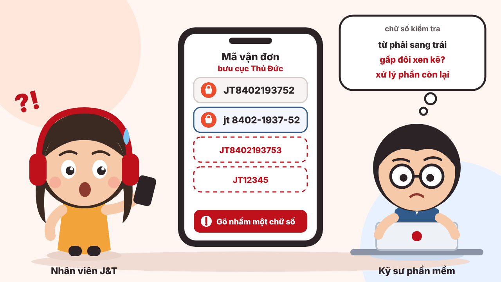

# Hệ thống kiểm tra mã vận đơn của J&T Express

### 1. Bối cảnh & Vấn đề



*Nhân viên J&T Express nhập mã vận đơn tại bưu cục*

Ở bưu cục **J&T Express** Thủ Đức, nhân viên gõ tay mã vận đơn khi máy quét hỏng, nên hay gõ thừa dấu cách, gạch ngang, chữ thường, hoặc gõ nhầm một chữ số. Mã vận đơn gồm `JT` và 10 chữ số; **chữ số cuối là chữ số kiểm tra** theo thuật toán Luhn (thuật toán cũng dùng cho số thẻ ngân hàng):

```plaintext
Đi từ chữ số cuối sang trái, gấp đôi các chữ số ở vị trí thứ 2, 4, 6...
(gấp đôi được số lớn hơn 9 thì trừ 9), cộng tất cả lại.
Mã đúng khi tổng chia hết cho 10.          Ví dụ JT8402193752: tổng 40, mã đúng.
```

Bưu cục cần kiểm tra một mã, tính chữ số kiểm tra khi in mã mới, nhận đơn, và lọc mã sai trong lô mã đối tác gửi sang. Mọi xử lý chuỗi và lô mã viết bằng **đệ quy**, không vòng lặp.

Bạn xây dựng module **"J&T Waybill Check CLI"**.

### 2. Yêu cầu nghiệp vụ

Dữ liệu mẫu: `make_parcels()` trả về 3 đơn đã nhận (xem `van_don.py`).

**Chức năng 1 — Kiểm tra mã vận đơn** (menu phụ): `1` kiểm tra một mã (`Mã <mã> hợp lệ.` hoặc `Mã <mã> sai chữ số kiểm tra.`); `2` nhập 9 chữ số đầu, in `Mã đầy đủ: JT<10 chữ số>`.

**Chức năng 2 — Nhận đơn.** Nhập mã và người nhận; mã phải đúng dạng, đúng chữ số kiểm tra, chưa nhận.

**Chức năng 3 — Kiểm tra lô mã của đối tác.** Nhập các mã cách nhau bởi dấu phẩy; in `Hợp lệ <a>/<n> mã.` và `Mã sai: ...` (giữ thứ tự).

**Chức năng 4 — Xem đơn đã nhận. Chức năng 5 — Thoát.**

Các hàm `clean` (không dùng `replace`), `luhn_sum`, `invalid_codes` viết bằng đệ quy, không vòng lặp.

Màn hình mẫu (đoạn đầu; phím gõ vào hiện sau dấu hai chấm, `[menu chính]` là menu được in lại):

```plaintext
===== J&T EXPRESS - BƯU CỤC THỦ ĐỨC =====
1. Kiểm tra mã vận đơn
2. Nhận đơn
3. Kiểm tra lô mã của đối tác
4. Xem đơn đã nhận
5. Thoát
Chọn chức năng (1-5): 1
1. Kiểm tra một mã  2. Tính chữ số kiểm tra
Chọn: 1
Mã vận đơn: jt 8402-1937-52
Mã JT8402193752 hợp lệ.

[menu chính]
Chọn chức năng (1-5): 1
1. Kiểm tra một mã  2. Tính chữ số kiểm tra
Chọn: 1
Mã vận đơn: JT8402193753
Mã JT8402193753 sai chữ số kiểm tra.

[menu chính]
Chọn chức năng (1-5): 1
1. Kiểm tra một mã  2. Tính chữ số kiểm tra
Chọn: 2
9 chữ số đầu: 260455901
Mã đầy đủ: JT2604559019

[... các lượt sau: thêm dữ liệu sai, nhập menu sai, thoát ...]
```

### 3. Edge Cases (Bẫy dữ liệu)

**Bẫy 1 — Mã gõ không chuẩn.** `jt 8402-1937-52` là `JT8402193752`.

**Bẫy 2 — Sai dạng, sai chữ số kiểm tra.** Thiếu, thừa chữ số, không bắt đầu bằng `JT`, có chữ cái trong phần số: `Lỗi: Mã vận đơn phải gồm JT và 10 chữ số`; đúng dạng nhưng sai chữ số cuối: `Mã vận đơn sai chữ số kiểm tra`.

**Bẫy 3 — Chuỗi rỗng, lô rỗng.** `clean("")` là `""`; lô không có mã sai thì không in dòng `Mã sai`.

**Bẫy 4 — Nhận trùng, thiếu người nhận.** Đúng thông báo trong docstring của `receive`.

**Bẫy 5 — Menu sai.** Menu phụ: `Lựa chọn không hợp lệ.`; menu chính: `Lựa chọn không hợp lệ, vui lòng nhập số từ 1 đến 5.`

### 4. Yêu cầu

**(1) Phân tích và thiết kế (viết vào `PHAN_TICH.md`)**

- Input/Output của từng chức năng, trong trường hợp thường và trong từng bẫy; luồng chương trình (mã giả hoặc các bước).
- Với `clean`, `luhn_sum`, `invalid_codes`: trường hợp cơ sở, bước đệ quy, vì sao dừng; chạy tay `luhn_sum("8402193752", False)` từng tầng (chữ số, có gấp đôi không, giá trị cộng).
- Mỗi lời gọi `text[1:]` tạo chuỗi mới: tổng số ký tự phải chép khi `clean` một chuỗi n ký tự là bao nhiêu, Big-O?

**(2) Triển khai code**

- Viết các hàm trong `van_don.py` (giữ tên, tham số; hàm "Có sẵn" giữ nguyên) và chương trình menu trong `main.py`. Hàm nghiệp vụ không gọi `input()`, `print()`.
- Thông báo đúng từng chữ như đề; không dừng vì lỗi ở bất kỳ thao tác nào; tên biến snake_case, có chú thích.
- `python kiem_tra.py` đạt cả 7 mục (mục cuối tự chạy `main.py`, gõ một loạt lựa chọn có cả dữ liệu sai, và kiểm tra các thông báo của đề).

### 5. Quy định nộp bài

1. Tạo kho GitHub riêng, đặt tên `[Tên Lớp]_IT301_Session04_TH03`. Tải thư mục khởi đầu tại https://github.com/cuongtm191221/it301-bai-tap-ve-nha/tree/main/session-04-thuc-hanh-cli/bai-03 rồi chép các tệp vào kho: `van_don.py`, `main.py`, `kiem_tra.py`, `PHAN_TICH.md`.
2. Mức AI: AI-0 (tự làm, không dùng AI).
3. Đưa bài làm lên kho và nộp đường dẫn kho lên hệ thống.
