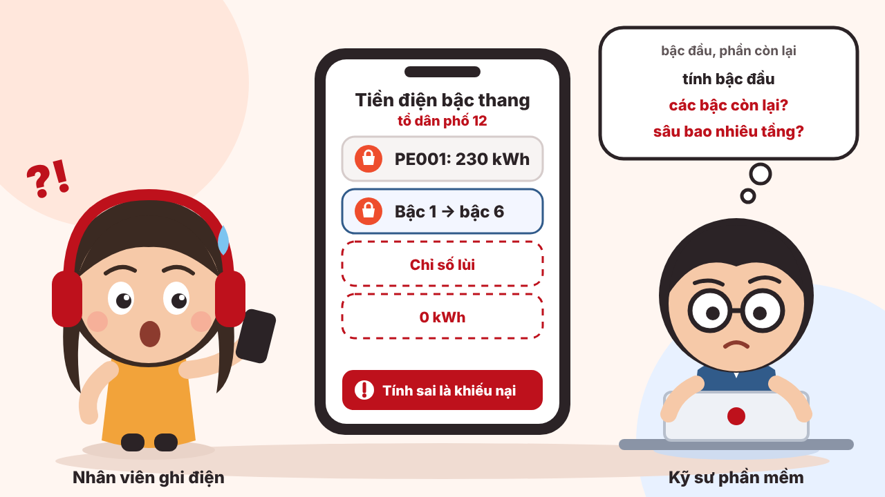

# Hệ thống tính tiền điện bậc thang cho tổ dân phố của EVN Hà Nội

### 1. Bối cảnh & Vấn đề



*Nhân viên ghi điện EVN tính tiền điện cho tổ dân phố*

Cuối tháng, nhân viên ghi điện của **EVN Hà Nội** ghi chỉ số công tơ của từng hộ trong tổ dân phố 12. Mỗi hộ là `[mã khách hàng, tên chủ hộ, chỉ số cũ, chỉ số mới]`; điện tiêu thụ là chỉ số mới trừ chỉ số cũ. Tiền điện tính **bậc thang**: 50 kWh đầu giá bậc 1, 50 kWh tiếp giá bậc 2..., phần vượt 400 kWh tính giá bậc 6. Bảng giá (minh họa, chưa gồm VAT) có sẵn trong mã:

```python
TIERS = [(50, 1893), (50, 1956), (100, 2271), (100, 2860), (100, 3197), (None, 3302)]
```

Cách tính có cấu trúc lặp lại: tính bậc đầu, phần còn lại tính tiếp với các bậc còn lại; nên nhóm phát triển yêu cầu viết bằng **đệ quy**, không vòng lặp. Ví dụ 230 kWh: 50 × 1.893 + 50 × 1.956 + 100 × 2.271 + 30 × 2.860 = 505.350đ.

Bạn xây dựng module **"EVN Neighborhood Billing CLI"**.

### 2. Yêu cầu nghiệp vụ

Dữ liệu mẫu: `make_customers()` trả về 4 hộ `PE001` đến `PE004` (xem `tien_dien.py`).

**Chức năng 1 — Xem tiền điện** (menu phụ): `1` mọi hộ kèm kWh và tiền; `2` chi tiết từng bậc của một hộ (`Bậc <i>: <kWh> kWh = <tiền>`; không dùng điện in `Tháng này không dùng điện.`).

**Chức năng 2 — Ghi chỉ số mới.** Nhập mã khách hàng và chỉ số mới; in `Đã ghi <mã>: <kWh> kWh, <tiền>.`

**Chức năng 3 — Tổng tiền cả tổ. Chức năng 4 — Hộ dùng nhiều điện nhất** (bằng nhau lấy hộ đứng trước, không dùng `max()`). **Chức năng 5 — Thoát.**

Các hàm `bill`, `breakdown`, `total_bill`, `top_user` viết bằng đệ quy, không vòng lặp, không làm đổi dữ liệu.

Màn hình mẫu (đoạn đầu; phím gõ vào hiện sau dấu hai chấm, `[menu chính]` là menu được in lại):

```plaintext
===== EVN HÀ NỘI - TIỀN ĐIỆN TỔ DÂN PHỐ 12 =====
1. Xem tiền điện
2. Ghi chỉ số mới
3. Tổng tiền cả tổ
4. Hộ dùng nhiều điện nhất
5. Thoát
Chọn chức năng (1-5): 1
1. Tất cả các hộ  2. Chi tiết bậc của một hộ
Chọn cách xem: 1
PE001 | Nguyễn Văn Hòa | 230 kWh | 505.350đ
PE002 | Trần Thị Lan | 40 kWh | 75.720đ
PE003 | Lê Minh Tâm | 400 kWh | 1.025.250đ
PE004 | Đỗ Khánh Vy | 0 kWh | 0đ

[menu chính]
Chọn chức năng (1-5): 1
1. Tất cả các hộ  2. Chi tiết bậc của một hộ
Chọn cách xem: 2
Mã khách hàng: pe004
Tháng này không dùng điện.

[menu chính]
Chọn chức năng (1-5): 1
1. Tất cả các hộ  2. Chi tiết bậc của một hộ
Chọn cách xem: 2
Mã khách hàng: pe001
Bậc 1: 50 kWh = 94.650đ
Bậc 2: 50 kWh = 97.800đ
Bậc 3: 100 kWh = 227.100đ
Bậc 4: 30 kWh = 85.800đ

[... các lượt sau: thêm dữ liệu sai, nhập menu sai, thoát ...]
```

### 3. Edge Cases (Bẫy dữ liệu)

**Bẫy 1 — Ranh giới bậc.** 50 kWh chỉ tính bậc 1; 51 kWh có 1 kWh bậc 2; trên 400 kWh dùng bậc cuối không giới hạn.

**Bẫy 2 — Không dùng điện.** 0 kWh: tiền 0đ, không có bậc nào.

**Bẫy 3 — Chỉ số sai.** Mã không có, chỉ số không phải số nguyên không âm, chỉ số mới nhỏ hơn chỉ số cũ: đúng thông báo trong docstring của `update_reading`, dữ liệu giữ nguyên.

**Bẫy 4 — Menu sai.** Menu phụ: `Lựa chọn không hợp lệ.`; menu chính: `Lựa chọn không hợp lệ, vui lòng nhập số từ 1 đến 5.`

### 4. Yêu cầu

**(1) Phân tích và thiết kế (viết vào `PHAN_TICH.md`)**

- Input/Output của từng chức năng, trong trường hợp thường và trong từng bẫy; luồng chương trình (mã giả hoặc các bước).
- Với `bill`, `breakdown`, `total_bill`, `top_user`: trường hợp cơ sở, bước đệ quy, vì sao dừng; chạy tay `bill(230, TIERS)` từng tầng.
- Độ sâu đệ quy của `bill` phụ thuộc vào gì (số kWh hay số bậc)? Của `total_bill`? Tổ có 2.000 hộ thì sao?

**(2) Triển khai code**

- Viết các hàm trong `tien_dien.py` (giữ tên, tham số; hàm "Có sẵn" giữ nguyên) và chương trình menu trong `main.py`. Hàm nghiệp vụ không gọi `input()`, `print()`.
- Thông báo đúng từng chữ như đề; không dừng vì lỗi ở bất kỳ thao tác nào; tên biến snake_case, có chú thích.
- `python kiem_tra.py` đạt cả 6 mục (mục cuối tự chạy `main.py`, gõ một loạt lựa chọn có cả dữ liệu sai, và kiểm tra các thông báo của đề).

### 5. Quy định nộp bài

1. Tạo kho GitHub riêng, đặt tên `[Tên Lớp]_IT301_Session04_TH04`. Tải thư mục khởi đầu tại https://github.com/cuongtm191221/it301-bai-tap-ve-nha/tree/main/session-04-thuc-hanh-cli/bai-04 rồi chép các tệp vào kho: `tien_dien.py`, `main.py`, `kiem_tra.py`, `PHAN_TICH.md`.
2. Mức AI: AI-0 (tự làm, không dùng AI).
3. Đưa bài làm lên kho và nộp đường dẫn kho lên hệ thống.
