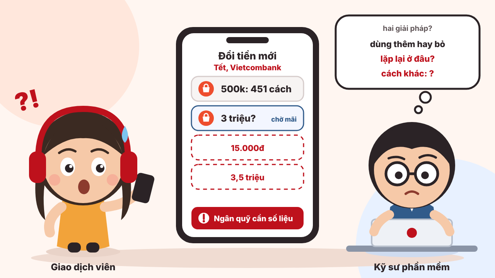

# Hệ thống quầy đổi tiền mới dịp Tết của Vietcombank

### 1. Bối cảnh & Vấn đề



*Giao dịch viên Vietcombank đổi tiền mới dịp Tết*

Dịp Tết, quầy **Vietcombank** Hoàn Kiếm đổi tiền mới mệnh giá 500.000đ, 200.000đ, 100.000đ, 50.000đ, 20.000đ, 10.000đ cho khách mừng tuổi. Khách đổi một số tiền là bội của 10.000đ, tối đa 3.000.000đ. Quầy cần hai thông tin: **phương án ít tờ nhất** (để chuẩn bị tiền nhanh) và **có bao nhiêu cách đổi** (bộ phận ngân quỹ dùng để ước lượng nhu cầu từng mệnh giá; hai cách có cùng số tờ mỗi mệnh giá là một cách).

Bản đếm số cách hiện tại viết bằng đệ quy: với mệnh giá đang xét, hoặc dùng thêm một tờ, hoặc bỏ hẳn mệnh giá đó. Đổi 500.000đ có kết quả ngay, đổi 3.000.000đ thì chờ rất lâu. Trưởng quầy yêu cầu một giải pháp khác, chứng minh bằng số đo và phân tích.

Bạn xây dựng module **"Vietcombank Tet Exchange CLI"**.

### 2. Yêu cầu nghiệp vụ

**Chức năng 1 — Phương án ít tờ nhất.** `fewest_notes` (đệ quy trên các mệnh giá, không vòng lặp): lấy nhiều nhất có thể tờ lớn rồi đổi phần còn lại; in `Đổi: <k> tờ <mệnh giá>, ...` (bỏ mệnh giá 0 tờ); ghi vào lịch sử phiên.

**Chức năng 2 — Số cách đổi** (menu phụ chọn giải pháp). `count_ways_v1` (đệ quy) và `count_ways_v2` cho **cùng kết quả**, **khác nhau về cách làm**; giải pháp 2 tính 3.000.000đ trong 1 giây. In `Có <k> cách đổi <tiền>.`

**Chức năng 3 — Lịch sử đổi trong phiên. Chức năng 4 — Đo** hai giải pháp với 500.000đ, 1.000.000đ, 1.500.000đ. **Chức năng 5 — Thoát.**

Màn hình mẫu (đoạn đầu; phím gõ vào hiện sau dấu hai chấm, `[menu chính]` là menu được in lại):

```plaintext
===== VIETCOMBANK HOÀN KIẾM - ĐỔI TIỀN MỚI =====
1. Phương án ít tờ nhất
2. Số cách đổi
3. Lịch sử đổi trong phiên
4. Đo so sánh hai giải pháp
5. Thoát
Chọn chức năng (1-5): 3
Chưa có lượt đổi nào.

[menu chính]
Chọn chức năng (1-5): 1
Số tiền đổi (đồng): 1780000
Đổi: 3 tờ 500.000đ, 1 tờ 200.000đ, 1 tờ 50.000đ, 1 tờ 20.000đ, 1 tờ 10.000đ

[menu chính]
Chọn chức năng (1-5): 2
1. Giải pháp 1  2. Giải pháp 2
Chọn giải pháp: 1
Số tiền đổi (đồng): 500000
Có 451 cách đổi 500.000đ.

[... các lượt sau: thêm dữ liệu sai, nhập menu sai, thoát ...]
```

Chức năng 4 in dạng sau (số đo trên máy soạn đề, Python 3.10):

```plaintext
số tiền | giải pháp 1 (ms) | giải pháp 2 (ms)
500.000đ | 1.0 | 0.03
1.000.000đ | 16.2 | 0.06
1.500.000đ | 108.2 | 0.09
```

### 3. Edge Cases (Bẫy dữ liệu)

**Bẫy 1 — Trường hợp cơ sở.** 10.000đ có 1 cách; 20.000đ có 2 cách (một tờ 20.000đ, hai tờ 10.000đ).

**Bẫy 2 — Thứ tự đưa tờ không tạo cách mới.** 30.000đ = 20.000 + 10.000 = 10.000 + 20.000 chỉ là một cách.

**Bẫy 3 — Số tiền sai.** Không phải bội của 10.000, ngoài 10.000–3.000.000, không phải số nguyên: `Lỗi: Số tiền phải là bội của 10.000đ, từ 10.000đ đến 3.000.000đ`.

**Bẫy 4 — Số lớn.** 3.000.000đ có 393.119 cách; giải pháp 2 trong 1 giây, không `RecursionError`, không tăng giới hạn đệ quy.

**Bẫy 5 — Menu sai.** Menu phụ: `Lựa chọn không hợp lệ.`; menu chính: `Lựa chọn không hợp lệ, vui lòng nhập số từ 1 đến 5.`

### 4. Yêu cầu

**(1) Phân tích và thiết kế (viết vào `PHAN_TICH.md`)**

- Input/Output của từng chức năng, trong trường hợp thường và trong từng bẫy; luồng chương trình (mã giả hoặc các bước).
- Đề xuất ít nhất hai giải pháp đếm số cách đổi khác nhau (ý tưởng, cây lời gọi với 50.000đ, mã giả); giải thích vì sao giải pháp 1 chậm (lời gọi nào lặp lại).
- Bảng so sánh 5 tiêu chí (tốc độ, bộ nhớ phụ, độ sâu đệ quy, độ dễ đọc, phù hợp bối cảnh) kèm số đo chức năng 4 trên máy bạn; chọn giải pháp và giải thích.

**(2) Triển khai code**

- Viết các hàm trong `doi_tien.py` (giữ tên, tham số; hàm "Có sẵn" giữ nguyên) và chương trình menu trong `main.py`. Hàm nghiệp vụ không gọi `input()`, `print()`.
- Thông báo đúng từng chữ như đề; không dừng vì lỗi ở bất kỳ thao tác nào; tên biến snake_case, có chú thích.
- `python kiem_tra.py` đạt cả 7 mục (mục cuối tự chạy `main.py`, gõ một loạt lựa chọn có cả dữ liệu sai, và kiểm tra các thông báo của đề).

### 5. Quy định nộp bài

1. Tạo kho GitHub riêng, đặt tên `[Tên Lớp]_IT301_Session04_TH07`. Tải thư mục khởi đầu tại https://github.com/cuongtm191221/it301-bai-tap-ve-nha/tree/main/session-04-thuc-hanh-cli/bai-07 rồi chép các tệp vào kho: `doi_tien.py`, `main.py`, `kiem_tra.py`, `PHAN_TICH.md`.
2. Mức AI: AI-0 (tự làm, không dùng AI).
3. Đưa bài làm lên kho và nộp đường dẫn kho lên hệ thống.
