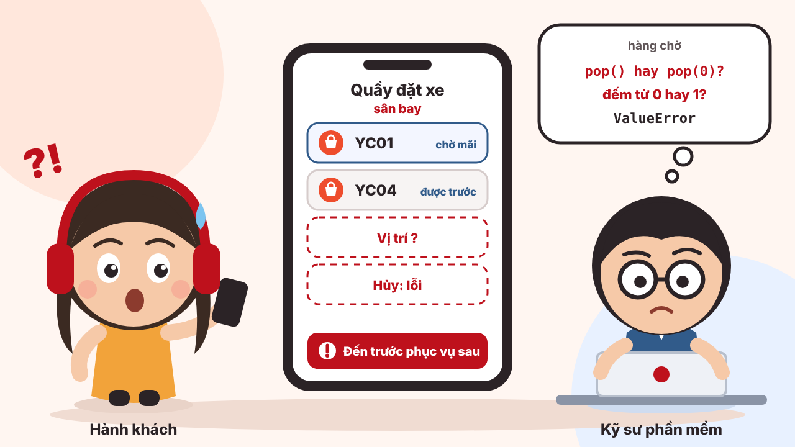

# Lỗi hàng chờ đặt xe GrabCar tại sân bay

### 1. Bối cảnh nghiệp vụ



*Hành khách đến trước lại bị phục vụ sau cùng, hỏi vị trí trong hàng thì ứng dụng báo lỗi.*

Bạn là kỹ sư phần mềm trong nhóm vận hành điểm đón sân bay Tân Sơn Nhất của Grab.

Hành khách xếp hàng **đặt xe** tại quầy; mỗi yêu cầu có một mã (`YC01`, `YC02`...). Quy định: **ai đặt trước được phục vụ trước**. Lớp `RideQueue` có các thao tác:

- `join(code)`: thêm yêu cầu vào cuối hàng.
- `serve()`: trả mã yêu cầu được phục vụ tiếp theo và xóa khỏi hàng; hàng rỗng trả `None`.
- `position(code)`: **số thứ tự** của yêu cầu trong hàng, **đếm từ 1** (người đứng đầu là 1); không có mã đó trả `None`.
- `cancel(code)`: hủy yêu cầu; trả `True` nếu hủy được, `False` nếu không có mã đó.
- `size()`: số yêu cầu đang chờ.

Màn hình ở quầy hiện "Bạn đứng thứ N" cho hành khách hỏi; hành khách đổi ý thì bấm hủy. Giờ cao điểm hàng có vài trăm người, nên mọi thao tác không được làm sập màn hình.

Mỗi lần màn hình hiện sai số thứ tự, hành khách lên quầy hỏi lại và hàng càng ùn. Ban quản lý sân bay đã nhắc nhở Grab về tình trạng chen hàng ở khu đón, nên nhóm cần bản sửa ngay trong tuần.

Kịch bản kiểm tra (đoạn cuối tệp): bốn yêu cầu vào hàng; phục vụ hai lượt; hỏi vị trí của YC04 và YC09; hủy YC03 và YC09; phục vụ thêm hai lượt.

Kết quả đúng cần hiển thị:

```plaintext
Phục vụ: YC01 YC02
Vị trí của YC04: 2
Vị trí của YC09: None
Hủy YC03: True | hủy YC09: False
Phục vụ: YC04 | tiếp: None | còn lại: 0
```

### 2. Vấn đề hiện tại

Nhân viên quầy phản ánh:

- Hành khách **đặt sau cùng lại được phục vụ trước**; người đặt đầu tiên chờ mãi.
- Hỏi vị trí của một mã thì màn hình hiện số nhỏ hơn thực tế một đơn vị, hoặc báo lỗi `ValueError`.
- Bấm hủy một mã đã được phục vụ thì màn hình báo lỗi; phục vụ khi hàng đã hết cũng báo lỗi.

Nhắc lại kiến thức (Lesson 03):

- `pop()` lấy phần tử **cuối**, O(1); `pop(0)` lấy phần tử **đầu**, dồn n − 1 tham chiếu sang trái, O(n).
- `in`, `index` xét từ đầu và dừng ở lần gặp đầu; `index` và `remove` báo `ValueError` khi không có giá trị. Muốn trả `None` hoặc `False` thì phải kiểm tra trước (hoặc bắt lỗi).
- Chỉ số của list đếm từ 0, còn "số thứ tự" nói với người dùng đếm từ 1.
- Chọn cấu trúc cho hàng chờ là cân nhắc chi phí của thao tác dùng nhiều nhất (Lesson 03, mục 3.1).

### 3. Mã nguồn hiện tại (Legacy Code)

Toàn bộ tệp `hang_cho.py` trong thư mục khởi đầu (đoạn cuối tệp là kịch bản chạy thử):

```python
"""Hàng chờ yêu cầu đặt xe GrabCar tại sân bay."""
class RideQueue:
    # Hàng chờ yêu cầu đặt xe: ai đặt trước được phục vụ trước.
    # serve() trả mã yêu cầu được phục vụ, hàng rỗng trả None.
    # position(code) là số thứ tự trong hàng, đếm từ 1; không có trả None.
    # cancel(code) trả True nếu hủy được, False nếu không có mã đó.
    def __init__(self):
        self._items = []

    def join(self, code):
        self._items.append(code)

    def serve(self):
        return self._items.pop()

    def position(self, code):
        return self._items.index(code)

    def cancel(self, code):
        self._items.remove(code)
        return True

    def size(self):
        return len(self._items)


q = RideQueue()
for code in ("YC01", "YC02", "YC03", "YC04"):
    q.join(code)
print("Phục vụ:", q.serve(), q.serve())
print("Vị trí của YC04:", q.position("YC04"))
print("Vị trí của YC09:", q.position("YC09"))
print("Hủy YC03:", q.cancel("YC03"), "| hủy YC09:", q.cancel("YC09"))
print("Phục vụ:", q.serve(), "| tiếp:", q.serve(), "| còn lại:", q.size())
```

Kết quả hiển thị trên Console:

```plaintext
Phục vụ: YC04 YC03
Traceback (most recent call last):
  ...
    return self._items.index(code)
ValueError: 'YC04' is not in list
```

Đối chiếu với kết quả đúng: hai lượt phục vụ đầu ra YC04, YC03 (người đến sau cùng); hỏi vị trí YC04 gây `ValueError` vì YC04 đã bị phục vụ, nên các dòng sau không được in.

### 4. Yêu cầu

Với vai trò kỹ sư phần mềm của nhóm, hãy thực hiện:

**(1) Phân tích lỗi** (trả lời vào `PHAN_TICH.md`)

- Chạy tay kịch bản với mã hiện tại: ghi nội dung hàng sau mỗi thao tác cho tới dòng gây lỗi. Thao tác nào làm sai thứ tự phục vụ?
- Viết lại `serve` theo quy định. Thao tác list bạn dùng có Big-O là gì? Với hàng 300 người thì sao, với 200.000 người thì sao?
- Vì sao `position` trả về số nhỏ hơn thực tế một đơn vị? Khi mã không có trong hàng thì chuyện gì xảy ra?
- `cancel` báo lỗi khi nào? Sửa thế nào để trả `False`?
- Trong `position` và `cancel` bản sửa, mỗi thao tác xét bao nhiêu phần tử trong trường hợp xấu nhất?
- Ghi bốn bộ dữ liệu thử: hàng rỗng, hủy mã không có, mã đứng đầu, mã đứng cuối; kèm kết quả mong đợi.

**(2) Sửa lỗi**

- Sửa lớp `RideQueue` trong `hang_cho.py`. Không đổi tên lớp, phương thức, tham số và dạng giá trị trả về.
- Chạy `python hang_cho.py` phải in đúng phần "Kết quả đúng cần hiển thị" ở mục 1.
- Chạy `pytest -q` phải xanh cả 4 test.

### 5. Quy định nộp bài

1. Tạo một kho GitHub riêng cho bài này, đặt tên theo mẫu `[Tên Lớp]_IT301_Session05_Ex03`.
2. Tải thư mục khởi đầu tại https://github.com/cuongtm191221/it301-bai-tap-ve-nha/tree/main/session-05-mang-va-danh-sach-dong/bai-03 rồi chép các tệp vào kho: `hang_cho.py`, `test_hang_cho.py`, `PHAN_TICH.md`.
3. Điền phần phân tích vào `PHAN_TICH.md`, sửa mã trong `hang_cho.py`.
4. Mức AI của bài: AI-0 (tự làm, không dùng AI).
5. Đưa bài làm lên kho và nộp đường dẫn kho lên hệ thống.
