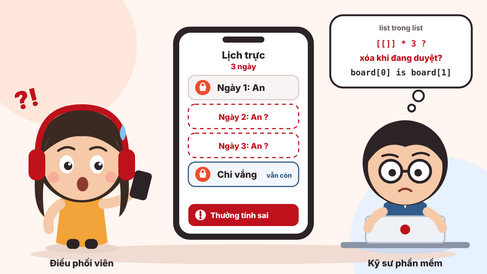

# Lỗi lịch trực tài xế GrabBike tại điểm đón

### 1. Bối cảnh nghiệp vụ



*Xếp An trực ngày đầu thì An có tên trong cả ba ngày; xóa hai tài xế vắng liền nhau thì một người vẫn còn.*

Bạn là kỹ sư phần mềm trong nhóm điều phối tài xế của Grab tại một điểm đón lớn.

Điểm đón có **lịch trực** nhiều ngày; mỗi ngày là một list tên tài xế. Nhóm viết bốn hàm:

- `make_board(days)`: tạo lịch trống `days` ngày, **mỗi ngày một list riêng**.
- `assign(board, day, driver)`: xếp tài xế vào ngày `day` (chỉ số từ 0).
- `count_shifts(board, driver)`: số ca trực của tài xế trong cả lịch.
- `remove_absent(drivers, absent)`: xóa **tại chỗ** khỏi list `drivers` mọi tài xế có tên trong `absent`, giữ thứ tự những người còn lại. List `drivers` được màn hình điều phối dùng chung, nên phải sửa chính list đó chứ không trả về list mới.

Ví dụ lịch 3 ngày, xếp An ngày đầu và Bình ngày thứ hai: `[["An"], ["Bình"], []]`. Lịch trực dùng để tính thưởng chuyên cần cuối tháng, nên đếm ca sai là trả thưởng sai.

Danh sách tài xế đang trực còn được dùng để chia cuốc xe: tài xế vắng mà vẫn còn trong danh sách sẽ được giao cuốc, khách chờ không có xe tới và cuốc bị hủy. Bộ phận điều phối cần bản sửa trước kỳ tính thưởng cuối tháng.

Kịch bản kiểm tra (đoạn cuối tệp): tạo lịch 3 ngày, xếp hai tài xế, in lịch và số ca của An; xóa hai tài xế vắng (Bình và Chi, đứng liền nhau) khỏi danh sách đang trực.

Kết quả đúng cần hiển thị:

```plaintext
Lịch 3 ngày: [['An'], ['Bình'], []]
Số ca của An: 1
Tài xế còn trực: ['An', 'Dũng', 'Em']
```

### 2. Vấn đề hiện tại

Bộ phận điều phối phản ánh:

- Xếp An trực **một** ngày thì lịch hiện An ở **cả ba** ngày, và An được tính 3 ca.
- Báo vắng Bình và Chi thì Bình bị xóa nhưng **Chi vẫn còn** trong danh sách trực.

Nhắc lại kiến thức (Lesson 03):

- `[[]] * k` tạo một list ngoài có k tham chiếu tới **cùng một** list con: sửa một "ngày" là sửa tất cả. Mỗi phần tử phải là một list con mới.
- Xóa phần tử khỏi chính list đang duyệt làm các phần tử phía sau dồn trái một ô, trong khi vòng lặp vẫn tiến tới chỉ số kế tiếp: phần tử ngay sau phần tử bị xóa bị bỏ qua.
- `remove` xóa lần khớp đầu và dịch phần sau, O(n); gọi trong vòng lặp có thể thành O(n²).
- `a[:] = b` thay toàn bộ nội dung của chính list a, mọi nơi đang giữ a đều thấy nội dung mới.

### 3. Mã nguồn hiện tại (Legacy Code)

Toàn bộ tệp `lich_truc.py` trong thư mục khởi đầu (đoạn cuối tệp là kịch bản chạy thử):

```python
"""Lịch trực và danh sách tài xế GrabBike của một điểm đón."""
def make_board(days):
    # Lịch trực: mỗi ngày một list tài xế riêng.
    return [[]] * days


def assign(board, day, driver):
    board[day].append(driver)


def count_shifts(board, driver):
    total = 0
    for day in board:
        total += day.count(driver)
    return total


def remove_absent(drivers, absent):
    # Xóa tại chỗ khỏi drivers mọi tài xế có tên trong absent, giữ thứ tự những người còn lại.
    for name in drivers:
        if name in absent:
            drivers.remove(name)


board = make_board(3)
assign(board, 0, "An")
assign(board, 1, "Bình")
print("Lịch 3 ngày:", board)
print("Số ca của An:", count_shifts(board, "An"))
drivers = ["An", "Bình", "Chi", "Dũng", "Em"]
remove_absent(drivers, ["Bình", "Chi"])
print("Tài xế còn trực:", drivers)
```

Kết quả hiển thị trên Console:

```plaintext
Lịch 3 ngày: [['An', 'Bình'], ['An', 'Bình'], ['An', 'Bình']]
Số ca của An: 3
Tài xế còn trực: ['An', 'Chi', 'Dũng', 'Em']
```

Đối chiếu với kết quả đúng: cả ba ngày đều có An và Bình; An có 3 ca thay vì 1; Chi vẫn còn trong danh sách trực.

### 4. Yêu cầu

Với vai trò kỹ sư phần mềm của nhóm, hãy thực hiện:

**(1) Phân tích lỗi** (trả lời vào `PHAN_TICH.md`)

- Vẽ sơ đồ tham chiếu của `make_board(3)` trong mã hiện tại: list ngoài có mấy ô, các ô trỏ tới mấy list con? Kiểm chứng bằng `board[0] is board[1]`.
- Viết lại `make_board` để mỗi ngày là một list riêng; kiểm chứng lại bằng `is`.
- Chạy tay `remove_absent(["An", "Bình", "Chi", "Dũng", "Em"], ["Bình", "Chi"])` của mã hiện tại: ghi chỉ số vòng lặp đang xét và nội dung list sau mỗi lượt. Vì sao Chi bị bỏ qua?
- Với danh sách `["An", "An", "Bình", "An"]` và vắng An, mã hiện tại cho kết quả gì?
- Sửa `remove_absent` để vẫn sửa **chính list** được truyền vào. Kiểm chứng bằng `is` trước và sau khi gọi. Ghi Big-O của bản sửa.
- Ghi bốn bộ dữ liệu thử: vắng hai người liền nhau, tên trùng nhiều lần, không ai vắng, cả danh sách vắng; kèm kết quả mong đợi.

**(2) Sửa lỗi**

- Sửa `make_board` và `remove_absent` trong `lich_truc.py`. Không đổi tên hàm, tham số; `remove_absent` vẫn sửa tại chỗ và không trả về list mới.
- Chạy `python lich_truc.py` phải in đúng phần "Kết quả đúng cần hiển thị" ở mục 1.
- Chạy `pytest -q` phải xanh cả 4 test.

### 5. Quy định nộp bài

1. Tạo một kho GitHub riêng cho bài này, đặt tên theo mẫu `[Tên Lớp]_IT301_Session05_Ex04`.
2. Tải thư mục khởi đầu tại https://github.com/cuongtm191221/it301-bai-tap-ve-nha/tree/main/session-05-mang-va-danh-sach-dong/bai-04 rồi chép các tệp vào kho: `lich_truc.py`, `test_lich_truc.py`, `PHAN_TICH.md`.
3. Điền phần phân tích vào `PHAN_TICH.md`, sửa mã trong `lich_truc.py`.
4. Mức AI của bài: AI-0 (tự làm, không dùng AI).
5. Đưa bài làm lên kho và nộp đường dẫn kho lên hệ thống.
