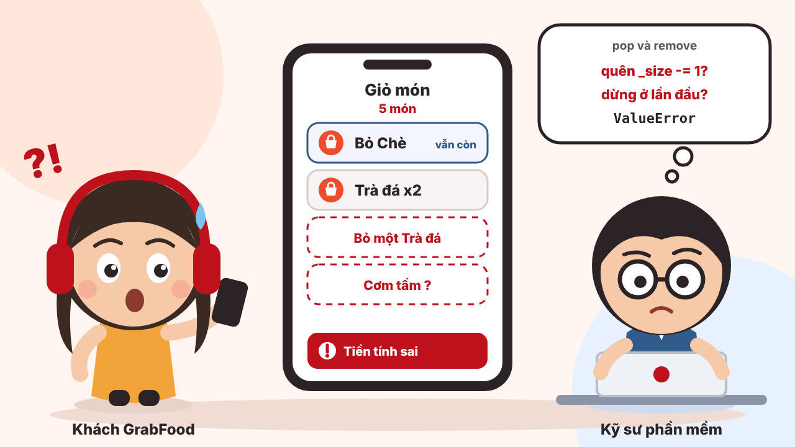

# Lỗi bỏ món khỏi giỏ hàng GrabFood

### 1. Bối cảnh nghiệp vụ



*Khách bỏ một món thì giỏ vẫn đủ số món và món cuối bị nhân đôi; bỏ một ly trà đá thì mất sạch các món phía sau.*

Bạn là kỹ sư phần mềm trong nhóm giỏ hàng của GrabFood.

Giỏ món lưu trong lớp `Basket`, cài bằng mảng động theo Lesson 04 (`__init__`, `__len__`, `items`, `_normalize_index` đã có và đúng). Nhóm viết hai phương thức theo đặc tả giống list:

- `pop(index=-1)`: lấy và **xóa** món tại `index` (mặc định món cuối), trả về món đó; các món phía sau dồn lên; ô cuối vừa bỏ trống đặt về `None` để không giữ tham chiếu thừa; chỉ số sai báo `IndexError`.
- `remove(value)`: xóa **lần xuất hiện đầu tiên** của món; không có thì báo `ValueError("không tìm thấy món")`.

`moves` đếm số tham chiếu đã dịch, `checks` đếm số lượt so sánh trong `remove`. Giỏ hàng quyết định số tiền khách trả, nên mỗi lần bỏ món phải chính xác.

Kịch bản kiểm tra (đoạn cuối tệp): giỏ 5 món (hai ly "Trà đá"); lấy món cuối; lấy món đầu; bỏ một "Trà đá"; bỏ "Cơm tấm" (không có).

Kết quả đúng cần hiển thị:

```plaintext
Lấy món cuối: Chè | giỏ: ['Phở bò', 'Trà đá', 'Bánh mì', 'Trà đá']
Lấy món đầu: Phở bò | giỏ: ['Trà đá', 'Bánh mì', 'Trà đá']
Bỏ một Trà đá: ['Bánh mì', 'Trà đá'] | số món: 2
Bỏ Cơm tấm: không tìm thấy món
```

### 2. Vấn đề hiện tại

Khách và nhà hàng phản ánh:

- Bỏ món cuối thì món đó **vẫn nằm trong giỏ**, số món không giảm.
- Bỏ một ly trà đá thì giỏ chỉ còn món đầu và món cuối lặp lại nhiều lần; khách bị tính tiền sai.
- Bỏ món không có trong giỏ thì không có thông báo gì.

Nhắc lại kiến thức (Lesson 03, Lesson 04):

- `pop(i)` dồn **n − i − 1** tham chiếu sang trái, rồi **giảm size** và bỏ tham chiếu ở ô cuối; quên giảm size thì phần tử cuối "còn sống" hai lần.
- `remove` xét từ đầu, **dừng ở lần khớp đầu**, xóa bằng `pop`; không thấy thì báo `ValueError`.
- Sau khi xóa phần tử j, phần tử đứng sau dồn lên chỉ số j; vòng lặp tiếp tục tăng j sẽ bỏ qua nó.

### 3. Mã nguồn hiện tại (Legacy Code)

Toàn bộ tệp `gio_mon.py` trong thư mục khởi đầu (đoạn cuối tệp là kịch bản chạy thử):

```python
"""Giỏ món GrabFood, lưu bằng mảng động tự cài."""
class Basket:
    # Giỏ món GrabFood, lưu bằng mảng động tự cài (Lesson 04). moves đếm tham chiếu đã dịch, checks đếm lượt so sánh.
    def __init__(self, items=()):
        self._capacity = max(1, len(items))
        self._size = 0
        self._data = [None] * self._capacity
        self.moves = self.checks = 0
        for item in items:
            self._data[self._size] = item
            self._size += 1

    def __len__(self):
        return self._size

    def items(self):
        return [self._data[j] for j in range(self._size)]

    def _normalize_index(self, index):
        if index < 0:
            index += self._size
        if not 0 <= index < self._size:
            raise IndexError("Chỉ số ngoài phạm vi phần tử")
        return index

    def pop(self, index=-1):
        # Lấy và xóa món tại index (mặc định món cuối), trả về món đó.
        index = self._normalize_index(index)
        value = self._data[index]
        for j in range(index, self._size - 1):
            self._data[j] = self._data[j + 1]
            self.moves += 1
        return value

    def remove(self, value):
        # Xóa lần xuất hiện đầu tiên của value; không có thì báo ValueError("không tìm thấy món").
        for j in range(self._size):
            self.checks += 1
            if self._data[j] == value:
                self.pop(j)


basket = Basket(["Phở bò", "Trà đá", "Bánh mì", "Trà đá", "Chè"])
print("Lấy món cuối:", basket.pop(), "| giỏ:", basket.items())
print("Lấy món đầu:", basket.pop(0), "| giỏ:", basket.items())
basket.remove("Trà đá")
print("Bỏ một Trà đá:", basket.items(), "| số món:", len(basket))
try:
    basket.remove("Cơm tấm")
except ValueError as error:
    print("Bỏ Cơm tấm:", error)
```

Kết quả hiển thị trên Console:

```plaintext
Lấy món cuối: Chè | giỏ: ['Phở bò', 'Trà đá', 'Bánh mì', 'Trà đá', 'Chè']
Lấy món đầu: Phở bò | giỏ: ['Trà đá', 'Bánh mì', 'Trà đá', 'Chè', 'Chè']
Bỏ một Trà đá: ['Bánh mì', 'Chè', 'Chè', 'Chè', 'Chè'] | số món: 5
```

Đối chiếu với kết quả đúng: giỏ không bao giờ ngắn đi, món cuối bị lặp; bỏ "Trà đá" làm hỏng cả giỏ; bỏ "Cơm tấm" không có dòng thông báo nào.

### 4. Yêu cầu

Với vai trò kỹ sư phần mềm của nhóm, hãy thực hiện:

**(1) Phân tích lỗi** (trả lời vào `PHAN_TICH.md`)

- Chạy tay `pop(0)` trên giỏ `["A", "B", "C"]` của mã hiện tại: ghi `_data`, `_size` sau vòng dịch. Thiếu những bước nào so với đặc tả?
- Vì sao lần gọi `pop()` đầu tiên trả đúng "Chè" nhưng giỏ vẫn còn "Chè"?
- Chạy tay `remove("Trà đá")` của mã hiện tại trên giỏ `["Trà đá", "Bánh mì", "Trà đá", "Chè", "Chè"]` (sau hai lần pop). Ghi j, `_size`, `_data` ở mỗi vòng. Vì sao vòng lặp không dừng sau lần khớp đầu?
- Sau khi sửa `pop`, nếu `remove` vẫn không dừng sau lần khớp đầu thì xóa hai ly "Trà đá" liền nhau sẽ ra sao?
- Ghi số lượt so sánh (`checks`) và số tham chiếu dịch (`moves`) của `remove` khi món ở đầu, ở cuối, không có. Ghi Big-O.
- Ghi bốn bộ dữ liệu thử: giỏ một món, pop trên giỏ rỗng, hai món trùng liền nhau, bỏ món không có; kèm kết quả mong đợi.

**(2) Sửa lỗi**

- Sửa `pop` và `remove` trong `gio_mon.py`. Không đổi tên lớp, phương thức, thuộc tính, thông báo lỗi; không dùng `list.pop`, `list.remove` trên `_data`.
- Chạy `python gio_mon.py` phải in đúng phần "Kết quả đúng cần hiển thị" ở mục 1.
- Chạy `pytest -q` phải xanh cả 4 test.

### 5. Quy định nộp bài

1. Tạo một kho GitHub riêng cho bài này, đặt tên theo mẫu `[Tên Lớp]_IT301_Session05_Ex07`.
2. Tải thư mục khởi đầu tại https://github.com/cuongtm191221/it301-bai-tap-ve-nha/tree/main/session-05-mang-va-danh-sach-dong/bai-07 rồi chép các tệp vào kho: `gio_mon.py`, `test_gio_mon.py`, `PHAN_TICH.md`.
3. Điền phần phân tích vào `PHAN_TICH.md`, sửa mã trong `gio_mon.py`.
4. Mức AI của bài: AI-0 (tự làm, không dùng AI).
5. Đưa bài làm lên kho và nộp đường dẫn kho lên hệ thống.
