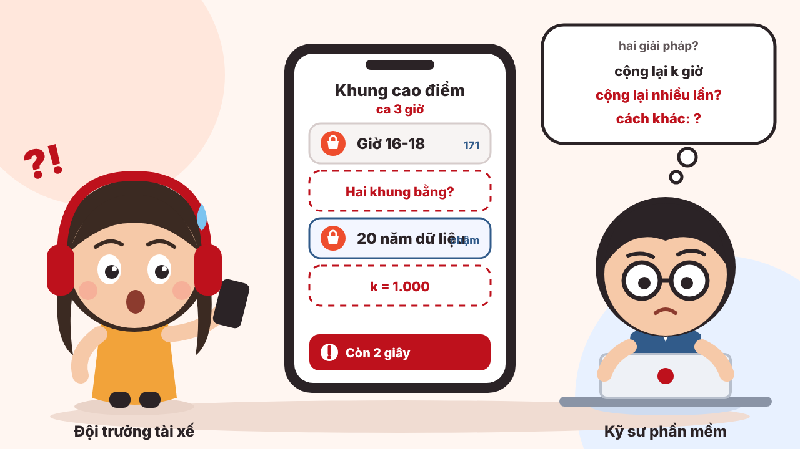

# Tìm khung giờ cao điểm cho đội tài xế GrabBike

### 1. Bối cảnh & Vấn đề



*Đội tài xế muốn biết k giờ liên tiếp nào trong ngày có nhiều chuyến nhất để xếp ca; dữ liệu nhiều năm làm báo cáo chạy rất lâu.*

Mỗi quận có bảng **số chuyến GrabBike theo từng giờ**: phần tử thứ h là số chuyến trong giờ thứ h (giờ 0 là 0:00–0:59). Đội trưởng tài xế muốn biết **k giờ liên tiếp** nào có tổng số chuyến lớn nhất để xếp ca, ví dụ ca 3 giờ hay ca 8 giờ.

```plaintext
[12, 8, 5, 4, 6, 20, 45, 60, 38, 25, 30, 41, 50, 33, 28, 31, 47, 66, 58, 40, 27, 22, 18, 15]
Khung 3 giờ nhiều chuyến nhất: giờ 16 đến 18, 47 + 66 + 58 = 171 chuyến
```

Kết quả được gửi cho tài xế mỗi sáng qua thông báo đẩy, nên phải chính xác và ổn định: cùng dữ liệu phải luôn cho cùng một khung giờ.

Nhóm phân tích còn chạy cùng hàm trên dữ liệu **20 năm** (175.200 giờ) với khung 1.000 giờ để tìm mùa cao điểm; báo cáo phải có trong **2 giây**. Cách làm đầu tiên một bạn trong nhóm nghĩ tới là với mỗi giờ bắt đầu, cộng lại k giờ: đúng nhưng với dữ liệu 20 năm phải cộng gần 175 triệu lần. Trưởng nhóm yêu cầu bạn đề xuất ít nhất hai giải pháp, đo, so sánh rồi mới chọn.

### 2. Yêu cầu nghiệp vụ

**2.1. `busiest_window_v1(trips, k)` và `busiest_window_v2(trips, k)`**: mỗi hàm cài một giải pháp, trả về bộ `(giờ bắt đầu, tổng số chuyến)` của khung k giờ liên tiếp có tổng lớn nhất; `k <= 0` hoặc `k` lớn hơn số giờ có dữ liệu thì trả `None`. Hai hàm cho cùng kết quả nhưng **khác nhau về cách làm**; không sửa list đầu vào.

**2.2. `window_message(trips, k)`**: dùng giải pháp bạn chọn, trả về một trong ba thông báo:

```plaintext
Cao điểm 3 giờ: từ giờ thứ 16 đến giờ thứ 18, 171 chuyến.
Chưa đủ dữ liệu: cần ít nhất 3 giờ.
Độ dài khung giờ phải lớn hơn 0.
```

### 3. Edge Cases (Bẫy dữ liệu)

**Bẫy 1 — Hai khung bằng nhau.** Chọn khung **sớm hơn**: `[5, 9, 9, 5]` với k = 2 cho `(1, 18)`.

**Bẫy 2 — k bằng số giờ.** Khung duy nhất bắt đầu ở giờ 0.

**Bẫy 3 — k không hợp lệ.** k = 0, k âm, k lớn hơn số giờ, dữ liệu rỗng: hàm trả `None`, thông báo đúng như trên.

**Bẫy 4 — Không sửa dữ liệu.** List số chuyến giữ nguyên sau khi gọi.

**Bẫy 5 — Dữ liệu 20 năm.** 175.200 giờ, khung 1.000 giờ: thông báo trong 2 giây.

**Kịch bản chạy thử.** Chạy `python gio_cao_diem.py` (đoạn chạy thử có sẵn ở cuối tệp) phải in ra đúng:

```plaintext
Cao điểm 3 giờ: từ giờ thứ 16 đến giờ thứ 18, 171 chuyến.
Cao điểm 1 giờ: từ giờ thứ 17 đến giờ thứ 17, 66 chuyến.
Cao điểm 2 giờ: từ giờ thứ 1 đến giờ thứ 2, 18 chuyến.
Chưa đủ dữ liệu: cần ít nhất 3 giờ.
Độ dài khung giờ phải lớn hơn 0.
Cao điểm 1000 giờ: từ giờ thứ 8 đến giờ thứ 1007, 50080 chuyến.
```

### 4. Yêu cầu

Với vai trò kỹ sư phần mềm, bạn phải thực hiện đầy đủ ba phần sau:

**(1) Đề xuất và phân tích nhiều giải pháp (bắt buộc, viết vào `PHAN_TICH.md`)**

- Phân tích Input/Output của các hàm: kiểu dữ liệu đầu vào, giá trị trả về trong trường hợp thường và trong từng bẫy.
- Đề xuất **ít nhất hai giải pháp** khác nhau về cách làm cho việc tìm khung giờ cao điểm. Với mỗi giải pháp: mô tả ý tưởng trong 2–3 câu, minh họa trên ví dụ ở mục 1, viết mã giả.
- Đo thời gian hai giải pháp bằng `timeit` với n = 20.000, 40.000, 80.000 giờ và k = 100, 1.000; ghi bảng số đo, phiên bản Python và máy đo. Đếm thêm số phép cộng hoặc số tham chiếu phải dịch bằng một biến đếm.
- So sánh các giải pháp theo bảng 5 tiêu chí: thời gian (Big-O), bộ nhớ phụ (Big-O), kết quả đo, độ dễ đọc và dễ bảo trì, mức phù hợp với bối cảnh của bài.
- Chọn giải pháp dùng cho `window_message` và nêu lý do dựa trên bảng so sánh. Lựa chọn không có lý do không được tính điểm.

**(2) Chạy tay**

- Với mỗi giải pháp, chạy tay `[3, 1, 4, 1, 5, 9]` với k = 3: ghi tổng của từng khung và số phép cộng đã làm.

**(3) Triển khai code**

- Viết thân ba hàm trong `gio_cao_diem.py`. Không đổi tên hàm, tham số.
- Không sửa list đầu vào; không dùng `sum()` trên lát cắt trong giải pháp thứ hai.
- Xử lý đủ 5 bẫy ở mục 3; `python gio_cao_diem.py` in đúng kịch bản chạy thử; `pytest -q` xanh cả 7 test có sẵn (các test về giải pháp chạy trên cả hai hàm `_v1`, `_v2`).
- Mã sạch, dễ đọc, tên biến theo snake_case, có chú thích nêu ý tưởng và độ phức tạp ở đầu mỗi hàm.

### 5. Quy định nộp bài

1. Tạo một kho GitHub riêng cho bài này, đặt tên theo mẫu `[Tên Lớp]_IT301_Session05_Ex13`.
2. Tải thư mục khởi đầu tại https://github.com/cuongtm191221/it301-bai-tap-ve-nha/tree/main/session-05-mang-va-danh-sach-dong/bai-13 rồi chép các tệp vào kho: `gio_cao_diem.py`, `test_gio_cao_diem.py`, `PHAN_TICH.md`.
3. Điền phần phân tích vào `PHAN_TICH.md`, viết mã trong `gio_cao_diem.py`.
4. Mức AI của bài: AI-0 (tự làm, không dùng AI).
5. Đưa bài làm lên kho và nộp đường dẫn kho lên hệ thống.
