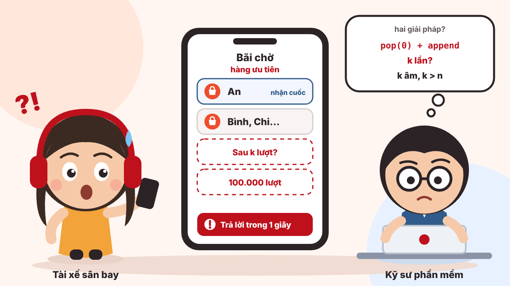

# Xoay vòng lượt ưu tiên tài xế GrabCar tại sân bay

### 1. Bối cảnh & Vấn đề



*Tài xế xếp hàng ở bãi chờ sân bay; mỗi lượt khách, người đầu hàng nhận cuốc rồi quay về cuối hàng. Hệ thống cần biết thứ tự sau k lượt.*

Tại bãi chờ sân bay, tài xế GrabCar xếp thành **hàng ưu tiên**. Mỗi lượt có khách, tài xế **đứng đầu** nhận cuốc, chở xong quay về **cuối hàng**. Để báo trước cho tài xế, hệ thống tính **thứ tự hàng sau k lượt**:

```plaintext
Hàng: ["An", "Bình", "Chi", "Dũng", "Em"]
Sau 2 lượt: ["Chi", "Dũng", "Em", "An", "Bình"]
```

Thứ tự này hiện trên ứng dụng tài xế để mỗi người ước lượng thời gian chờ, và được dùng để giải quyết khiếu nại "chen hàng". Một tài xế bị xếp sai vị trí có thể mất cả giờ chờ, nên kết quả phải khớp tuyệt đối với cách xoay thủ công: lấy người đầu, đưa xuống cuối, lặp lại k lần.

Bộ phận điều phối đôi khi cần xem **ngược lại** (thứ tự của k lượt trước, nhập k âm). Danh sách gốc dùng cho bảng chấm công nên **không được sửa**; hàm trả về list mới.

Một sân bay lớn có tới **100.000 lượt tài xế** trong dữ liệu mô phỏng, và hệ thống thường hỏi thứ tự sau gần 100.000 lượt; câu trả lời phải có trong **1 giây**. Bản đầu tiên làm đúng như mô tả: lặp k lần "lấy người đầu, đưa xuống cuối" bằng `pop(0)` và `append`. Trưởng nhóm yêu cầu bạn đề xuất ít nhất hai giải pháp, đo, so sánh rồi mới chọn.

### 2. Yêu cầu nghiệp vụ

**2.1. `rotate_v1(drivers, k)` và `rotate_v2(drivers, k)`**: mỗi hàm cài một giải pháp, trả về **list mới** sau khi xoay sang trái k bước (k âm: sang phải). Hai hàm cho cùng kết quả nhưng **khác nhau về cách làm**.

**2.2. `next_round_message(drivers, k)`**: dùng giải pháp bạn chọn:

```plaintext
Sau 2 lượt, tài xế ưu tiên: Chi, tiếp theo: Dũng, Em
Chưa có tài xế nào trong hàng.
```

### 3. Edge Cases (Bẫy dữ liệu)

**Bẫy 1 — k bằng 0 hoặc bằng số tài xế.** Hàng không đổi.

**Bẫy 2 — k lớn hơn số tài xế.** 7 lượt với 5 tài xế giống 2 lượt.

**Bẫy 3 — k âm.** −1 lượt: người cuối lên đầu.

**Bẫy 4 — Hàng rỗng, hàng một người; không sửa danh sách gốc.** Hàng một người: phần "tiếp theo" để trống.

**Bẫy 5 — 100.000 tài xế, 99.999 lượt.** Trả lời trong 1 giây. Giải pháp chậm vẫn phải cho kết quả đúng với dữ liệu nhỏ, vì test so sánh hai giải pháp trên nhiều hàng ngẫu nhiên với k từ −30 đến 30; với dữ liệu lớn chỉ giải pháp bạn chọn được dùng.

**Kịch bản chạy thử.** Chạy `python xoay_vong.py` (đoạn chạy thử có sẵn ở cuối tệp) phải in ra đúng:

```plaintext
['Chi', 'Dũng', 'Em', 'An', 'Bình']
Sau 2 lượt, tài xế ưu tiên: Chi, tiếp theo: Dũng, Em
Sau 7 lượt, tài xế ưu tiên: Chi, tiếp theo: Dũng, Em
Sau -1 lượt, tài xế ưu tiên: Em, tiếp theo: An, Bình
Chưa có tài xế nào trong hàng.
Sau 99999 lượt, tài xế ưu tiên: TX99999, tiếp theo: TX0, TX1 | danh sách gốc: TX0
```

### 4. Yêu cầu

Với vai trò kỹ sư phần mềm, bạn phải thực hiện đầy đủ ba phần sau:

**(1) Đề xuất và phân tích nhiều giải pháp (bắt buộc, viết vào `PHAN_TICH.md`)**

- Phân tích Input/Output của các hàm: kiểu dữ liệu đầu vào, giá trị trả về trong trường hợp thường và trong từng bẫy.
- Đề xuất **ít nhất hai giải pháp** khác nhau về cách làm cho việc xoay vòng hàng tài xế. Với mỗi giải pháp: mô tả ý tưởng trong 2–3 câu, minh họa trên ví dụ ở mục 1, viết mã giả.
- Đo thời gian hai giải pháp bằng `timeit` với n = 10.000, 20.000, 40.000 tài xế và k = n − 1; ghi bảng số đo, phiên bản Python và máy đo. Đếm thêm số phép cộng hoặc số tham chiếu phải dịch bằng một biến đếm.
- So sánh các giải pháp theo bảng 5 tiêu chí: thời gian (Big-O), bộ nhớ phụ (Big-O), kết quả đo, độ dễ đọc và dễ bảo trì, mức phù hợp với bối cảnh của bài.
- Chọn giải pháp dùng cho `next_round_message` và nêu lý do dựa trên bảng so sánh. Lựa chọn không có lý do không được tính điểm.

**(2) Chạy tay**

- Với mỗi giải pháp, chạy tay hàng 5 tài xế với k = 7: ghi hàng sau mỗi bước (hoặc vị trí mà từng tài xế được ghi vào) và số tham chiếu phải dịch.

**(3) Triển khai code**

- Viết thân ba hàm trong `xoay_vong.py`. Không đổi tên hàm, tham số.
- Không sửa list `drivers`
- Xử lý đủ 5 bẫy ở mục 3; `python xoay_vong.py` in đúng kịch bản chạy thử; `pytest -q` xanh cả 6 test có sẵn (các test về giải pháp chạy trên cả hai hàm `_v1`, `_v2`).
- Mã sạch, dễ đọc, tên biến theo snake_case, có chú thích nêu ý tưởng và độ phức tạp ở đầu mỗi hàm.

### 5. Quy định nộp bài

1. Tạo một kho GitHub riêng cho bài này, đặt tên theo mẫu `[Tên Lớp]_IT301_Session05_Ex16`.
2. Tải thư mục khởi đầu tại https://github.com/cuongtm191221/it301-bai-tap-ve-nha/tree/main/session-05-mang-va-danh-sach-dong/bai-16 rồi chép các tệp vào kho: `xoay_vong.py`, `test_xoay_vong.py`, `PHAN_TICH.md`.
3. Điền phần phân tích vào `PHAN_TICH.md`, viết mã trong `xoay_vong.py`.
4. Mức AI của bài: AI-0 (tự làm, không dùng AI).
5. Đưa bài làm lên kho và nộp đường dẫn kho lên hệ thống.
