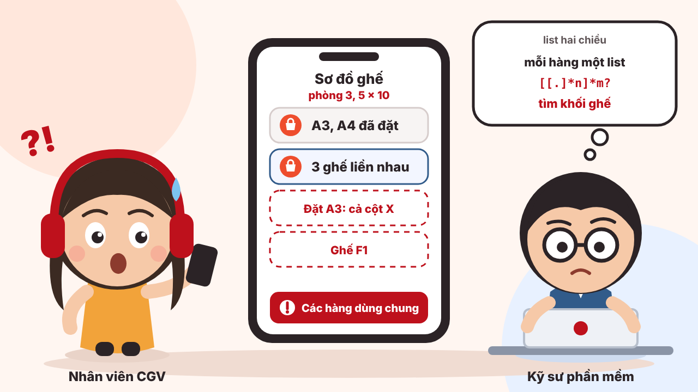

# Hệ thống sơ đồ ghế phòng chiếu của CGV

### 1. Bối cảnh & Vấn đề



*Nhân viên quầy vé CGV xem sơ đồ ghế*

Tại **CGV** Vincom Bà Triệu, quầy vé lưu sơ đồ một phòng chiếu thành **list hai chiều**: list các hàng A, B, C...; mỗi hàng là list các ô `"."` (trống) hoặc `"X"` (đã đặt). Truy cập một ghế là truy cập theo chỉ số `hall[hàng][ghế]`, rất nhanh.

Bản thử đầu tiên tạo phòng bằng `[["."] * cols] * rows`: khách đặt ghế A3 thì sơ đồ hiện đặt cả B3, C3, D3, E3. Ngoài đặt và hủy ghế, nhóm khách đi cùng nhau hay hỏi: "còn k ghế liền nhau không?"; quầy cần gợi ý khối ghế đầu tiên (hàng A trước, trong hàng từ trái sang phải).

Bạn xây dựng module **"CGV Seat Map CLI"**.

### 2. Yêu cầu nghiệp vụ

Dữ liệu mẫu: `make_sample_hall()` tạo phòng 5 hàng × 10 ghế, đã đặt `A3, A4, C5, C6, C7, E1`; `render` có sẵn vẽ sơ đồ (xem `ghe_cgv.py`).

**Chức năng 1 — Xem sơ đồ ghế** và dòng `Còn trống <a>/<n> ghế`.

**Chức năng 2 — Đặt ghế. Chức năng 3 — Hủy ghế.** Nhập tên ghế như `C5` (chữ thường được); in `Đã đặt ghế C5.` / `Đã hủy ghế C5.`

**Chức năng 4 — Tìm ghế ngồi cùng nhau.** Nhập số người k (1–10); in `Gợi ý: <ghế đầu> đến <ghế cuối>` hoặc `Không còn đủ ghế liền nhau.` Mỗi hàng duyệt một lượt.

**Chức năng 5 — Thoát.**

Bạn viết `make_hall` (mỗi hàng là một list riêng), `parse_seat`, `book`, `cancel`, `free_count`, `find_block`.

Màn hình mẫu (đoạn đầu; phím gõ vào hiện sau dấu hai chấm, `[menu chính]` là menu được in lại):

```plaintext
===== CGV VINCOM BÀ TRIỆU - PHÒNG 3 =====
1. Xem sơ đồ ghế
2. Đặt ghế
3. Hủy ghế
4. Tìm ghế ngồi cùng nhau
5. Thoát
Chọn chức năng (1-5): 1
A  . . X X . . . . . .
B  . . . . . . . . . .
C  . . . . X X X . . .
D  . . . . . . . . . .
E  X . . . . . . . . .
   ======MÀN HÌNH=====
Còn trống 44/50 ghế

[menu chính]
Chọn chức năng (1-5): 4
Số người: 3
Gợi ý: A5 đến A7

[menu chính]
Chọn chức năng (1-5): 2
Ghế (ví dụ C5): a5
Đã đặt ghế A5.

[... các lượt sau: thêm dữ liệu sai, nhập menu sai, thoát ...]
```

### 3. Edge Cases (Bẫy dữ liệu)

**Bẫy 1 — Các hàng dùng chung.** Đặt một ghế hàng A không được làm đổi hàng khác.

**Bẫy 2 — Tên ghế sai.** `5B`, `CC5`, chuỗi rỗng: `Lỗi: Ghế không hợp lệ`; `F1`, `A11`, `A0`: `Lỗi: Ghế ngoài phòng chiếu`.

**Bẫy 3 — Đặt trùng, hủy ghế trống.** `Lỗi: Ghế <ghế> đã có người đặt` / `Lỗi: Ghế <ghế> chưa được đặt`.

**Bẫy 4 — Khối ghế ở biên.** Khối đúng bằng cả hàng (10 người, hàng B); khối nằm cuối hàng; không đủ ghế.

**Bẫy 5 — Nhập sai.** Số người ngoài 1–10: `Lỗi: Số người phải là số nguyên từ 1 đến 10`; menu sai: `Lựa chọn không hợp lệ, vui lòng nhập số từ 1 đến 5.`

### 4. Yêu cầu

**(1) Phân tích và thiết kế (viết vào `PHAN_TICH.md`)**

- Input/Output của từng chức năng, trong trường hợp thường và trong từng bẫy; luồng chương trình (mã giả hoặc các bước).
- Vẽ sơ đồ tham chiếu của `[["."] * 3] * 2` và của cách tạo phòng bạn dùng; kiểm chứng bằng `is`.
- Công thức đổi `C5` thành chỉ số; Big-O của đặt ghế, đếm ghế trống, tìm khối ghế theo số hàng R và số ghế mỗi hàng C.

**(2) Triển khai code**

- Viết các hàm trong `ghe_cgv.py` (giữ tên, tham số; hàm "Có sẵn" giữ nguyên) và chương trình menu trong `main.py`. Hàm nghiệp vụ không gọi `input()`, `print()`.
- Thông báo đúng từng chữ như đề; không dừng vì lỗi ở bất kỳ thao tác nào; tên biến snake_case, có chú thích.
- `python kiem_tra.py` đạt cả 6 mục (mục cuối tự chạy `main.py`, gõ một loạt lựa chọn có cả dữ liệu sai, và kiểm tra các thông báo của đề).

### 5. Quy định nộp bài

1. Tạo kho GitHub riêng, đặt tên `[Tên Lớp]_IT301_Session06_TH02`. Tải thư mục khởi đầu tại https://github.com/cuongtm191221/it301-bai-tap-ve-nha/tree/main/session-06-thuc-hanh-cli/bai-02 rồi chép các tệp vào kho: `ghe_cgv.py`, `main.py`, `kiem_tra.py`, `PHAN_TICH.md`.
2. Mức AI: AI-0 (tự làm, không dùng AI).
3. Đưa bài làm lên kho và nộp đường dẫn kho lên hệ thống.
