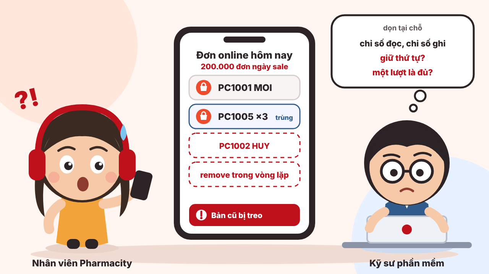

# Hệ thống dọn danh sách đơn thuốc online của Pharmacity

### 1. Bối cảnh & Vấn đề



*Nhân viên Pharmacity dọn danh sách đơn online*

Cửa hàng **Pharmacity** nhận đơn thuốc online cả ngày; mỗi đơn là `[mã đơn, trạng thái "MOI" hoặc "HUY", số tiền]`, xếp theo thời gian nhận. Hai vấn đề hay gặp: khách hủy đơn, và ứng dụng thỉnh thoảng **gửi trùng một đơn nhiều lần liền nhau**. Trước giờ giao hàng, nhân viên dọn danh sách: bỏ đơn hủy, gộp đơn trùng liền nhau, có khi đảo thứ tự để xem đơn mới nhất trước.

Bản cũ bỏ đơn hủy bằng `remove` trong vòng lặp: chạy được với vài chục đơn, nhưng ngày khuyến mãi có hàng trăm nghìn đơn thì treo, vì mỗi lần xóa phải dịch cả phần sau. Trưởng ca yêu cầu dọn **tại chỗ, trong một lượt**.

Bạn xây dựng module **"Pharmacity Order Cleanup CLI"**.

### 2. Yêu cầu nghiệp vụ

Dữ liệu mẫu: `make_orders()` trả về 9 đơn, có 2 đơn hủy và các đơn `PC1003`, `PC1005` bị gửi trùng liền nhau (xem `don_thuoc.py`).

**Chức năng 1 — Xem danh sách đơn. Chức năng 2 — Nhận đơn** (mã `PC` + 4 chữ số, số tiền). **Chức năng 3 — Hủy đơn** (mọi đơn mã đó đang "MOI" chuyển sang "HUY").

**Chức năng 4 — Dọn danh sách** (menu phụ): `1` bỏ đơn hủy (`Đã bỏ <k> đơn hủy. Còn <n> đơn.`); `2` gộp đơn trùng liền nhau, giữ đơn đầu mỗi nhóm (`Đã gộp <k> đơn trùng. Còn <n> đơn.`); `3` đảo thứ tự bằng hai chỉ số (`Đã đảo thứ tự danh sách.`).

**Chức năng 5 — Thoát.**

`compact` (dồn đơn "MOI" lên đầu, giữ thứ tự giữa chúng, đếm số lần gán), `drop_cancelled`, `merge_duplicates`, `reverse_in_place` làm **tại chỗ**, **một lượt**, không gọi `pop`, `remove`, `insert`; `reverse_in_place` không dùng `reverse()`, `[::-1]`, `reversed()`.

Màn hình mẫu (đoạn đầu; phím gõ vào hiện sau dấu hai chấm, `[menu chính]` là menu được in lại):

```plaintext
===== PHARMACITY - ĐƠN ONLINE TRONG NGÀY =====
1. Xem danh sách đơn
2. Nhận đơn
3. Hủy đơn
4. Dọn danh sách
5. Thoát
Chọn chức năng (1-5): 4
1. Bỏ đơn hủy  2. Gộp đơn trùng liền nhau  3. Đảo thứ tự
Chọn thao tác: 2
Đã gộp 3 đơn trùng. Còn 6 đơn.

[menu chính]
Chọn chức năng (1-5): 3
Mã đơn: pc1005
Đã hủy 1 đơn.

[menu chính]
Chọn chức năng (1-5): 4
1. Bỏ đơn hủy  2. Gộp đơn trùng liền nhau  3. Đảo thứ tự
Chọn thao tác: 1
Đã bỏ 3 đơn hủy. Còn 3 đơn.

[... các lượt sau: thêm dữ liệu sai, nhập menu sai, thoát ...]
```

### 3. Edge Cases (Bẫy dữ liệu)

**Bẫy 1 — Giữ thứ tự.** Sau khi bỏ đơn hủy, các đơn còn lại giữ nguyên thứ tự nhận.

**Bẫy 2 — Chỉ gộp đơn liền nhau.** `A, B, A` không gộp gì.

**Bẫy 3 — Danh sách rỗng, một đơn.** Không báo lỗi; đảo một đơn giữ nguyên.

**Bẫy 4 — 200.000 đơn.** Bỏ 100.000 đơn hủy trong 2 giây.

**Bẫy 5 — Nhập sai.** Mã đơn sai dạng, số tiền không phải số nguyên dương, hủy đơn không có hoặc đã hủy, menu phụ và menu chính sai: đúng thông báo của đề.

### 4. Yêu cầu

**(1) Phân tích và thiết kế (viết vào `PHAN_TICH.md`)**

- Input/Output của từng chức năng, trong trường hợp thường và trong từng bẫy; luồng chương trình (mã giả hoặc các bước).
- Chạy tay `compact` trên 9 đơn mẫu: chỉ số đọc, chỉ số ghi, list sau mỗi bước, số lần gán.
- So sánh bỏ đơn hủy bằng `remove` trong vòng lặp và bằng cách dồn tại chỗ: số phần tử bị dịch, Big-O. Vì sao `del orders[k:]` ở cuối chỉ chạy một lần là chấp nhận được?

**(2) Triển khai code**

- Viết các hàm trong `don_thuoc.py` (giữ tên, tham số; hàm "Có sẵn" giữ nguyên) và chương trình menu trong `main.py`. Hàm nghiệp vụ không gọi `input()`, `print()`.
- Thông báo đúng từng chữ như đề; không dừng vì lỗi ở bất kỳ thao tác nào; tên biến snake_case, có chú thích.
- `python kiem_tra.py` đạt cả 7 mục (mục cuối tự chạy `main.py`, gõ một loạt lựa chọn có cả dữ liệu sai, và kiểm tra các thông báo của đề).

### 5. Quy định nộp bài

1. Tạo kho GitHub riêng, đặt tên `[Tên Lớp]_IT301_Session06_TH03`. Tải thư mục khởi đầu tại https://github.com/cuongtm191221/it301-bai-tap-ve-nha/tree/main/session-06-thuc-hanh-cli/bai-03 rồi chép các tệp vào kho: `don_thuoc.py`, `main.py`, `kiem_tra.py`, `PHAN_TICH.md`.
2. Mức AI: AI-0 (tự làm, không dùng AI).
3. Đưa bài làm lên kho và nộp đường dẫn kho lên hệ thống.
