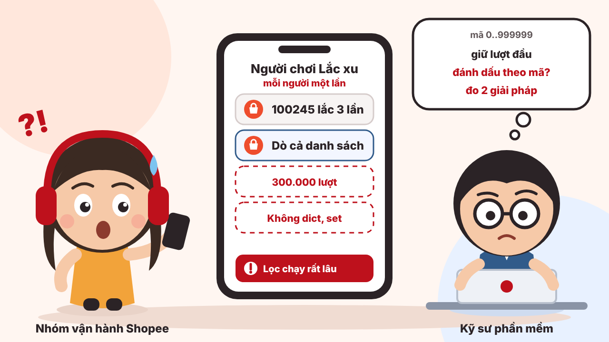

# Hệ thống lọc người chơi minigame Lắc xu của Shopee

### 1. Bối cảnh & Vấn đề



*Nhóm vận hành Shopee lọc danh sách người chơi minigame*

Minigame **Lắc xu** của **Shopee** ghi mỗi lượt lắc thành mã người dùng, là **số nguyên từ 0 đến 999999**, theo thứ tự thời gian; một người lắc nhiều lần. Cuối đợt, nhóm vận hành cần **danh sách người chơi**: mỗi người một lần, theo thứ tự lượt lắc đầu tiên của họ (để trao thưởng theo thứ tự tham gia).

Công cụ hiện tại kiểm tra "đã có trong danh sách kết quả chưa" bằng cách dò cả danh sách: chạy tức thì với vài nghìn lượt, nhưng đợt 12.12 có hàng trăm nghìn lượt thì chạy rất lâu. Hệ thống không cho dùng `dict`, `set` (thư viện nội bộ đang khóa phiên bản), nên trưởng nhóm yêu cầu một giải pháp khác chỉ dùng list, chứng minh bằng số đo và phân tích.

Bạn xây dựng module **"Shopee Shake Players CLI"**.

### 2. Yêu cầu nghiệp vụ

Dữ liệu mẫu: `make_turns()` trả về 8 lượt (xem `lac_xu.py`).

**Chức năng 1 — Ghi lượt tham gia** (mã 0–999999). **Chức năng 2 — Danh sách người chơi** (menu phụ chọn giải pháp): in `<k> người chơi: ...` (10 mã đầu, mã in đủ 6 chữ số). **Chức năng 3 — Số lượt của một người.**

**Chức năng 4 — Đo** hai giải pháp với n = 2.000, 4.000, 8.000. **Chức năng 5 — Thoát.**

`unique_v1`, `unique_v2` cho **cùng kết quả**, **khác nhau về cách làm**, không dùng `dict`, `set`; giải pháp 2 xử lý 300.000 lượt trong 1 giây; không làm đổi danh sách lượt.

Màn hình mẫu (đoạn đầu; phím gõ vào hiện sau dấu hai chấm, `[menu chính]` là menu được in lại):

```plaintext
===== SHOPEE - MINIGAME LẮC XU =====
1. Ghi lượt tham gia
2. Danh sách người chơi
3. Số lượt của một người
4. Đo so sánh hai giải pháp
5. Thoát
Chọn chức năng (1-5): 2
1. Giải pháp 1  2. Giải pháp 2
Chọn giải pháp: 1
5 người chơi: 100245, 532001, 777777, 000003, 888120

[menu chính]
Chọn chức năng (1-5): 2
1. Giải pháp 1  2. Giải pháp 2
Chọn giải pháp: 2
5 người chơi: 100245, 532001, 777777, 000003, 888120

[menu chính]
Chọn chức năng (1-5): 1
Mã người dùng: 000999
Đã ghi lượt của 000999. Tổng 9 lượt.

[... các lượt sau: thêm dữ liệu sai, nhập menu sai, thoát ...]
```

Chức năng 4 in dạng sau (máy soạn đề, Python 3.10):

```plaintext
n | giải pháp 1 (ms) | giải pháp 2 (ms)
2000 | 3.9 | 3.2
4000 | 15.3 | 2.9
8000 | 61.3 | 2.3
```

### 3. Edge Cases (Bẫy dữ liệu)

**Bẫy 1 — Giữ thứ tự lượt đầu.** `100245` lắc ở lượt 1, 3, 6: đứng đầu danh sách, chỉ một lần.

**Bẫy 2 — Mã ở biên.** Mã `0` và `999999` hợp lệ; `000003` là mã 3.

**Bẫy 3 — Danh sách rỗng.** Trả list rỗng.

**Bẫy 4 — Dữ liệu lớn.** 300.000 lượt: giải pháp 2 trong 1 giây.

**Bẫy 5 — Nhập sai.** Mã vượt 999999, có chữ, âm, trống; menu phụ và menu chính sai: đúng thông báo của đề.

### 4. Yêu cầu

**(1) Phân tích và thiết kế (viết vào `PHAN_TICH.md`)**

- Input/Output của từng chức năng, trong trường hợp thường và trong từng bẫy; luồng chương trình (mã giả hoặc các bước).
- Đề xuất ít nhất hai giải pháp khác nhau (ý tưởng, hình minh họa trên 8 lượt mẫu, mã giả); giải pháp 1 xét bao nhiêu phần tử trong trường hợp xấu nhất? Giải pháp của bạn dựa vào điều gì của mã người dùng?
- Bảng so sánh 5 tiêu chí (tốc độ, bộ nhớ phụ, độ dễ đọc, dễ bảo trì, phù hợp bối cảnh) kèm số đo chức năng 4 trên máy bạn; giải pháp 2 tốn bao nhiêu bộ nhớ (ước lượng bằng `sys.getsizeof`)? Chọn giải pháp và giải thích.

**(2) Triển khai code**

- Viết các hàm trong `lac_xu.py` (giữ tên, tham số; hàm "Có sẵn" giữ nguyên) và chương trình menu trong `main.py`. Hàm nghiệp vụ không gọi `input()`, `print()`.
- Thông báo đúng từng chữ như đề; không dừng vì lỗi ở bất kỳ thao tác nào; tên biến snake_case, có chú thích.
- `python kiem_tra.py` đạt cả 7 mục (mục cuối tự chạy `main.py`, gõ một loạt lựa chọn có cả dữ liệu sai, và kiểm tra các thông báo của đề).

### 5. Quy định nộp bài

1. Tạo kho GitHub riêng, đặt tên `[Tên Lớp]_IT301_Session06_TH07`. Tải thư mục khởi đầu tại https://github.com/cuongtm191221/it301-bai-tap-ve-nha/tree/main/session-06-thuc-hanh-cli/bai-07 rồi chép các tệp vào kho: `lac_xu.py`, `main.py`, `kiem_tra.py`, `PHAN_TICH.md`.
2. Mức AI: AI-0 (tự làm, không dùng AI).
3. Đưa bài làm lên kho và nộp đường dẫn kho lên hệ thống.
