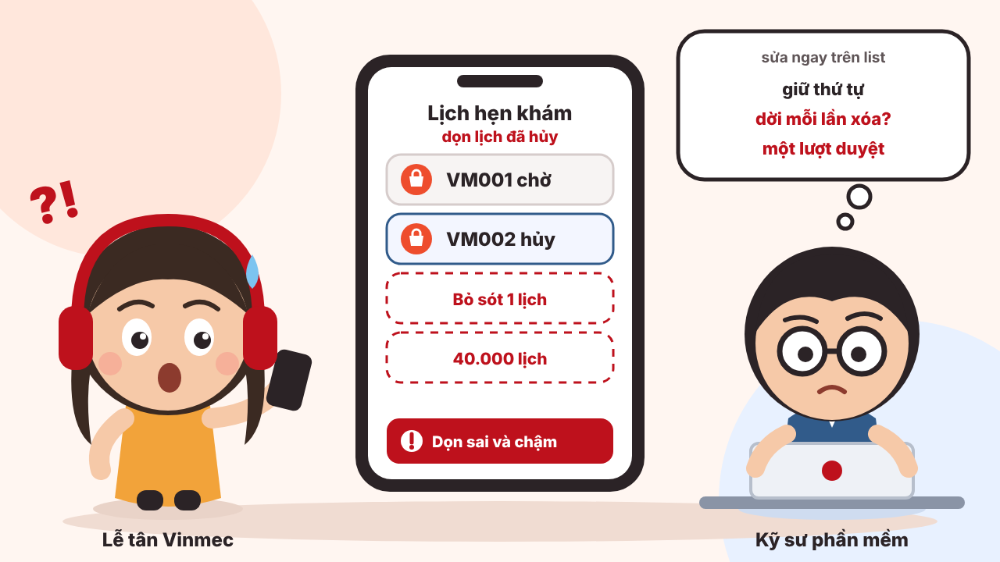

# Hệ thống dọn lịch hẹn khám đã hủy của Vinmec

### 1. Bối cảnh & Vấn đề



*Lễ tân Vinmec dọn danh sách lịch hẹn cuối ngày*

Bộ phận lễ tân bệnh viện **Vinmec** giữ danh sách lịch hẹn khám theo thứ tự đặt; mỗi lịch có mã `VMxxx`, tên bệnh nhân và trạng thái **chờ khám** hoặc **đã hủy**. Cuối mỗi ca, hệ thống **dọn** các lịch đã hủy khỏi danh sách để màn hình gọi số chỉ còn người chờ khám.

Bản dọn đầu tiên của đội IT bỏ sót lịch: hai lịch hủy đứng liền nhau thì chỉ một lịch bị xóa. Bản sửa lỗi thì đúng nhưng mỗi lần xóa phải dời cả phần sau của danh sách; ở cụm phòng khám lớn, danh sách cả tháng có hàng chục nghìn lịch và việc dọn chạy rất chậm. Trưởng nhóm yêu cầu hai giải pháp đúng, so sánh bằng số đo và phân tích.

Bạn xây dựng module **"Vinmec Appointment Cleaner CLI"**.

### 2. Yêu cầu nghiệp vụ

Dữ liệu mẫu: `make_appointments()` trả về 6 lịch (xem `lich_hen.py`).

**Chức năng 1 — Đặt lịch**: mã mới là số lớn nhất đang có cộng 1. **Chức năng 2 — Hủy lịch.** **Chức năng 3 — Dọn lịch đã hủy** (menu phụ chọn giải pháp). **Chức năng 4 — Xem lịch hẹn.**

**Chức năng 5 — Đo** hai giải pháp với n = 10.000, 20.000, 40.000. **Chức năng 6 — Thoát.**

`clean_v1`, `clean_v2` sửa **ngay trên list** được truyền vào, giữ thứ tự lịch còn lại, trả về số lịch đã xóa; cho **cùng kết quả**, **khác nhau về cách làm**; giải pháp 2 dọn 200.000 lịch trong 1 giây.

Màn hình mẫu (đoạn đầu; phím gõ vào hiện sau dấu hai chấm, `[menu chính]` là menu được in lại):

```plaintext
===== VINMEC - LỊCH HẸN KHÁM =====
1. Đặt lịch
2. Hủy lịch
3. Dọn lịch đã hủy
4. Xem lịch hẹn
5. Đo so sánh hai giải pháp
6. Thoát
Chọn chức năng (1-6): 4
VM001 | Nguyễn An | chờ khám
VM002 | Trần Bình | đã hủy
VM003 | Lê Chi | đã hủy
VM004 | Phạm Dũng | chờ khám
VM005 | Hoàng Em | đã hủy
VM006 | Vũ Giang | chờ khám

[menu chính]
Chọn chức năng (1-6): 3
1. Giải pháp 1  2. Giải pháp 2
Chọn giải pháp: 1
Đã dọn 3 lịch hủy. Còn 3 lịch hẹn.

[menu chính]
Chọn chức năng (1-6): 1
Tên bệnh nhân: Đỗ Hà
Đã đặt VM007 cho Đỗ Hà.

[... các lượt sau: thêm dữ liệu sai, nhập menu sai, thoát ...]
```

Chức năng 5 in dạng sau (máy soạn đề, Python 3.10):

```plaintext
n | giải pháp 1 (ms) | giải pháp 2 (ms)
10000 | 3.1 | 0.6
20000 | 10.8 | 1.1
40000 | 47.7 | 2.5
```

### 3. Edge Cases (Bẫy dữ liệu)

**Bẫy 1 — Hai lịch hủy liền nhau.** `VM002`, `VM003` đều phải bị xóa.

**Bẫy 2 — Sửa ngay trên list.** Màn hình gọi số đang giữ chính list đó; trả về list mới mà không đổi list cũ là sai.

**Bẫy 3 — Mã mới sau khi dọn.** Danh sách còn `VM004`, `VM002`: lịch mới là `VM005`; danh sách rỗng: `VM001`.

**Bẫy 4 — Dữ liệu lớn.** 200.000 lịch: giải pháp 2 trong 1 giây.

**Bẫy 5 — Nhập sai.** Tên trống, hủy mã không có, hủy lịch đã hủy, mã viết thường (`vm004` hợp lệ); menu phụ và menu chính sai: đúng thông báo của đề.

### 4. Yêu cầu

**(1) Phân tích và thiết kế (viết vào `PHAN_TICH.md`)**

- Input/Output của từng chức năng, trong trường hợp thường và trong từng bẫy; luồng chương trình (mã giả hoặc các bước).
- Đề xuất ít nhất hai giải pháp khác nhau (ý tưởng, hình minh họa trên 6 lịch mẫu, mã giả); với mỗi giải pháp, đếm số lần dời phần tử khi dọn 6 lịch mẫu và nêu số bước theo n.
- Bảng so sánh 5 tiêu chí (tốc độ, bộ nhớ phụ, độ dễ đọc, dễ bảo trì, phù hợp bối cảnh) kèm số đo chức năng 5 trên máy bạn; chọn giải pháp và giải thích.

**(2) Triển khai code**

- Viết các hàm trong `lich_hen.py` (giữ tên, tham số; hàm "Có sẵn" giữ nguyên) và chương trình menu trong `main.py`. Hàm nghiệp vụ không gọi `input()`, `print()`.
- Thông báo đúng từng chữ như đề; không dừng vì lỗi ở bất kỳ thao tác nào; tên biến snake_case, có chú thích.
- `python kiem_tra.py` đạt cả 7 mục (mục cuối tự chạy `main.py`, gõ một loạt lựa chọn có cả dữ liệu sai, và kiểm tra các thông báo của đề).

### 5. Quy định nộp bài

1. Tạo kho GitHub riêng, đặt tên `[Tên Lớp]_IT301_Session06_TH08`. Tải thư mục khởi đầu tại https://github.com/cuongtm191221/it301-bai-tap-ve-nha/tree/main/session-06-thuc-hanh-cli/bai-08 rồi chép các tệp vào kho: `lich_hen.py`, `main.py`, `kiem_tra.py`, `PHAN_TICH.md`.
2. Mức AI: AI-0 (tự làm, không dùng AI).
3. Đưa bài làm lên kho và nộp đường dẫn kho lên hệ thống.
