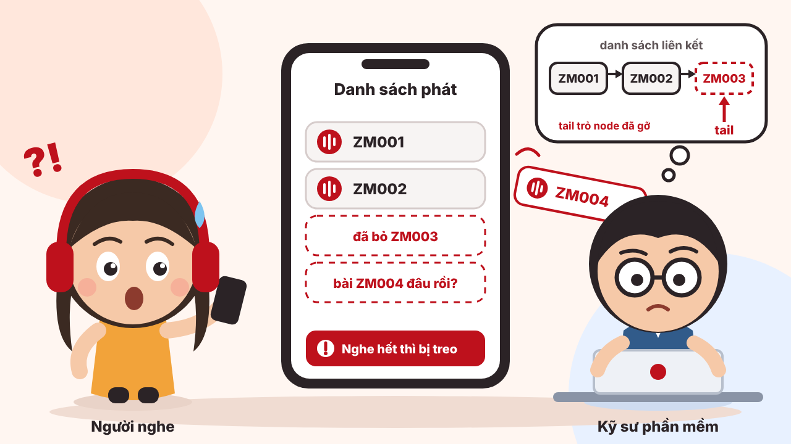

# Lỗi bỏ bài hát khỏi danh sách phát Zing MP3

### 1. Bối cảnh nghiệp vụ



*Người nghe bỏ bài cuối rồi thêm bài mới, nhưng bài mới không xuất hiện trong danh sách phát.*

Bạn là kỹ sư phần mềm trong nhóm xây dựng tính năng danh sách phát của ứng dụng nghe nhạc Zing MP3.

Danh sách phát của mỗi người nghe được lưu bằng **danh sách liên kết đơn** có `head` (bài sẽ phát đầu tiên), `tail` (bài cuối danh sách) và `size` (số bài).

Ví dụ danh sách phát có ba bài:

```plaintext
head                         tail
 |                            |
ZM001  ->  ZM002  ->  ZM003  ->  None        size = 3
```

Trong lúc nghe nhạc có hai thao tác lấy bài ra khỏi danh sách:

- **Phát xong một bài**: ứng dụng lấy bài ở **đầu** danh sách ra để phát (`remove_first`), trả về mã bài đó.
- **Người nghe bấm "Bỏ khỏi danh sách phát"** ở một bài bất kỳ: ứng dụng xóa bài có mã đó (`remove`), trả về `True` nếu xóa được, `False` nếu không có bài đó.

Sau mỗi thao tác, `head`, `tail` và `size` phải đúng với danh sách thật. Khi danh sách đã hết bài mà ứng dụng vẫn gọi phát tiếp, `remove_first` phải báo `IndexError("danh sách phát đang trống")` để phần giao diện hiện thông báo, thay vì làm treo ứng dụng.

Kịch bản kiểm tra của nhóm: danh sách gồm `"ZM001"`, `"ZM002"`, `"ZM003"`; bỏ `"ZM003"` rồi thêm `"ZM004"` vào cuối; bỏ `"ZM001"`; phát lần lượt hai bài còn lại; in số bài và bài cuối; cuối cùng gọi phát tiếp khi danh sách đã trống.

Kết quả đúng cần hiển thị:

```plaintext
Bỏ ZM003: True
Danh sách phát: ZM001 -> ZM002 -> ZM004 -> None
Bỏ ZM001: True
Danh sách phát: ZM002 -> ZM004 -> None
Phát xong: ZM002
Phát xong: ZM004
Số bài còn lại: 0
Bài cuối danh sách: None
Không phát được: danh sách phát đang trống
```

### 2. Vấn đề hiện tại

Người nghe phản ánh: bỏ bài cuối rồi thêm bài mới thì **bài mới không hiện ra**; bấm bỏ bài đang đứng đầu thì **không có gì xảy ra**; số bài hiển thị **không giảm** khi nghe hết; và nghe hết danh sách thì ứng dụng **bị treo**.

Lập trình viên trước đã viết `remove_first` và `remove`, nhưng bỏ sót các trường hợp biên của thao tác xóa trên danh sách liên kết đơn có `tail`:

- Xóa **node cuối**: `tail` phải lùi về node đứng trước. Nếu không, `tail` vẫn trỏ tới node đã bị gỡ, và lần thêm cuối tiếp theo nối bài mới vào node đó.
- Xóa **node đầu**: không có node đứng trước, nên phải xử lý riêng bằng cách dời `head`.
- Xóa **node duy nhất**: cả `head` và `tail` đều phải thành `None`.
- **Danh sách rỗng**: `head` là `None`, gọi `.value` hoặc `.next` trên `None` sẽ báo `AttributeError`.
- `size` phải giảm đúng 1 ở **mọi** lần xóa thành công.

### 3. Mã nguồn hiện tại (Legacy Code)

Tệp `playlist.py` trong thư mục khởi đầu (`add_last` và `to_text` đã đúng, không cần sửa):

```python
class Node:
    def __init__(self, value, next=None):
        self.value = value
        self.next = next


class Playlist:
    def __init__(self):
        self.head = None    # bài sẽ phát đầu tiên
        self.tail = None    # bài cuối danh sách
        self.size = 0       # số bài trong danh sách

    def add_last(self, code):
        # Cho sẵn, đã đúng: thêm bài vào cuối danh sách
        node = Node(code)
        if self.head is None:
            self.head = node
            self.tail = node
        else:
            self.tail.next = node
            self.tail = node
        self.size += 1

    def to_text(self):
        # Cho sẵn, đã đúng
        parts = []
        current = self.head
        while current is not None:
            parts.append(current.value)
            current = current.next
        return " -> ".join(parts + ["None"])

    def remove_first(self):
        # Phát xong bài đầu: lấy bài đầu ra khỏi danh sách và trả về mã bài
        code = self.head.value
        self.head = self.head.next
        return code

    def remove(self, code):
        # Người nghe bỏ một bài: xóa bài có mã code, trả True nếu xóa được
        prev = self.head
        while prev.next is not None:
            if prev.next.value == code:
                prev.next = prev.next.next
                self.size -= 1
                return True
            prev = prev.next
        return False


playlist = Playlist()
for code in ["ZM001", "ZM002", "ZM003"]:
    playlist.add_last(code)
# Người nghe bỏ bài cuối, rồi thêm một bài mới
print("Bỏ ZM003:", playlist.remove("ZM003"))
playlist.add_last("ZM004")
print("Danh sách phát:", playlist.to_text())
# Người nghe bỏ bài đang đứng đầu
print("Bỏ ZM001:", playlist.remove("ZM001"))
print("Danh sách phát:", playlist.to_text())
# Phát lần lượt cho tới hết danh sách
print("Phát xong:", playlist.remove_first())
print("Phát xong:", playlist.remove_first())
print("Số bài còn lại:", playlist.size)
print("Bài cuối danh sách:", playlist.tail)
# Danh sách đã hết bài nhưng ứng dụng vẫn gọi phát tiếp
playlist.remove_first()
```

Kết quả hiển thị trên Console:

```plaintext
Bỏ ZM003: True
Danh sách phát: ZM001 -> ZM002 -> None
Bỏ ZM001: False
Danh sách phát: ZM001 -> ZM002 -> None
Phát xong: ZM001
Phát xong: ZM002
Số bài còn lại: 3
Bài cuối danh sách: <__main__.Node object at 0x...>
Traceback (most recent call last):
  ...
    code = self.head.value
AttributeError: 'NoneType' object has no attribute 'value'
```

Chương trình dừng ở lệnh `remove_first()` cuối cùng. Trước đó, các dòng đã in cũng sai so với kết quả đúng:

- Bài `ZM004` vừa thêm không có trong danh sách phát.
- Bỏ `ZM001` trả về `False` và bài vẫn còn nguyên.
- Đã phát hết mà số bài còn lại vẫn là 3, và `tail` vẫn trỏ tới một node.

### 4. Yêu cầu

Với vai trò kỹ sư phần mềm của nhóm, hãy thực hiện:

**(1) Phân tích lỗi** (trả lời vào `PHAN_TICH.md`)

- Sau lệnh `remove("ZM003")` của mã hiện tại, `tail` đang trỏ tới node nào? Node đó còn nằm trong danh sách không?
- Lệnh `add_last("ZM004")` nối bài mới vào node nào? Vì sao duyệt từ `head` không thấy `ZM004`?
- Trong `remove`, cần thêm lệnh gì, ở đâu, để `tail` đúng khi xóa node cuối?
- Vòng lặp của `remove` bắt đầu so sánh từ node nào? Vì sao `remove("ZM001")` trả về `False`?
- Viết đoạn mã xử lý riêng trường hợp bài cần xóa nằm ở `head`.
- `remove_first` thiếu những việc gì khi (a) xóa node duy nhất, (b) cập nhật `size`?
- Vì sao lệnh `remove_first()` cuối cùng báo `AttributeError`? Cần kiểm tra điều gì ở đầu phương thức, và báo lỗi nào?
- Điều gì xảy ra nếu gọi `remove("ZM001")` trên một danh sách rỗng với mã hiện tại?

**(2) Sửa lỗi**

- Sửa hai phương thức `remove_first` và `remove` trong `playlist.py`. Không đổi tên lớp, tên phương thức; không dùng list Python để lưu các bài.
- Ở đoạn chạy thử cuối tệp, bọc lệnh `remove_first()` cuối cùng bằng `try` / `except IndexError` để in ra dòng `Không phát được: ...`.
- Chạy `python playlist.py` phải cho đúng kết quả:

```plaintext
Bỏ ZM003: True
Danh sách phát: ZM001 -> ZM002 -> ZM004 -> None
Bỏ ZM001: True
Danh sách phát: ZM002 -> ZM004 -> None
Phát xong: ZM002
Phát xong: ZM004
Số bài còn lại: 0
Bài cuối danh sách: None
Không phát được: danh sách phát đang trống
```

- Chạy `pytest -q` phải xanh cả 5 test.

### 5. Quy định nộp bài

1. Tạo một kho GitHub riêng cho bài này, đặt tên theo mẫu `[Tên Lớp]_IT301_Session07_Ex03`.
2. Tải thư mục khởi đầu tại https://github.com/cuongtm191221/it301-bai-tap-ve-nha/tree/main/session-07-danh-sach-lien-ket/bai-03 rồi chép các tệp vào kho: `playlist.py`, `test_playlist.py`, `PHAN_TICH.md`.
3. Điền phần phân tích vào `PHAN_TICH.md`, sửa mã trong tệp mã nguồn.
4. Mức AI của bài: AI-0 (tự làm, không dùng AI).
5. Đưa bài làm lên kho và nộp đường dẫn kho lên hệ thống.
