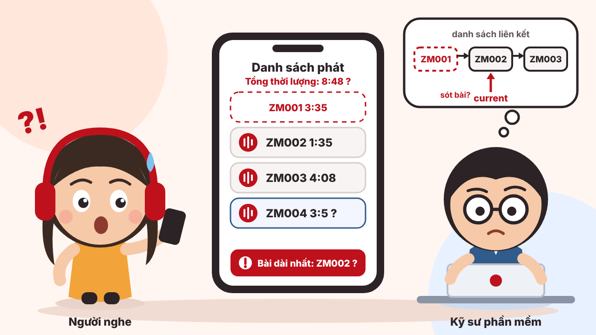

# Lỗi thống kê thời lượng danh sách phát Zing MP3

### 1. Bối cảnh nghiệp vụ



*Màn hình danh sách phát báo tổng thời lượng ngắn hơn thực tế và chọn sai bài dài nhất.*

Bạn là kỹ sư phần mềm trong nhóm xây dựng tính năng danh sách phát của ứng dụng nghe nhạc Zing MP3.

Đầu màn hình danh sách phát có một dòng thống kê: tổng thời lượng của cả danh sách và bài dài nhất. Danh sách phát được lưu bằng **danh sách liên kết đơn**; mỗi node giữ một chuỗi theo định dạng:

```plaintext
"MÃ_BÀI - SỐ_GIÂY"
```

Ví dụ danh sách phát dùng để kiểm tra:

```plaintext
"ZM001 - 215"  ->  "ZM002 - 95"  ->  "ZM003 - 248"  ->  "ZM004 - 185"  ->  None
```

Hệ thống cần ba hàm:

- `total_seconds(playlist)`: tổng số giây của **mọi** bài. Danh sách rỗng thì tổng là 0.
- `longest_song(playlist)`: chuỗi của bài có số giây lớn nhất; hai bài bằng nhau thì lấy bài đứng trước; danh sách rỗng trả về `None`.
- `format_duration(seconds)`: đổi số giây thành chuỗi `"phút:giây"`, phần giây luôn đủ hai chữ số. Ví dụ 185 giây là `"3:05"`, 60 giây là `"1:00"`, 0 giây là `"0:00"`.

Với danh sách trên: 215 + 95 + 248 + 185 = 743 giây, tức 12 phút 23 giây; bài dài nhất là `ZM003` với 248 giây.

Kết quả đúng cần hiển thị:

```plaintext
Tổng thời lượng: 12:23
Bài dài nhất: ZM003 - 248
Thời lượng bài ZM004: 3:05
Tổng thời lượng danh sách mới: 0:00
Bài dài nhất của danh sách mới: None
```

### 2. Vấn đề hiện tại

Người nghe phản ánh: tổng thời lượng hiện ra **ngắn hơn** thời gian nghe thật; bài được gắn nhãn "dài nhất" lại là một bài rất ngắn; có bài hiện thời lượng `3:5`; và mở một danh sách phát mới tạo thì màn hình **bị treo**.

Lập trình viên trước chưa chú ý bốn điều:

- Duyệt danh sách liên kết phải bắt đầu từ `head`. Bắt đầu từ `head.next` là bỏ sót bài đầu tiên.
- Phần số giây lấy ra bằng `split(" - ")` là một **chuỗi**. So sánh hai chuỗi là so từng ký tự từ trái sang, nên `"95" > "248"` cho kết quả `True`. Muốn so theo giá trị số phải đổi sang `int`.
- Phần giây nhỏ hơn 10 phải được thêm số 0 đứng trước.
- Danh sách rỗng có `head` là `None`; mọi hàm phải xử lý trường hợp này trước khi gọi `.next` hay `.value`.

### 3. Mã nguồn hiện tại (Legacy Code)

Tệp `thoi_luong.py` trong thư mục khởi đầu có sẵn lớp `Node`, lớp `Playlist` (các phương thức `add_first`, `add_last`, `find`, `to_text` đã đúng, không cần sửa). Phần cần xem xét là ba hàm thống kê và đoạn chạy thử:

```python
def total_seconds(playlist):
    # Tổng số giây của mọi bài trong danh sách phát
    total = 0
    current = playlist.head.next
    while current is not None:
        total += int(current.value.split(" - ")[1])
        current = current.next
    return total


def longest_song(playlist):
    # Bài có thời lượng dài nhất; bằng nhau thì lấy bài đứng trước; danh sách rỗng trả None
    best = playlist.head
    current = playlist.head.next
    while current is not None:
        if current.value.split(" - ")[1] > best.value.split(" - ")[1]:
            best = current
        current = current.next
    return best.value


def format_duration(seconds):
    # Đổi số giây thành chuỗi "phút:giây", phần giây luôn có hai chữ số
    minutes = seconds // 60
    rest = seconds % 60
    return str(minutes) + ":" + str(rest)


playlist = Playlist()
for song in ["ZM001 - 215", "ZM002 - 95", "ZM003 - 248", "ZM004 - 185"]:
    playlist.add_last(song)
print("Tổng thời lượng:", format_duration(total_seconds(playlist)))
print("Bài dài nhất:", longest_song(playlist))
print("Thời lượng bài ZM004:", format_duration(185))

# Danh sách mới tạo, chưa có bài nào
empty = Playlist()
print("Tổng thời lượng danh sách mới:", format_duration(total_seconds(empty)))
print("Bài dài nhất của danh sách mới:", longest_song(empty))

```

Kết quả hiển thị trên Console:

```plaintext
Tổng thời lượng: 8:48
Bài dài nhất: ZM002 - 95
Thời lượng bài ZM004: 3:5
Traceback (most recent call last):
  ...
    current = playlist.head.next
AttributeError: 'NoneType' object has no attribute 'next'
```

Chương trình dừng ở dòng tính tổng thời lượng của danh sách mới. Trước đó, cả ba dòng đã in đều sai so với kết quả đúng: tổng thời lượng là `8:48` thay vì `12:23`, bài dài nhất là `ZM002 - 95` thay vì `ZM003 - 248`, thời lượng 185 giây hiện là `3:5` thay vì `3:05`.

### 4. Yêu cầu

Với vai trò kỹ sư phần mềm của nhóm, hãy thực hiện:

**(1) Phân tích lỗi** (trả lời vào `PHAN_TICH.md`)

- Tổng `8:48` là bao nhiêu giây? So với 743 giây thì thiếu đúng số giây của bài nào? Từ đó suy ra vòng lặp của `total_seconds` bắt đầu từ node nào.
- Sửa dòng khởi tạo biến `current` trong `total_seconds`. Sau khi sửa, hàm chạy trên danh sách rỗng trả về gì, có còn báo lỗi không?
- Trong `longest_song`, hai giá trị được đem so sánh thuộc kiểu dữ liệu gì? Vì sao `"95" > "248"` lại là `True`?
- Với cách so sánh hiện tại, bài nào được chọn nếu danh sách là `"ZM001 - 95"`, `"ZM002 - 1000"`? Viết lại phép so sánh cho đúng.
- Khi hai bài cùng số giây, mã hiện tại (sau khi sửa phép so sánh) giữ bài đứng trước hay đứng sau? Vì sao?
- `longest_song` cần thêm kiểm tra gì để danh sách rỗng trả về `None`?
- Vì sao `format_duration(185)` ra `3:5`? Nêu một cách để phần giây luôn đủ hai chữ số.
- Ba hàm này có làm thay đổi danh sách phát không? Big-O thời gian của `total_seconds` và `longest_song` là gì (n là số bài)?

**(2) Sửa lỗi**

- Sửa ba hàm `total_seconds`, `longest_song`, `format_duration` trong `thoi_luong.py`. Không đổi tên hàm; không chép các bài sang list Python để tính.
- Chạy `python thoi_luong.py` phải cho đúng kết quả:

```plaintext
Tổng thời lượng: 12:23
Bài dài nhất: ZM003 - 248
Thời lượng bài ZM004: 3:05
Tổng thời lượng danh sách mới: 0:00
Bài dài nhất của danh sách mới: None
```

- Chạy `pytest -q` phải xanh cả 6 test.

### 5. Quy định nộp bài

1. Tạo một kho GitHub riêng cho bài này, đặt tên theo mẫu `[Tên Lớp]_IT301_Session07_Ex05`.
2. Tải thư mục khởi đầu tại https://github.com/cuongtm191221/it301-bai-tap-ve-nha/tree/main/session-07-danh-sach-lien-ket/bai-05 rồi chép các tệp vào kho: `thoi_luong.py`, `test_thoi_luong.py`, `PHAN_TICH.md`.
3. Điền phần phân tích vào `PHAN_TICH.md`, sửa mã trong tệp mã nguồn.
4. Mức AI của bài: AI-0 (tự làm, không dùng AI).
5. Đưa bài làm lên kho và nộp đường dẫn kho lên hệ thống.
