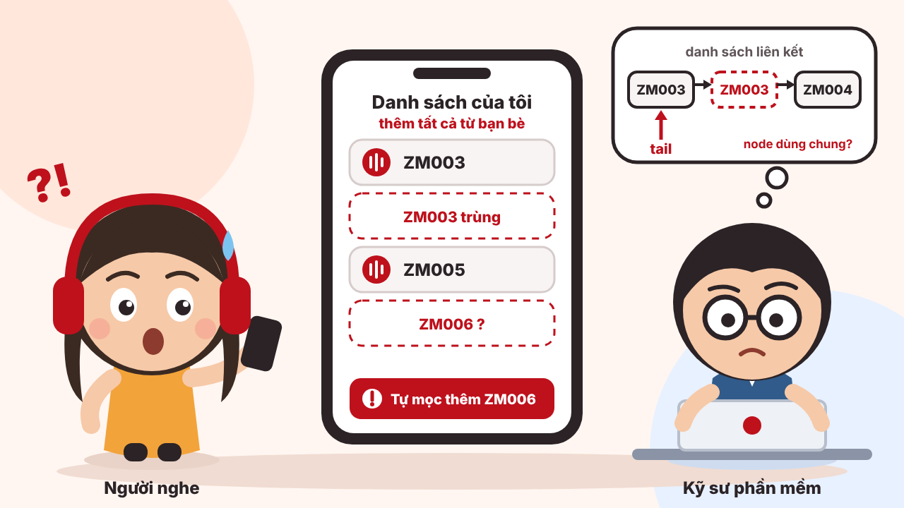

# Lỗi gộp danh sách phát được chia sẻ trên Zing MP3

### 1. Bối cảnh nghiệp vụ



*Người nghe thêm danh sách phát của bạn bè vào danh sách của mình, bị trùng bài và danh sách tự đổi theo bạn.*

Bạn là kỹ sư phần mềm trong nhóm xây dựng tính năng chia sẻ danh sách phát của ứng dụng nghe nhạc Zing MP3.

Khi một người bạn chia sẻ danh sách phát, người nghe có nút **"Thêm tất cả vào danh sách phát của tôi"**. Mỗi danh sách phát là một **danh sách liên kết đơn** có `head`, `tail`, `size`; mỗi node giữ mã một bài.

Ví dụ:

```plaintext
Danh sách của tôi (mine):     ZM001  ->  ZM002  ->  ZM003  ->  None
Danh sách của bạn (shared):   ZM003  ->  ZM004  ->  ZM005  ->  None
```

Hàm `append_all(target, source)` chép các bài của `source` vào cuối `target` theo ba quy tắc nghiệp vụ:

- **Không thêm bài đã có**: `ZM003` đã có trong danh sách của tôi nên bị bỏ qua. Hàm trả về **số bài thật sự được thêm**.
- **Hai danh sách độc lập sau khi gộp**: bạn bè thêm hay bớt bài trong danh sách của họ thì danh sách của tôi không được đổi theo, và ngược lại. Muốn vậy, mỗi bài được thêm phải nằm trong một **node mới** của `target`.
- **Danh sách nguồn giữ nguyên**: `source` không bị thay đổi.

Sau khi gộp, `head`, `tail`, `size` của `target` phải đúng; `target` đang rỗng cũng phải gộp được.

Kịch bản kiểm tra của nhóm: gộp `shared` vào `mine` như ví dụ; in danh sách của tôi, số bài, bài cuối; bạn bè thêm `ZM006` vào danh sách của họ; in lại cả hai danh sách; cuối cùng gộp danh sách của bạn vào một danh sách mới tạo.

Kết quả đúng cần hiển thị:

```plaintext
Số bài đã thêm: 2
Danh sách của tôi: ZM001 -> ZM002 -> ZM003 -> ZM004 -> ZM005 -> None
Số bài: 5 | bài cuối: ZM005
Danh sách của bạn: ZM003 -> ZM004 -> ZM005 -> ZM006 -> None
Danh sách của tôi: ZM001 -> ZM002 -> ZM003 -> ZM004 -> ZM005 -> None
Số bài đã thêm vào danh sách mới: 4
Danh sách mới: ZM003 -> ZM004 -> ZM005 -> ZM006 -> None
```

### 2. Vấn đề hiện tại

Người nghe phản ánh: sau khi bấm "Thêm tất cả", danh sách của họ có **bài bị trùng**; vài hôm sau danh sách đó **tự mọc thêm bài** mà họ không hề thêm; và nếu danh sách của họ đang trống thì ứng dụng **bị treo**.

Lập trình viên trước đã chọn cách nhanh nhất: nối thẳng `tail` của danh sách đích vào `head` của danh sách nguồn. Cách này chỉ tốn O(1), nhưng sai với nghiệp vụ:

- Hai danh sách **dùng chung các node**. Từ lúc đó, mọi thay đổi ở phần đuôi của danh sách này đều hiện ra ở danh sách kia.
- `tail` của danh sách đích không được cập nhật, nên vẫn chỉ vào node cuối cũ.
- Không có bước nào kiểm tra bài đã có hay chưa.
- Danh sách đích rỗng thì `tail` là `None`, gọi `.next` sẽ báo lỗi.

### 3. Mã nguồn hiện tại (Legacy Code)

Tệp `gop_danh_sach.py` trong thư mục khởi đầu có sẵn lớp `Node`, lớp `Playlist` (các phương thức `add_first`, `add_last`, `find`, `to_text` đã đúng, không cần sửa). Phần cần xem xét là hàm `append_all` và đoạn chạy thử:

```python
def append_all(target, source):
    # Chép các bài của source vào cuối target, bỏ qua bài target đã có. Trả về số bài đã thêm.
    target.tail.next = source.head
    target.size += source.size
    return source.size


mine = Playlist()
for code in ["ZM001", "ZM002", "ZM003"]:
    mine.add_last(code)
shared = Playlist()
for code in ["ZM003", "ZM004", "ZM005"]:
    shared.add_last(code)

print("Số bài đã thêm:", append_all(mine, shared))
print("Danh sách của tôi:", mine.to_text())
print("Số bài:", mine.size, "| bài cuối:", mine.tail.value)

# Bạn bè thêm một bài vào danh sách của họ: danh sách của tôi không được đổi theo
shared.add_last("ZM006")
print("Danh sách của bạn:", shared.to_text())
print("Danh sách của tôi:", mine.to_text())

# Danh sách mới tạo nhận bài từ danh sách của bạn
new_list = Playlist()
print("Số bài đã thêm vào danh sách mới:", append_all(new_list, shared))
print("Danh sách mới:", new_list.to_text())

```

Kết quả hiển thị trên Console:

```plaintext
Số bài đã thêm: 3
Danh sách của tôi: ZM001 -> ZM002 -> ZM003 -> ZM003 -> ZM004 -> ZM005 -> None
Số bài: 6 | bài cuối: ZM003
Danh sách của bạn: ZM003 -> ZM004 -> ZM005 -> ZM006 -> None
Danh sách của tôi: ZM001 -> ZM002 -> ZM003 -> ZM003 -> ZM004 -> ZM005 -> ZM006 -> None
Traceback (most recent call last):
  ...
    target.tail.next = source.head
AttributeError: 'NoneType' object has no attribute 'next'
```

Chương trình dừng ở lần gộp vào danh sách mới. Trước đó, đối chiếu với kết quả đúng: số bài đã thêm là 3 thay vì 2; danh sách của tôi có hai bài `ZM003`; số bài là 6 và bài cuối là `ZM003` thay vì 5 và `ZM005`; sau khi bạn bè thêm `ZM006`, danh sách của tôi cũng có `ZM006`.

### 4. Yêu cầu

Với vai trò kỹ sư phần mềm của nhóm, hãy thực hiện:

**(1) Phân tích lỗi** (trả lời vào `PHAN_TICH.md`)

- Vẽ hai danh sách sau lệnh `target.tail.next = source.head`: node `ZM003` thứ hai, `ZM004`, `ZM005` thuộc về danh sách nào?
- Vì sao sau khi bạn bè gọi `shared.add_last("ZM006")`, bài `ZM006` xuất hiện trong danh sách của tôi?
- Sau lệnh nối, `mine.tail` đang trỏ tới node nào? Nếu lúc này tôi gọi `mine.add_last("ZM007")` thì chuyện gì xảy ra với các bài `ZM003` (thứ hai), `ZM004`, `ZM005` trong danh sách của tôi? Còn danh sách của bạn thì sao?
- Để hai danh sách độc lập, mỗi bài của `source` phải được đưa vào `target` bằng cách nào? Phương thức có sẵn nào của `Playlist` làm đúng việc đó và tự lo `tail`, `size`?
- Dùng phương thức có sẵn nào để biết một bài đã có trong `target` hay chưa? Khi nào thì tăng biến đếm số bài đã thêm?
- Vì sao mã hiện tại báo `AttributeError` khi `target` rỗng? Cách làm mới của bạn có cần xử lý riêng trường hợp này không?
- Cách nối thẳng tốn O(1). Cách làm đúng của bạn tốn bao nhiêu, với n là số bài của `target` và m là số bài của `source`? Phần nào tốn nhất?
- Nêu một trường hợp mà nối thẳng hai danh sách là chấp nhận được, và điều kiện đi kèm.

**(2) Sửa lỗi**

- Viết lại hàm `append_all` trong `gop_danh_sach.py`. Không đổi tên hàm, tham số; không sửa lớp `Playlist`; không dùng list Python hay `set` để lưu các bài.
- Chạy `python gop_danh_sach.py` phải cho đúng kết quả:

```plaintext
Số bài đã thêm: 2
Danh sách của tôi: ZM001 -> ZM002 -> ZM003 -> ZM004 -> ZM005 -> None
Số bài: 5 | bài cuối: ZM005
Danh sách của bạn: ZM003 -> ZM004 -> ZM005 -> ZM006 -> None
Danh sách của tôi: ZM001 -> ZM002 -> ZM003 -> ZM004 -> ZM005 -> None
Số bài đã thêm vào danh sách mới: 4
Danh sách mới: ZM003 -> ZM004 -> ZM005 -> ZM006 -> None
```

- Chạy `pytest -q` phải xanh cả 5 test.

### 5. Quy định nộp bài

1. Tạo một kho GitHub riêng cho bài này, đặt tên theo mẫu `[Tên Lớp]_IT301_Session07_Ex07`.
2. Tải thư mục khởi đầu tại https://github.com/cuongtm191221/it301-bai-tap-ve-nha/tree/main/session-07-danh-sach-lien-ket/bai-07 rồi chép các tệp vào kho: `gop_danh_sach.py`, `test_gop_danh_sach.py`, `PHAN_TICH.md`.
3. Điền phần phân tích vào `PHAN_TICH.md`, sửa mã trong tệp mã nguồn.
4. Mức AI của bài: AI-0 (tự làm, không dùng AI).
5. Đưa bài làm lên kho và nộp đường dẫn kho lên hệ thống.
