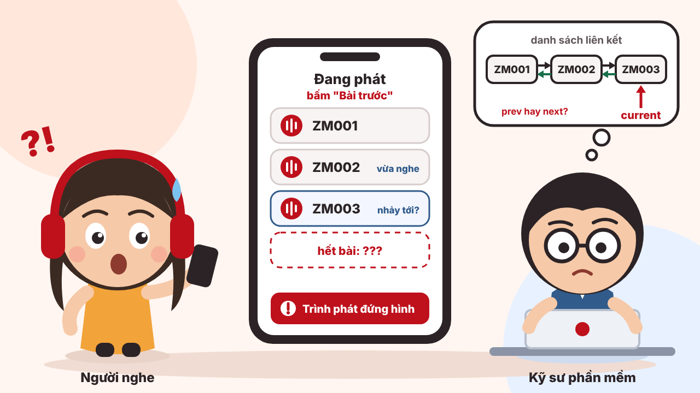

# Lỗi nút "Bài trước" và "Bài tiếp theo" của trình phát Zing MP3

### 1. Bối cảnh nghiệp vụ



*Người nghe bấm Bài trước nhưng trình phát lại nhảy sang bài sau, rồi đứng hình ở bài cuối.*

Bạn là kỹ sư phần mềm trong nhóm xây dựng trình phát nhạc của ứng dụng Zing MP3.

Thanh điều khiển của trình phát có hai nút: **"Bài trước"** và **"Bài tiếp theo"**. Vì phải đi được cả hai chiều, danh sách phát được lưu bằng **danh sách liên kết đôi**: mỗi node có `prev` và `next`. Lớp `Player` giữ thêm con trỏ `current` chỉ tới node của **bài đang phát**; khi chưa phát bài nào thì `current` là `None`.

Ví dụ danh sách có ba bài, đang phát bài thứ hai:

```plaintext
head                              tail
 |                                 |
ZM001  <->  ZM002  <->  ZM003
              ^
           current
```

Ba thao tác, mỗi thao tác **trả về** một thông báo để giao diện hiển thị:

- `play_first()`: bắt đầu phát từ bài đầu, trả về `Đang phát: ZM001`. Danh sách chưa có bài nào thì trả về `Danh sách phát đang trống.`
- `next_song()`: chuyển sang bài kế tiếp, trả về `Đang phát: ...`. Đang ở bài cuối thì **giữ nguyên bài đang phát** và trả về `Đã ở bài cuối, không thể chuyển tiếp.`
- `prev_song()`: lùi về bài đứng trước, trả về `Đang phát: ...`. Đang ở bài đầu thì giữ nguyên và trả về `Đã ở bài đầu, không thể lùi.`
- Nếu chưa phát bài nào mà người nghe bấm một trong hai nút, cả hai phương thức trả về `Chưa phát bài nào.`

Kịch bản kiểm tra của nhóm: danh sách `ZM001`, `ZM002`, `ZM003`; phát từ đầu; bấm tiếp, trước, trước, tiếp, tiếp, tiếp, tiếp; in bài đang phát; rồi với một trình phát mới mở, bấm "Bài tiếp theo" và "phát từ đầu".

Kết quả đúng cần hiển thị:

```plaintext
Đang phát: ZM001
Đang phát: ZM002
Đang phát: ZM001
Đã ở bài đầu, không thể lùi.
Đang phát: ZM002
Đang phát: ZM003
Đã ở bài cuối, không thể chuyển tiếp.
Đã ở bài cuối, không thể chuyển tiếp.
Bài đang phát: ZM003
Chưa phát bài nào.
Danh sách phát đang trống.
```

### 2. Vấn đề hiện tại

Người nghe phản ánh: bấm "Bài trước" thì trình phát lại **nhảy sang bài sau**; nghe tới bài cuối mà bấm "Bài tiếp theo" thì trình phát **đứng hình**, phải tắt ứng dụng mở lại.

Lập trình viên trước viết `next_song` xong thì chép nguyên sang `prev_song`, và chưa nghĩ tới các vị trí biên của con trỏ `current`:

- Lùi về bài trước phải đi theo `prev`; tiến tới bài sau đi theo `next`.
- Ở bài cuối, `current.next` là `None`. Nếu vẫn gán `current = current.next` thì `current` thành `None`: trình phát **mất dấu bài đang phát**, và lệnh `current.value` tiếp theo báo `AttributeError`.
- Tương tự ở bài đầu với `current.prev`.
- Phải kiểm tra biên **trước khi** dời `current`; khi không dời được thì `current` giữ nguyên.
- `current` là `None` (chưa phát bài nào) cũng là một trường hợp phải xử lý.

### 3. Mã nguồn hiện tại (Legacy Code)

Tệp `trinh_phat.py` trong thư mục khởi đầu (`add_last` đã đúng, không cần sửa):

```python
class Node:
    def __init__(self, value):
        self.value = value
        self.prev = None
        self.next = None


class Player:
    def __init__(self):
        self.head = None       # bài đầu danh sách phát
        self.tail = None       # bài cuối danh sách phát
        self.current = None    # bài đang phát, None khi chưa phát bài nào

    def add_last(self, code):
        # Cho sẵn, đã đúng: thêm bài vào cuối, nối đủ hai chiều
        node = Node(code)
        if self.tail is None:
            self.head = node
            self.tail = node
        else:
            node.prev = self.tail
            self.tail.next = node
            self.tail = node

    def play_first(self):
        # Bắt đầu phát từ bài đầu danh sách
        self.current = self.head
        return "Đang phát: " + self.current.value

    def next_song(self):
        # Nút "Bài tiếp theo"
        self.current = self.current.next
        return "Đang phát: " + self.current.value

    def prev_song(self):
        # Nút "Bài trước"
        self.current = self.current.next
        return "Đang phát: " + self.current.value


player = Player()
for code in ["ZM001", "ZM002", "ZM003"]:
    player.add_last(code)
print(player.play_first())
print(player.next_song())
print(player.prev_song())
print(player.prev_song())
print(player.next_song())
print(player.next_song())
print(player.next_song())
print(player.next_song())
print("Bài đang phát:", player.current.value)

# Trình phát mới mở, chưa có bài và chưa phát bài nào
new_player = Player()
print(new_player.next_song())
print(new_player.play_first())
```

Kết quả hiển thị trên Console:

```plaintext
Đang phát: ZM001
Đang phát: ZM002
Đang phát: ZM003
Traceback (most recent call last):
  ...
    return "Đang phát: " + self.current.value
AttributeError: 'NoneType' object has no attribute 'value'
```

Chương trình dừng ở lần bấm "Bài trước" thứ hai. Trước đó, dòng thứ ba đã sai: sau khi bấm "Bài trước" ở `ZM002`, trình phát phải về `ZM001` nhưng lại báo `Đang phát: ZM003`.

### 4. Yêu cầu

Với vai trò kỹ sư phần mềm của nhóm, hãy thực hiện:

**(1) Phân tích lỗi** (trả lời vào `PHAN_TICH.md`)

- Sau `play_first()` và `next_song()`, `current` đang ở node nào? Lệnh `prev_song()` của mã hiện tại dời `current` theo liên kết nào, tới node nào?
- Sửa dòng lệnh nào trong `prev_song` để lùi đúng chiều?
- Ở lần bấm "Bài trước" thứ hai của mã hiện tại, `current` đang ở `ZM003`. Sau lệnh gán, `current` có giá trị gì? Vì sao dòng `return` báo `AttributeError: 'NoneType' object has no attribute 'value'`?
- Sau lỗi đó, trình phát còn biết bài đang phát là bài nào không? Vì sao phải kiểm tra biên trước khi dời `current`, không phải sau?
- Viết điều kiện nhận biết "đang ở bài cuối" và "đang ở bài đầu" chỉ bằng `current`, không dùng `head`, `tail`.
- Với trình phát mới mở, `current` là gì? `next_song()` của mã hiện tại báo lỗi gì, ở dòng nào?
- `play_first()` của mã hiện tại làm gì khi danh sách chưa có bài nào? Cần sửa thế nào?
- Mỗi lần bấm nút tốn bao nhiêu bước, dù danh sách có 3 bài hay 3.000 bài? Nếu danh sách phát là danh sách liên kết đơn thì nút "Bài trước" tốn bao nhiêu bước, vì sao?

**(2) Sửa lỗi**

- Sửa ba phương thức `play_first`, `next_song`, `prev_song` trong `trinh_phat.py`. Không đổi tên lớp, tên phương thức; không dùng list Python để lưu các bài. Các thông báo phải đúng từng ký tự.
- Chạy `python trinh_phat.py` phải cho đúng kết quả:

```plaintext
Đang phát: ZM001
Đang phát: ZM002
Đang phát: ZM001
Đã ở bài đầu, không thể lùi.
Đang phát: ZM002
Đang phát: ZM003
Đã ở bài cuối, không thể chuyển tiếp.
Đã ở bài cuối, không thể chuyển tiếp.
Bài đang phát: ZM003
Chưa phát bài nào.
Danh sách phát đang trống.
```

- Chạy `pytest -q` phải xanh cả 5 test.

### 5. Quy định nộp bài

1. Tạo một kho GitHub riêng cho bài này, đặt tên theo mẫu `[Tên Lớp]_IT301_Session07_Ex08`.
2. Tải thư mục khởi đầu tại https://github.com/cuongtm191221/it301-bai-tap-ve-nha/tree/main/session-07-danh-sach-lien-ket/bai-08 rồi chép các tệp vào kho: `trinh_phat.py`, `test_trinh_phat.py`, `PHAN_TICH.md`.
3. Điền phần phân tích vào `PHAN_TICH.md`, sửa mã trong tệp mã nguồn.
4. Mức AI của bài: AI-0 (tự làm, không dùng AI).
5. Đưa bài làm lên kho và nộp đường dẫn kho lên hệ thống.
