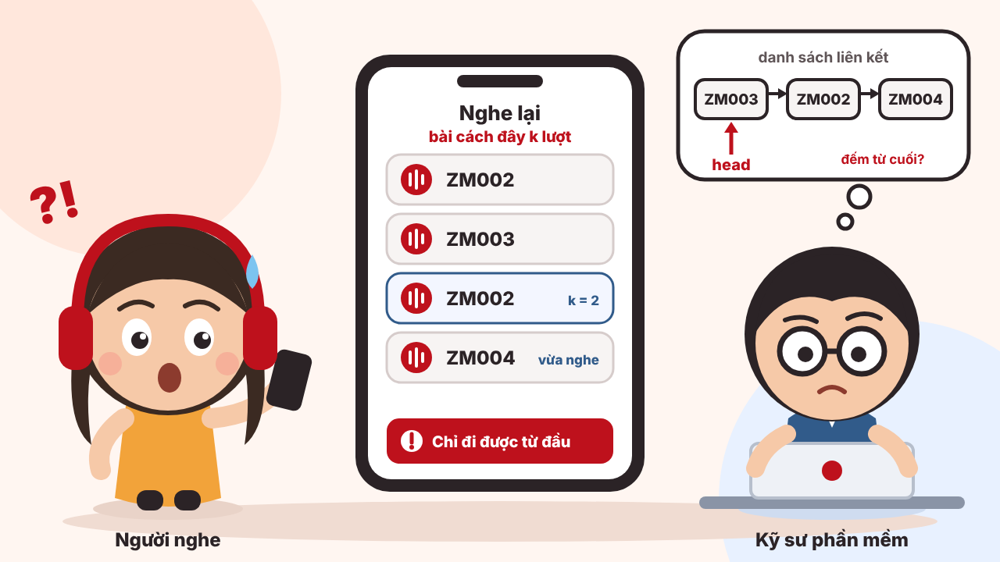

# Nút "Nghe lại bài cách đây k lượt" trên Zing MP3

### 1. Bối cảnh & Vấn đề



*Người nghe muốn mở lại bài đã nghe cách đây vài lượt, trong khi nhật ký nghe chỉ đi được một chiều.*

Trong ứng dụng nghe nhạc Zing MP3, màn hình trình phát có nút **"Nghe lại"**: người nghe chọn một số `k`, ứng dụng mở lại bài đã nghe **cách đây k lượt**. `k = 1` là bài vừa nghe xong gần nhất, `k = 2` là bài trước đó.

Máy chủ gửi về **nhật ký nghe** của phiên hiện tại dưới dạng một **danh sách liên kết đơn**, bài nghe **sớm nhất đứng đầu**, bài vừa nghe đứng cuối. Mỗi node giữ chuỗi `"MÃ_BÀI - TÊN_BÀI"`. Ứng dụng chỉ nhận được **node đầu** (`head`): không có `tail`, không có `size`, không có liên kết `prev`.

Ví dụ nhật ký có năm lượt nghe (một bài có thể được nghe nhiều lần):

```plaintext
head
 |
ZM001 - Bình minh trên phố -> ZM002 - Mưa đêm -> ZM003 - Đường về nhà -> ZM002 - Mưa đêm -> ZM004 - Phố cũ -> None

k = 1: ZM004 - Phố cũ
k = 2: ZM002 - Mưa đêm
k = 5: ZM001 - Bình minh trên phố
```

Vấn đề: bài cần lấy được tính **từ cuối**, nhưng danh sách liên kết đơn chỉ đi được **từ đầu**, và ứng dụng không biết trước nhật ký dài bao nhiêu. Nhật ký của một phiên nghe dài có thể tới hàng nghìn lượt, nên nhóm không chấp nhận cách chép cả nhật ký sang list Python rồi lấy phần tử `[-k]`.

Bạn được giao thiết kế và viết chức năng này. Vì có nhiều cách làm, trưởng nhóm yêu cầu bạn đề xuất ít nhất hai giải pháp, so sánh rồi mới chọn.

### 2. Yêu cầu nghiệp vụ

Tệp `nghe_lai.py` có sẵn lớp `Node` và hàm `build_log` (tạo nhật ký từ một list chuỗi để chạy thử). Bạn viết ba hàm.

**2.1. Hai hàm tìm bài: `kth_from_end_v1(head, k)` và `kth_from_end_v2(head, k)`**

Mỗi hàm cài một giải pháp của bạn. Cả hai nhận node đầu của nhật ký và số nguyên `k`, **trả về chuỗi `value`** của node thứ `k` tính từ cuối. Khi không có node như vậy, trả về `None` (xem các bẫy ở mục 3). Hai hàm phải cho cùng kết quả với mọi dữ liệu, nhưng **khác nhau về cách làm**.

Ràng buộc cho cả hai hàm:

- Không chép nhật ký sang list, tuple, dict hay chuỗi.
- Không thêm thuộc tính vào `Node`, không sửa liên kết của nhật ký.

**2.2. Thông báo cho giao diện: `replay_message(head, k)`**

Dùng một trong hai hàm trên (hàm bạn đã chọn ở phần phân tích) và trả về thông báo:

```plaintext
Bài cách đây 2 lượt nghe: ZM002 - Mưa đêm
```

### 3. Edge Cases (Bẫy dữ liệu)

**Bẫy 1 — `k` lớn hơn số lượt nghe**

- Nhật ký có 5 lượt, người nghe chọn `k = 6`. Hai hàm tìm bài trả về `None`, không được báo lỗi. `replay_message` trả về:

```plaintext
Không có bài cách đây 6 lượt nghe.
```

**Bẫy 2 — `k` bằng 0 hoặc âm**

- Hai hàm tìm bài trả về `None`. `replay_message` trả về:

```plaintext
Số lượt phải từ 1 trở lên.
```

**Bẫy 3 — Nhật ký trống hoặc chỉ có một lượt nghe**

- `head` là `None`: hai hàm tìm bài trả về `None` với mọi `k`. `replay_message` trả về thông báo dưới đây, kể cả khi `k` không hợp lệ:

```plaintext
Nhật ký nghe đang trống.
```

- Nhật ký có đúng một lượt: `k = 1` trả về bài đó, `k = 2` trả về `None`.

**Bẫy 4 — Nhật ký không được thay đổi**

- Sau khi gọi hàm (kể cả với `k` không hợp lệ), duyệt lại nhật ký từ `head` phải gặp đúng các bài như trước, đúng thứ tự.

**Bẫy 5 — Bài cần lấy là node đầu**

- `k` bằng đúng số lượt nghe (ví dụ `k = 5` với nhật ký năm lượt) phải trả về node đầu. Đây là chỗ dễ lệch một đơn vị: thử cả `k = 4`, `k = 5`, `k = 6` khi chạy tay.

**Kịch bản chạy thử.** Chạy `python nghe_lai.py` (đoạn chạy thử có sẵn ở cuối tệp, dùng nhật ký ở mục 1 với `k` lần lượt là 1, 2, 5, 6, 0, rồi một nhật ký trống) phải in ra đúng:

```plaintext
Bài cách đây 1 lượt nghe: ZM004 - Phố cũ
Bài cách đây 2 lượt nghe: ZM002 - Mưa đêm
Bài cách đây 5 lượt nghe: ZM001 - Bình minh trên phố
Không có bài cách đây 6 lượt nghe.
Số lượt phải từ 1 trở lên.
Nhật ký nghe đang trống.
Giải pháp 1: ZM003 - Đường về nhà | Giải pháp 2: ZM003 - Đường về nhà
```

### 4. Yêu cầu

Với vai trò kỹ sư phần mềm, bạn phải thực hiện đầy đủ ba phần sau:

**(1) Đề xuất và phân tích nhiều giải pháp (bắt buộc, viết vào `PHAN_TICH.md`)**

- Phân tích Input/Output của ba hàm: kiểu dữ liệu đầu vào, giá trị trả về trong trường hợp thường và trong từng bẫy.
- Đề xuất **ít nhất hai giải pháp** khác nhau về cách làm cho việc tìm node thứ `k` tính từ cuối. Với mỗi giải pháp: mô tả ý tưởng trong 2–3 câu, vẽ hình minh họa trên ví dụ ở mục 1, viết mã giả.
- So sánh các giải pháp theo bảng 5 tiêu chí: thời gian (Big-O), bộ nhớ dùng thêm (Big-O), số lượt duyệt qua nhật ký, độ dễ đọc và dễ bảo trì, mức phù hợp với bối cảnh của bài.
- Chọn giải pháp dùng cho `replay_message` và nêu lý do dựa trên bảng so sánh. Lựa chọn không có lý do không được tính điểm.

**(2) Chạy tay**

- Với mỗi giải pháp, lập bảng chạy tay trên nhật ký ở mục 1 cho `k = 2` và `k = 6`: ghi giá trị các biến sau từng bước.

**(3) Triển khai code**

- Viết thân ba hàm trong `nghe_lai.py`. Không đổi tên hàm, tham số.
- Xử lý đủ 5 bẫy ở mục 3; `python nghe_lai.py` in đúng kịch bản chạy thử; `pytest -q` xanh cả 14 test (mỗi test về tìm bài chạy trên cả hai hàm).
- Mã sạch, dễ đọc, tên biến theo snake_case, có chú thích nêu ý tưởng ở đầu mỗi hàm.

### 5. Quy định nộp bài

1. Tạo một kho GitHub riêng cho bài này, đặt tên theo mẫu `[Tên Lớp]_IT301_Session07_Ex13`.
2. Tải thư mục khởi đầu tại https://github.com/cuongtm191221/it301-bai-tap-ve-nha/tree/main/session-07-danh-sach-lien-ket/bai-13 rồi chép các tệp vào kho: `nghe_lai.py`, `test_nghe_lai.py`, `PHAN_TICH.md`.
3. Điền phần phân tích vào `PHAN_TICH.md`, viết mã trong `nghe_lai.py`.
4. Mức AI của bài: AI-0 (tự làm, không dùng AI).
5. Đưa bài làm lên kho và nộp đường dẫn kho lên hệ thống.
