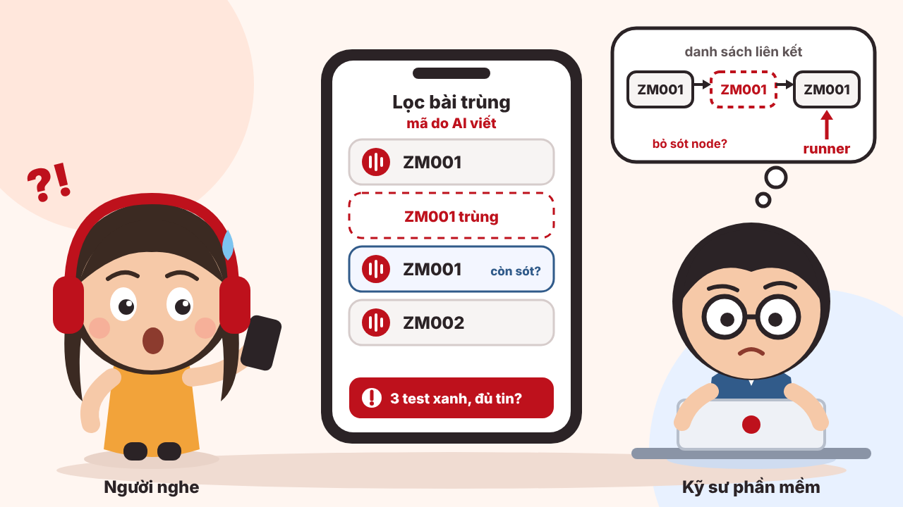

# Phản biện mã do AI viết: lọc bài trùng trong danh sách phát Zing MP3

### 1. Bối cảnh & Vấn đề



*Trợ lý AI viết xong hàm lọc bài trùng trong vài giây, ba test đều xanh. Kỹ sư có nên đưa lên bản chính thức?*

Trong ứng dụng nghe nhạc Zing MP3, khi người nghe gộp nhiều danh sách phát, cùng một bài có thể xuất hiện nhiều lần. Nhóm cần chức năng **"Lọc bài trùng"**: với mỗi mã bài, giữ lại **lần xuất hiện đầu tiên**, bỏ các lần sau, các bài còn lại giữ nguyên thứ tự.

Danh sách phát là **danh sách liên kết đơn có `head`, `tail`, `size`**, mỗi node giữ một mã bài:

```plaintext
Trước khi lọc:  ZM001 -> ZM002 -> ZM001 -> ZM003 -> ZM002 -> None     (5 bài)
Sau khi lọc:    ZM001 -> ZM002 -> ZM003 -> None                       (3 bài, đã bỏ 2)
```

Sau khi lọc, hàm trả về **số bài đã bỏ**; `size` phải bằng số bài còn lại; `tail` phải là node cuối và `tail.next` là `None`, để các chức năng khác (thêm bài, đếm bài) tiếp tục chạy đúng.

Một đồng nghiệp đã nhờ trợ lý AI viết hàm này. AI trả về đoạn mã kèm ba test, cả ba đều xanh, và đồng nghiệp đề nghị đưa lên bản chính thức ngay hôm nay. Bạn là người **duyệt mã**. Quy định của nhóm: mã do AI sinh chỉ được dùng khi người duyệt đã tự chạy thử với dữ liệu của mình và chịu trách nhiệm về nó.

### 2. Mã do AI sinh

Tệp `loc_trung.py` trong thư mục khởi đầu có sẵn lớp `Node`, lớp `Playlist` (`add_last`, `to_text` đã đúng, không cần sửa) và hàm do AI viết:

```python
def remove_duplicates(playlist):
    """Bỏ các bài trùng mã, giữ lại lần xuất hiện đầu tiên. Trả về số bài đã bỏ."""
    removed = 0
    current = playlist.head
    while current is not None:
        runner = current
        while runner.next is not None:
            if runner.next.value == current.value:
                runner.next = runner.next.next
                removed += 1
            runner = runner.next
        current = current.next
    return removed
```

Lời giải thích AI gửi kèm: "Hàm dùng hai vòng lặp lồng nhau: `current` lần lượt đứng ở từng bài, `runner` đi qua các bài phía sau và gỡ những node có cùng mã. Độ phức tạp O(n²), không dùng thêm bộ nhớ. Đã kiểm tra với ba test."

Ba test của AI nằm trong `test_loc_trung.py`: danh sách không có bài trùng, danh sách có một bài trùng ở giữa, danh sách trống. Chạy thử đoạn cuối tệp:

```plaintext
Trước khi lọc: ZM001 -> ZM002 -> ZM001 -> ZM003 -> None
Số bài đã bỏ: 1
Sau khi lọc: ZM001 -> ZM002 -> ZM003 -> None
```

Kết quả trông đúng. Đoạn chạy thử này nằm ở cuối tệp; bạn sẽ sửa nó để thử các bộ dữ liệu khác. Nhiệm vụ của bạn là tìm ra những dữ liệu mà đoạn mã này **không** xử lý đúng.

### 3. Các hướng cần kiểm chứng

Ba test của AI đều dùng dữ liệu "đẹp". Hãy kiểm chứng đoạn mã với những tình huống có thật trong nghiệp vụ dưới đây. Đề không cho biết tình huống nào làm lộ lỗi; bạn phải tự chạy tay hoặc chạy thử để biết.

**Hướng 1 — Vị trí của bài trùng**

- Bài trùng đứng **liền ngay sau** bài gốc; nhiều bài trùng đứng liền nhau (người nghe bấm "Thêm" ba lần liên tiếp).
- Bài trùng là **bài cuối cùng** của danh sách.

**Hướng 2 — Trạng thái của danh sách sau khi lọc**

- `size` sau khi lọc.
- `tail` sau khi lọc, và điều xảy ra khi gọi `add_last` ngay sau đó.

**Hướng 3 — Dữ liệu ở biên**

- Mọi bài trong danh sách đều cùng một mã.
- Danh sách chỉ có một bài.

**Hướng 4 — Lời giải thích của AI**

- "O(n²), không dùng thêm bộ nhớ" có đúng không? Với danh sách phát 10.000 bài, vòng lặp trong chạy khoảng bao nhiêu lượt?

### 4. Yêu cầu

Với vai trò người duyệt mã, bạn phải thực hiện đầy đủ bốn phần sau:

**(1) Tìm dữ liệu làm lộ lỗi**

- Theo các hướng ở mục 3, tự nghĩ ra **ít nhất 6 bộ dữ liệu thử** (mỗi bộ là một dãy mã bài). Với mỗi bộ: dự đoán kết quả đúng trước, rồi sửa đoạn chạy thử ở cuối `loc_trung.py` để chạy hàm của AI trên bộ đó và in ra số bài đã bỏ, danh sách sau khi lọc, `size`, `tail.value`.
- Ghi vào bảng trong `PHAN_TICH.md`: dữ liệu, kết quả đúng, kết quả thực tế (hoặc thông báo lỗi), đúng hay sai. Các bộ dữ liệu của bạn phải làm lộ **ít nhất 3 lỗi khác nhau**.

**(2) Phân tích (viết vào `PHAN_TICH.md`)**

- Với mỗi lỗi: dòng lệnh gây lỗi và bảng chạy tay trên bộ dữ liệu nhỏ nhất làm lộ lỗi đó, cho thấy lỗi xuất hiện ở bước nào.
- Điền bảng **"Nhật ký giữ – sửa – loại bỏ"**: phần nào trong mã của AI bạn giữ nguyên, phần nào sửa, phần nào bỏ, kèm lý do.
- Đề xuất **giải pháp thứ hai** nhanh hơn cho danh sách dài. So sánh hai giải pháp theo bảng 5 tiêu chí: thời gian (Big-O), bộ nhớ dùng thêm (Big-O), số lượt duyệt, độ dễ đọc, mức phù hợp khi danh sách có 100 bài và khi có 10.000 bài. Nêu rõ bạn chọn giải pháp nào cho bản chính thức.
- Trả lời hướng 4: nhận xét về lời giải thích của AI.

**(3) Sửa mã và cài giải pháp thứ hai (trong `loc_trung.py`)**

- Sửa hàm `remove_duplicates` (giữ cách làm hai vòng lặp, không dùng thêm bộ nhớ) để hết mọi lỗi bạn tìm được.
- Viết hàm `remove_duplicates_fast` theo giải pháp thứ hai của bạn; được dùng `set` hoặc `dict` để ghi nhớ, không chép các bài sang list rồi dựng lại danh sách.
- Cả hai hàm: gỡ node ngay trên danh sách, trả về số bài đã bỏ, cập nhật đúng `size` và `tail`.

**(4) Kiểm chứng sau khi sửa**

- Chạy lại **toàn bộ** các bộ dữ liệu thử ở phần (1) trên cả hai hàm đã sửa, ghi kết quả vào cột "Sau khi sửa" của bảng. Mọi dòng phải đúng, kể cả `size` và `tail`.
- `pytest -q` vẫn xanh cả ba test có sẵn của AI.

### 5. Quy định nộp bài

1. Tạo một kho GitHub riêng cho bài này, đặt tên theo mẫu `[Tên Lớp]_IT301_Session07_Ex15`.
2. Tải thư mục khởi đầu tại https://github.com/cuongtm191221/it301-bai-tap-ve-nha/tree/main/session-07-danh-sach-lien-ket/bai-15 rồi chép các tệp vào kho: `loc_trung.py`, `test_loc_trung.py`, `PHAN_TICH.md`.
3. Điền `PHAN_TICH.md`, sửa và viết mã trong `loc_trung.py`.
4. Mức AI của bài: AI-2 cho phần phản biện (đề đã cung cấp mã do AI sinh; bạn được hỏi AI để hiểu đoạn mã, nhưng dữ liệu thử, phân tích và mã sửa phải do bạn tự làm và tự kiểm chứng).
5. Đưa bài làm lên kho và nộp đường dẫn kho lên hệ thống.
