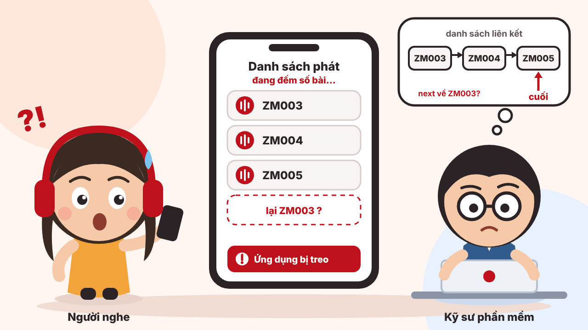

# Danh sách phát bị lặp vòng làm treo ứng dụng Zing MP3

### 1. Bối cảnh & Vấn đề



*Sau một lần đồng bộ lỗi, bài cuối trỏ ngược về giữa danh sách: ứng dụng đếm bài mãi không xong.*

Trong ứng dụng nghe nhạc Zing MP3, danh sách phát của người nghe được đồng bộ giữa điện thoại và máy tính. Mỗi danh sách là một **danh sách liên kết đơn**; mỗi node giữ một mã bài. Các chức năng như đếm số bài, tính tổng thời lượng, hiển thị đều duyệt từ node đầu cho tới khi gặp `None`.

Tuần này bộ phận hỗ trợ nhận nhiều phản ánh: mở một số danh sách phát thì ứng dụng **treo cứng**, pin tụt nhanh. Nhóm kiểm tra dữ liệu và thấy sau một lần đồng bộ lỗi, node cuối của các danh sách này không trỏ tới `None` mà trỏ **ngược về một node phía trước**:

```plaintext
Bình thường:   ZM001 -> ZM002 -> ZM003 -> ZM004 -> ZM005 -> None

Bị lặp vòng:   ZM001 -> ZM002 -> ZM003 -> ZM004 -> ZM005
                                  ^                    |
                                  +--------------------+
```

Với danh sách bị lặp vòng, vòng lặp `while current is not None` không bao giờ dừng. Trong lúc chờ sửa bộ đồng bộ, nhóm cần một hàm **phát hiện danh sách bị lặp vòng** để ứng dụng kiểm tra trước khi duyệt.

Hàm này chạy mỗi lần mở một danh sách phát, trên điện thoại, với danh sách có thể tới 10.000 bài. Vì vậy trưởng nhóm yêu cầu bạn đề xuất ít nhất hai giải pháp, so sánh về thời gian và bộ nhớ rồi mới chọn. Lưu ý: hàm chỉ nhận **node đầu**; không thể tin `size` hay `tail` vì chính chúng cũng có thể đã sai sau lần đồng bộ lỗi.

### 2. Yêu cầu nghiệp vụ

Tệp `lap_vong.py` có sẵn lớp `Node` và hàm `build(values, loop_to)` để tạo danh sách chạy thử: `build(["ZM001", "ZM002", "ZM003"], loop_to=1)` tạo danh sách ba bài mà node cuối trỏ về node ở vị trí 1 (tính từ 0). Bạn viết ba hàm.

**2.1. Hai hàm phát hiện: `has_loop_v1(head)` và `has_loop_v2(head)`**

Mỗi hàm cài một giải pháp của bạn. Cả hai nhận node đầu, trả về `True` nếu danh sách bị lặp vòng, `False` nếu duyệt tới được `None`. Hai hàm phải cho cùng kết quả với mọi dữ liệu, nhưng **khác nhau về cách làm**.

Ràng buộc cho cả hai hàm:

- Phải **luôn dừng**, kể cả với danh sách bị lặp vòng. Không dùng cách "duyệt quá một số bước cố định thì coi là lặp vòng" (ví dụ quá 100.000 bước): danh sách thật có thể dài hơn con số đó.
- Không sửa danh sách: không đổi `value`, không đổi `next`, không thêm thuộc tính vào `Node`.

**2.2. Đếm an toàn: `count_message(head)`**

Dùng một trong hai hàm trên (hàm bạn đã chọn ở phần phân tích) để kiểm tra trước, rồi trả về thông báo:

```plaintext
Danh sách phát có 5 bài.
```

### 3. Edge Cases (Bẫy dữ liệu)

**Bẫy 1 — Node cuối trỏ về node đầu**

- Cả danh sách là một vòng tròn kín. Vẫn là lặp vòng; hai hàm trả về `True`.

**Bẫy 2 — Một node trỏ về chính nó**

- Danh sách một bài mà `next` của node đó là chính nó; hoặc danh sách năm bài mà node cuối trỏ về chính nó. Hai hàm trả về `True`.

**Bẫy 3 — Danh sách trống hoặc chỉ có một bài**

- `head` là `None`, hoặc một node duy nhất có `next` là `None`: không lặp vòng, hai hàm trả về `False` và không được báo lỗi. `count_message(None)` trả về:

```plaintext
Danh sách phát đang trống.
```

**Bẫy 4 — Bài lặp lại không phải là lặp vòng**

- Người nghe được phép thêm một bài nhiều lần. Danh sách dưới đây có hai node cùng mã `ZM001`, hai node cùng mã `ZM002`, nhưng duyệt vẫn tới `None` nên **không** lặp vòng:

```plaintext
ZM001 -> ZM002 -> ZM001 -> ZM002 -> None
```

- Lặp vòng nghĩa là gặp lại **chính node đã đi qua**, không phải gặp lại một mã bài. Giải pháp nào so sánh `value` sẽ sai ở bẫy này.

**Bẫy 5 — Đếm trên danh sách bị lặp vòng**

- `count_message` không được treo mà trả về:

```plaintext
Danh sách phát bị lặp vòng, không thể đếm.
```

**Kịch bản chạy thử.** Chạy `python lap_vong.py` (đoạn chạy thử có sẵn ở cuối tệp; mỗi dòng gồm tên trường hợp, kết quả của hai hàm phát hiện và thông báo đếm) phải in ra đúng:

```plaintext
Bình thường | False | False | Danh sách phát có 5 bài.
Cuối trỏ về giữa | True | True | Danh sách phát bị lặp vòng, không thể đếm.
Cuối trỏ về đầu | True | True | Danh sách phát bị lặp vòng, không thể đếm.
Có bài lặp lại | False | False | Danh sách phát có 4 bài.
Trống | False | False | Danh sách phát đang trống.
```

Lưu ý khi chạy thử: nếu hàm của bạn sai, chương trình có thể không dừng. Bấm Ctrl + C để ngắt.

### 4. Yêu cầu

Với vai trò kỹ sư phần mềm, bạn phải thực hiện đầy đủ ba phần sau:

**(1) Đề xuất và phân tích nhiều giải pháp (bắt buộc, viết vào `PHAN_TICH.md`)**

- Phân tích Input/Output của ba hàm: kiểu dữ liệu đầu vào, giá trị trả về trong trường hợp thường và trong từng bẫy.
- Đề xuất **ít nhất hai giải pháp** khác nhau về cách làm cho việc phát hiện lặp vòng. Với mỗi giải pháp: mô tả ý tưởng trong 2–3 câu, vẽ hình minh họa trên ví dụ ở mục 1, viết mã giả.
- So sánh các giải pháp theo bảng 5 tiêu chí: thời gian (Big-O), bộ nhớ dùng thêm (Big-O), có luôn dừng hay không, và vì sao, độ dễ đọc và dễ bảo trì, mức phù hợp với bối cảnh của bài.
- Chọn giải pháp dùng cho `count_message` và nêu lý do dựa trên bảng so sánh. Lựa chọn không có lý do không được tính điểm.
- Với danh sách 10.000 bài không lặp vòng, ước lượng lượng bộ nhớ dùng thêm của từng giải pháp (tính theo số phần tử phải ghi nhớ).

**(2) Chạy tay**

- Với mỗi giải pháp, lập bảng chạy tay trên hai danh sách ở mục 1 (bình thường, và bị lặp vòng về `ZM003`): ghi giá trị các biến sau từng bước cho tới khi hàm trả về.

**(3) Triển khai code**

- Viết thân ba hàm trong `lap_vong.py`. Không đổi tên hàm, tham số.
- Xử lý đủ 5 bẫy ở mục 3; `python lap_vong.py` in đúng kịch bản chạy thử; `pytest -q` xanh cả 17 test (mỗi test về phát hiện chạy trên cả hai hàm).
- Mã sạch, dễ đọc, tên biến theo snake_case, có chú thích nêu ý tưởng ở đầu mỗi hàm.

### 5. Quy định nộp bài

1. Tạo một kho GitHub riêng cho bài này, đặt tên theo mẫu `[Tên Lớp]_IT301_Session07_Ex16`.
2. Tải thư mục khởi đầu tại https://github.com/cuongtm191221/it301-bai-tap-ve-nha/tree/main/session-07-danh-sach-lien-ket/bai-16 rồi chép các tệp vào kho: `lap_vong.py`, `test_lap_vong.py`, `PHAN_TICH.md`.
3. Điền phần phân tích vào `PHAN_TICH.md`, viết mã trong `lap_vong.py`.
4. Mức AI của bài: AI-0 (tự làm, không dùng AI).
5. Đưa bài làm lên kho và nộp đường dẫn kho lên hệ thống.
