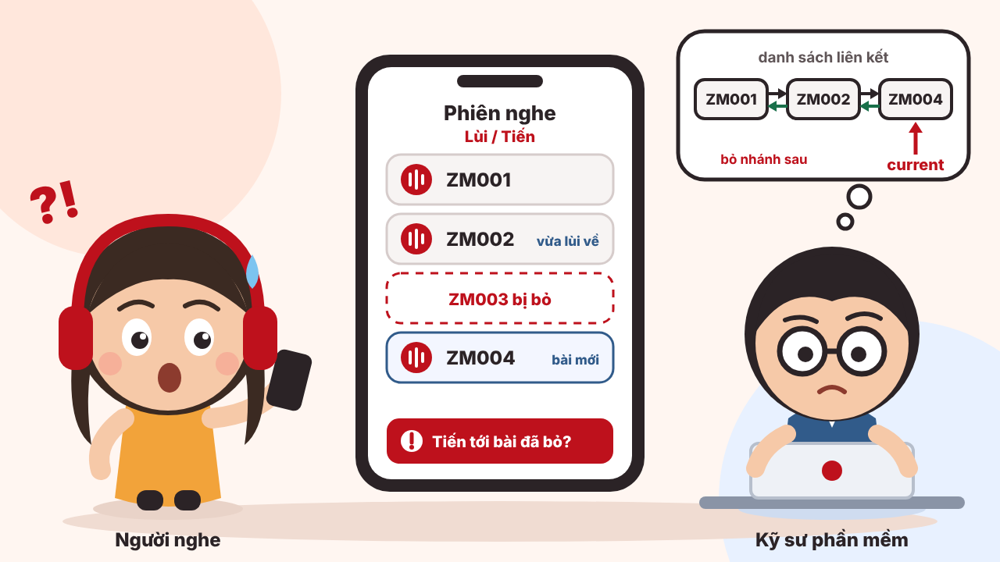

# Nút "Lùi" và "Tiến" trong phiên nghe nhạc Zing MP3

### 1. Bối cảnh & Vấn đề



*Người nghe lùi về bài cũ rồi chọn một bài khác: các bài phía sau phải được bỏ đi, như nút lùi của trình duyệt.*

Trong ứng dụng nghe nhạc Zing MP3, người nghe thường không phát theo một danh sách có sẵn mà **chọn bài tùy hứng**: nghe bài này, tìm bài khác, bấm vào một bài gợi ý. Ứng dụng gọi chuỗi các bài đã mở là một **phiên nghe**, và có hai nút **"Lùi"**, **"Tiến"** để đi lại trong phiên nghe, hoạt động giống nút lùi và tiến của trình duyệt web.

Ví dụ người nghe mở lần lượt `ZM001`, `ZM002`, `ZM003`, rồi bấm "Lùi" một lần:

```plaintext
head                       tail
 |                          |
ZM001  <->  ZM002  <->  ZM003
              ^
           current (bài đang phát)
```

Lúc này bấm "Tiến" sẽ trở lại `ZM003`. Nhưng nếu người nghe **chọn một bài mới** `ZM004`, thì giống trình duyệt, nhánh phía sau (`ZM003`) bị bỏ đi và `ZM004` trở thành bài cuối của phiên nghe:

```plaintext
ZM001  <->  ZM002  <->  ZM004
                          ^
                       current
```

Phiên nghe được lưu bằng **danh sách liên kết đôi có `head`, `tail`, `size`** và con trỏ `current`. Phiên bản hiện tại của ứng dụng lưu phiên nghe bằng list Python kèm một chỉ số, và mỗi lần bỏ nhánh sau phải cắt list. Nhóm muốn chuyển sang danh sách liên kết đôi để bỏ cả nhánh sau chỉ bằng một lần đổi liên kết.

Bạn được giao viết trọn lớp `ListeningSession`.

### 2. Yêu cầu nghiệp vụ

Lớp `ListeningSession` (khung có sẵn trong `lui_tien.py`, lớp `Node` đã có `value`, `prev`, `next`) cần bốn chức năng. Mỗi node giữ chuỗi `"MÃ_BÀI - TÊN_BÀI"`. Mỗi chức năng **trả về** thông báo đúng từng chữ.

**2.1. Phát một bài: `play(code, title)`**

- Chuẩn hóa: xóa khoảng trắng hai đầu của mã và tên, mã chuyển thành chữ hoa.
- Tạo node mới và đặt **ngay sau bài đang phát**; node mới trở thành bài đang phát và là `tail`. Trả về:

```plaintext
Đang phát: ZM001 - Bình minh trên phố
```

- Phiên nghe chưa có bài nào thì node mới là `head`, `tail` và `current`.
- Cùng một bài có thể được phát ở hai thời điểm khác nhau của phiên nghe (mở `ZM001`, `ZM002`, rồi lại mở `ZM001`): đó là hai node khác nhau.

**2.2. Lùi: `back()`**

Chuyển `current` về bài đã nghe ngay trước đó, trả về:

```plaintext
Lùi về: ZM002 - Mưa đêm
```

**2.3. Tiến: `forward()`**

Chuyển `current` tới bài đã nghe ngay sau đó, trả về:

```plaintext
Tiến tới: ZM003 - Đường về nhà
```

**2.4. Hiển thị phiên nghe: `to_lines()`**

Trả về list các dòng theo thứ tự từ `head`. Dòng của bài đang phát bắt đầu bằng `"> "`, các dòng khác bắt đầu bằng hai khoảng trắng:

```plaintext
  ZM001 - Bình minh trên phố
> ZM002 - Mưa đêm
  ZM003 - Đường về nhà
```

Sau mọi chức năng: `size` bằng số bài đang giữ; `head.prev` và `tail.next` là `None`; đi xuôi theo `next` và đi ngược theo `prev` gặp đúng các node đó. Bộ test kiểm tra các điều này sau mỗi thao tác.

### 3. Edge Cases (Bẫy dữ liệu)

**Bẫy 1 — Mã bài hoặc tên bài bị thừa khoảng trắng, mã viết thường**

- `play("  zm002 ", " Mưa đêm ")` trả về:

```plaintext
Đang phát: ZM002 - Mưa đêm
```

**Bẫy 2 — Phát bài mới sau khi đã lùi**

- Phiên nghe có `ZM001`, `ZM002`, `ZM003`. Lùi hai lần (đang ở `ZM001`) rồi `play("ZM004", "Phố cũ")`. Hai bài phía sau bị bỏ; `size` là 2; `tail` là `ZM004`; `ZM004.prev` là `ZM001`. Thông báo ghi rõ số bài bị bỏ:

```plaintext
Đang phát: ZM004 - Phố cũ (đã bỏ 2 bài phía sau)
```

- Sau đó bấm "Tiến" phải nhận thông báo của bẫy 3, không được tiến tới một bài đã bị bỏ.

**Bẫy 3 — Lùi ở bài đầu tiên, tiến ở bài cuối**

- `current` giữ nguyên, hệ thống trả về lần lượt:

```plaintext
Đây là bài đầu tiên của phiên nghe.
Không có bài nào phía sau để tiến tới.
```

**Bẫy 4 — Chưa phát bài nào**

- `back()`, `forward()` đều trả về thông báo dưới đây và không báo lỗi; `to_lines()` trả về list chỉ có một dòng này:

```plaintext
Chưa phát bài nào.
```

**Bẫy 5 — Chọn đúng bài đang phát**

- Đang phát `ZM003` mà gọi `play("zm003", "Đường về nhà")`: không tạo node mới, **không bỏ nhánh phía sau**, trả về:

```plaintext
Bài ZM003 đang được phát.
```

- Chỉ so sánh với bài **đang phát**. Nếu `ZM003` có trong phiên nghe nhưng không phải bài đang phát thì vẫn tạo node mới như mục 2.1.

**Kịch bản chạy thử.** Chạy `python lui_tien.py` (đoạn chạy thử có sẵn ở cuối tệp) phải in ra đúng:

```plaintext
Chưa phát bài nào.
Đang phát: ZM001 - Bình minh trên phố
Đang phát: ZM002 - Mưa đêm
Đang phát: ZM003 - Đường về nhà
Bài ZM003 đang được phát.
Không có bài nào phía sau để tiến tới.
Lùi về: ZM002 - Mưa đêm
Lùi về: ZM001 - Bình minh trên phố
Đây là bài đầu tiên của phiên nghe.
Tiến tới: ZM002 - Mưa đêm
  ZM001 - Bình minh trên phố
> ZM002 - Mưa đêm
  ZM003 - Đường về nhà
Đang phát: ZM004 - Phố cũ (đã bỏ 1 bài phía sau)
Không có bài nào phía sau để tiến tới.
  ZM001 - Bình minh trên phố
  ZM002 - Mưa đêm
> ZM004 - Phố cũ
Số bài đang giữ: 3 | bài cuối: ZM004 - Phố cũ
```

### 4. Yêu cầu

Bạn phụ trách trọn tính năng và phải thực hiện đủ ba phần:

**(1) Phân tích và thiết kế (viết vào `PHAN_TICH.md`)**

- Input/Output của từng chức năng, trong trường hợp thường và trong từng bẫy.
- Thiết kế `play`: vẽ hình trước và sau cho ba trường hợp (phiên nghe trống; `current` đang là `tail`; `current` ở giữa và phải bỏ nhánh sau). Ghi rõ từng liên kết phải gán và thứ tự gán.
- Lập bảng trạng thái cho kịch bản chạy thử: sau mỗi lệnh, ghi `head`, `tail`, `current`, `size`.
- Chi phí: ghi Big-O thời gian của bốn chức năng, n là số bài trong phiên nghe. Trong `play`, việc bỏ nhánh sau cần mấy lần đổi liên kết? Việc cập nhật `size` tốn bao nhiêu trong thiết kế của bạn, và có cách nào để `play` là O(1) không (gợi ý: nghĩ xem cần lưu thêm thông tin gì)? So sánh với cách dùng list Python kèm chỉ số.

**(2) Triển khai code**

- Viết mã trong `lui_tien.py`; được thêm phương thức, hàm, lớp phụ; không đổi tên và tham số đã có trong khung.
- Không dùng list, dict, set, deque của Python để lưu các bài (list chỉ dùng cho giá trị trả về khi hiển thị).
- Xử lý đủ 5 bẫy; chương trình in đúng kịch bản chạy thử; `pytest -q` xanh cả 8 test có sẵn. Mã sạch, có chú thích ở những chỗ sửa liên kết.

**(3) Nghiên cứu mở rộng (viết vào mục cuối của `PHAN_TICH.md`)**

- Tìm hiểu History API của trình duyệt (`history.back()`, `history.forward()`, `history.go(n)`, `history.pushState()`): mỗi lệnh ứng với chức năng nào trong lớp của bạn? Trình duyệt xử lý nhánh phía sau thế nào khi mở trang mới sau khi đã lùi?
- Dựa trên `history.go(n)`, thiết kế chức năng `go(steps)` (âm là lùi, dương là tiến nhiều bước): viết mã giả, nêu các bẫy và thông báo bạn đề xuất. Cài vào `lui_tien.py` là điểm cộng.
- Được tra cứu tài liệu và hỏi AI để tìm hiểu; phải ghi nguồn và viết lại bằng lời của bạn.

### 5. Quy định nộp bài

1. Tạo một kho GitHub riêng cho bài này, đặt tên theo mẫu `[Tên Lớp]_IT301_Session07_Ex18`.
2. Tải thư mục khởi đầu tại https://github.com/cuongtm191221/it301-bai-tap-ve-nha/tree/main/session-07-danh-sach-lien-ket/bai-18 rồi chép các tệp vào kho: `lui_tien.py`, `test_lui_tien.py`, `PHAN_TICH.md`.
3. Viết mã trong `lui_tien.py`, điền phần phân tích và phần nghiên cứu mở rộng vào `PHAN_TICH.md`.
4. Mức AI của bài: AI-0 cho phần phân tích và mã chính (tự làm, không dùng AI); AI-1 cho phần nghiên cứu mở rộng (được hỏi AI để tìm hiểu, phải ghi nguồn và tự kiểm chứng).
5. Đưa bài làm lên kho và nộp đường dẫn kho lên hệ thống.
