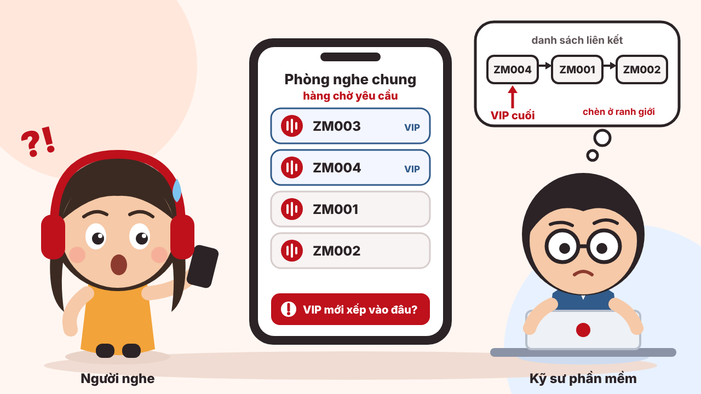

# Hàng chờ ưu tiên của "Phòng nghe chung" trên Zing MP3

### 1. Bối cảnh & Vấn đề



*Trong phòng nghe chung, yêu cầu của tài khoản VIP được chen lên trước, nhưng không được chen ngang nhau.*

Zing MP3 thử nghiệm tính năng **"Phòng nghe chung"**: nhiều người cùng vào một phòng, cùng nghe một luồng nhạc, và ai cũng có thể **yêu cầu bài**. Các yêu cầu xếp thành một hàng chờ; phòng phát lần lượt từ đầu hàng chờ.

Quy tắc ưu tiên:

- Yêu cầu của **tài khoản thường** xếp vào **cuối** hàng chờ.
- Yêu cầu của **tài khoản VIP** được đứng **trước mọi yêu cầu thường**, nhưng **sau các yêu cầu VIP đã có** (VIP không chen ngang VIP; ai yêu cầu trước được phát trước).

Ví dụ: hai tài khoản thường yêu cầu `ZM001`, `ZM002`; sau đó hai tài khoản VIP lần lượt yêu cầu `ZM003`, `ZM004`. Hàng chờ là:

```plaintext
head                                                     tail
[VIP] ZM003  ->  [VIP] ZM004  ->  ZM001  ->  ZM002  ->  None
```

Hàng chờ luôn gồm hai đoạn: **đoạn VIP ở trước, đoạn thường ở sau**. Một yêu cầu VIP mới phải được chèn đúng vào **ranh giới** giữa hai đoạn.

Hàng chờ được lưu bằng **danh sách liên kết đơn có `head`, `tail`, `size`**. Mỗi node có `value` (chuỗi `"MÃ_BÀI - TÊN_BÀI"`), `vip` (`True` hoặc `False`) và `next`. Bạn được giao viết trọn lớp `RoomQueue` và tự quyết định cách xác định ranh giới.

### 2. Yêu cầu nghiệp vụ

Lớp `RoomQueue` (khung có sẵn trong `phong_nghe.py`) cần bốn chức năng. Mỗi chức năng **trả về** thông báo đúng từng chữ. Mọi mã bài nhận vào được xóa khoảng trắng hai đầu và chuyển thành chữ hoa; tên bài được xóa khoảng trắng hai đầu.

**2.1. Nhận yêu cầu: `add_request(code, title, vip=False)`**

Xếp yêu cầu vào đúng chỗ theo quy tắc ưu tiên và trả về thông báo có **vị trí** của bài trong hàng chờ (tính từ 1) ngay sau khi xếp:

```plaintext
Đã xếp hàng: ZM002 - Mưa đêm (vị trí 2)
Đã xếp ưu tiên: ZM003 - Đường về nhà (vị trí 1)
```

**2.2. Phát bài tiếp theo: `play_next()`**

Lấy bài ở đầu hàng chờ ra trong O(1), trả về:

```plaintext
Đang phát: ZM003 - Đường về nhà
```

**2.3. Hủy yêu cầu: `cancel(code)`**

Gỡ node của bài có mã `code` (bất kể VIP hay thường), trả về:

```plaintext
Đã hủy yêu cầu: ZM004 - Phố cũ
```

**2.4. Hiển thị hàng chờ: `to_lines()`**

Trả về list các dòng đánh số từ 1; yêu cầu VIP có nhãn `[VIP]`:

```plaintext
1. [VIP] ZM003 - Đường về nhà
2. [VIP] ZM004 - Phố cũ
3. ZM001 - Bình minh trên phố
4. ZM002 - Mưa đêm
```

Hàng chờ không có bài: `to_lines()` trả về list chỉ có một dòng, và `play_next()` trả về đúng dòng đó:

```plaintext
Hàng chờ của phòng đang trống.
```

Sau mọi chức năng: `size` và `tail` đúng, mọi node VIP đứng trước mọi node thường.

### 3. Edge Cases (Bẫy dữ liệu)

**Bẫy 1 — Bài đã có trong hàng chờ**

- Mỗi bài chỉ được chờ một lần. Hàng chờ đã có `ZM001`; một tài khoản VIP yêu cầu `zm001`: không xếp thêm, không đổi vị trí bài cũ, trả về:

```plaintext
Bài ZM001 đã có trong hàng chờ của phòng.
```

**Bẫy 2 — Yêu cầu VIP khi hàng chờ trống, hoặc chỉ toàn VIP**

- Hàng chờ trống: node VIP là `head` và cũng là `tail`.
- Hàng chờ chỉ toàn VIP: yêu cầu VIP mới đứng cuối, nên `tail` phải dời sang node mới.

**Bẫy 3 — Hủy yêu cầu VIP cuối cùng, rồi có yêu cầu VIP mới**

- Hàng chờ `[VIP] ZM003`, `[VIP] ZM004`, `ZM001`, `ZM002`. Hủy `ZM004`, rồi một tài khoản VIP yêu cầu `ZM005`: bài mới phải ở vị trí 2, ngay sau `ZM003`. Hủy tiếp cả `ZM003` và `ZM005`, rồi VIP yêu cầu `ZM006`: bài mới phải ở vị trí 1.

**Bẫy 4 — Phát hết các bài VIP, rồi có yêu cầu VIP mới**

- Sau khi phát hết hai bài VIP của hàng chờ ở bẫy 3, yêu cầu VIP mới phải đứng ở vị trí 1, trước `ZM001`.

**Bẫy 5 — Hủy bài cuối rồi thêm; hủy bài không có**

- Hủy `ZM002` (đang là `tail`) rồi nhận một yêu cầu thường: bài mới phải nằm ngay sau `ZM001`.
- Hủy một bài không có, kể cả khi hàng chờ trống:

```plaintext
Không tìm thấy bài ZM999 trong hàng chờ của phòng.
```

**Kịch bản chạy thử.** Chạy `python phong_nghe.py` (đoạn chạy thử có sẵn ở cuối tệp) phải in ra đúng:

```plaintext
Đã xếp hàng: ZM001 - Bình minh trên phố (vị trí 1)
Đã xếp hàng: ZM002 - Mưa đêm (vị trí 2)
Đã xếp ưu tiên: ZM003 - Đường về nhà (vị trí 1)
Đã xếp ưu tiên: ZM004 - Phố cũ (vị trí 2)
Bài ZM001 đã có trong hàng chờ của phòng.
Đã xếp hàng: ZM005 - Gió qua thềm (vị trí 5)
1. [VIP] ZM003 - Đường về nhà
2. [VIP] ZM004 - Phố cũ
3. ZM001 - Bình minh trên phố
4. ZM002 - Mưa đêm
5. ZM005 - Gió qua thềm
Không tìm thấy bài ZM999 trong hàng chờ của phòng.
Đã hủy yêu cầu: ZM004 - Phố cũ
Đã xếp ưu tiên: ZM006 - Ngày nắng (vị trí 2)
1. [VIP] ZM003 - Đường về nhà
2. [VIP] ZM006 - Ngày nắng
3. ZM001 - Bình minh trên phố
4. ZM002 - Mưa đêm
5. ZM005 - Gió qua thềm
Số bài đang chờ: 5 | bài cuối: ZM005 - Gió qua thềm
Đang phát: ZM003 - Đường về nhà
Đang phát: ZM006 - Ngày nắng
Đã xếp ưu tiên: ZM008 - Sau cơn mưa (vị trí 1)
Bài đầu: ZM008 - Sau cơn mưa
```

### 4. Yêu cầu

Bạn phụ trách trọn tính năng và phải thực hiện đủ ba phần:

**(1) Phân tích và thiết kế (viết vào `PHAN_TICH.md`)**

- Input/Output của từng chức năng, trong trường hợp thường và trong từng bẫy.
- So sánh **hai thiết kế** xác định ranh giới VIP / thường: (a) duyệt từ `head` mỗi lần; (b) giữ thêm con trỏ tới node VIP cuối cùng. Xét thời gian, những chức năng phải cập nhật thêm, nguy cơ sai, cách tính vị trí cho thông báo; chọn một và nêu lý do.
- Vẽ hình bốn trường hợp chèn yêu cầu VIP: hàng chờ trống; chưa có VIP; có cả VIP và bài thường; chỉ toàn VIP.
- Chi phí: Big-O thời gian của bốn chức năng theo n (số bài đang chờ) và v (số bài VIP), cho thiết kế bạn chọn.

**(2) Triển khai code**

- Viết mã trong `phong_nghe.py`; được thêm phương thức, hàm, lớp phụ; không đổi tên và tham số đã có trong khung.
- Không dùng list, dict, set, deque của Python để lưu các bài (list chỉ dùng cho giá trị trả về khi hiển thị).
- Xử lý đủ 5 bẫy; chương trình in đúng kịch bản chạy thử; `pytest -q` xanh cả 9 test có sẵn. Mã sạch, có chú thích ở những chỗ sửa liên kết.

**(3) Nghiên cứu mở rộng (viết vào mục cuối của `PHAN_TICH.md`)**

- Tìm hiểu **hàng đợi ưu tiên** (priority queue), heap và mô-đun `heapq` của Python: các hàm chính, chi phí thêm và lấy phần tử nhỏ nhất.
- Tạo `nghien_cuu.py`: dùng `heapq` cài lại `add_request` và `play_next`, vẫn giữ quy tắc "VIP không chen ngang VIP". So sánh với danh sách liên kết của bạn về chi phí thêm, lấy bài tiếp theo, hủy một yêu cầu, và khả năng mở rộng lên năm mức ưu tiên.
- Được tra cứu tài liệu và hỏi AI để tìm hiểu; phải ghi nguồn và viết lại bằng lời của bạn.

### 5. Quy định nộp bài

1. Tạo một kho GitHub riêng cho bài này, đặt tên theo mẫu `[Tên Lớp]_IT301_Session07_Ex19`.
2. Tải thư mục khởi đầu tại https://github.com/cuongtm191221/it301-bai-tap-ve-nha/tree/main/session-07-danh-sach-lien-ket/bai-19 rồi chép các tệp vào kho: `phong_nghe.py`, `test_phong_nghe.py`, `PHAN_TICH.md`.
3. Viết mã trong `phong_nghe.py`, điền phần phân tích và phần nghiên cứu mở rộng vào `PHAN_TICH.md`. Tạo thêm `nghien_cuu.py` cho phần thử `heapq`.
4. Mức AI của bài: AI-0 cho phần phân tích và mã chính (tự làm, không dùng AI); AI-1 cho phần nghiên cứu mở rộng (được hỏi AI để tìm hiểu, phải ghi nguồn và tự kiểm chứng).
5. Đưa bài làm lên kho và nộp đường dẫn kho lên hệ thống.
