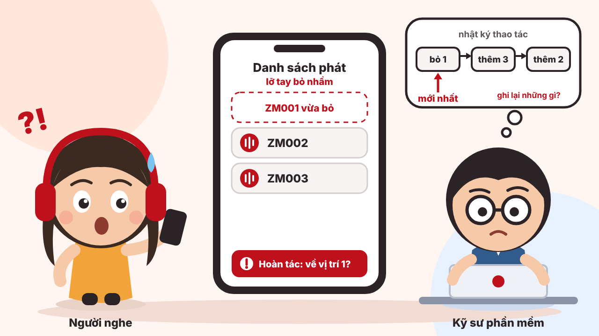

# Nút "Hoàn tác" khi chỉnh danh sách phát trên Zing MP3

### 1. Bối cảnh & Vấn đề



*Người nghe lỡ tay bỏ nhầm một bài và muốn lấy lại đúng vị trí cũ. Thiết kế nhật ký thao tác là việc của bạn.*

Trong ứng dụng nghe nhạc Zing MP3, người nghe hay lỡ tay bỏ nhầm một bài khỏi danh sách phát và không có cách lấy lại. Nhóm sản phẩm quyết định thêm nút **"Hoàn tác"** vào màn hình chỉnh danh sách phát.

Quy tắc nghiệp vụ:

- Người nghe có hai thao tác chỉnh sửa: **thêm** một bài vào cuối danh sách phát và **bỏ** một bài bất kỳ.
- Mỗi lần bấm "Hoàn tác", thao tác **gần nhất** bị đảo lại: hoàn tác một lần thêm là gỡ bài đó ra; hoàn tác một lần bỏ là đưa bài đó về **đúng vị trí cũ**.
- Ứng dụng chỉ nhớ một số thao tác gần nhất (`limit`, mặc định là 3); thao tác cũ hơn không hoàn tác được.

Ví dụ với danh sách `ZM001`, `ZM002`, `ZM003`:

```plaintext
Bỏ ZM001          ->  ZM002, ZM003
Hoàn tác          ->  ZM001, ZM002, ZM003      (ZM001 về vị trí 1, không phải về cuối)
```

Danh sách phát được lưu bằng **danh sách liên kết đơn có `head`, `tail`, `size`**, mỗi node giữ chuỗi `"MÃ_BÀI - TÊN_BÀI"`. Phần còn lại là bài toán mở: ứng dụng cần một **nhật ký thao tác** để biết phải đảo lại cái gì, và **bạn là người thiết kế nhật ký đó**. Ràng buộc duy nhất: nhật ký cũng phải là một danh sách liên kết do bạn tự viết.

### 2. Yêu cầu nghiệp vụ

Lớp `UndoablePlaylist` (khung có sẵn trong `hoan_tac.py`) cần bốn chức năng. Mỗi chức năng **trả về** thông báo đúng từng chữ. Mã bài được xóa khoảng trắng hai đầu và chuyển thành chữ hoa; tên bài được xóa khoảng trắng hai đầu.

**2.1. Thêm bài: `add_song(code, title)`**

Thêm bài vào **cuối** danh sách phát, ghi thao tác vào nhật ký, trả về:

```plaintext
Đã thêm: ZM001 - Bình minh trên phố
```

**2.2. Bỏ bài: `remove_song(code)`**

Gỡ node của bài có mã `code`, ghi thao tác vào nhật ký, trả về:

```plaintext
Đã bỏ: ZM001 - Bình minh trên phố
```

**2.3. Hoàn tác: `undo()`**

Lấy thao tác gần nhất ra khỏi nhật ký và đảo lại. Trả về một trong hai dạng:

```plaintext
Đã hoàn tác thêm: ZM003 - Đường về nhà
Đã hoàn tác bỏ: ZM001 - Bình minh trên phố (về vị trí 1)
```

Vị trí tính từ 1. Việc hoàn tác **không** được ghi vào nhật ký.

**2.4. Hiển thị: `to_lines()`**

Trả về list các dòng đánh số từ 1; danh sách không có bài thì trả về list chỉ có một dòng:

```plaintext
Danh sách phát đang trống.
```

Sau mọi chức năng, kể cả sau khi hoàn tác, `size` và `tail` phải đúng.

### 3. Edge Cases (Bẫy dữ liệu)

**Bẫy 1 — Thao tác không thành công không được ghi vào nhật ký**

- Thêm một bài đã có, hoặc bỏ một bài không có, danh sách giữ nguyên và hệ thống trả về:

```plaintext
Bài ZM001 đã có trong danh sách phát.
Không tìm thấy bài ZM999 trong danh sách phát.
```

- Lần "Hoàn tác" kế tiếp phải đảo lại thao tác **thành công** gần nhất.

**Bẫy 2 — Hoàn tác một lần bỏ phải trả bài về đúng vị trí**

- Bài bị bỏ có thể từng đứng đầu, giữa hoặc cuối. Đưa về đầu phải sửa `head`; đưa về cuối phải sửa `tail`, và thêm bài mới ngay sau đó vẫn phải đúng.

**Bẫy 3 — Hết thao tác để hoàn tác**

- Chưa có thao tác nào, hoặc đã hoàn tác hết, hệ thống không báo lỗi mà trả về:

```plaintext
Không còn thao tác nào để hoàn tác.
```

- Hoàn tác lần thêm duy nhất: danh sách trống, `head` và `tail` đều là `None`.

**Bẫy 4 — Vượt quá `limit`**

- Với `limit` là 3, thêm lần lượt năm bài `ZM001` … `ZM005`. Chỉ ba lần thêm gần nhất hoàn tác được; lần "Hoàn tác" thứ tư trả về thông báo của bẫy 3, và danh sách còn `ZM001`, `ZM002`.

**Bẫy 5 — Hoàn tác nhiều thao tác đan xen**

- Danh sách `ZM001`, `ZM002`, `ZM003` (`limit` là 5): bỏ `ZM002`, thêm `ZM004`, bỏ `ZM001`. Ba lần hoàn tác liên tiếp phải đưa `ZM001` về vị trí 1, gỡ `ZM004`, đưa `ZM002` về vị trí 2.

**Kịch bản chạy thử.** Chạy `python hoan_tac.py` (đoạn chạy thử có sẵn ở cuối tệp, `limit` là 3) phải in ra đúng:

```plaintext
Không còn thao tác nào để hoàn tác.
Đã thêm: ZM001 - Bình minh trên phố
Đã thêm: ZM002 - Mưa đêm
Đã thêm: ZM003 - Đường về nhà
Bài ZM001 đã có trong danh sách phát.
Không tìm thấy bài ZM999 trong danh sách phát.
Đã bỏ: ZM001 - Bình minh trên phố
Đã hoàn tác bỏ: ZM001 - Bình minh trên phố (về vị trí 1)
1. ZM001 - Bình minh trên phố
2. ZM002 - Mưa đêm
3. ZM003 - Đường về nhà
Đã hoàn tác thêm: ZM003 - Đường về nhà
Đã thêm: ZM004 - Phố cũ
Đã bỏ: ZM004 - Phố cũ
Đã hoàn tác bỏ: ZM004 - Phố cũ (về vị trí 3)
Đã hoàn tác thêm: ZM004 - Phố cũ
Đã hoàn tác thêm: ZM002 - Mưa đêm
Không còn thao tác nào để hoàn tác.
1. ZM001 - Bình minh trên phố
Số bài: 1 | bài cuối: ZM001 - Bình minh trên phố
```

### 4. Yêu cầu

Bạn phụ trách trọn tính năng và phải thực hiện đủ ba phần:

**(1) Phân tích và thiết kế (viết vào `PHAN_TICH.md`)**

- Input/Output của từng chức năng, trong trường hợp thường và trong từng bẫy.
- Thiết kế nhật ký: mỗi thao tác ghi những thông tin gì; thao tác mới thêm ở đầu nào, lấy ra ở đầu nào; bỏ thao tác cũ nhất thế nào khi vượt `limit`. Vẽ hình nhật ký sau ba thao tác ở bẫy 5.
- So sánh **hai phương án** trả bài về chỗ cũ (ghi vị trí; hoặc ghi bài đứng trước nó), chọn một và lập luận vì sao nó vẫn đúng khi hoàn tác nhiều thao tác đan xen.
- Viết mã giả của `undo` cho cả hai loại thao tác.
- Chi phí: Big-O thời gian của bốn chức năng (n là số bài) và của ba việc trên nhật ký: ghi, lấy thao tác gần nhất, bỏ thao tác cũ nhất.

**(2) Triển khai code**

- Viết mã trong `hoan_tac.py`; được thêm phương thức, hàm, lớp phụ; không đổi tên và tham số đã có trong khung.
- Không dùng list, dict, set, deque của Python để lưu các bài và nhật ký thao tác (list chỉ dùng cho giá trị trả về khi hiển thị).
- Xử lý đủ 5 bẫy; chương trình in đúng kịch bản chạy thử; `pytest -q` xanh cả 9 test có sẵn. Mã sạch, có chú thích ở những chỗ sửa liên kết.

**(3) Nghiên cứu mở rộng (viết vào mục cuối của `PHAN_TICH.md`)**

- Nhật ký của bạn hoạt động như một **ngăn xếp** (stack, Session 09 sẽ học). Tìm hiểu trước: stack là gì, push và pop, vì sao hoàn tác dùng stack; nhật ký của bạn khác stack thuần túy ở điểm nào?
- Tìm hiểu cách các ứng dụng làm nút **"Làm lại"** (redo), rồi thiết kế nút đó cho lớp của bạn: cần thêm cấu trúc gì, `undo` phải sửa gì, chuyện gì xảy ra với các thao tác "làm lại" khi có thao tác mới? Viết mã giả của `redo`. Cài vào `hoan_tac.py` là điểm cộng.
- Được tra cứu tài liệu và hỏi AI để tìm hiểu; phải ghi nguồn và viết lại bằng lời của bạn.

### 5. Quy định nộp bài

1. Tạo một kho GitHub riêng cho bài này, đặt tên theo mẫu `[Tên Lớp]_IT301_Session07_Ex20`.
2. Tải thư mục khởi đầu tại https://github.com/cuongtm191221/it301-bai-tap-ve-nha/tree/main/session-07-danh-sach-lien-ket/bai-20 rồi chép các tệp vào kho: `hoan_tac.py`, `test_hoan_tac.py`, `PHAN_TICH.md`.
3. Viết mã trong `hoan_tac.py`, điền phần phân tích và phần nghiên cứu mở rộng vào `PHAN_TICH.md`.
4. Mức AI của bài: AI-0 cho phần phân tích và mã chính (tự làm, không dùng AI); AI-1 cho phần nghiên cứu mở rộng (được hỏi AI để tìm hiểu, phải ghi nguồn và tự kiểm chứng).
5. Đưa bài làm lên kho và nộp đường dẫn kho lên hệ thống.
