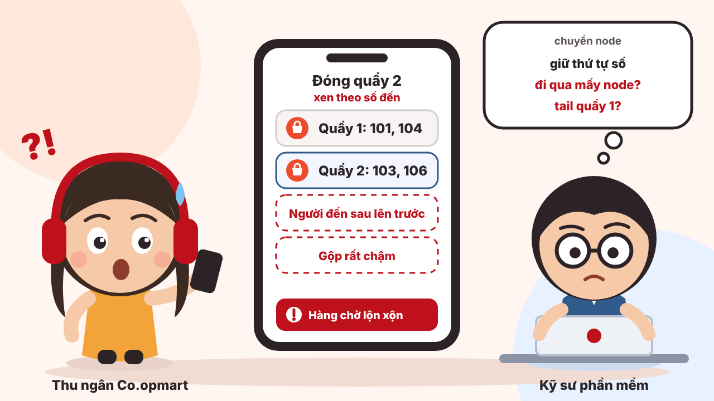

# Hệ thống gộp hàng chờ khi đóng quầy thu ngân của Co.opmart

### 1. Bối cảnh & Vấn đề



*Thu ngân Co.opmart chuyển khách khi đóng quầy*

Ở siêu thị **Co.opmart**, khách lấy **số thứ tự đến** (101, 102, ...) rồi xếp vào quầy 1 hoặc quầy 2; trong mỗi quầy, khách đứng theo số tăng dần. Khi quầy 2 đóng (hết ca, máy hỏng), khách quầy 2 được chuyển sang quầy 1 và **xen vào đúng chỗ theo số**, để không ai đến trước mà phải chờ sau người đến sau.

Mỗi quầy là **danh sách liên kết đơn có `head`, `tail`**; màn hình gọi số giữ tham chiếu tới các node nên phải **chuyển node**, không tạo node mới. Bản đầu tiên chuyển đúng nhưng ngày đông (kiểm thử tải hàng nghìn khách) rất chậm. Trưởng nhóm yêu cầu hai giải pháp đúng, so sánh bằng số đo và phân tích.

Bạn xây dựng module **"Co.opmart Checkout Lanes CLI"**.

### 2. Yêu cầu nghiệp vụ

Siêu thị mẫu: `make_store()`. Lớp `Node`, `Lane` (có `add_last`, `remove_first`, `to_text`), `Store` có sẵn.

**Chức năng 1 — Xem hai quầy.** **Chức năng 2 — Khách vào quầy** (cấp số tiếp theo). **Chức năng 3 — Đóng quầy 2** (menu phụ chọn giải pháp), in `Đã chuyển <k> khách sang quầy 1.`

**Chức năng 4 — Phục vụ khách** ở một quầy. **Chức năng 5 — Đo** hai giải pháp với n = 500, 1.000, 2.000 khách mỗi quầy. **Chức năng 6 — Thoát.**

`merge_v1`, `merge_v2` cho **cùng kết quả**, **khác nhau về cách làm**, chuyển node (không tạo node, không dùng list, không `sorted`); quầy 2 rỗng sau khi gộp; giải pháp 2 gộp hai quầy 100.000 khách trong 1 giây.

Màn hình mẫu (đoạn đầu; phím gõ vào hiện sau dấu hai chấm, `[menu chính]` là menu được in lại):

```plaintext
===== CO.OPMART - QUẦY THU NGÂN =====
1. Xem hai quầy
2. Khách vào quầy
3. Đóng quầy 2, chuyển khách sang quầy 1
4. Phục vụ khách
5. Đo so sánh hai giải pháp
6. Thoát
Chọn chức năng (1-6): 1
Quầy 1: 101 -> 104 -> 105 -> 109 -> None
Quầy 2: 103 -> 106 -> 107 -> 108 -> 110 -> None

[menu chính]
Chọn chức năng (1-6): 2
Quầy: 1
Khách số 111 vào quầy 1.

[menu chính]
Chọn chức năng (1-6): 2
Quầy: 3
Lỗi: Quầy phải là 1 hoặc 2

[... các lượt sau: thêm dữ liệu sai, nhập menu sai, thoát ...]
```

Chức năng 5 in dạng sau (máy soạn đề, Python 3.10):

```plaintext
n | giải pháp 1 (ms) | giải pháp 2 (ms)
500 | 14.55 | 0.08
1000 | 59.26 | 0.17
2000 | 227.92 | 0.33
```

### 3. Edge Cases (Bẫy dữ liệu)

**Bẫy 1 — Chen vào đầu, nối vào cuối.** Khách quầy 2 có số nhỏ hơn mọi khách quầy 1 thì thành `head`; lớn hơn thì `tail` phải đổi.

**Bẫy 2 — Quầy rỗng.** Một hoặc cả hai quầy rỗng; sau khi gộp, quầy 2 có `head`, `tail` là `None` và vẫn nhận khách mới.

**Bẫy 3 — Giữ node.** Không tạo node mới; khách thêm vào quầy 1 sau khi gộp nối đúng sau `tail`.

**Bẫy 4 — Dữ liệu lớn.** Hai quầy 100.000 khách: giải pháp 2 trong 1 giây.

**Bẫy 5 — Nhập sai.** Quầy không phải 1 hoặc 2, phục vụ ở quầy trống; menu phụ và menu chính sai.

### 4. Yêu cầu

**(1) Phân tích và thiết kế (viết vào `PHAN_TICH.md`)**

- Input/Output của từng chức năng, trong trường hợp thường và trong từng bẫy; luồng chương trình (mã giả hoặc các bước).
- Đề xuất ít nhất hai giải pháp khác nhau (ý tưởng, sơ đồ con trỏ trên dữ liệu mẫu, mã giả); số node phải đi qua theo n và m (số khách hai quầy).
- Bảng so sánh 5 tiêu chí (tốc độ, bộ nhớ phụ, độ dễ đọc, dễ bảo trì, phù hợp bối cảnh) kèm số đo chức năng 5 trên máy bạn; chọn giải pháp và giải thích.

**(2) Triển khai code**

- Viết các hàm trong `quay_thu_ngan.py` (giữ tên, tham số; hàm "Có sẵn" giữ nguyên) và chương trình menu trong `main.py`. Hàm nghiệp vụ không gọi `input()`, `print()`.
- Thông báo đúng từng chữ như đề; không dừng vì lỗi ở bất kỳ thao tác nào; tên biến snake_case, có chú thích.
- `python kiem_tra.py` đạt cả 7 mục (mục cuối tự chạy `main.py`, gõ một loạt lựa chọn có cả dữ liệu sai, và kiểm tra các thông báo của đề).

### 5. Quy định nộp bài

1. Tạo kho GitHub riêng, đặt tên `[Tên Lớp]_IT301_Session08_TH08`. Tải thư mục khởi đầu tại https://github.com/cuongtm191221/it301-bai-tap-ve-nha/tree/main/session-08-thuc-hanh-cli/bai-08 rồi chép các tệp vào kho: `quay_thu_ngan.py`, `main.py`, `kiem_tra.py`, `PHAN_TICH.md`.
2. Mức AI: AI-0 (tự làm, không dùng AI).
3. Đưa bài làm lên kho và nộp đường dẫn kho lên hệ thống.
