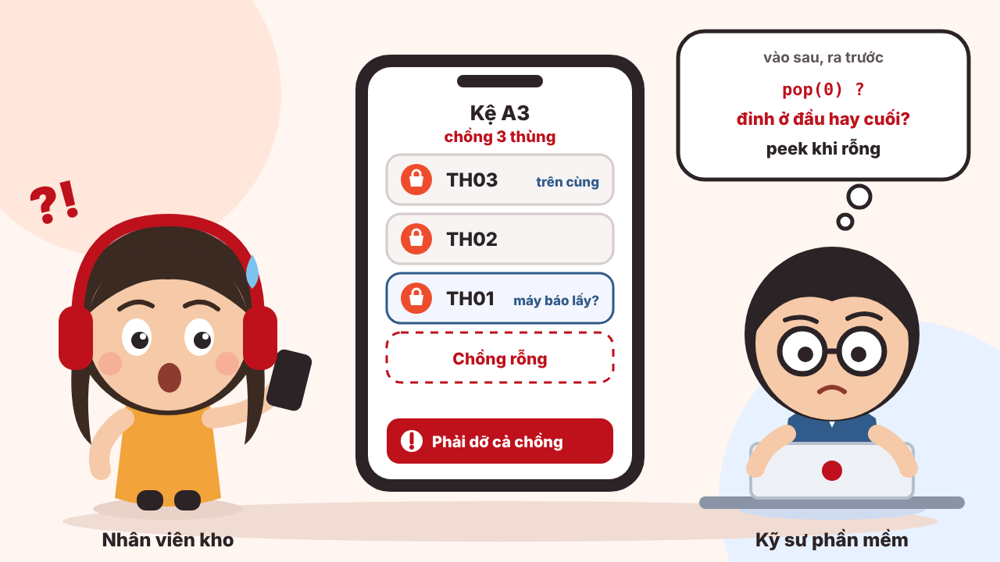

# Lỗi quản lý chồng thùng hàng trên kệ kho Tiki

### 1. Bối cảnh nghiệp vụ



*Nhân viên kho được báo lấy thùng ở đáy chồng, trong khi chỉ lấy được thùng trên cùng.*

Bạn là kỹ sư phần mềm trong nhóm vận hành kho của Tiki.

Ở mỗi ô kệ, thùng hàng được **xếp chồng** lên nhau: thùng đặt sau cùng nằm trên cùng, và nhân viên chỉ lấy được **thùng trên cùng**. Máy quét cầm tay hiện "Thùng trên cùng" và "Lấy thùng" theo lớp `BoxStack`, được viết theo đặc tả ngăn xếp:

- `push(box)`: đặt thùng lên trên cùng.
- `pop()`: lấy thùng trên cùng ra, trả về mã thùng.
- `peek()`: xem mã thùng trên cùng mà không lấy.
- `is_empty()`, `size()`: chồng có rỗng không; số thùng.
- Chồng rỗng: `pop()` và `peek()` báo `IndexError("ngăn xếp rỗng")`.

Kho lớn có ô kệ chứa hàng nghìn thùng nhỏ (linh kiện, phụ kiện), và cuối ngày máy quét có lúc phải lấy hết cả chồng để kiểm kê.

Máy quét còn dùng `peek()` để nhắc nhân viên mã thùng sắp lấy; nếu báo sai thùng, nhân viên phải dỡ cả chồng để tìm, mất thời gian và dễ làm rơi hàng.

Kịch bản kiểm tra (đoạn cuối tệp): xếp ba thùng TH01, TH02, TH03; xem thùng trên cùng; lấy ra một thùng; lấy hết; xem chồng rỗng.

Kết quả đúng cần hiển thị:

```plaintext
Thùng trên cùng: TH03
Lấy ra: TH03 | còn 2 thùng, trên cùng: TH02
Lấy tiếp: TH02 TH01 | rỗng: True
Xem chồng rỗng: ngăn xếp rỗng
```

### 2. Vấn đề hiện tại

Nhân viên kho phản ánh:

- Máy quét báo thùng trên cùng là **TH01** (thùng đặt đầu tiên, nằm ở đáy) và yêu cầu lấy thùng đó trước.
- Xem chồng rỗng thì máy báo lỗi khó hiểu `list index out of range` thay vì "ngăn xếp rỗng".
- Kiểm kê cuối ngày ở ô kệ nhiều thùng rất chậm.

Nhắc lại kiến thức (Lesson 01):

- Ngăn xếp (stack) là ADT **vào sau, ra trước** (LIFO): `push` đặt lên đỉnh, `pop` lấy phần tử ở đỉnh, `peek` xem đỉnh mà không lấy. Ngăn xếp rỗng thì `pop`, `peek` báo `IndexError`.
- Cài bằng list: đặt **đỉnh ở cuối list**, vì `append` và `pop()` ở cuối là O(1). Đặt đỉnh ở đầu list thì mỗi lần lấy phải dồn cả dãy (Session 05).
- `peek` không kiểm tra ngăn xếp rỗng là lỗi thường gặp.

### 3. Mã nguồn hiện tại (Legacy Code)

Toàn bộ tệp `chong_thung.py` trong thư mục khởi đầu (đoạn cuối tệp là kịch bản chạy thử):

```python
"""Chồng thùng hàng trên kệ kho Tiki, quản lý bằng ngăn xếp."""
class BoxStack:
    # Chồng thùng hàng ở một ô kệ kho Tiki: thùng đặt sau cùng nằm trên cùng, được lấy ra trước.
    # pop() lấy thùng trên cùng; peek() xem thùng trên cùng mà không lấy.
    # Chồng rỗng: pop() và peek() báo IndexError("ngăn xếp rỗng").
    def __init__(self):
        self._items = []

    def push(self, box):
        self._items.append(box)

    def pop(self):
        if self.is_empty():
            raise IndexError("ngăn xếp rỗng")
        return self._items.pop(0)

    def peek(self):
        return self._items[0]

    def is_empty(self):
        return len(self._items) == 0

    def size(self):
        return len(self._items)


shelf = BoxStack()
for box in ("TH01", "TH02", "TH03"):
    shelf.push(box)
print("Thùng trên cùng:", shelf.peek())
print("Lấy ra:", shelf.pop(), "| còn", shelf.size(), "thùng, trên cùng:", shelf.peek())
print("Lấy tiếp:", shelf.pop(), shelf.pop(), "| rỗng:", shelf.is_empty())
try:
    shelf.peek()
except IndexError as error:
    print("Xem chồng rỗng:", error)
```

Kết quả hiển thị trên Console:

```plaintext
Thùng trên cùng: TH01
Lấy ra: TH01 | còn 2 thùng, trên cùng: TH02
Lấy tiếp: TH02 TH03 | rỗng: True
Xem chồng rỗng: list index out of range
```

Đối chiếu với kết quả đúng: thứ tự thùng bị ngược (TH01 ra trước), và xem chồng rỗng nhận thông báo `list index out of range`.

### 4. Yêu cầu

Với vai trò kỹ sư phần mềm của nhóm, hãy thực hiện:

**(1) Phân tích lỗi** (trả lời vào `PHAN_TICH.md`)

- Chạy tay kịch bản với mã hiện tại: ghi `_items` và giá trị trả về sau mỗi thao tác. Thùng nào được coi là "trên cùng"?
- Mã hiện tại đặt đỉnh ở đầu hay cuối list? `push` và `pop` có làm việc ở cùng một đầu không? Vì sao đó là điều kiện để có "vào sau, ra trước"?
- Với chồng n thùng, `pop()` của mã hiện tại dịch bao nhiêu tham chiếu? Lấy hết chồng tốn bao nhiêu? Ghi Big-O trước và sau khi sửa.
- Vì sao `peek()` trên chồng rỗng báo `list index out of range`? Sửa theo đặc tả.
- Với chồng 3 thùng, liệt kê mọi thứ tự lấy ra có thể nếu nhân viên xếp và lấy xen kẽ (ví dụ push, pop, push...). Thứ tự TH01, TH02, TH03 có xảy ra được không?
- Ghi bốn bộ dữ liệu thử: chồng rỗng, chồng 1 thùng, push sau khi đã pop, peek liên tiếp hai lần; kèm kết quả mong đợi.
- Nếu sau này kho đổi sang cài ngăn xếp bằng chuỗi nút (Lesson 01, mục 2.3), đỉnh nên đặt ở head hay tail? Vì sao? Máy quét có phải sửa gì không?

**(2) Sửa lỗi**

- Sửa lớp `BoxStack` trong `chong_thung.py`. Không đổi tên lớp, phương thức, thông báo lỗi.
- Lấy hết 100.000 thùng phải dưới 0,5 giây.
- Chạy `python chong_thung.py` phải in đúng phần "Kết quả đúng cần hiển thị" ở mục 1.
- Chạy `pytest -q` phải xanh cả 4 test.

### 5. Quy định nộp bài

1. Tạo một kho GitHub riêng cho bài này, đặt tên theo mẫu `[Tên Lớp]_IT301_Session09_Ex01`.
2. Tải thư mục khởi đầu tại https://github.com/cuongtm191221/it301-bai-tap-ve-nha/tree/main/session-09-stack-queue-deque/bai-01 rồi chép các tệp vào kho: `chong_thung.py`, `test_chong_thung.py`, `PHAN_TICH.md`.
3. Điền phần phân tích vào `PHAN_TICH.md`, sửa mã trong `chong_thung.py`.
4. Mức AI của bài: AI-0 (tự làm, không dùng AI).
5. Đưa bài làm lên kho và nộp đường dẫn kho lên hệ thống.
