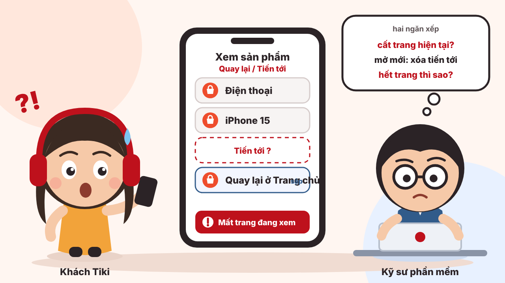

# Lỗi nút Quay lại, Tiến tới khi xem sản phẩm trên Tiki

### 1. Bối cảnh nghiệp vụ



*Khách bấm Tiến tới thì không đi đâu, mở trang mới rồi vẫn tiến tới được trang cũ, bấm Quay lại ở trang chủ thì ứng dụng sập.*

Bạn là kỹ sư phần mềm trong nhóm ứng dụng di động của Tiki.

Khi khách lướt sản phẩm, ứng dụng có hai nút **Quay lại** và **Tiến tới**, giống trình duyệt web. Lớp `ProductBrowser` dùng hai ngăn xếp:

- `visit(page)`: mở trang mới. Trang đang xem được cất vào ngăn quay lại; **ngăn tiến tới bị xóa sạch** (đã rẽ sang hướng khác).
- `back()`: trang đang xem cất vào ngăn tiến tới, lấy trang ở đỉnh ngăn quay lại ra xem.
- `forward()`: trang đang xem cất vào ngăn quay lại, lấy trang ở đỉnh ngăn tiến tới ra xem.
- `back()`, `forward()` trả trang đang xem sau khi bấm; hết trang thì **giữ nguyên** trang đang xem, không báo lỗi.

Ứng dụng có hàng triệu lượt dùng mỗi ngày; chỉ một nút điều hướng sai cũng làm khách mất trang đang xem và bỏ giỏ hàng.

Khách thường mở nhiều sản phẩm liên tiếp để so sánh, quay lại vài trang rồi rẽ sang sản phẩm khác; vì vậy cả ba nút phải đúng trong mọi thứ tự bấm, kể cả bấm khi đã hết trang.

Kịch bản kiểm tra (đoạn cuối tệp): từ Trang chủ mở ba trang; quay lại hai lần; tiến tới; quay lại; mở trang mới rồi bấm tiến tới; quay lại 4 lần.

Kết quả đúng cần hiển thị:

```plaintext
Quay lại 2 lần: iPhone 15 -> Điện thoại
Tiến tới: iPhone 15
Quay lại: Điện thoại
Mở trang mới rồi tiến tới: Sạc dự phòng
Quay lại 4 lần: Trang chủ
```

### 2. Vấn đề hiện tại

Khách hàng phản ánh:

- Quay lại rồi Tiến tới, sau đó Quay lại thì về sai trang.
- Đang ở trang đã quay lại, mở trang mới, bấm Tiến tới vẫn nhảy về **trang cũ**.
- Bấm Quay lại khi đã về tới Trang chủ thì ứng dụng **sập**.

Nhắc lại kiến thức (Lesson 02):

- Quay lại và tiến tới dùng **hai ngăn xếp**, giống hoàn tác và làm lại: mỗi lần bấm, trang đang xem phải được cất vào ngăn bên kia.
- Có thao tác mới (mở trang mới) thì xóa sạch ngăn tiến tới.
- Lấy từ ngăn xếp rỗng phải được kiểm tra trước: list Python báo `IndexError` khi gọi `pop()` trên list rỗng, và lỗi đó làm sập cả màn hình.

### 3. Mã nguồn hiện tại (Legacy Code)

Toàn bộ tệp `xem_san_pham.py` trong thư mục khởi đầu (đoạn cuối tệp là kịch bản chạy thử):

```python
"""Nút Quay lại và Tiến tới khi xem sản phẩm trên ứng dụng Tiki."""
class ProductBrowser:
    # Nút Quay lại / Tiến tới khi khách xem sản phẩm trên ứng dụng Tiki.
    # current() là trang đang xem. back(), forward() trả trang đang xem sau khi bấm;
    # không còn trang để quay lại / tiến tới thì giữ nguyên trang đang xem.
    def __init__(self, home):
        self._back = []
        self._forward = []
        self._current = home

    def current(self):
        return self._current

    def visit(self, page):
        self._back.append(self._current)
        self._current = page

    def back(self):
        self._forward.append(self._current)
        self._current = self._back.pop()
        return self._current

    def forward(self):
        if self._forward:
            self._current = self._forward.pop()
        return self._current


b = ProductBrowser("Trang chủ")
for page in ("Điện thoại", "iPhone 15", "Ốp lưng"):
    b.visit(page)
print("Quay lại 2 lần:", b.back(), "->", b.back())
print("Tiến tới:", b.forward())
print("Quay lại:", b.back())
b.visit("Sạc dự phòng")
print("Mở trang mới rồi tiến tới:", b.forward())
for _ in range(4):
    b.back()
print("Quay lại 4 lần:", b.current())
```

Kết quả hiển thị trên Console:

```plaintext
Quay lại 2 lần: iPhone 15 -> Điện thoại
Tiến tới: iPhone 15
Quay lại: Trang chủ
Mở trang mới rồi tiến tới: iPhone 15
Traceback (most recent call last):
  ...
    self._current = self._back.pop()
IndexError: pop from empty list
```

Ba dòng đầu đúng nhưng dòng thứ tư sai trang; dòng thứ năm vẫn tiến tới được; vòng quay lại 4 lần gây `IndexError`, nên dòng cuối không được in.

### 4. Yêu cầu

Với vai trò kỹ sư phần mềm của nhóm, hãy thực hiện:

**(1) Phân tích lỗi** (trả lời vào `PHAN_TICH.md`)

- Chạy tay kịch bản với mã hiện tại: ghi trang đang xem, ngăn quay lại, ngăn tiến tới sau mỗi thao tác. Dòng thứ tư sai vì đâu?
- Sửa `forward` để trang đang xem được cất vào ngăn quay lại. Chạy tay lại dòng thứ tư.
- Vì sao mở trang mới rồi vẫn tiến tới được? Sửa `visit`.
- Vì sao quay lại ở Trang chủ báo lỗi? Sửa `back` theo đặc tả.
- So sánh lớp này với `DescriptionEditor` ở bài hoàn tác: thao tác nào tương ứng với thao tác nào?
- Ghi bốn bộ dữ liệu thử: quay lại khi chưa mở trang nào, tiến tới khi chưa quay lại, quay lại hết rồi tiến tới hết, mở trang mới xen giữa; kèm kết quả mong đợi.
- Ghi Big-O của `visit`, `back`, `forward` (lưu ý `clear()` trên ngăn tiến tới).

**(2) Sửa lỗi**

- Sửa lớp `ProductBrowser` trong `xem_san_pham.py`. Không đổi tên lớp, phương thức.
- Chạy `python xem_san_pham.py` phải in đúng phần "Kết quả đúng cần hiển thị" ở mục 1.
- Chạy `pytest -q` phải xanh cả 4 test.

### 5. Quy định nộp bài

1. Tạo một kho GitHub riêng cho bài này, đặt tên theo mẫu `[Tên Lớp]_IT301_Session09_Ex04`.
2. Tải thư mục khởi đầu tại https://github.com/cuongtm191221/it301-bai-tap-ve-nha/tree/main/session-09-stack-queue-deque/bai-04 rồi chép các tệp vào kho: `xem_san_pham.py`, `test_xem_san_pham.py`, `PHAN_TICH.md`.
3. Điền phần phân tích vào `PHAN_TICH.md`, sửa mã trong `xem_san_pham.py`.
4. Mức AI của bài: AI-0 (tự làm, không dùng AI).
5. Đưa bài làm lên kho và nộp đường dẫn kho lên hệ thống.
