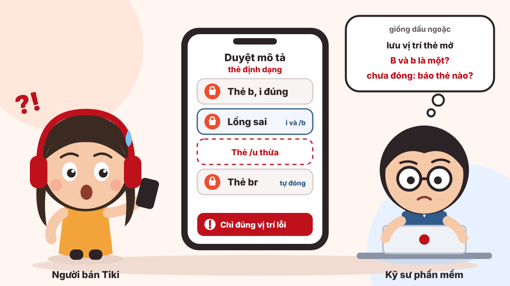

# Kiểm tra thẻ định dạng trong mô tả sản phẩm Tiki

### 1. Bối cảnh & Vấn đề



*Người bán chèn thẻ in đậm, in nghiêng vào mô tả; thẻ lồng sai làm cả trang sản phẩm hiển thị lệch, nên phải chặn và chỉ đúng chỗ sai.*

Người bán trên Tiki được dùng một số **thẻ định dạng** trong mô tả sản phẩm: `<b>…</b>` (in đậm), `<i>…</i>` (in nghiêng), `<ul>`, `<li>`… và thẻ **tự đóng** như `<br/>` (xuống dòng). Thẻ phải mở, đóng đúng cặp và lồng đúng thứ tự, giống dấu ngoặc ở Lesson 02. Mô tả sai thẻ làm cả trang sản phẩm hiển thị lệch (chữ in đậm tới hết trang), nên hệ thống duyệt phải **từ chối** và chỉ ra **vị trí lỗi đầu tiên** để người bán sửa.

Mỗi ngày có hàng chục nghìn mô tả mới hoặc sửa lại, nên hệ thống phải duyệt tự động. Thông báo lỗi được gửi thẳng cho người bán; người bán không rành kỹ thuật nên cần biết **thẻ nào, ở vị trí nào** sai, và sai vì lý do gì (không khớp, thừa, hay thiếu thẻ đóng). Chỉ báo "mô tả không hợp lệ" chung chung làm người bán phải gọi tổng đài hỏi lại.

Hàm `find_tags(text)` (có sẵn) đã tách các thẻ ra thành list bộ `(vị trí, thẻ)`, vị trí là chỉ số của dấu `<` trong mô tả. Hàm chỉ nhận chuỗi dạng `<ten>`, `</ten>`, `<ten/>` với tên chỉ gồm chữ cái, nên `Giá < 100k` không phải thẻ. Tên thẻ **không phân biệt hoa thường**: `<B>…</b>` hợp lệ.

### 2. Yêu cầu nghiệp vụ

**2.1. `check_tags(text)`**: `None` nếu mọi thẻ hợp lệ; ngược lại là dòng mô tả **lỗi đầu tiên** gặp phải, một trong ba dạng:

```plaintext
Thẻ </b> ở vị trí 14 không khớp với <i> ở vị trí 8
Thẻ </u> ở vị trí 12 không có thẻ mở
Thẻ <i> ở vị trí 8 chưa đóng
```

Thẻ trong thông báo viết đúng như trong mô tả với thẻ đóng; thẻ mở viết bằng tên chữ thường. Còn nhiều thẻ chưa đóng thì báo thẻ **mở sau cùng**.

**2.2. `review_message(text)`**: `Hợp lệ (3 thẻ).` (đếm mọi thẻ, kể cả thẻ tự đóng) hoặc `Từ chối: <dòng lỗi>`.

### 3. Edge Cases (Bẫy dữ liệu)

**Bẫy 1 — Lồng sai thứ tự.** `<b>Giảm <i>50%</b></i>`: lỗi tại `</b>`, không phải `</i>`.

**Bẫy 2 — Thẻ đóng không có thẻ mở.** `Giá < 100k, </u>bảo hành`: dấu `<` đầu không phải thẻ.

**Bẫy 3 — Thẻ chưa đóng.** `<ul><li>Màu đen<li>Màu trắng</ul>`: `</ul>` gặp `<li>` chưa đóng; `<b>Hàng <i>mới`: hết mô tả còn `<i>`.

**Bẫy 4 — Thẻ tự đóng và chữ hoa.** `<br/>` không cần đóng; `<B>` khớp `</b>`.

**Bẫy 5 — Mô tả dài, lồng sâu.** 20.000 thẻ `<b>` lồng nhau vẫn kiểm tra được (không đệ quy).

**Kịch bản chạy thử.** Chạy `python kiem_tra_the.py` (đoạn chạy thử có sẵn ở cuối tệp) phải in ra đúng:

```plaintext
Hợp lệ (7 thẻ).
Từ chối: Thẻ </b> ở vị trí 14 không khớp với <i> ở vị trí 8
Từ chối: Thẻ </u> ở vị trí 12 không có thẻ mở
Hợp lệ (2 thẻ).
Từ chối: Thẻ </ul> ở vị trí 28 không khớp với <li> ở vị trí 15
Hợp lệ (0 thẻ).
```

### 4. Yêu cầu

Với vai trò kỹ sư phần mềm, bạn phải thực hiện đầy đủ hai phần sau:

**(1) Phân tích và thiết kế giải pháp (bắt buộc, viết vào `PHAN_TICH.md`)**

- Phân tích Input/Output: với từng hàm hoặc phương thức, nêu dữ liệu đầu vào (kiểu dữ liệu) và giá trị trả về trong trường hợp thường và trong từng bẫy.
- Thiết kế giải pháp: ngăn xếp cần lưu những gì cho mỗi thẻ mở để in được thông báo lỗi? Chạy tay `<b>Giảm <i>50%</b></i>`, ghi ngăn xếp sau mỗi thẻ.
- So sánh với kiểm tra dấu ngoặc ở Lesson 02: ba kiểu sai tương ứng với ba thông báo nào?
- Khi còn nhiều thẻ chưa đóng, vì sao thẻ mở sau cùng là thẻ nên báo?
- Một bạn đề xuất chỉ đếm số thẻ mở và số thẻ đóng của từng tên, bằng nhau là hợp lệ. Tìm một mô tả làm cách này sai.
- Nếu sau này cho phép thuộc tính trong thẻ (ví dụ `<a href=...>`), phần nào của giải pháp phải đổi, phần nào giữ nguyên?
- Bộ dữ liệu thử: lập bảng ít nhất 6 đầu vào phủ đủ 5 bẫy ở mục 3, mỗi dòng ghi kết quả mong đợi (tính tay trước khi chạy) và kết quả chạy thật của bài làm.
- Độ phức tạp: ghi Big-O thời gian và bộ nhớ phụ của `check_tags` theo n (độ dài mô tả) và t (số thẻ).

**(2) Triển khai code**

- Viết thân các hàm, phương thức còn trống trong `kiem_tra_the.py`. Không đổi tên, tham số, thông báo lỗi; hàm ghi "Có sẵn" giữ nguyên; được thêm thuộc tính và hàm phụ.
- Dùng ngăn xếp, không đệ quy; dùng `find_tags` có sẵn.
- Xử lý đủ 5 bẫy ở mục 3; `python kiem_tra_the.py` in đúng kịch bản chạy thử; `pytest -q` xanh cả 8 test có sẵn.
- Mã sạch, dễ đọc, tên biến theo snake_case, có chú thích ở những chỗ quyết định độ phức tạp.

### 5. Quy định nộp bài

1. Tạo một kho GitHub riêng cho bài này, đặt tên theo mẫu `[Tên Lớp]_IT301_Session09_Ex10`.
2. Tải thư mục khởi đầu tại https://github.com/cuongtm191221/it301-bai-tap-ve-nha/tree/main/session-09-stack-queue-deque/bai-10 rồi chép các tệp vào kho: `kiem_tra_the.py`, `test_kiem_tra_the.py`, `PHAN_TICH.md`.
3. Điền phần phân tích vào `PHAN_TICH.md`, viết mã trong `kiem_tra_the.py`.
4. Mức AI của bài: AI-0 (tự làm, không dùng AI).
5. Đưa bài làm lên kho và nộp đường dẫn kho lên hệ thống.
