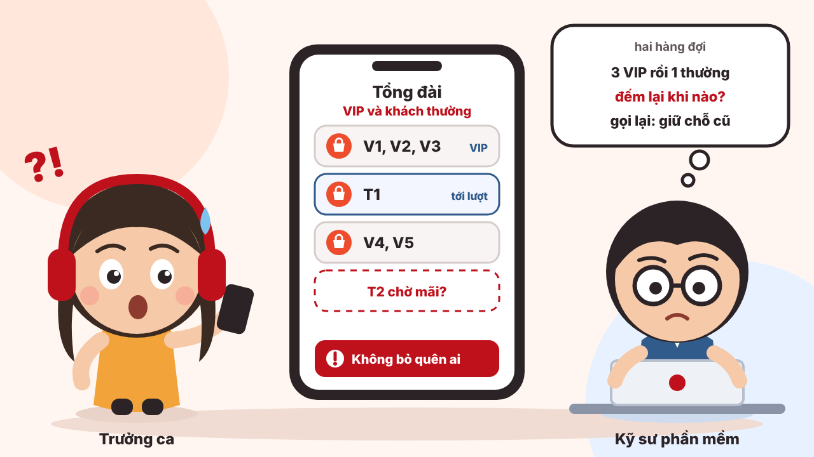

# Hàng chờ chăm sóc khách hàng Tiki ưu tiên khách TikiNOW

### 1. Bối cảnh & Vấn đề



*Khách TikiNOW được phục vụ trước, nhưng giờ cao điểm khách thường chờ mãi không tới lượt; nhóm cần quy tắc ưu tiên không bỏ quên ai.*

Tổng đài Tiki có hai loại khách: khách **TikiNOW** (gói thành viên trả phí, gọi là VIP) và khách **thường**. Chính sách: **VIP được phục vụ trước**. Nhưng giờ cao điểm, khách VIP gọi liên tục làm khách thường chờ hàng giờ. Bộ phận chất lượng thêm quy tắc chống "bỏ quên":

- Mỗi loại khách có một hàng đợi riêng, ai gọi trước trong cùng loại được phục vụ trước.
- Thường thì phục vụ khách VIP trước. Nhưng nếu đã phục vụ **3 khách VIP liên tiếp** mà có khách thường đang chờ, thì phục vụ **một khách thường**, rồi đếm lại.
- Không có khách thường đang chờ thì cứ phục vụ VIP; không có VIP thì phục vụ khách thường theo thứ tự gọi.

Trưởng ca cần màn hình "đang chờ" luôn đúng số khách mỗi loại để điều thêm điện thoại viên khi một hàng quá dài. Quy tắc 3 VIP rồi 1 khách thường được chọn sau khi phân tích dữ liệu: khách VIP vẫn chờ ít hơn rõ rệt, còn khách thường không còn phải chờ quá lâu. Nếu sau này bộ phận chất lượng đổi con số 3, chỉ cần sửa hằng số `VIP_STREAK`.

Một khách không được có mặt hai lần trong hai hàng (gọi lại khi đang chờ thì giữ chỗ cũ). Lớp `PriorityDesk` đã có sẵn hai hàng `vip`, `normal` (kiểu `deque`); bạn tự thêm thuộc tính cần thiết.

### 2. Yêu cầu nghiệp vụ

**2.1. `add(code, is_vip=False)`**: thêm khách vào cuối hàng tương ứng, trả `True`; mã đã có trong một trong hai hàng thì trả `False`.

**2.2. `serve()`**: trả mã khách được phục vụ tiếp theo theo quy tắc trên; cả hai hàng rỗng trả `None`.

**2.3. `waiting()`**: bộ (số khách VIP đang chờ, số khách thường đang chờ).

**2.4. `serve_all(desk)`**: list mã khách theo thứ tự được phục vụ cho tới khi hết hàng, ví dụ:

```plaintext
Thường: T1, T2.  VIP: V1, V2, V3, V4, V5
Thứ tự: ['V1', 'V2', 'V3', 'T1', 'V4', 'V5', 'T2']
```

### 3. Edge Cases (Bẫy dữ liệu)

**Bẫy 1 — Chỉ có một loại khách.** Chỉ VIP: phục vụ liên tục, không dừng sau 3 khách. Chỉ khách thường: phục vụ theo thứ tự.

**Bẫy 2 — Đếm lại sau khách thường.** Sau khi phục vụ một khách thường, chuỗi VIP liên tiếp đếm lại từ 0.

**Bẫy 3 — Chuỗi VIP khi khách thường đến muộn.** Đã phục vụ 3 VIP khi chưa có khách thường; khách thường vừa vào thì được phục vụ ngay ở lượt sau.

**Bẫy 4 — Mã trùng.** Gọi lại khi đang chờ (kể cả đổi loại) trả `False`, hàng giữ nguyên.

**Bẫy 5 — Hàng rỗng và thêm lại.** `serve()` trả `None`; sau đó thêm khách vẫn phục vụ đúng và chuỗi VIP liên tiếp không bị đếm sai; 8.000 khách phục vụ trong 1 giây.

**Kịch bản chạy thử.** Chạy `python cskh_uu_tien.py` (đoạn chạy thử có sẵn ở cuối tệp) phải in ra đúng:

```plaintext
Thêm trùng V2: False | đang chờ (VIP, thường): (5, 2)
Thứ tự phục vụ: ['V1', 'V2', 'V3', 'T1', 'V4', 'V5', 'T2']
Chỉ có VIP: ['V0', 'V1', 'V2', 'V3', 'V4']
```

### 4. Yêu cầu

Với vai trò kỹ sư phần mềm, bạn phải thực hiện đầy đủ hai phần sau:

**(1) Phân tích và thiết kế giải pháp (bắt buộc, viết vào `PHAN_TICH.md`)**

- Phân tích Input/Output: với từng hàm hoặc phương thức, nêu dữ liệu đầu vào (kiểu dữ liệu) và giá trị trả về trong trường hợp thường và trong từng bẫy.
- Thiết kế giải pháp: cần lưu thêm thông tin gì ngoài hai hàng? Viết quy tắc chọn hàng dưới dạng bảng điều kiện (VIP rỗng / không, thường rỗng / không, số VIP liên tiếp).
- Chạy tay ví dụ ở mục 2.4 và bẫy 3: ghi hai hàng, số VIP liên tiếp và khách được phục vụ sau mỗi lượt.
- Vì sao dùng `deque` mà không dùng list cho hai hàng?
- Nếu đổi quy tắc thành "5 VIP rồi 2 khách thường", bạn phải sửa những chỗ nào? Có cách viết nào để đổi con số mà không sửa logic?
- Bộ dữ liệu thử: lập bảng ít nhất 6 đầu vào phủ đủ 5 bẫy ở mục 3, mỗi dòng ghi kết quả mong đợi (tính tay trước khi chạy) và kết quả chạy thật của bài làm.
- Độ phức tạp: ghi Big-O thời gian của `add` (gồm kiểm tra trùng), `serve`, `waiting`, `serve_all` theo v, t (số khách VIP, thường đang chờ).

**(2) Triển khai code**

- Viết thân các hàm, phương thức còn trống trong `cskh_uu_tien.py`. Không đổi tên, tham số, thông báo lỗi; hàm ghi "Có sẵn" giữ nguyên; được thêm thuộc tính và hàm phụ.
- Dùng `deque` với `append`, `popleft`; không dùng `pop(0)` trên list.
- Xử lý đủ 5 bẫy ở mục 3; `python cskh_uu_tien.py` in đúng kịch bản chạy thử; `pytest -q` xanh cả 8 test có sẵn.
- Mã sạch, dễ đọc, tên biến theo snake_case, có chú thích ở những chỗ quyết định độ phức tạp.

### 5. Quy định nộp bài

1. Tạo một kho GitHub riêng cho bài này, đặt tên theo mẫu `[Tên Lớp]_IT301_Session09_Ex11`.
2. Tải thư mục khởi đầu tại https://github.com/cuongtm191221/it301-bai-tap-ve-nha/tree/main/session-09-stack-queue-deque/bai-11 rồi chép các tệp vào kho: `cskh_uu_tien.py`, `test_cskh_uu_tien.py`, `PHAN_TICH.md`.
3. Điền phần phân tích vào `PHAN_TICH.md`, viết mã trong `cskh_uu_tien.py`.
4. Mức AI của bài: AI-0 (tự làm, không dùng AI).
5. Đưa bài làm lên kho và nộp đường dẫn kho lên hệ thống.
