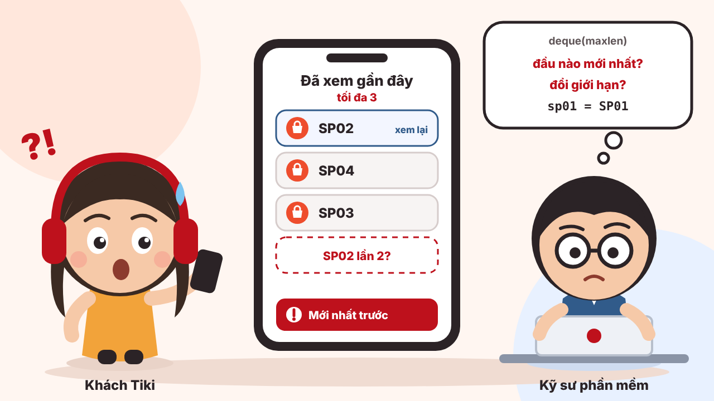

# Mục "Sản phẩm đã xem gần đây" trên ứng dụng Tiki

### 1. Bối cảnh & Vấn đề



*Ứng dụng chỉ nhớ một số sản phẩm khách xem gần nhất; xem lại một sản phẩm thì nó phải lên đầu, không được hiện hai lần.*

Trang chủ ứng dụng Tiki có mục **"Sản phẩm đã xem gần đây"**. Điện thoại chỉ lưu **tối đa N sản phẩm** (mặc định 20, khách đổi được trong cài đặt), hiển thị **mới nhất trước**. Lesson 04 đã cho thấy `deque(maxlen=N)` tự bỏ phần tử cũ nhất khi đầy; nhưng mục này có thêm yêu cầu:

- Xem lại một sản phẩm **đã có** trong danh sách thì nó được đưa **lên đầu**, không xuất hiện hai lần.
- Mã sản phẩm đến từ nhiều màn hình nên có thể viết thường, thừa khoảng trắng: `" sp01 "` là `SP01`. Mã rỗng (chỉ có khoảng trắng) bị bỏ qua.
- Khách **giảm giới hạn** trong cài đặt thì chỉ giữ các sản phẩm mới nhất; tăng giới hạn thì giữ nguyên danh sách hiện có.

Mục này giúp khách quay lại sản phẩm đang cân nhắc mua; nếu một sản phẩm hiện hai lần, hoặc sản phẩm vừa xem không nằm đầu danh sách, khách khó tìm và tỉ lệ mua giảm. Danh sách lưu trên điện thoại nên phải nhỏ gọn, và mỗi lượt xem phải xử lý ngay, không làm chậm việc mở trang sản phẩm.

Bạn viết lớp `RecentlyViewed`.

### 2. Yêu cầu nghiệp vụ

**2.1. `RecentlyViewed(limit)`**: `limit` phải là số nguyên dương, nếu không báo `ValueError("Giới hạn phải là số nguyên dương")`.

**2.2. `view(product)`**: ghi nhận khách vừa xem sản phẩm, theo các quy tắc trên.

**2.3. `items()`**: list mã sản phẩm, mới nhất trước, ví dụ giới hạn 3:

```plaintext
Xem SP01, sp02, ' SP03 ', SP04 -> ['SP04', 'SP03', 'SP02']
Xem tiếp SP02           -> ['SP02', 'SP04', 'SP03']
```

**2.4. `set_limit(limit)`, `clear()`**: đổi giới hạn (cùng quy tắc kiểm tra); xóa toàn bộ lịch sử (khi khách bấm "Xóa lịch sử xem"). Sau khi xóa, khách xem tiếp thì danh sách bắt đầu lại từ đầu với giới hạn hiện tại.

### 3. Edge Cases (Bẫy dữ liệu)

**Bẫy 1 — Xem lại sản phẩm đã có.** Đưa lên đầu, độ dài danh sách không đổi, không có mã trùng.

**Bẫy 2 — Chuẩn hóa mã.** `"sp01"`, `" SP01 "` là một sản phẩm; `"   "` và `""` bị bỏ qua.

**Bẫy 3 — Giới hạn 1.** Luôn chỉ còn sản phẩm vừa xem.

**Bẫy 4 — Đổi giới hạn.** Giảm từ 4 xuống 2 giữ hai sản phẩm mới nhất; tăng lên 3 rồi xem thêm thì danh sách dài ra tới 3.

**Bẫy 5 — Giới hạn sai và xem rất nhiều.** `0`, `-1`, `2.5`, `"3"` báo lỗi, cả khi tạo và khi đổi giới hạn; danh sách giữ nguyên khi đổi giới hạn sai. 200.000 lượt xem với giới hạn 20 phải xong trong 2 giây, vì khách lướt rất nhanh và mỗi lượt xem đều ghi vào danh sách.

**Kịch bản chạy thử.** Chạy `python xem_gan_day.py` (đoạn chạy thử có sẵn ở cuối tệp) phải in ra đúng:

```plaintext
Xem 'SP01'    -> ['SP01']
Xem 'sp02'    -> ['SP02', 'SP01']
Xem ' SP03 '  -> ['SP03', 'SP02', 'SP01']
Xem 'SP04'    -> ['SP04', 'SP03', 'SP02']
Xem 'SP02'    -> ['SP02', 'SP04', 'SP03']
Xem '   '     -> ['SP02', 'SP04', 'SP03']
Giới hạn 2: ['SP02', 'SP04']
Giới hạn 5, xem SP09: ['SP09', 'SP02', 'SP04']
```

### 4. Yêu cầu

Với vai trò kỹ sư phần mềm, bạn phải thực hiện đầy đủ hai phần sau:

**(1) Phân tích và thiết kế giải pháp (bắt buộc, viết vào `PHAN_TICH.md`)**

- Phân tích Input/Output: với từng hàm hoặc phương thức, nêu dữ liệu đầu vào (kiểu dữ liệu) và giá trị trả về trong trường hợp thường và trong từng bẫy.
- Thiết kế giải pháp: chọn đầu nào của deque là "mới nhất"? Khi đầy, `maxlen` tự bỏ phần tử ở đầu nào, có đúng là sản phẩm cũ nhất không? (Lesson 04, mục 4.2: thêm nhầm phía khi có `maxlen`.)
- Mô tả các bước của `view` khi sản phẩm đã có; chạy tay ví dụ ở mục 2.3.
- `maxlen` của một deque không đổi được sau khi tạo: `set_limit` làm thế nào?
- Kiểm tra "sản phẩm đã có" trên deque tốn bao nhiêu phép so sánh? Vì sao test có sẵn dùng giới hạn 20 cho 200.000 lượt xem?
- So sánh với cách dùng list và `insert(0, ...)`: chi phí mỗi lượt xem và vì sao Lesson 04 khuyên dùng deque.
- Bộ dữ liệu thử: lập bảng ít nhất 6 đầu vào phủ đủ 5 bẫy ở mục 3, mỗi dòng ghi kết quả mong đợi (tính tay trước khi chạy) và kết quả chạy thật của bài làm.
- Độ phức tạp: ghi Big-O thời gian của `view`, `items`, `set_limit` theo N (giới hạn), và vì sao chấp nhận được khi N nhỏ.

**(2) Triển khai code**

- Viết thân các hàm, phương thức còn trống trong `xem_gan_day.py`. Không đổi tên, tham số, thông báo lỗi; hàm ghi "Có sẵn" giữ nguyên; được thêm thuộc tính và hàm phụ.
- Dùng `collections.deque`; không dùng list với `insert(0, ...)` hay `pop(0)`.
- Xử lý đủ 5 bẫy ở mục 3; `python xem_gan_day.py` in đúng kịch bản chạy thử; `pytest -q` xanh cả 8 test có sẵn.
- Mã sạch, dễ đọc, tên biến theo snake_case, có chú thích ở những chỗ quyết định độ phức tạp.

### 5. Quy định nộp bài

1. Tạo một kho GitHub riêng cho bài này, đặt tên theo mẫu `[Tên Lớp]_IT301_Session09_Ex12`.
2. Tải thư mục khởi đầu tại https://github.com/cuongtm191221/it301-bai-tap-ve-nha/tree/main/session-09-stack-queue-deque/bai-12 rồi chép các tệp vào kho: `xem_gan_day.py`, `test_xem_gan_day.py`, `PHAN_TICH.md`.
3. Điền phần phân tích vào `PHAN_TICH.md`, viết mã trong `xem_gan_day.py`.
4. Mức AI của bài: AI-0 (tự làm, không dùng AI).
5. Đưa bài làm lên kho và nộp đường dẫn kho lên hệ thống.
