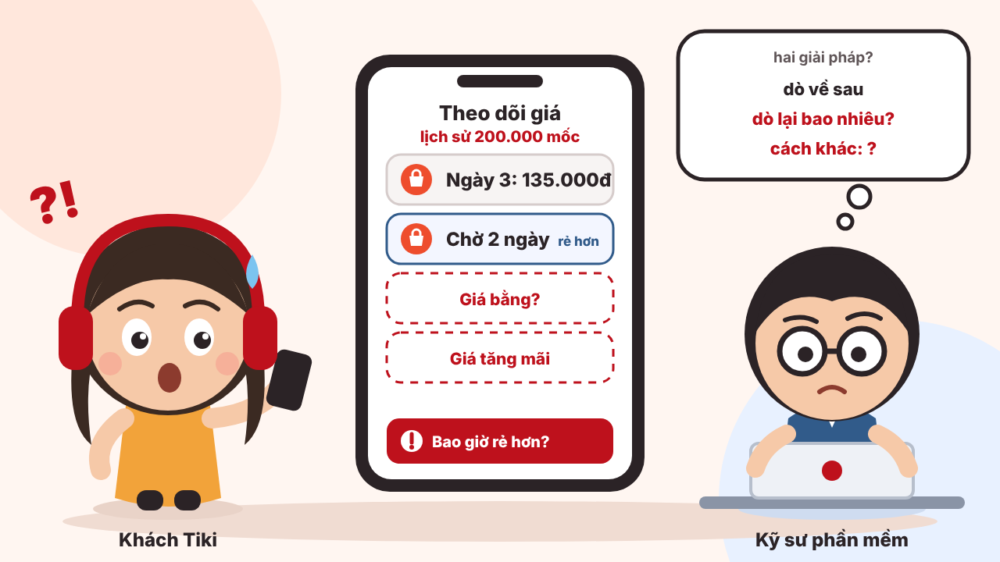

# Gợi ý "chờ giá giảm" cho khách theo dõi giá trên Tiki

### 1. Bối cảnh & Vấn đề



*Khách theo dõi giá muốn biết: nếu không mua hôm nay, phải chờ bao nhiêu ngày thì giá xuống thấp hơn? Lịch sử giá có thể dài hàng trăm nghìn ngày.*

Tính năng **"Theo dõi giá"** của Tiki lưu lịch sử giá theo ngày của mỗi sản phẩm. Nhóm phân tích muốn tính trước, cho **từng ngày**, số ngày phải chờ tới **ngày gần nhất sau đó có giá thấp hơn hẳn**; không có ngày nào như vậy thì ghi 0. Kết quả dùng để gợi ý "Bạn có thể chờ thêm vài ngày" khi khách xem lại lịch sử.

```plaintext
Giá:   129.000 125.000 135.000 140.000 119.000 119.000 139.000 99.000
Chờ:         1       3       2       1       3       2       1      0
```

Ngày 3 (135.000đ) phải chờ 2 ngày, tới ngày 5 giá 119.000đ. Ngày 5 và ngày 6 cùng 119.000đ: giá **bằng** không tính là giảm. Ngày 8 là ngày rẻ nhất về sau nên ghi 0. Kết quả phải tính cho **mọi** ngày cùng lúc, vì cùng một list còn được vẽ thành biểu đồ "thời gian chờ giảm giá" trên trang quản trị.

Nhóm chạy phép tính này cho hàng triệu sản phẩm mỗi đêm; một số sản phẩm có lịch sử giá theo phút, tới **200.000** mốc. Cách làm đầu tiên một bạn nghĩ tới là với mỗi ngày, dò tiếp về sau tới khi gặp giá thấp hơn: đúng, nhưng với lịch sử giá tăng dần thì gần như phải dò tới cuối cho mọi ngày. Trưởng nhóm yêu cầu bạn đề xuất ít nhất hai giải pháp, đo, so sánh rồi mới chọn.

### 2. Yêu cầu nghiệp vụ

**2.1. `wait_days_v1(prices)` và `wait_days_v2(prices)`**: mỗi hàm cài một giải pháp, trả về list số ngày phải chờ như trên. Hai hàm cho cùng kết quả nhưng **khác nhau về cách làm**; không sửa list giá. Hàm `money(amount)` có sẵn.

**2.2. `wait_message(prices, day)`**: dùng giải pháp bạn chọn, ngày `day` đếm từ 1:

```plaintext
Ngày 3 (135.000đ): giá thấp hơn sau 2 ngày (ngày 5, 119.000đ).
Ngày 8 (99.000đ): chưa có ngày nào sau đó rẻ hơn.
Ngày không hợp lệ.
```

### 3. Edge Cases (Bẫy dữ liệu)

**Bẫy 1 — Giá bằng nhau.** `[5, 5, 5]` cho `[0, 0, 0]`; `[5, 5, 4]` cho `[2, 1, 0]`.

**Bẫy 2 — Giá tăng dần, giảm dần.** Tăng dần: mọi ngày là 0. Giảm dần: mọi ngày là 1 trừ ngày cuối.

**Bẫy 3 — Lịch sử rỗng, một ngày.** `[]` và `[0]`.

**Bẫy 4 — Ngày không hợp lệ.** `day` nhỏ hơn 1 hoặc lớn hơn số ngày.

**Bẫy 5 — 200.000 mốc giá tăng dần.** `wait_message` trả lời trong 1 giây. Giải pháp chậm vẫn phải đúng với dữ liệu nhỏ, vì test so sánh hai giải pháp trên 200 lịch sử giá ngẫu nhiên.

**Kịch bản chạy thử.** Chạy `python cho_giam_gia.py` (đoạn chạy thử có sẵn ở cuối tệp) phải in ra đúng:

```plaintext
[1, 3, 2, 1, 3, 2, 1, 0]
Ngày 1 (129.000đ): giá thấp hơn sau 1 ngày (ngày 2, 125.000đ).
Ngày 3 (135.000đ): giá thấp hơn sau 2 ngày (ngày 5, 119.000đ).
Ngày 5 (119.000đ): giá thấp hơn sau 3 ngày (ngày 8, 99.000đ).
Ngày 8 (99.000đ): chưa có ngày nào sau đó rẻ hơn.
Ngày không hợp lệ.
200.000 ngày, ngày đầu: Ngày 1 (50.000đ): chưa có ngày nào sau đó rẻ hơn.
```

### 4. Yêu cầu

Với vai trò kỹ sư phần mềm, bạn phải thực hiện đầy đủ ba phần sau:

**(1) Đề xuất và phân tích nhiều giải pháp (bắt buộc, viết vào `PHAN_TICH.md`)**

- Phân tích Input/Output của các hàm: kiểu dữ liệu đầu vào, giá trị trả về trong trường hợp thường và trong từng bẫy.
- Đề xuất **ít nhất hai giải pháp** khác nhau về cách làm cho việc tính số ngày phải chờ. Với mỗi giải pháp: mô tả ý tưởng trong 2–3 câu, minh họa trên ví dụ ở mục 1, viết mã giả.
- Đo thời gian hai giải pháp bằng `timeit` với n = 5.000, 10.000, 20.000 mốc giá tăng dần (trường hợp xấu nhất của cách dò); ghi bảng số đo, phiên bản Python và máy đo. Đếm thêm số phép cộng hoặc số tham chiếu phải dịch bằng một biến đếm.
- So sánh các giải pháp theo bảng 5 tiêu chí: thời gian (Big-O), bộ nhớ phụ (Big-O), kết quả đo, độ dễ đọc và dễ bảo trì, mức phù hợp với bối cảnh của bài.
- Chọn giải pháp dùng cho `wait_message` và nêu lý do dựa trên bảng so sánh. Lựa chọn không có lý do không được tính điểm.

**(2) Chạy tay**

- Với mỗi giải pháp, chạy tay lịch sử giá ở mục 1: ghi dữ liệu trung gian (với giải pháp dùng cấu trúc phụ, ghi cấu trúc đó sau mỗi ngày) và số phép so sánh.

**(3) Triển khai code**

- Viết thân ba hàm trong `cho_giam_gia.py`. Không đổi tên hàm, tham số.
- Không sửa list giá
- Xử lý đủ 5 bẫy ở mục 3; `python cho_giam_gia.py` in đúng kịch bản chạy thử; `pytest -q` xanh cả 7 test có sẵn (các test về giải pháp chạy trên cả hai hàm `_v1`, `_v2`).
- Mã sạch, dễ đọc, tên biến theo snake_case, có chú thích nêu ý tưởng và độ phức tạp ở đầu mỗi hàm.

### 5. Quy định nộp bài

1. Tạo một kho GitHub riêng cho bài này, đặt tên theo mẫu `[Tên Lớp]_IT301_Session09_Ex13`.
2. Tải thư mục khởi đầu tại https://github.com/cuongtm191221/it301-bai-tap-ve-nha/tree/main/session-09-stack-queue-deque/bai-13 rồi chép các tệp vào kho: `cho_giam_gia.py`, `test_cho_giam_gia.py`, `PHAN_TICH.md`.
3. Điền phần phân tích vào `PHAN_TICH.md`, viết mã trong `cho_giam_gia.py`.
4. Mức AI của bài: AI-0 (tự làm, không dùng AI).
5. Đưa bài làm lên kho và nộp đường dẫn kho lên hệ thống.
